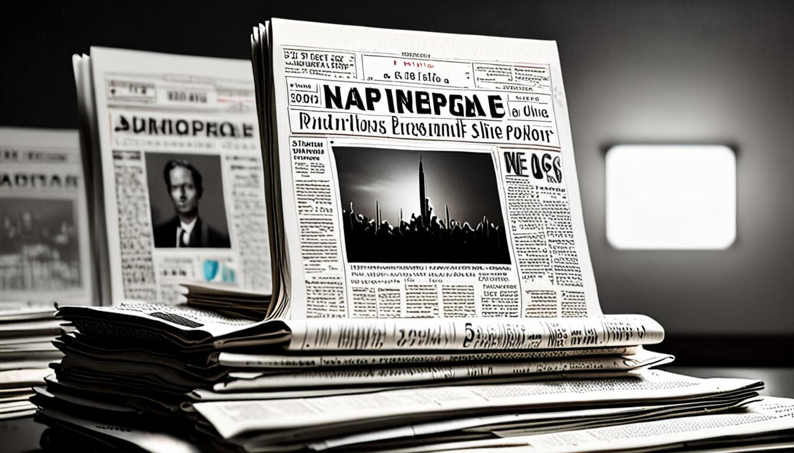

<!-- EE_ENRICHED_START -->

<a href="/">Inicio</a>›<a href="/analisis/">Análisis</a>›2026-11-15

📄 Ángulo del Día
<strong>Publicado:</strong> 2026-11-15 &nbsp;·&nbsp; <strong>Tipo:</strong> Ángulo del Día

<figure style="margin:1.5em 0;"><figcaption style="font-size:0.85em;color:#888;text-align:center;margin-top:0.5em;font-style:italic;">Libertad Digital: la técnica del descalificación mediante et</figcaption></figure>
<h1>Libertad Digital y la técnica de descalificación mediante etiquetado negativo y contraste polarizador</h1>

En la vorágine de la campaña electoral del 29-N, los medios no se quedan en la mera transmisión de hechos. Se convierten en arquitectos de narrativas, a menudo construidas con la misma maquinaria que el propio gobierno: la descalificación y el contraste polarizador. Libertad Digital, ese periódico que se ha convertido en un espejo de la retórica de la oposición, despliega con maestría la técnica de etiquetado negativo para empañar la figura del presidente Alberto Núñez Feijóo, mientras al mismo tiempo crea un contraste que polariza a la audiencia en torno a la gestión de Pedro Sánchez.

<h2>Qué dijo</h2>
<figure style="margin:1.5em 0;"><figcaption style="font-size:0.85em;color:#888;text-align:center;margin-top:0.5em;font-style:italic;">Qué dijo</figcaption></figure>

El titular de Libertad Digital, «Feijóo reivindica la gestión frente al "despilfarro" de Sánchez y arranca en Galicia su camino hacia el 29-N», ya es una declaración de posicionamiento. El uso de “despilfarro” como etiqueta negativa encapsula la narrativa que el medio quiere que el lector absorba: el gobierno de Sánchez, según la prensa, está malgastando recursos. Este término no sólo descalifica al gobierno, sino que también sugiere una falta de disciplina fiscal que, en la visión de Libertad Digital, se contrapone a la supuesta “gestión” de Feijóo.

<h2>Cómo lo dijo (cita textual)</h2>

Dentro del cuerpo del artículo, el medio no se queda en la abstracción. Se apoya en citas textuales que, sin alterarlas, refuerzan la imagen de Feijóo como un líder de “rigor, gestión y experiencia”. El propio presidente del PP afirmó: <q>España necesita “rigor, gestión y experiencia”</q>. Al mismo tiempo, Feijóo se autoproclamó defensor de los servicios públicos con la frase: <q>Lo público se defiende gestionándolo bien, no gritando que lo defiendes y después quebrando lo público</q>. La declaración sobre la relación entre esfuerzo fiscal y servicios públicos, <q>Corresponder el esfuerzo a la ciudadanía es tener servicios públicos en condiciones, para eso pagáis impuestos</q>, añade una capa de justificación económica a la campaña.

<h2>Qué omitió</h2>

La pieza editorial, sin embargo, deja de lado cualquier mención de los logros concretos del gobierno de Sánchez en los servicios públicos. No se menciona el aumento de la cobertura de la sanidad, los programas de vivienda social ni las inversiones en infraestructuras que han beneficiado a Galicia. Tampoco se hace referencia a los acuerdos de financiación de la UE que han permitido la ejecución de proyectos de energía renovable. Al omitir estos puntos, el medio se centra exclusivamente en la crítica, sin ofrecer un contrapunto equilibrado que pudiera suavizar la polarización.

<h2>Cómo detectarlo</h2>

El lector atento puede identificar la técnica de descalificación en la selección de palabras y en la omisión de datos relevantes. El uso de “despilfarro” y la ausencia de cifras concretas sobre el gasto público crean una narrativa de ineficiencia que no se sustenta en la realidad. Asimismo, la falta de menciones a los programas de apoyo social y a las mejoras en la infraestructura revela un sesgo editorial que busca favorecer la figura de Feijóo a costa de una visión más completa del panorama político.

<figure style="margin:1.5em 0;"><figcaption style="font-size:0.85em;color:#888;text-align:center;margin-top:0.5em;font-style:italic;">Conclusión</figcaption></figure>
<h2>Conclusión</h2>

Libertad Digital, al emplear la técnica de descalificación mediante etiquetado negativo y contraste polarizador, demuestra que la información puede ser tan poderosa como la propaganda. Al etiquetar el gobierno de Sánchez como “despilfarrador” y al presentar a Feijóo como el salvador de la gestión, el medio crea una dicotomía que simplifica la complejidad de la política a una batalla de “bien” contra “mal”. Esta estrategia no sólo polariza al público, sino que también refuerza la narrativa de que la única solución viable es la propuesta del PP. En un contexto donde la objetividad se vuelve cada vez más escasa, los lectores deben ser críticos y conscientes de cómo las palabras y las omisiones pueden moldear la percepción pública.

<strong>Titular real de Libertad Digital:</strong> «Feijóo reivindica la gestión frente al "despilfarro" de Sánchez y arranca en Galicia su camino hacia el 29-N»

<strong>Fuente:</strong> <a href="https://www.libertaddigital.com/espana/política/2026-11-14/feijoo-reivindica-la-gestion-frente-al-despilfarro-de-sanchez-y-arranca-en-galicia-su-camino-hacia-el-29-n-7491558/?utm_source=rss&amp;utm_medium=feed&amp;utm_campaign=Libertad+Digital%3A+Noticias+y+opini%C3%B3n+en+la+red" target="_blank" rel="noopener">Leer en Libertad Digital</a>

<strong>Tecnica detectada:</strong> descalificación mediante etiquetado negativo y contraste polarizador

<strong>Aviso legal:</strong> Esto no es una acusacion. Es una autopsia. Los medios estan citados y enlazados. El derecho de cita (art. 32 LPI) nos ampara.

<strong>Síguenos:</strong> <a href="https://youtube.com/@somoselencuadre.oficial">YouTube</a> · <a href="https://tiktok.com/@somoselencuadre">TikTok</a> · <a href="https://instagram.com/somoselencuadre">Instagram</a> · <a href="https://x.com/SomosElEncuadre">X</a> · <a href="https://threads.net/@somoselencuadre">Threads</a>

<a href="https://twitter.com/intent/tweet?text=Libertad Digital: la tecnica del descalificación mediante etiquetado negativo y contraste polarizador&url=https://elencuadre.pages.dev/analisis/2026-11-15-mediano-medio_crudo/" target="_blank" rel="noopener" class="ee-share-x">𝕏 Compartir</a>
<a href="https://threads.net/intent/post?text=Libertad Digital: la tecnica del descalificación mediante etiquetado negativo y contraste polarizador+https://elencuadre.pages.dev/analisis/2026-11-15-mediano-medio_crudo/" target="_blank" rel="noopener" class="ee-share-threads">@ Threads</a>
<a href="https://www.linkedin.com/sharing/share-offsite/?url=https://elencuadre.pages.dev/analisis/2026-11-15-mediano-medio_crudo/" target="_blank" rel="noopener" class="ee-share-linkedin">in LinkedIn</a>
<a href="https://t.me/share/url?url=https://elencuadre.pages.dev/analisis/2026-11-15-mediano-medio_crudo/&text=Libertad Digital: la tecnica del descalificación mediante etiquetado negativo y contraste polarizador" target="_blank" rel="noopener" class="ee-share-telegram">✈ Telegram</a>

<!-- EE_ENRICHED_END -->
