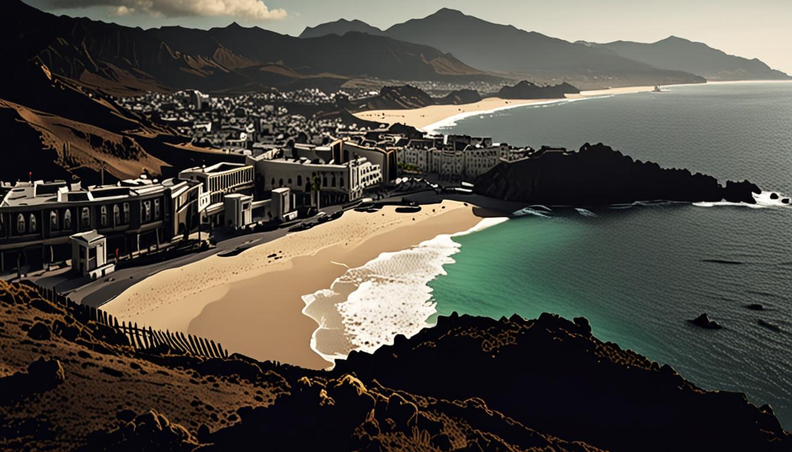

<!-- EE_ENRICHED_START -->

<a href="/">Inicio</a>›<a href="/analisis/">Análisis</a>›2026-11-17

📁 Dossier Ejecutivo
<strong>Publicado:</strong> 2026-11-17 &nbsp;·&nbsp; <strong>Tipo:</strong> Dossier Ejecutivo

<figure style="margin:1.5em 0;"><figcaption style="font-size:0.85em;color:#888;text-align:center;margin-top:0.5em;font-style:italic;">El Encuadre: El CNI informó al Gobierno del riesgo de desbor</figcaption></figure>
<h1>Dossier del día: El Encuadre – El CNI informó al Gobierno del riesgo de desbordamiento en Canarias tras la crisis en Ceuta</h1>

Hoy el panorama migratorio español vuelve a ser el foco de los titulares y, como siempre, los medios se afanan en pintar la escena con sus propias tintas. Desde el aviso del CNI hasta los planes europeos de deportación, repasamos los hechos, desmontamos las técnicas y revelamos los patrones que alimentan la histeria colectiva.

<h2>Noticias del día</h2>
<figure style="margin:1.5em 0;"><figcaption style="font-size:0.85em;color:#888;text-align:center;margin-top:0.5em;font-style:italic;">Noticias del día</figcaption></figure>

<ul>
<li>El Centro Nacional de Inteligencia (CNI) advirtió repetidamente al Gobierno de que la crisis migratoria en Ceuta podía “desplazarse” hacia las costas de las Islas Canarias. El mayor registro histórico se produjo en El Hierro entre el 14 y el 15 de noviembre, con 1 580 personas el primer día y 1 467 el siguiente, superando el máximo anterior de 1 461 inmigrantes registrado en 2020. En total, “3 890 personas inmigrantes en tres días”.</li>
<li>Varios países de la UE (Alemania, Dinamarca, Austria, Grecia y los Países Bajos) avanzan en la creación de un centro de deportación en Ruanda, previsto para 2027, con capacidad inicial para “sólo un centenar de personas”. La iniciativa se presenta como una “solución innovadora” para frenar las llegadas.</li>
<li>Otros titulares de la jornada, como la polémica sobre el bono social de calefacción a la pareja de Santiago Abascal, siguen alimentando la narrativa de culpabilidad y escándalo político.</li>
</ul>

<strong>Cita de El Mundo:</strong> “El escenario que entonces se puso sobre la mesa es el que se está produciendo ahora en el archipiélago, con El Hierro como principal punto de llegada y donde entre el sábado 14 y el domingo 15 de noviembre se produjo el mayor registro de llegadas de las tres décadas de la historia de la ruta canaria.”

<strong>Cita de Ara:</strong> “El projecte per endurir la política migratòria europea agafa embranzida. Cinc països europeus crearan a Ruanda el primer centre de deportació de migrants irregulars fora de les fronteres comunitàries.”

<h2>Los medios y sus técnicas</h2>

Los titulares no aparecen por casualidad; cada uno emplea una estrategia que busca moldear la percepción del lector. A continuación, una tabla que sintetiza los recursos detectados.

<table border="1" cellpadding="5" cellspacing="0">
<tr><th>Medio</th><th>Técnica</th><th>Omite</th></tr>
<tr><td>El Mundo</td><td>Apelación al miedo (alarmismo)</td><td>-</td></tr>
<tr><td>Ara</td><td>Apego a la autoridad y normalización</td><td>-</td></tr>
<tr><td>La Vanguardia</td><td>Sensacionalismo y miedo a la inmigración</td><td>-</td></tr>
<tr><td>InfoLibre</td><td>Apelación a la culpa y a la autoridad</td><td>-</td></tr>
<tr><td>elDiario.es</td><td>Apelación a la culpa y al miedo</td><td>-</td></tr>
<tr><td>20 Minutos</td><td>Inducción al pánico administrativo</td><td>-</td></tr>
<tr><td>The Objective</td><td>Reencuadre de la derrota como continuidad de la amenaza</td><td>-</td></tr>
<tr><td>BBC World</td><td>Apelación al miedo</td><td>-</td></tr>
</table>

<h2>Las técnicas al detalle</h2>
<h3>Apelación al miedo (alarmismo)</h3>

<strong>Medio:</strong> El Mundo

<strong>Cita:</strong> “El riesgo era que la presión migratoria que se había concentrado en Ceuta terminara desplazándose hacia el Atlántico, como así ha sucedido.”

<strong>Detección:</strong> Uso de vocabulario que sugiere una amenaza inminente y catástrofe potencial (“riesgo”, “desplazándose”, “como así ha sucedido”), sin ofrecer datos que contextualicen la magnitud real del fenómeno.

<h3>Apego a la autoridad y normalización</h3>

<strong>Medio:</strong> Ara

<strong>Cita:</strong> “El projecte per endurir la política migratòria europea agafa embranzida. Cinc països europeus crearan a Ruanda el primer centre de deportació de migrants irregulars fora de les fronteres comunitàries.”

<strong>Detección:</strong> Presentación de la medida como una iniciativa “europea” y “normalizada”, citando a varios Estados y a la UE sin cuestionar la viabilidad ni los derechos involucrados.

<h3>Sensacionalismo y miedo a la inmigración</h3>

<strong>Medio:</strong> La Vanguardia

<strong>Cita:</strong> “Cinco países crearán en Ruanda el primer centro para deportar migrantes fuera de la UE… El desafío migratorio… está un paso más cerca de materializarse.”

<strong>Detección:</strong> Empleo de expresiones como “desafío migratorio” y “un paso más cerca de materializarse” que dramatizan la medida, creando una atmósfera de urgencia y peligro.

<h3>Apelación a la culpa y a la autoridad</h3>

<strong>Medio:</strong> InfoLibre

<strong>Cita:</strong> “La pareja de Abascal cobra el bono social de calefacción para familias vulnerables… el líder del partido ultra se une, a través de su esposa, a la larga lista de políticos que cobran esta subvención.”

<strong>Detección:</strong> Vinculación directa de un personaje político con un beneficio social, insinuando impropiedad y aprovechamiento sin aportar evidencia de irregularidad.

<h3>Inducción al pánico administrativo</h3>

<strong>Medio:</strong> 20 Minutos

<strong>Cita:</strong> “Renfe y Adif prevén que la huelga de este martes paralice el tren y recomiendan a sus pasajeros buscar alternativas.”

<strong>Detección:</strong> Aviso de interrupción del servicio y recomendación de buscar “alternativas”, generando incertidumbre y presión sobre el lector para que tome decisiones de último momento.

<h2>Los sesgos compartidos</h2>

Los medios analizados comparten tres patrones recurrentes:

<ol>
<li><strong>Enfoque en la amenaza.</strong> Tanto El Mundo como La Vanguardia y la BBC utilizan la palabra “riesgo” o “peligro” para magnificar la percepción de una crisis inminente.</li>
<li><strong>Apelación a la autoridad.</strong> Ara, InfoLibre y elDiario.es legitiman sus narrativas citando a gobiernos, instituciones o “fuentes de toda solvencia”, sin ofrecer contrapesos.</li>
<li><strong>Normalización de medidas extremas.</strong> La presentación de los centros de deportación como “soluciones innovadoras” o “proyectos europeos” suaviza la gravedad de la medida y la hace parecer rutinaria.</li>
</ol>

Estos sesgos funcionan porque activan emociones primarias (miedo, indignación) y reducen la necesidad de análisis crítico, conduciendo al lector a aceptar la versión oficial sin cuestionarla.

<figure style="margin:1.5em 0;"><figcaption style="font-size:0.85em;color:#888;text-align:center;margin-top:0.5em;font-style:italic;">Conclusión</figcaption></figure>
<h2>Conclusión</h2>

El mecanismo está al descubierto: alarmismo, autoridad fingida y normalización de lo extraordinario. Mañana volverán a hacerlo, pero mientras tanto, el lector debe mantener la guardia alta y desentrañar la trama antes de que la narrativa lo haga por él.

<h3>Fuentes consultadas:</h3>
<ul>
<li><strong>El Mundo:</strong> «El CNI informó al Gobierno del riesgo de desbordamiento en Canarias tras la crisis en Ceuta» — <a href="https://www.elmundo.es/espana/2026/11/16/6afb57edfc6c83f5438b4585.html" target="_blank" rel="noopener">Leer completo</a></li>
<li><strong>Ara:</strong> «Cinc països de la UE crearan un centre de deportació de migrants a Ruanda» — <a href="https://www.ara.cat/internacional/europa/cinc-paisos-ue-crearan-centre-deportacio-migrants-ruanda_1_5912421.html" target="_blank" rel="noopener">Leer completo</a></li>
<li><strong>The Objective:</strong> «N/A» — <a href="https://theobjective.com/podcasts/dos-orillas-podcast/podcast-las-dos-orillas-lula-gana-brasil-bolsonarismo/" target="_blank" rel="noopener">Leer completo</a></li>
<li><strong>elDiario.es:</strong> «Gabriel Rufián: "A Abascal le paga Israel y a Silvia Orriols le paga Israel"» — <a href="https://www.eldiario.es/política/medidas-bloqueadas-psoe-durante-legislatura-entran-campana-causan-choque-frente-amplio_1_13668808.html" target="_blank" rel="noopener">Leer completo</a></li>
<li><strong>La Vanguardia:</strong> «Cinco países crean en Ruanda el primer centro para deportar migrantes fuera de la UE» — <a href="https://www.lavanguardia.com/internacional/20261116/11685591/cinco-paises-crean-ruanda-primer-centro-deportar-migrantes-fuera-ue.html" target="_blank" rel="noopener">Leer completo</a></li>
<li><strong>InfoLibre:</strong> «La pareja de Abascal cobra el bono social de calefacción para familias vulnerables» — <a href="https://www.infolibre.es/política/pareja-abascal-cobra-bono-social-calefaccion-familias-vulnerables_1_2240283.html" target="_blank" rel="noopener">Leer completo</a></li>
<li><strong>20 Minutos:</strong> «N/A» — <a href="https://www.20minutos.es/nacional/renfe-adif-preven-que-huelga-este-martes-paralice-tren-recomiendan-sus-pasajeros-buscar-alternativas_7061626_0.html" target="_blank" rel="noopener">Leer completo</a></li>
<li><strong>BBC World:</strong> «Five EU countries announce migrant deportation centre in Rwanda» — <a href="https://www.bbc.co.uk/news/articles/cw987343352go?at_medium=RSS&amp;at_campaign=rss" target="_blank" rel="noopener">Leer completo</a></li>
<li><strong>Libertad Digital:</strong> «Anticorrupción investiga "graves irregularidades" en la adjudicación de contratos de Defensa por más de 6.000 millones» — <a href="https://www.libertaddigital.com/defensa/2026-11-16/anticorrupcion-investiga-graves-irregularidades-en-la-adjudicacion-de-contratos-de-defensa-por-más-de-6-000-milllones-7492103/?utm_source=rss&amp;utm_medium=feed&amp;utm_campaign=Libertad+Digital%3A+Noticias+y+opini%C3%B3n+en+la+red" target="_blank" rel="noopener">Leer completo</a></li>
<li><strong>The Guardian:</strong> «Five EU states announce plans for immigration ‘return hubs’ in Rwanda» — <a href="https://www.theguardian.com/world/2026/nov/16/eu-states-immigration-return-hubs-rwanda" target="_blank" rel="noopener">Leer completo</a></li>
<li><strong>Al Jazeera:</strong> «Gunfire erupts in occupied West Bank settler attack» — <a href="https://www.aljazeera.com/video/newsfeed/2026/11/17/gunfire-erupts-in-occupied-west-bank-settler-attack?traffic_source=rss" target="_blank" rel="noopener">Leer completo</a></li>
</ul>

<strong>Aviso legal:</strong> Esto no es una acusación. Es una autopsia. Los medios están citados y enlazados. El derecho de cita (art. 32 LPI) nos ampara.

<strong>Síguenos:</strong> <a href="https://youtube.com/@somoselencuadre.oficial">YouTube</a> · <a href="https://tiktok.com/@somoselencuadre">TikTok</a> · <a href="https://instagram.com/somoselencuadre">Instagram</a> · <a href="https://x.com/SomosElEncuadre">X</a> · <a href="https://threads.net/@somoselencuadre">Threads</a>

<a href="https://twitter.com/intent/tweet?text=Dossier del día: El Encuadre: El CNI informó al Gobierno del riesgo de desbor&url=https://elencuadre.pages.dev/analisis/2026-11-17-dossier-v2/" target="_blank" rel="noopener" class="ee-share-x">𝕏 Compartir</a>
<a href="https://threads.net/intent/post?text=Dossier del día: El Encuadre: El CNI informó al Gobierno del riesgo de desbor+https://elencuadre.pages.dev/analisis/2026-11-17-dossier-v2/" target="_blank" rel="noopener" class="ee-share-threads">@ Threads</a>
<a href="https://www.linkedin.com/sharing/share-offsite/?url=https://elencuadre.pages.dev/analisis/2026-11-17-dossier-v2/" target="_blank" rel="noopener" class="ee-share-linkedin">in LinkedIn</a>
<a href="https://t.me/share/url?url=https://elencuadre.pages.dev/analisis/2026-11-17-dossier-v2/&text=Dossier del día: El Encuadre: El CNI informó al Gobierno del riesgo de desbor" target="_blank" rel="noopener" class="ee-share-telegram">✈ Telegram</a>

<!-- EE_ENRICHED_END -->
