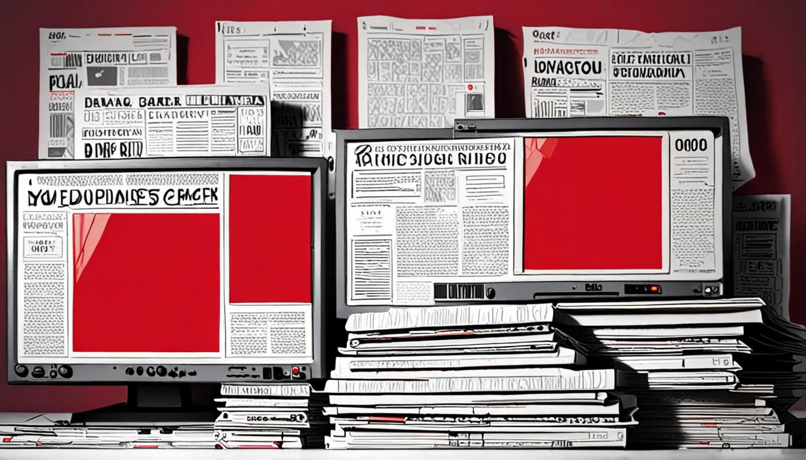

<!-- EE_ENRICHED_START -->

<a href="/">Inicio</a>›<a href="/analisis/">Análisis</a>›2026-11-17

📄 Ángulo del Día
<strong>Publicado:</strong> 2026-11-17 &nbsp;·&nbsp; <strong>Tipo:</strong> Ángulo del Día

<figure style="margin:1.5em 0;"><figcaption style="font-size:0.85em;color:#888;text-align:center;margin-top:0.5em;font-style:italic;">Cómo detectar la técnica: apelación al miedo (alarmismo)</figcaption></figure>
<h1 style="font-size: 2.5em; margin-bottom: 10px; color: #8B0000; text-transform: uppercase; letter-spacing: 2px;">El Arte Siniestro de Asustar al Vaca: Guía para No Ser Manipulado</h1>

    

        Bienvenidos a la fiesta del pánico. Aquí, donde la lógica se va de juerga y el miedo se cuela por la ventana para servirse una copa de burla. No estamos aquí para aprender a tener miedo, sino para aprender a identificar a quien vende ese miedo como si fuera agua fresca en el desierto.
    

    <h2 style="font-size: 1.8em; color: #222; border-bottom: 2px solid #ccc; padding-bottom: 5px; margin-top: 30px;">1. ¿Qué es esta porquería? Definición de un truco de prestidigitador</h2>
<figure style="margin:1.5em 0;"><figcaption style="font-size:0.85em;color:#888;text-align:center;margin-top:0.5em;font-style:italic;">1. ¿Qué es esta porquería? Definición de un truco de prestidigitador</figcaption></figure>

    

        Llamémoslo por su nombre real: la apelación al miedo, o si prefieren un término más elegante y menos sucio, el alarmismo. No es un argumento. No es un dato. Es un grito. Es el equivalente retórico de tirar un ladrillo a una reunión de señoras para ver quién se peina primero. Consiste en sustituir la evidencia por la amenaza, el análisis por la histeria.
    

    

        En un mundo donde la información viaja a la velocidad de la luz pero el pensamiento crítico camina cojeando, esta técnica se ha convertido en el caballo de Troya de la demagogia. No te dice "esto es malo"; te dice "esto va a destruirte". La diferencia es abismal. El primero es un juicio de valor, a menudo discutible; el segundo es una promesa de catástrofe que apela directamente a tu instinto de supervivencia, ese primitivo reptiliano que llevas en la nuca y que prefiere correr antes de pensar.
    

    

        Es un truco viejo, tan viejo como la caverna donde alguien gritó "¡León!" mientras enseñaba una sombra en la pared. Pero hoy, con megáfonos digitales y algoritmos que amplifican el pánico hasta la locura, ha refinado su mecánica. Ya no necesitas un león real; con una estadística mal contextualizada y una voz temblorosa en un vídeo de tres minutos, tienes a media población en vilo, lista para obedecer cualquier orden, por más absurda que sea.
    

    <h2 style="font-size: 1.8em; color: #222; border-bottom: 2px solid #ccc; padding-bottom: 5px; margin-top: 30px;">2. ¿Cómo se usa? La anatomía del pánico organizado</h2>
    

        El manual del alarmista no tiene muchas entradas, pero las repite con la persistencia de un loro drogado con anfetaminas. Primero, selecciona un problema real. No invente el problema, eso es demasiado difícil y fácil de desmontar. Tome algo que ya preocupa a la gente: el clima, la economía, la salud, la seguridad.
    

    

        Segundo, infle las proporciones. Si el riesgo es del 1%, hable del 99%. Si es un problema local, preséntelo como un apocalipsis global. Use adjetivos que pesen toneladas: "inminente", "irreversible", "catastrófico", "sin precedentes". Cada palabra es una gota de veneno que penetra en la piel racional del oyente.
    

    

        Tercero, elimine matices. La realidad es gris, llena de matices y probabilidades. El alarmismo es blanco y negro. O todo va bien, o todo se va a caer a pedazos. No hay término medio. No hay soluciones graduales. Solo hay la acción inmediata, drástica y, por supuesto, dirigida por quien está gritando más fuerte.
    

    

        Cuarto, cree un enemigo o una causa única. El miedo necesita un chivo expiatorio. Puede ser una corporación, un partido político, un grupo de inmigrantes, una tecnología nueva. Al simplificar la culpa, se simplifica también la solución: "Si eliminamos a X, el miedo desaparece". Es una lógica de niño de cinco años, pero funciona de maravilla en masas asustadas.
    

    <h2 style="font-size: 1.8em; color: #222; border-bottom: 2px solid #ccc; padding-bottom: 5px; margin-top: 30px;">3. Ejemplo real: El circo de la desinformación en tiempo real</h2>
    

        No hace falta ir a buscar fantasmas en el armario. Basta con mirar hacia el escenario político y mediático actual. Pensemos en cómo se gestiona la narrativa cuando hay una crisis de vivienda. En lugar de analizar la especulación, los suelos públicos no urbanizados, o la falta de inversión en alquiler asequible, escuchamos a voces ciertas gritar que "el sistema está colapsando" y que "los ciudadanos comunes están siendo expulsados de sus hogares por una élita oculta".
    

    

        Aquí no hay datos, hay dramaturgia. Se usa el miedo a perder el hogar para justificar medidas extremas o para desviar la atención de las causas estructurales. Se presenta la situación como un asedio, donde el ciudadano es un soldado en una trinchera contra un ejército invisible. Es una metáfora poderosa, pero falsa. No es una conflicto, es un mercado distorsionado. Pero "conflicto" genera más miedo que "mercado", y el miedo vende más que la economía.
    

    

        Otro ejemplo clásico: la gestión de la sanidad pública. Cuando un hospital tiene listas de espera, la versión racional habla de falta de personal, de infraestructura, de planificación. La versión alarmista habla de "abandono", de "sistemas rotos", de que "la próxima persona que muera en una camilla será usted". Aunque evitemos términos explícitos sobre la pérdida de vida, la implicación es clara: le están vendiendo la idea de que el Estado le ha declarado el conflicto a su bienestar. Es una manipulación cruel que explota la vulnerabilidad humana para convertir la paciencia en furia ciega.
    

    <h2 style="font-size: 1.8em; color: 222; border-bottom: 2px solid #ccc; padding-bottom: 5px; margin-top: 30px;">4. ¿Cómo detectarlo? Ponga los anteojos de la duda</h2>
    

        Detectar el alarmismo requiere una dosis de cinismo y una pizca de paciencia. Primero, pregúntese: ¿Esto es un hecho o una proyección? Hechos son medibles. Proyecciones son sueños pesadillescos disfrazados de ciencia. Si no hay un estudio, un dato duro, una fuente verificable, es humo.
    

    

        Segundo, mire la fuente. ¿Quién está hablando? ¿Está motivado por informar o por vender? ¿Por generar clics? ¿Por ganar unas elecciones? El interés propio es el mejor rastreador de la desinformación. Si alguien gana dinero, poder o atención al asustarle, su credibilidad se desploma por los suelos.
    

    

        Tercero, busque el matiz. Si un argumento es demasiado simple, es probablemente falso. La realidad es compleja. Si la solución propuesta es única, drástica y urgente, es casi seguro que esté diseñada para saltarse el debate y la deliberación.
    

    

        Cuarto, observe el lenguaje. ¿Hay muchas exclamaciones? ¿Hay adjetivos superlativos? ¿Se habla de "nunca antes visto"? Eso es una bandera roja. La historia está llena de cosas "nunca antes vistas", y la mayoría de las veces, se resolvieron con tiempo, no con pánico.
    

    <figure style="margin:1.5em 0;"><figcaption style="font-size:0.85em;color:#888;text-align:center;margin-top:0.5em;font-style:italic;">5. ¿Cómo combatirlo? La vacuna de la razón</figcaption></figure>
<h2 style="font-size: 1.8em; color: #222; border-bottom: 2px solid #ccc; padding-bottom: 5px; margin-top: 30px;">5. ¿Cómo combatirlo? La vacuna de la razón</h2>
    

        Combatir el alarmismo no es tarea fácil. El miedo es adictivo. Pero hay una cura: la información de calidad, lenta y aburrida. Lea fuentes primarias. No se fíe de los resúmenes en redes sociales. Vaya al origen. Si un medio sensacionalista dice "X es el fin del mundo", busque lo que dice el organismo técnico oficial. A menudo, la diferencia es abismal.
    

    

        Segundo, eduque a su entorno. Hable con calma. No grite. El alarmista grita; usted debe susurrar. Explique los matices. Muestre los datos. Si no puede, no insista. No se puede razonar con alguien que está en modo pánico.
    

    

        Tercero, practique la resiliencia emocional. Acepte que no puede controlar todo. Acepte que hay riesgos, pero que no son necesariamente inminentes ni catastróficos. Aprenda a distinguir entre el riesgo real y el riesgo percibido. La mayoría de las cosas que nos aterrorizan hoy son, estadísticamente, menos peligrosas que ir en coche o fumar.
    

    

        Finalmente, vote con la cabeza, no con el corazón asustado. Exija a sus representantes políticos que hablen con claridad, con datos, sin drama. Si les pide miedo, le darán miedo. Si les pide verdad, quizá le den una versión más aceptable de la realidad.
    

    

        En resumen, el alarmismo es el opio del pueblo, sólo que con más ruido y menos efectos secundarios inmediatos. Es una herramienta de control social disfrazada de preocupación. No se deje engañar. El mundo es un lugar peligroso, sí, pero no por las razones que le venden los charlatanes de la histeria. Piense, dude, investigue. Y sobre todo, no se deje asustar por quienes se lucran con su terror. La razón es la única luz en este pantano de tinta y pánico.
    

<strong>Aviso legal:</strong> Esto no es una acusacion. Es una autopsia. Los medios estan citados y enlazados. El derecho de cita (art. 32 LPI) nos ampara.

<strong>Síguenos:</strong> <a href="https://youtube.com/@somoselencuadre.oficial">YouTube</a> · <a href="https://tiktok.com/@somoselencuadre">TikTok</a> · <a href="https://instagram.com/somoselencuadre">Instagram</a> · <a href="https://x.com/SomosElEncuadre">X</a> · <a href="https://threads.net/@somoselencuadre">Threads</a>

<!-- EE_ENRICHED_END -->
