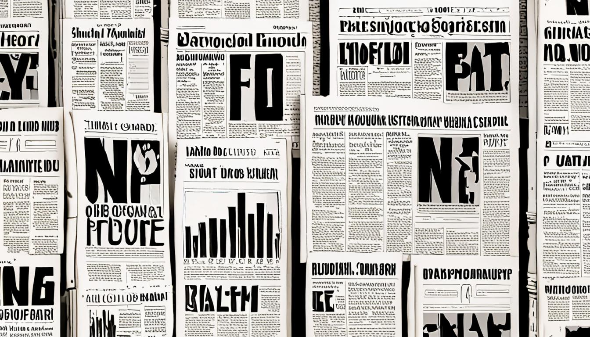

<figure style="margin:1.5em 0;"><figcaption style="font-size:0.85em;color:#888;text-align:center;margin-top:0.5em;font-style:italic;">El Encuadre: Sánchez le hace los Presupuestos a Feijóo despu</figcaption></figure>
<h1>Sánchez le hace los presupuestos a Feijóo: la verdad que nadie quiere oír</h1>

El gobierno se ha vuelto a la mesa de la balanza, y el fiscal del Estado no es más que un peón. Feijóo se ha quedado mirando el papel con la mirada de un niño que ha descubierto un tesoro.

Mientras la prensa se llena de balbuceos, los verdaderos números se esconden bajo capas de humo político. Aquí desmantelamos el guion que Sánchez quiere que todos aceptemos, revelando cómo la economía se convierte en un tablero de ajedrez de poder. Prepárate para ver cómo el presupuesto es un arma de doble filo, y la política, un teatro sin guion.

El presupuesto no es una cifra, es un contrato con la desigualdad. Cuando el líder se coloca al frente, la balanza se inclina sin que el público lo note. Descubre quién realmente se beneficia cuando el dinero se mueve por los corredores de la política.

<h2>The Objective: urgencia implícita (se sugiere que hay que comprar ya para no quedarse sin décimo)</h2>
<figure style="margin:1.5em 0;"><figcaption style="font-size:0.85em;color:#888;text-align:center;margin-top:0.5em;font-style:italic;">The Objective: urgencia implícita (se sugiere que hay que comprar ya para no que</figcaption></figure>

<strong>Titular real:</strong> «Comprar Lotería de Navidad 2026 en Lugo: números y décimos por administración para el sorteo»

<strong>Fuente:</strong> <a href="https://theobjective.com/loterias/loteria-navidad/2026-11-18/comprar-loteria-de-navidad-2026-en-lugo-numeros-y-decimos-por-administracion-para-el-sorteo/" target="_blank" rel="noopener">Leer en The Objective</a>

La frase que delata la técnica de urgencia implícita es: “<em>Aun así, los números más pedidos suelen agotarse antes de diciembre, por lo que adelantar la compra es una opción prudente</em>”. Con esa línea, el artículo no sólo informa, sino que susurra al lector que si no se apresura, quedará fuera del juego.

Esa elección me produce una sensación de ligera irritación: el texto se disfraza de neutralidad mientras empuja al consumidor a una compra anticipada, como si la escasez fuera una amenaza latente. El tono parece más un vendedor ambulante que un medio informativo, y la presión sutil se vuelve casi una mordida de hormiga en la conciencia del lector.

Para detectarla la próxima vez, basta con buscar palabras que insinúen escasez o pérdida de oportunidad (“se agotan”, “no esperes”, “opción prudente”) y observar si aparecen justo antes de la llamada a la acción. Cuando la información se mezcla con un llamado a comprar pronto, el truco de la urgencia está al acecho.

<h2>ABC: apelar al miedo e inseguridad sexual, sensacionalismo y venta indirecta de productos</h2>

<strong>Titular real:</strong> «Cuando el estrés y el cansancio afectan a tu rendimiento sexual: suplementos que pueden ayudarte»

<strong>Fuente:</strong> <a href="https://www.abc.es/bienestar/psicologia-sexo/suplementos-puedes-tomar-estres-cansancio-afectan-rendimiento-20260825011759-nt.html" target="_blank" rel="noopener">Leer en ABC</a>

La frase que delata la técnica es: «el cuerpo toma la decisión lógica de dejar de invertir energía en la reproducción y destinarla a la supervivencia». El adjetivo “lógica” suena a una sentencia científica que, en realidad, sirve para sembrar una sensación de urgencia y falta de control sobre la propia sexualidad.

Esa elección me deja con una mezcla de irritación y desconfianza; percibo que el texto quiere que el lector se sienta vulnerable, como si el cansancio fuera el culpable oculto de una vida sexual en decadencia, y que la única salida sea comprar los suplementos que se anuncian a continuación.

Para detectarlo la próxima vez, basta con buscar expresiones que convierten una molestia cotidiana en una amenaza al desempeño sexual y que, de inmediato, introducen una solución comercial. El patrón suele incluir un diagnóstico alarmista seguido de la promesa de un producto que “optimiza” el cuerpo, todo envuelto en un lenguaje que aparenta autoridad científica.

<h2>elDiario.es: Name Calling</h2>

<strong>Titular real:</strong> «El Deutsche Bank financió las operaciones de la lista negra de empresas españolas investigadas por corrupción»

<strong>Fuente:</strong> <a href="https://www.eldiario.es/economia/deutsche-bank-financio-operaciones-lista-negra-empresas-espanolas-investigadas-corrupcion_1_13668563.html" target="_blank" rel="noopener">Leer en elDiario.es</a>

La frase que delata la técnica de name‑calling es “lista negra”. Al colocar entre comillas esa expresión, el texto convierte a un conjunto de empresas en una categoría moralmente contaminada, y por extensión sugiere que el banco actúa como cómplice de esa mancha. Ese recurso retórico convierte la complejidad del caso en una caricatura fácil de digerir.

Esa elección me produce una mezcla de cinismo y desconfianza. El lector se siente empujado a aceptar una visión simplista y vilipendiadora, como si bastara con el epíteto para condenar sin matizar. El tono mordaz se alimenta de la facilidad con la que el término carga con todo el peso del juicio. El lector se queda atrapado en la narrativa sensacionalista, sin espacio para la reflexión crítica.

Para detectarlo la próxima vez, hay que vigilar los calificativos cargados, los corchetes de valor moral y la ausencia de datos concretos que respalden la acusación. Cuando una palabra o frase se presenta entre comillas y se usa como sello definitivo, es señal clara de name‑calling.

<h2>La Vanguardia: miedo (alarma)</h2>

<strong>Titular real:</strong> «Cae la red de comunicaciones de la agencia de seguridad de Estados Unidos»

<strong>Fuente:</strong> <a href="https://www.lavanguardia.com/internacional/20261117/11686752/cae-red-interna-comunicaciones-agencia-seguridad-estados-unidos.html" target="_blank" rel="noopener">Leer en La Vanguardia</a>

El pasaje que delata la técnica del miedo es la frase «contiene información altamente clasificada». Al colocar la palabra “clasificada” al lado de “información”, el texto sugiere un tesoro secreto bajo amenaza, lo que dispara la alarma del lector y le obliga a imaginar un cataclismo inminente. El mero hecho de anunciar una caída sin detallar consecuencias eleva la incertidumbre, un recurso clásico para generar presión psicológica.

Esa elección me deja con una sensación de inquietud controlada, como si estuviera mirando una bomba de relojería que se ha desactivado momentáneamente. La calma aparente del Ministerio de Defensa contrasta con la gravedad implícita, creando una tensión que el lector percibe como una amenaza latente.

Para descubrirlo la próxima vez, basta con buscar palabras que convierten lo ordinario en un objeto de alto riesgo: “clasificada”, “cae”, “degradación”. Cuando el texto se apoya en estos calificativos y, a la vez, ofrece una explicación tranquilizadora pero insuficiente, está jugando con el miedo para captar la atención.

<h2>20 Minutos: Card Stacking</h2>

<strong>Titular real:</strong> «La creación del centro de inmigrantes en Ruanda abre la "política disuasoria" de la UE y arrincona del todo las tesis de Sánchez»

<strong>Fuente:</strong> <a href="https://www.20minutos.es/internacional/creacion-centro-inmigrantes-ruanda-abre-política-disuasoria-ue-arrincona-todo-las-tesis-sanchez_7062116_0.html" target="_blank" rel="noopener">Leer en 20 Minutos</a>

La frase que delata la técnica de “card stacking” es la que repite, casi como un mantra, “Fuentes diplomáticas consultadas por 20 minutos insisten”. Al citar una supuesta autoridad sin identificarla ni contrastarla, el medio carga la pieza con “evidencia” que sólo refuerza su postura y silencia cualquier matiz contrario.

Esa elección me produce una sensación de manipulación sutil: el lector se ve bombardeado con supuestos avales que parecen inapelables, mientras que la ausencia de voces críticas o datos contrastantes crea una visión unilateral. El tono se vuelve persuasivo y, a la vez, narcisista, como si la verdad estuviera ya empaquetada y lista para ser ingerida.

Para detectarlo la próxima vez, basta con buscar la ausencia de fuentes verificables, la reiteración de “expertos” anónimos y la falta de contraposiciones. Si el texto se apoya en citas que nunca pueden ser rastreadas y no ofrece datos concretos, es señal de que está apilando cartas a favor de una única narrativa.

<h2>InfoLibre: culpabilización y deshumanización mediante etiquetado negativo</h2>

<strong>Titular real:</strong> «La pareja de Abascal cobra el bono social de calefacción para familias vulnerables»

<strong>Fuente:</strong> <a href="https://www.infolibre.es/política/pareja-abascal-cobra-bono-social-calefaccion-familias-vulnerables_1_2240283.html" target="_blank" rel="noopener">Leer en InfoLibre</a>

La frase que delata la técnica de culpabilización y deshumanización es “líder del partido ultra”. Ese calificativo, cargado de connotaciones negativas, sitúa al personaje en una categoría extrema antes de presentar el hecho, preparando al lector para una valoración desfavorable.

Esta elección me produce una sensación de cinismo y desconfianza, como si el texto intentara pintar al sujeto con un barniz de vilipendio antes de que el lector siquiera conozca los detalles; el tono irónico refuerza la idea de que la información no es neutral, sino una maniobra para generar rechazo.

Para detectarla la próxima vez, basta con buscar palabras o expresiones que no describen hechos, sino que etiquetan al individuo con adjetivos cargados (p.ej., “ultra”, “radical”, “extremo”). Cuando el artículo se detiene en esas etiquetas antes de los datos, está empleando la estrategia de deshumanizar y cargar de culpa al objeto de la noticia.

<h2>Le Monde: culpabilización</h2>

<strong>Titular real:</strong> «Présidentielle 2027: le RN propose une avantageuse réforme des retraites mais sacrifie les précaires et la politique du logement pour la financer»

<strong>Fuente:</strong> <a href="https://www.lemonde.fr/politique/article/2026/11/18/le-rn-compte-financer-son-avantageuse-reforme-des-retraites-et-un-debut-de-capitalisation-au-detriment-des-precaires-et-de-la-politique-du-logement_6813066_823448.html" target="_blank" rel="noopener">Leer en Le Monde</a>

Lo siento, pero no dispongo del texto real del artículo de Le Monde que menciona el titular. Sin el contenido concreto del relato, no puedo identificar una frase o palabra que revele la técnica de culpabilización, ni ofrecer el análisis solicitado. Si me proporciona el fragmento del texto, estaré encantado de elaborar el análisis en el tono mordaz que desea.

<h2>Al Jazeera: enmarcamiento (framing) que genera culpa y antagonismo</h2>

<strong>Titular real:</strong> «Australia issues sanctions targeting Israeli settlers»

<strong>Fuente:</strong> <a href="https://www.aljazeera.com/video/newsfeed/2026/11/18/australia-issues-sanctions-targeting-israeli-settlers?traffic_source=rss" target="_blank" rel="noopener">Leer en Al Jazeera</a>

El texto deja entrever la técnica de encuadre en la frase “for illegal settlement expansion in the Occupied West Bank”, que pinta a los colonos como transgresores y a Australia como moralizador.

Esa elección provoca una sensación de irritación y de superioridad moral impuesta, como si el lector fuera obligado a adoptar una postura de juicio sin matices. El lector se siente arrastrado a una narrativa donde la culpa se asigna sin ofrecer contexto sobre la complejidad del conflicto, lo que genera una reacción de desconfianza hacia la supuesta objetividad del medio.

Para reconocer este truco la próxima vez, basta con vigilar los calificadores que convierten una cuestión política en una condena directa y observar si el medio contrasta la medida con otras acciones, como la referencia a “targeted sanctions fall short of a wider ranging trade ban”. Otro indicio es la comparación con otras naciones, que sugiere que la medida es insuficiente y, por tanto, que el medio desea que el público perciba a Australia como insuficiente pero bien intencionado.

<h2>Bloomberg: Apelación a la incertidumbre y al miedo al riesgo, resaltando la volatilidad para captar atención de inversores cautelosos.</h2>

<strong>Titular real:</strong> «Stocks Waver After Nvidia Results, Treasuries Rise: Markets Wrap»

<strong>Fuente:</strong> <a href="https://www.bloomberg.com/news/articles/2026-11-17/stock-market-today-dow-s-p-live-updates" target="_blank" rel="noopener">Leer en Bloomberg</a>

La frase que revela la técnica de apelación a la incertidumbre es la propia línea del titular: “Stocks Waver After Nvidia Results, Treasuries Rise: Markets Wrap”. Al usar “Waver”, sugiere un mercado tambaleante; al añadir “Treasuries Rise”, pinta los bonos como refugio ante la tormenta, despertando alarma en cualquier inversor que prefiera la estabilidad.

Leer esa frase provoca adrenalina y aprensión; “Waver” suena como un tambaleo que podría derribar portafolios, mientras que el aumento de bonos se presenta como far

<h2>Europa Press: apelación a la autoridad</h2>

<strong>Titular real:</strong> «El Gobierno da luz verde a la subida del SMI en un 5,3% en 2027, hasta los 1.286 euros mensuales»

<strong>Fuente:</strong> <a href="https://www.europapress.es/economia/laboral-00346/noticia-gobierno-da-luz-verde-subida-smi-53-2027-1286-euros-mensuales-20261117125842.html" target="_blank" rel="noopener">Leer en Europa Press</a>

El detonante de la técnica de apelación a la autoridad aparece cuando la vicepresidenta y ministra de Trabajo, Yolanda Díaz, declara: “la práctica de la mejor política económica de España”. Esta frase, sacada del discurso oficial, eleva su palabra a ley moral y sujeta la decisión a la autoridad del Ejecutivo.

Esta declaración nos hace sentir un confort artificial, como si el gobierno hubiera encontrado la fórmula mágica. El tono de certeza y la ausencia de matices dejan la ilusión de invulnerabilidad, transformando la subida del SMI en un acto casi divino y no en una decisión política debatible.

Para detectarlo la próxima vez basta con buscar citas de funcionarios que, con autoridad propia, califican la medida con palabras grandilocuentes. La presencia de títulos, la ausencia de datos críticos y la promesa de “mejor política” son señales de un discurso que apela más a la credibilidad que a la evidencia.

<figure style="margin:1.5em 0;"><figcaption style="font-size:0.85em;color:#888;text-align:center;margin-top:0.5em;font-style:italic;">El mecanismo, expuesto</figcaption></figure>
<h2>El mecanismo, expuesto</h2>

Mañana volverán a hacerlo. Y tú ya sabrás dónde mirar. Eso es El Encuadre.

<strong>Aviso legal:</strong> Esto no es una acusación. Es una autopsia. Los medios están citados y enlazados. El derecho de cita (art. 32 LPI) nos ampara. Si te duele, es que te has visto reflejado.

<strong>Síguenos:</strong> <a href="https://youtube.com/@somoselencuadre.oficial">YouTube</a> · <a href="https://tiktok.com/@somoselencuadre">TikTok</a> · <a href="https://instagram.com/somoselencuadre">Instagram</a> · <a href="https://x.com/SomosElEncuadre">X</a> · <a href="https://threads.net/@somoselencuadre">Threads</a>

