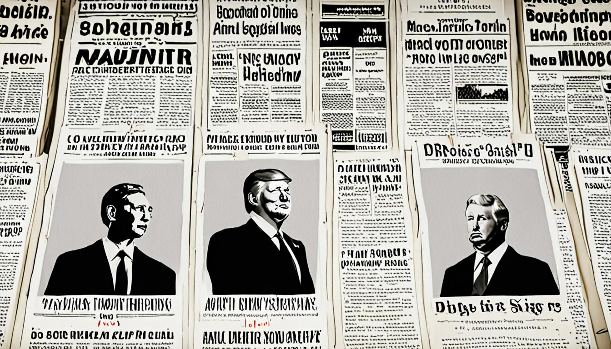
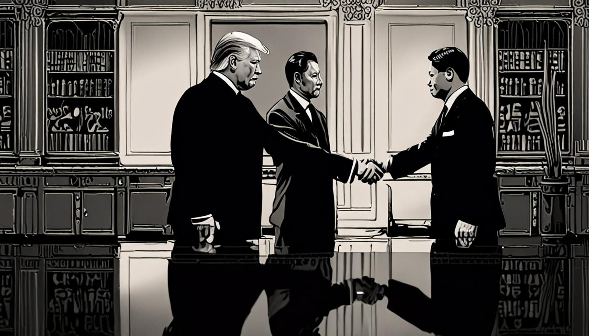

<!-- EE_ENRICHED_START -->

<a href="/">Inicio</a>›<a href="/analisis/">Análisis</a>›2026-11-19

📁 Dossier Ejecutivo
<strong>Publicado:</strong> 2026-11-19 &nbsp;·&nbsp; <strong>Tipo:</strong> Dossier Ejecutivo

<figure style="margin:1.5em 0;"><figcaption style="font-size:0.85em;color:#888;text-align:center;margin-top:0.5em;font-style:italic;">El Encuadre: Putin, ganador de la cumbre a tres de Shenzhen:</figcaption></figure>
<h1>Dossier del día: El Encuadre: Putin, ganador de la cumbre a tres de Shenzhen: Trump y Xi desoyen a Europa y lo incluyen en la tríada del poder global</h1>

<strong>Entradilla:</strong> Mientras el mundo se desangra en cumbres diplomáticas donde las máscaras caen, los medios de este país nos venden humo electoral y pánico migratorio. Hoy no venimos a informar, venimos a destripar el mecanismo. Lo que llaman "noticias" es, en realidad, una coreografía de miedo diseñado para que no miremos hacia arriba, sino hacia el abismo de nuestras propias elecciones. Aquí no hay verdad, sólo encuadre. Y el encuadre de hoy es una farsa de tres actos: la geopolítica ignorada, la democracia envenenada y el espectáculo vacío.

<h2>Noticias del día</h2>
<figure style="margin:1.5em 0;"><figcaption style="font-size:0.85em;color:#888;text-align:center;margin-top:0.5em;font-style:italic;">Noticias del día</figcaption></figure>

El gran titular del día es una mentira por omisión. El título que nos venden habla de una cumbre en Shenzhen donde Putin sale "ganador" y donde Trump y Xi "desoyen a Europa". Una narrativa de conspiración internacional que debería hacernos sonreír de no ser porque es la única forma de tapar el agujero negro que es la política española. Pero olvidemos por un momento a los osos y los dragones. El verdadero teatro se monta aquí, en la península, con un reparto local que actúa con la convicción de un actor de telenovela.

Por un lado, tenemos el caos jurídico alrededor de la "ley de nietos". El Tribunal Supremo, en una maniobra que huele a desesperación institucional, ha admitido que "no hay tiempo material" para revisar el censo. Esto significa que 189.678 personas, hijos de nacionalizados, podrán votar el 29 de noviembre. Según fuentes jurídicas citadas por Libertad Digital, esto podría "afectar a 14 escaños". Catorce sillas en el tablero. No es una anécdota, es la bomba de relojería que amenaza con reconfigurar el mapa político. El Supremo también ha desestimado el recurso de Vox para suspender cautelarmente el voto, dejando al Gobierno con la cara muy tranquila mientras la maquinaria electoral sigue girando sobre un eje que, al menos para algunos, está roto.

Por otro lado, el debate. El último cara a cara entre Pedro Sánchez y Alberto Núñez Feijóo. ElDiario.es lo enmarca como una "revancha de 2023", una narrativa de venganza personal disfrazada de política. Mientras tanto, el PP, a través de su secretario general Miguel Tellado, no pide que voten a ellos, sino que los votantes socialistas "se queden en casa". Una llamada al abstencionismo selectivo que es, en sí misma, una confesión de debilidad. No confían en su mensaje, confían en la pereza de los otros.

<h2>Los medios y sus técnicas</h2>

La prensa no reporta hechos, instala emociones. Cada redacción tiene su receta secreta, su aditivo químico para que el lector no piense, sino que sienta. Miedo, urgencia, certeza falsa. Analicemos los ingredientes que han usado hoy para cocinar esta sopa de letras.

<table>
    <tr>
        <th>Medio</th>
        <th>Técnica</th>
        <th>Omite</th>
    </tr>
    <tr>
        <td>El Español</td>
        <td>Apelación al miedo y dramatización</td>
        <td>La realidad de la cumbre; la irrelevancia de Europa en la tríada</td>
    </tr>
    <tr>
        <td>ABC</td>
        <td>Framing espectral</td>
        <td>La política; el contenido real del debate o de la actualidad</td>
    </tr>
    <tr>
        <td>The Objective</td>
        <td>Urgencia comercial</td>
        <td>La crítica social; el contexto del gasto público</td>
    </tr>
    <tr>
        <td>OkDiario</td>
        <td>Sensacionalismo territorial</td>
        <td>Las causas estructurales de la migración; la responsabilidad compartida</td>
    </tr>
    <tr>
        <td>InfoLibre</td>
        <td>Inseguridad y exclusión</td>
        <td>La solidez de los datos demoscópicos opuestos</td>
    </tr>
    <tr>
        <td>elDiario.es</td>
        <td>Narrativa de cierre de ciclo</td>
        <td>La complejidad de las encuestas; el margen de error</td>
    </tr>
    <tr>
        <td>Libertad Digital</td>
        <td>Apelación al miedo (fear appeal)</td>
        <td>La legalidad de la ley; el contexto histórico de la memoria</td>
    </tr>
</table>

Es un circo de espejos deformes. Cada medio distorsiona la realidad para que encaje en su burbuja ideológica. Pero el patrón es claro: nunca te dan la herramienta para pensar, sólo el golpe para reaccionar.

<h2>Las técnicas al detalle</h2>

<strong>1. La Dramatización de la Conspiración (El Español)</strong> 
El Español salta al ruedo con un titular que tiene más de película de espionaje que de crónica periodística: "Putin, ganador de la cumbre a tres de Shenzhen: Trump y Xi desoyen a Europa y lo incluyen en la tríada del poder global". La técnica aquí es la <em>apelación al miedo</em>. Al presentar a Europa como una entidad que ha sido "desoída" y "incluida" en un juego que no controla, se genera una sensación de vulnerabilidad colectiva. Se nos dice que estamos solos, que los grandes actores mundiales se ríen de nosotros. Es una forma elegante de decir: "No mireis a vuestro gobierno, mirad al exterior, allí está el verdadero peligro". Omite que la política exterior es compleja y que "ganar" una cumbre no es un concepto binario. Usa el miedo a la irrelevancia para condicionar la lectura de todo lo demás.

<strong>2. El Espejismo Cultural (ABC)</strong> 
ABC hace un movimiento de ajedrez maestro: el <em>framing</em> o encuadre contextual. Mientras el país arde por las elecciones y los cenzos, ABC titula: "Hora y canales que emiten hoy el cara a cara entre Pedro Sánchez y Feijóo". Pero el texto real que nos ha dado es una entrevista a Neus Sendra, narradora de audiolibros, que dice: "Yo me construyo una película en la cabeza y se la cuento al oyente. Le cojo de la mano y no le suelto en toda la novela". La técnica es la desviación. Al asociar la política (el cara a cara) con el arte de contar historias (la narración de audiolibros), se presenta el debate político como un espectáculo inevitable, casi artístico. Se omite el contenido político para centrarse en la forma. Nos dicen que la política es teatro, y que nosotros somos el público que debe quedarse "sin soltar" la mano del narrador. Es una anestesia cultural. En vez de analizar las propuestas, se analiza la emoción de la narrativa.

<strong>3. La Urgencia del Consumo (The Objective)</strong> 
The Objective utiliza la <em>urgencia</em> pura y dura, pero aplicada al consumo. Su texto real habla de comprar la Lotería de Navidad en Badajoz: "¿Hasta cuándo puede comprarse y cómo buscar un número? La venta empezó el 29 de junio... y se cierra el 21 de diciembre". En medio de la tormenta política, The Objective nos ofrece la tabla de salvación del azar. La técnica es la distracción a través del entusiasmo comercial. Al listar los premios y las administraciones, se crea una sensación de normalidad y rutina que contrasta con el caos exterior. Se nos invita a participar activamente en el juego de la lotería (un sistema de apuestas estatal) mientras se ignora el juego de la democracia. Es una forma de decir: "No puedes controlar a Sánchez ni a Feijóo, pero puedes controlar si compras el número 40000". Es un mecanismo de defensa individualista en tiempos de incertidumbre colectiva.

<strong>4. El Terrorismo del Censo (Libertad Digital)</strong> 
Libertad Digital cierra el círculo con la <em>apelación al miedo</em> más directa y sucia: "El voto de los hijos de los nacionalizados con la Ley de Nietos... puede afectar a 14 escaños". Aquí no hay sutileza. Hay una cifra mágica, 14, que flota en el aire como una amenaza existencial. Citan fuentes jurídicas que "temen" que esto repercuta de forma "notoria". La técnica es la infundación de duda sobre la legitimidad democrática. Se presenta la ley de memoria como un instrumento de manipulación electoral masiva. Se omite el debate sobre la memoria histórica para centrarse únicamente en el resultado aritmético de los escaños. Nos dicen que la democracia está en peligro no por falta de libertad, sino por exceso de papeletas. Es un miedo muy concreto, muy medible, y por tanto, muy fácil de vender.

<h2>Los sesgos compartidos</h2>

¿Qué tienen en común El Español, ABC, The Objective, OkDiario, InfoLibre, elDiario.es y Libertad Digital? Que todos, en su trinchera ideológica, practican la misma heresia: la deshumanización de la política a favor de la emoción primaria.

El patrón repetitivo es la <em>reducción</em>. La geopolítica se reduce a una trampa para Europa. El debate político se reduce a una película en la cabeza. La crisis migratoria se reduce a "imprevisibles movimientos" (OkDiario lo llama así: "imprevisibles movimientos migratorios contra Ceuta", una frase que suena a guion de película de desastre). La elección se reduce a 14 escaños o a un número de lotería.

¿Por qué funciona? Porque el ciudadano medio está agotado. La complejidad de la realidad es abrumadora. Es más cómodo creer que hay un villano (Putin, los nietos, la lotería, el otro candidato) que entender los matices de un tratado internacional o una ley de memoria. Los medios saben que si te dan datos fríos, te aburres. Pero si te dan miedo, te quedas. Si te dan esperanza (la lotería), te quedas. Si te dan la sensación de estar dentro de un secreto (la cumbre de Shenzhen), te quedas. Todos los medios, sin excepción, están vendiendo la misma cosa: la certeza de que algo está mal, y la única salida es sentirse parte de la tribu que lo ha detectado.

Hay un sesgo compartido de <em>inseguridad institucional</em>. El Supremo "no actúa con la diligencia exigible" (El Español). El Gobierno no garantiza la llave de La Moncloa (InfoLibre). Las islas están bajo amenaza (OkDiario). La democracia está en el aire (Libertad Digital). La sensación de que las instituciones están fallando o son complices es el pegamento que mantiene unida a la audiencia. No importa quién gobierne, importa que el sistema esté roto. Y mientras el sistema está roto, el medio de comunicación es el único que tiene las piezas para armarlo (o para romperlo aún más).

<figure style="margin:1.5em 0;"><figcaption style="font-size:0.85em;color:#888;text-align:center;margin-top:0.5em;font-style:italic;">Conclusión</figcaption></figure>
<h2>Conclusión</h2>

Mientras Trump y Xi juegan al ajedrez en Shenzhen, nosotros jugamos al escondite en el censo. Nos han vendido una narrativa donde la única verdad es la que sale en el titular. Donde la historia se cuenta como un audiolibro para no pensar. Donde la seguridad se mide en metros de valla en Ceuta. Donde la esperanza se compra por 0,50 euros en una administración de loterías.

El mecanismo, expuesto. Mañana volverán a hacerlo. Y tú, decides si coges la mano del narrador o sueltas el hilo y miras el mapa real. Porque la única cumbre que importa no es la de Shenzhen, es la de tu cabeza. Y ahí, el encuadre lo pones tú.

<h3>Fuentes consultadas:</h3>
<ul>
<li><strong>El Español:</strong> «Putin, ganador de la cumbre a tres de Shenzhen: Trump y Xi desoyen a Europa y lo incluyen en la tríada del poder global» — <a href="https://www.elespanol.com/espana/tribunales/20261119/supremo-endurece-critica-gobierno-no-actuar-diligencia-exigible-sacar-censo-falsos-nietos/1003744463762_0.html" target="_blank" rel="noopener">Leer completo</a></li>
<li><strong>ABC:</strong> «Hora y canales que emiten hoy el cara a cara entre Pedro Sánchez y Feijóo» — <a href="https://www.abc.es/cultura/libros/neus-sendra-narradora-audiolibros-construyo-pelicula-cabeza-20261119050000-nt.html" target="_blank" rel="noopener">Leer completo</a></li>
<li><strong>The Objective:</strong> «Comprar Lotería de Navidad 2026 en Badajoz: números y décimos por administración para el sorteo» — <a href="https://theobjective.com/loterias/loteria-navidad/2026-11-19/comprar-loteria-de-navidad-2026-en-badajoz-numeros-y-decimos-por-administracion-para-el-sorteo/" target="_blank" rel="noopener">Leer completo</a></li>
<li><strong>OkDiario:</strong> «Robles refuerza la seguridad de islas y peñones tras los «imprevisibles movimientos migratorios» contra Ceuta» — <a href="https://okdiario.com/espana/robles-refuerza-seguridad-islas-penones-imprevisibles-movimientos-migratorios-contra-ceuta-21117704" target="_blank" rel="noopener">Leer completo</a></li>
<li><strong>InfoLibre:</strong> «Sánchez apela a una participación del 75% que no le garantiza la llave de La Moncloa» — <a href="https://www.infolibre.es/política/sanchez-apela-participacion-75-no-le-garantiza-llave-moncloa_1_2240351.html" target="_blank" rel="noopener">Leer completo</a></li>
<li><strong>elDiario.es:</strong> «N/A» — <a href="https://www.eldiario.es/política/ultimo-cara-cara-sanchez-feijoo-pp-rebaja-expectativas-lider-psoe-prepara-revancha-2023_1_13674800.html" target="_blank" rel="noopener">Leer completo</a></li>
<li><strong>Libertad Digital:</strong> «N/A» — <a href="https://www.libertaddigital.com/espana/2026-11-19/el-voto-de-los-hijos-de-los-nacionalizados-con-la-ley-de-nietos-puede-afectar-a-14-escanos-en-las-elecciones-del-29-n-7493951/?utm_source=rss&amp;utm_medium=feed&amp;utm_campaign=Libertad+Digital%3A+Noticias+y+opini%C3%B3n+en+la+red" target="_blank" rel="noopener">Leer completo</a></li>
<li><strong>Al Jazeera:</strong> «Trump wants to talk nuclear with Putin and Xi» — <a href="https://www.aljazeera.com/video/newsfeed/2026/11/19/trump-wants-to-talk-nuclear-with-putin-and-xi?traffic_source=rss" target="_blank" rel="noopener">Leer completo</a></li>
<li><strong>The Guardian:</strong> «One in four women globally unable to refuse sex within marriage, says UN» — <a href="https://www.theguardian.com/global-development/2026/nov/19/women-girls-rights-rape-sexual-violence-africa-marriage-unfpa" target="_blank" rel="noopener">Leer completo</a></li>
</ul>

<strong>Aviso legal:</strong> Esto no es una acusación. Es una autopsia. Los medios están citados y enlazados. El derecho de cita (art. 32 LPI) nos ampara.

<strong>Síguenos:</strong> <a href="https://youtube.com/@somoselencuadre.oficial">YouTube</a> · <a href="https://tiktok.com/@somoselencuadre">TikTok</a> · <a href="https://instagram.com/somoselencuadre">Instagram</a> · <a href="https://x.com/SomosElEncuadre">X</a> · <a href="https://threads.net/@somoselencuadre">Threads</a>

<a href="https://twitter.com/intent/tweet?text=Dossier del día: El Encuadre: Putin, ganador de la cumbre a tres de Shenzhen:&url=https://elencuadre.pages.dev/analisis/2026-11-19-dossier-v2/" target="_blank" rel="noopener" class="ee-share-x">𝕏 Compartir</a>
<a href="https://threads.net/intent/post?text=Dossier del día: El Encuadre: Putin, ganador de la cumbre a tres de Shenzhen:+https://elencuadre.pages.dev/analisis/2026-11-19-dossier-v2/" target="_blank" rel="noopener" class="ee-share-threads">@ Threads</a>
<a href="https://www.linkedin.com/sharing/share-offsite/?url=https://elencuadre.pages.dev/analisis/2026-11-19-dossier-v2/" target="_blank" rel="noopener" class="ee-share-linkedin">in LinkedIn</a>
<a href="https://t.me/share/url?url=https://elencuadre.pages.dev/analisis/2026-11-19-dossier-v2/&text=Dossier del día: El Encuadre: Putin, ganador de la cumbre a tres de Shenzhen:" target="_blank" rel="noopener" class="ee-share-telegram">✈ Telegram</a>

<!-- EE_ENRICHED_END -->
