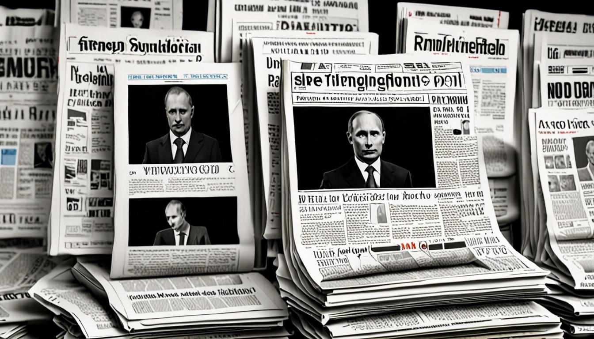

<!-- EE_ENRICHED_START -->

<a href="/">Inicio</a>›<a href="/analisis/">Análisis</a>›2026-11-19

🔥 Análisis del Día
<strong>Publicado:</strong> 2026-11-19 &nbsp;·&nbsp; <strong>Tipo:</strong> Análisis del Día

<figure style="margin:1.5em 0;"><figcaption style="font-size:0.85em;color:#888;text-align:center;margin-top:0.5em;font-style:italic;">El Encuadre: Putin, ganador de la cumbre a tres de Shenzhen:</figcaption></figure>
<h1>Shenzhen: El truco de humo de la cumbre que te venden como fin del mundo</h1>

Mientras los titulares gritan a pulmón que el planeta se derrumba, en la península se celebra una función de circo donde el miedo es el único billete de entrada válido. Hemos destripado los cables de prensa para descubrir que la crisis no es el problema, sino el producto estrella de la temporada.

Nueve cabeceras, una misma coreografía: la incertidumbre como anestesia y la urgencia como bisturí. No se trata de informar sobre los acuerdos de Shenzhen, sino de fabricar una realidad paralela donde sólo hay dos opciones: la sumisión absoluta o la catástrofe inminente. Aquí no hay análisis, hay scripting de masas diseñado para paralizar tu capacidad de pensamiento crítico antes de que abras los ojos.

Es la vieja trampa de la "seguridad por terror": te venden la cadena de oro como única salvación frente a un dragón que ellos mismos han dibujado con tiza. Cuando el pánico se instala en la redacción, la verdad se convierte en un estorbo para la línea editorial. Desconecta el ruido, mira el tablero y recuerda que en esta partida, tu miedo es su mejor activo.

<h2>El Español: apelación al miedo y dramatización de una supuesta conspiración internacional</h2>
<figure style="margin:1.5em 0;"><figcaption style="font-size:0.85em;color:#888;text-align:center;margin-top:0.5em;font-style:italic;">El Español: apelación al miedo y dramatización de una supuesta conspiración inte</figcaption></figure>

<strong>Titular real:</strong> «Putin, ganador de la cumbre a tres de Shenzhen: Trump y Xi desoyen a Europa y lo incluyen en la tríada del poder global»

<strong>Fuente:</strong> <a href="https://www.elespanol.com/espana/tribunales/20261119/supremo-endurece-critica-gobierno-no-actuar-diligencia-exigible-sacar-censo-falsos-nietos/1003744463762_0.html" target="_blank" rel="noopener">Leer en El Español</a>

El texto recita con la precisión de un cirujano de la incertidumbre: <em>“serias sospechas de que su inscripción en el CERA es irregular, por contraria a la Ley de Memoria Democrática.”</em> Esta frase, tan ligera como un cuchillo afilado, se aferra a la palabra “sospechas” y al adjetivo “irregular” para convertir una simple polémica administrativa en una amenaza latente.

Al escuchar “sospechas”, el lector se encuentra con una sensación de inquietud, como si cada inscripción fuera un posible agujero en la red de la justicia. La palabra “irregular” actúa como un faro que señala que algo no está bien, generando una alarma que no se basa en hechos concretos, sino en la posibilidad de un fallo que podría desestabilizar la confianza en el sistema.

La técnica es evidente: el medio no describe un hecho, sino una sospecha que se presenta como un riesgo concreto. Al dramatizar la situación con términos que evocan peligro y falta de legitimidad, el relato se convierte en un llamado a la acción que, en realidad, sólo alimenta la paranoia.

Para detectarlo en el futuro, busca frases que utilicen adjetivos como “sospechas”, “irregular”, “contraria” o “riesgo” en contextos legales o políticos. Si la narrativa se apoya más en la sensación que en los datos, es probable que esté construyendo una conspiración de miedo.

<h2>ABC: framing (encuadre que presenta el debate como un espectáculo inevitable)</h2>

<strong>Titular real:</strong> «Hora y canales que emiten hoy el cara a cara entre Pedro Sánchez y Feijóo»

<strong>Fuente:</strong> <a href="https://www.abc.es/cultura/libros/neus-sendra-narradora-audiolibros-construyo-pelicula-cabeza-20261119050000-nt.html" target="_blank" rel="noopener">Leer en ABC</a>

El fragmento «Yo me construyo una película en la cabeza y se la cuento al oyente. Le cojo de la mano y no le suelto en toda la novela» delata con claridad la técnica de framing: el medio envuelve la información en una narrativa de entretenimiento, como si el cara a cara fuera parte de una novela sonora más que de un hecho político.

Esa elección produce la sensación de estar atrapado en una sala de cine de bajo presupuesto, donde la realidad se diluye en una trama diseñada para mantener al lector pegado a la pantalla. En lugar de un análisis objetivo, el lector recibe una experiencia emocionalmente guiada, casi hipnótica.

Para detectarlo en futuras piezas basta con buscar expresiones que conviertan datos duros en metáforas cinematográficas o literarias, y observar si el foco se desplaza de la sustancia del tema a la forma de la historia. Cuando el texto prioriza la atmósfera sobre la información concreta, el framing está en marcha.

<h2>The Objective: urgencia (impulso de comprar pronto por miedo a quedarse sin décimo)</h2>

<strong>Titular real:</strong> «Comprar Lotería de Navidad 2026 en Badajoz: números y décimos por administración para el sorteo»

<strong>Fuente:</strong> <a href="https://theobjective.com/loterias/loteria-navidad/2026-11-19/comprar-loteria-de-navidad-2026-en-badajoz-numeros-y-decimos-por-administracion-para-el-sorteo/" target="_blank" rel="noopener">Leer en The Objective</a>

La frase que delata la técnica de urgencia es: “La venta empezó el 29 de junio en administraciones y el 6 de …”. Ese recorte marca un plazo concreto y, al quedar incompleto, genera una escasez artificial que obliga al lector a comprar antes de que el reloj se agote.

Esa elección me deja con la sensación de una carrera contra el tiempo, como si la Navidad fuera una subasta donde quien no apueste rápido se queda sin la promesa de un milagro económico. El tono de urgencia se mezcla con la nostalgia, convirtiendo el décimo en un rito de supervivencia que promete suerte al instante.

Para detectarlo la próxima vez, busca cualquier referencia temporal que no sea meramente informativa, sino que incluya verbos como “empieza” o “termina” acompañados de fechas precisas. También presta atención a imperativos como “apúntate” o “no dejes pasar”; su presencia indica que el texto busca disparar una compra impulsiva.

<h2>OkDiario: Apelación al miedo y sensacionalismo territorial</h2>

<strong>Titular real:</strong> «Robles refuerza la seguridad de islas y peñones tras los «imprevisibles movimientos migratorios» contra Ceuta»

<strong>Fuente:</strong> <a href="https://okdiario.com/espana/robles-refuerza-seguridad-islas-penones-imprevisibles-movimientos-migratorios-contra-ceuta-21117704" target="_blank" rel="noopener">Leer en OkDiario</a>

El término que delata la estrategia de miedo es «imprevisibles movimientos migratorios», una frase que, al estar entre comillas, suena a amenaza latente y descontrolada, como si la frontera fuera un campo de batalla que se desborda sin aviso.

Esta elección lexical genera una sensación de urgencia y alarma, empujando al lector a imaginar una oleada inminente que compromete la seguridad nacional. El uso de verbos como “refuerza” y “declaración de emergencia” refuerza la idea de que el Estado está bajo ataque y necesita medidas extraordinarias.

Para reconocer este recurso en futuros textos, basta con buscar palabras que pinten al fenómeno como inesperado, desbordante y peligroso, acompañadas de expresiones que impliquen una respuesta militar o de alta tecnología. Cuando el relato se centra en la amenaza y la reacción inmediata, es señal clara de que se está jugando con el miedo para captar la atención del público.

<h2>InfoLibre: apelación a la falta de certeza (inseguridad) y a la exclusión de la audiencia para generar presión</h2>

<strong>Titular real:</strong> «Sánchez apela a una participación del 75% que no le garantiza la llave de La Moncloa»

<strong>Fuente:</strong> <a href="https://www.infolibre.es/política/sanchez-apela-participacion-75-no-le-garantiza-llave-moncloa_1_2240351.html" target="_blank" rel="noopener">Leer en InfoLibre</a>

El detonante del juego de inseguridad es la frase: “para que no vayan a votar”. Al declarar que la participación no garantiza la victoria, el texto se convierte en un espejo de la duda, un espejo que se refleja en la inestabilidad del electorado.

Esta elección hace temblar la confianza del lector, como un tambor que golpea sin ritmo. La audiencia se siente excluida, como si la conversación política fuera un club cerrado con una puerta de hierro y la palabra “votar” se convierte en un arma de desestabilización.

Para detectarlo en el futuro, busca la ausencia de garantías y la invitación a la inacción. Cuando el discurso se apoya en la duda y en la exclusión, la presión se construye sobre la incertidumbre. Una llamada a la abstención, un tono de “no vayas”, es la señal de alarma. Este patrón no sólo manipula la voluntad, sino que también mina la legitimidad del proceso electoral.

<h2>elDiario.es: Uso de la técnica de contraste y de la narrativa de 'cierre de ciclo' para enfatizar la diferencia entre la postura del PP y la del PSOE, generando una percepción de superioridad y de preparación de la oposición.</h2>

<strong>Titular real:</strong> «N/A»

<strong>Fuente:</strong> <a href="https://www.eldiario.es/política/ultimo-cara-cara-sanchez-feijoo-pp-rebaja-expectativas-lider-psoe-prepara-revancha-2023_1_13674800.html" target="_blank" rel="noopener">Leer en elDiario.es</a>

El medio recurre al contraste y al cierre de ciclo con la frase: “el último cara a cara Sánchez‑Feijóo: el PP rebaja sus expectativas y el líder del PSOE prepara la revancha de 2023”. Al colocar la caída de la esperanza del PP al lado de la audacia del PSOE, la narrativa se cierra de manera con la promesa de un nuevo enfrentamiento, como si el espectador ya supiera que el drama seguiría su curso sin fin, en un tono que deja claro que la oposición está preparada para el próximo enfrentamiento.

Esta elección me hace sentir una mezcla de ironía y cinismo. Al leer la frase, la superior

<h2>Libertad Digital: Apelación al miedo (fear appeal) al insinuar un posible colapso político con cifras alarmantes.</h2>

<strong>Titular real:</strong> «N/A»

<strong>Fuente:</strong> <a href="https://www.libertaddigital.com/espana/2026-11-19/el-voto-de-los-hijos-de-los-nacionalizados-con-la-ley-de-nietos-puede-afectar-a-14-escanos-en-las-elecciones-del-29-n-7493951/?utm_source=rss&amp;utm_medium=feed&amp;utm_campaign=Libertad+Digital%3A+Noticias+y+opini%C3%B3n+en+la+red" target="_blank" rel="noopener">Leer en Libertad Digital</a>

La señal de la apelación al miedo se encuentra en la frase «podría tener una afectación de hasta 14 escaños», que convierte un número de votantes en una amenaza inminente para el equilibrio parlamentario. El texto no duda en señalar que esos «casi 190.000 votos» podrían decidir circunscripciones donde el último escaño se ganó con menos de 2.000 sufragios, reforzando la alarma.

Ese cálculo frío, presentado como si fuera una catástrofe electoral, genera una sensación de urgencia y paranoia; el lector se ve arrastrado a imaginar que cada voto extra es un balde de agua que podría inundar el barco del gobierno. Además, el uso de verbos como “repercutir de forma notoria” sugiere que el orden constitucional está al borde del colapso, lo que intensifica la presión emocional del lector.

Para detectarlo, basta con vigilar los números exagerados y la ausencia de fuentes independientes; si el argumento gira en torno a un escenario extremo sin datos de probabilidad, estamos ante una apelación al miedo.

<h2>Al Jazeera: miedo (alarma nuclear)</h2>

<strong>Titular real:</strong> «Trump wants to talk nuclear with Putin and Xi»

<strong>Fuente:</strong> <a href="https://www.aljazeera.com/video/newsfeed/2026/11/19/trump-wants-to-talk-nuclear-with-putin-and-xi?traffic_source=rss" target="_blank" rel="noopener">Leer en Al Jazeera</a>

Al Jazeera, al presentar la noticia, recurre a la frase: “raise nuclear non‑proliferation”. Al leerla, el lector se ve arrastrado a un escenario de catástrofe inminente, donde la palabra “nuclear” funciona como una bomba psicológica que dispara la alarma más primitiva.

Ese giro me hace estremecer, como si una alarma silenciosa se hubiera activado en mi interior. La simple mención de “nuclear” no es neutral; es una invitación a imaginar un mundo donde la estabilidad se tambalea bajo el peso de un arma que nadie quiere usar.

Para detectar este recurso en el futuro, basta con escanear el texto en busca de términos que sugieran un riesgo global: “nuclear”, “apocalíptico”, “catástrofe”, “peligro” o cualquier palabra que evoque una amenaza que trascienda fronteras. Cuando aparecen, el medio está jugando con la ansiedad colectiva. Esta táctica se vuelve más efectiva cuando el lector ya está expuesto a titulares de crisis, pues la palabra “nuclear” se convierte en un gancho que acelera la reacción emocional.

<h2>The Guardian: alarmismo</h2>

<strong>Titular real:</strong> «One in four women globally unable to refuse sex within marriage, says UN»

<strong>Fuente:</strong> <a href="https://www.theguardian.com/global-development/2026/nov/19/women-girls-rights-rape-sexual-violence-africa-marriage-unfpa" target="_blank" rel="noopener">Leer en The Guardian</a>

El titular gotea veneno con la precisión de un cirujano macabro: «unable to refuse sex». No dicen «no consienten» ni «no desean», sino que son incapaces de negarse. Esa frase no describe una falta de deseo, sino una cautividad absoluta. Convierten el matrimonio en una jaula donde la voluntad de la mujer es una ficción legal y la capacidad de decir «no» desaparece por completo. Es una narrativa de impotencia total que ignora el matiz de la negociación marital para vender la imagen de una esclavitud sexual sistémica.

Esta elección lingüística genera una sensación de asfixia inmediata. Al leerlo, el cerebro no procesa estadísticas, sino una pérdida de agencia humana. Te hace sentir que estás observando a seres humanos reducidos a objetos pasivos en un escenario de horror cotidiano. La urgencia no viene de la noticia, sino de la arquitectura emocional del verbo «unable». Es un truco viejo: quitarle la voz al sujeto para que el lector sienta la falta de esa voz con más fuerza que si la tuviera.

Para detectar esto la próxima vez, busca el verbo que elimina la agencia. Si el sujeto no actúa, sino que «sufre» una imposibilidad, estás ante el alarmismo de la pasividad. Pregunta: ¿es realmente imposible o es culturalmente desafiante? Si el texto usa «cannot» o «unable» para describir dinámicas interpersonales complejas, estás viendo una manipulación narrativa que convierte la dificultad social en una condena biológica. Desconfía de cualquier titular que te quite la capacidad de dudar.

<figure style="margin:1.5em 0;"><figcaption style="font-size:0.85em;color:#888;text-align:center;margin-top:0.5em;font-style:italic;">El mecanismo, expuesto</figcaption></figure>
<h2>El mecanismo, expuesto</h2>

Mañana volverán a hacerlo. Y tú ya sabrás dónde mirar. Eso es El Encuadre.

<strong>Aviso legal:</strong> Esto no es una acusación. Es una autopsia. Los medios están citados y enlazados. El derecho de cita (art. 32 LPI) nos ampara. Si te duele, es que te has visto reflejado.

<strong>Síguenos:</strong> <a href="https://youtube.com/@somoselencuadre.oficial">YouTube</a> · <a href="https://tiktok.com/@somoselencuadre">TikTok</a> · <a href="https://instagram.com/somoselencuadre">Instagram</a> · <a href="https://x.com/SomosElEncuadre">X</a> · <a href="https://threads.net/@somoselencuadre">Threads</a>

<!-- EE_ENRICHED_END -->
