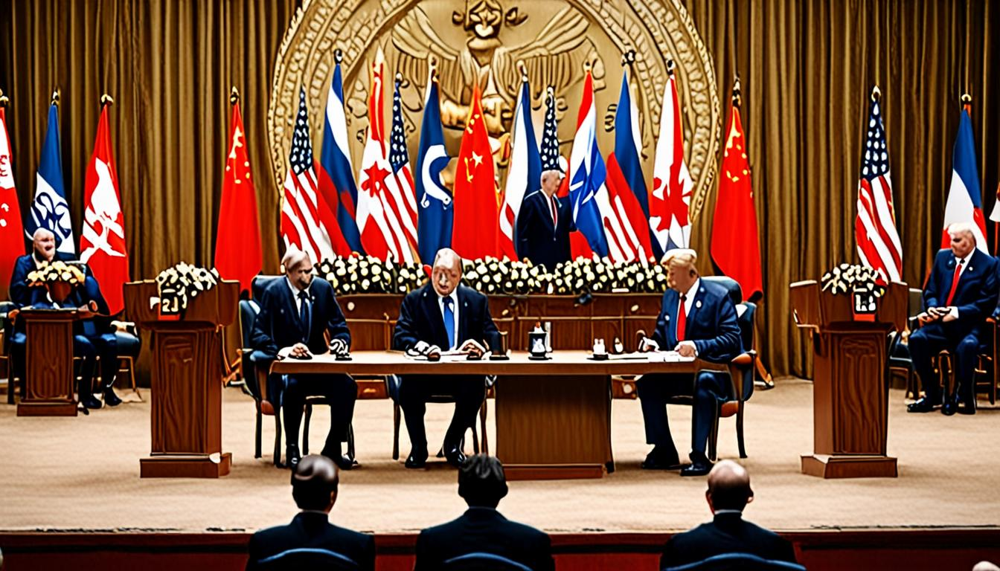
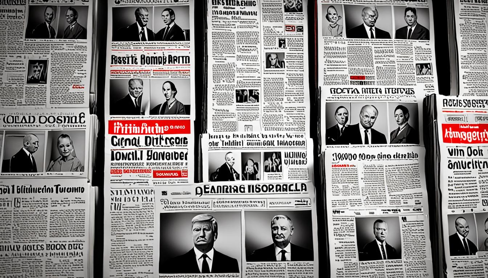

<figure style="margin:1.5em 0;"><figcaption style="font-size:0.85em;color:#888;text-align:center;margin-top:0.5em;font-style:italic;">La cita que lo cambia todo</figcaption></figure>
<h1>La sombra de Bernays sobre la opinión pública</h1>

En la era de los algoritmos que nos susurran al oído, una frase fragmentada de medio siglo atrás vuelve a resonar como un eco de advertencia. Edward Bernays, el abuelo del <em>public relations</em>, dejó una huella que hoy se siente en cada click que nos convierte en consumidores. Su mensaje, aunque incompleto, destila la esencia de una estrategia que ha pasado de los salones de la élite a los feeds de Instagram.

<blockquote>«{'autor': 'Edward Bernays', 'frase': 'La manipulación consciente e inteligente de los hábitos y opin»</blockquote>
<h2>Quién lo dijo</h2>
<figure style="margin:1.5em 0;"><figcaption style="font-size:0.85em;color:#888;text-align:center;margin-top:0.5em;font-style:italic;">Quién lo dijo</figcaption></figure>

Edward Bernays (1891‑1995) fue un pionero estadounidense del llamado “arte de la persuasión”. Nieto del célebre psicoanalista Sigmund Freud, heredó la idea de que los deseos humanos pueden ser moldeados con precisión quirúrgica. Tras trabajar en la campaña de la <em>American Tobacco Company</em>, donde popularizó el cigarrillo entre las mujeres bajo el lema “¡Fuma si eres libre!”, Bernays fundó su propia agencia y se convirtió en el arquitecto de la opinión moderna. Sus libros, como <em>Propaganda</em> (1928) y <em>Crystallizing Public Opinion</em> (1945), siguen siendo lecturas obligatorias en escuelas de comunicación y marketing, aunque pocos admiten que su legado es también una receta para el control social.

<h2>Contexto</h2>

La frase surgió en una época en la que la publicidad empezaba a abandonar el simple anuncio de productos para adentrarse en la psicología de masas. Tras la Primera conflicto Mundial, los gobiernos y las corporaciones descubrieron que la persuasión podía ser tan decisiva como la fuerza militar. Bernays, inspirado por los experimentos de su tío Freud, aplicó técnicas de sugestión y de creación de símbolos para convertir ideas abstractas en hábitos cotidianos. En los años 30, sus campañas para la United Fruit Company y la compañía de alimentos “Borden” mostraron cómo la manipulación de la información podía moldear la percepción pública sin necesidad de coacción directa.

<h2>Qué quería decir</h2>

El fragmento “La manipulación consciente e inteligente de los hábitos y opin…” revela una intención clara: la creación deliberada de patrones de comportamiento a través de la información seleccionada. Bernays no hablaba de mera persuasión; hablaba de una ingeniería social que parte de la observación de los deseos inconscientes para diseñar mensajes que los satisfagan antes de que el individuo siquiera los reconozca. En otras palabras, la gente compra la ilusión de libertad mientras sus decisiones son orquestadas desde la sombra de los datos y los relatos que se le presentan. La “inteligencia” del proceso radica en la capacidad de anticipar reacciones y adaptar la narrativa en tiempo real, un principio que hoy se materializa en los algoritmos de recomendación de plataformas como YouTube o TikTok.

<figure style="margin:1.5em 0;"><figcaption style="font-size:0.85em;color:#888;text-align:center;margin-top:0.5em;font-style:italic;">Qué oculta</figcaption></figure>
<h2>Qué oculta</h2>

Detrás de la aparente claridad de la frase se esconde una verdad incómoda: la falta de transparencia. Al hablar de “manipulación consciente”, Bernays reconoce que el proceso es deliberado, pero nunca menciona quién decide qué hábitos son dignos de ser fomentados. La ausencia de un sujeto claro permite que la manipulación se despliegue bajo la apariencia de neutralidad. Además, el fragmento está truncado; la palabra que sigue a “opin” probablemente sería “opiniones” o “opiniones colectivas”, lo que sugiere una intención de moldear no sólo acciones, sino también la forma en que la gente interpreta la realidad. Lo que queda fuera del discurso es la responsabilidad ética de quienes manejan esas técnicas, una cuestión que sigue sin resolverse en la era digital.

En conclusión, la cita incompleta de Bernays no es sólo un vestigio histórico, sino una advertencia viva. En un mundo donde los datos son el nuevo petróleo y los influencers son los curadores de la opinión, la “manipulación consciente e inteligente” sigue operando bajo la capa de la cotidianidad. La lección que deberíamos extraer es que la vigilancia no sólo corresponde a los poderes del Estado, sino también a los gigantes del marketing que, con la misma precisión de un cirujano, esculpen nuestros hábitos y nuestras ideas. Sólo al reconocer la existencia de esa arquitectura invisible podremos reclamar una esfera pública verdaderamente libre.

<strong>Aviso legal:</strong> Esto no es una acusacion. Es una autopsia. Los medios estan citados y enlazados. El derecho de cita (art. 32 LPI) nos ampara.

<strong>Síguenos:</strong> <a href="https://youtube.com/@somoselencuadre.oficial">YouTube</a> · <a href="https://tiktok.com/@somoselencuadre">TikTok</a> · <a href="https://instagram.com/somoselencuadre">Instagram</a> · <a href="https://x.com/SomosElEncuadre">X</a> · <a href="https://threads.net/@somoselencuadre">Threads</a>

