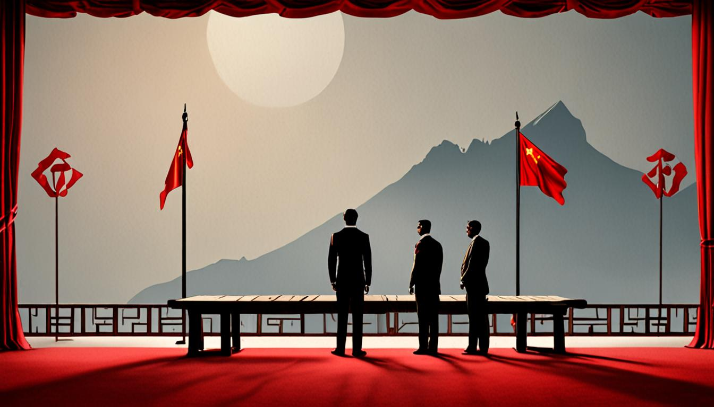
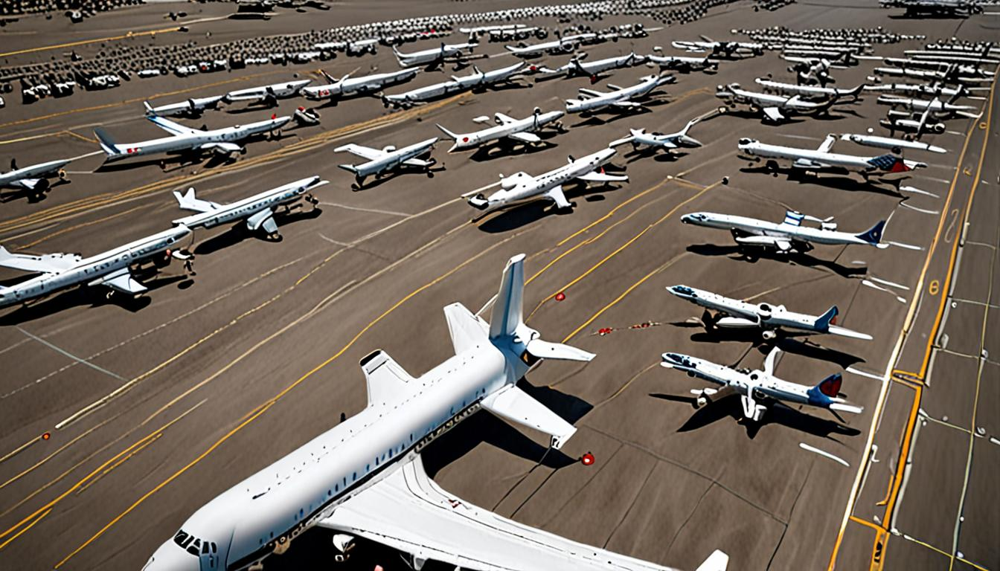

---
hide:
  - navigation
---

<h1>El Archivo del Anti-Medio</h1>

Todo nuestro arsenal. 62 análisis publicados. Sin filtros, con enlaces verificables.

  <button class="holo-filter-btn active" data-filter="all">Todos (62)</button>
  <button class="holo-filter-btn" data-filter="diario">Diarios (21)</button>
  <button class="holo-filter-btn" data-filter="dossier">Dossiers (21)</button>
  <button class="holo-filter-btn" data-filter="angulo">Ángulos (20)</button>

  

    
🔥 Análisis del Día

    
    <h3>El Encuadre: Putin, ganador de la cumbre a tres de Shenzhen:</h3>
    
Analisis largo: El Encuadre: Putin, ganador de la cumbre a tres de Shenzhen:

    
📅 2026-11-19

  

  

    
📁 Dossier Ejecutivo

    
    <h3>Dossier del día: El Encuadre: Putin, ganador de la cumbre a tres de Shenzhen:</h3>
    
Dossier ejecutivo: El Encuadre: Putin, ganador de la cumbre a tres de Shenzhen: Trump y Xi desoyen 

    
📅 2026-11-19

  

  

    
📄 Ángulo del Día

    
    <h3>La cita que lo cambia todo</h3>
    
Analisis cita: La cita que lo cambia todo

    
📅 2026-11-19

  

  

    
🔥 Análisis del Día

    
    <h3>El Encuadre: Sánchez le hace los Presupuestos a Feijóo despu</h3>
    
Analisis largo: El Encuadre: Sánchez le hace los Presupuestos a Feijóo despu

    
📅 2026-11-18

  

  

    
📁 Dossier Ejecutivo

    
    <h3>Dossier del día: El Encuadre: Sánchez le hace los Presupuestos a Feijóo despu</h3>
    
Dossier ejecutivo: El Encuadre: Sánchez le hace los Presupuestos a Feijóo después de cuatro años si

    
📅 2026-11-18

  

  

    
📄 Ángulo del Día

    
    <h3>Radar de medios: El Encuadre: Sánchez le hace los Presupuestos a Fe</h3>
    
Analisis radar: Radar de medios: El Encuadre: Sánchez le hace los Presupuestos a Fe

    
📅 2026-11-18

  

  

    
🔥 Análisis del Día

    
    <h3>El Encuadre: El CNI informó al Gobierno del riesgo de desbor</h3>
    
Analisis largo: El Encuadre: El CNI informó al Gobierno del riesgo de desbor

    
📅 2026-11-17

  

  

    
📁 Dossier Ejecutivo

    
    <h3>Dossier del día: El Encuadre: El CNI informó al Gobierno del riesgo de desbor</h3>
    
Dossier ejecutivo: El Encuadre: El CNI informó al Gobierno del riesgo de desbordamiento en Canarias

    
📅 2026-11-17

  

  

    
📄 Ángulo del Día

    
    <h3>Cómo detectar la técnica: apelación al miedo (alarmismo)</h3>
    
Analisis tutorial: Cómo detectar la técnica: apelación al miedo (alarmismo)

    
📅 2026-11-17

  

  

    
🔥 Análisis del Día

    
    <h3>El Encuadre: Vox roza un hito con dos escaños en Galicia y d</h3>
    
Analisis largo: El Encuadre: Vox roza un hito con dos escaños en Galicia y d

    
📅 2026-11-16

  

  

    
📁 Dossier Ejecutivo

    
    <h3>Dossier del día: El Encuadre: Vox roza un hito con dos escaños en Galicia y d</h3>
    
Dossier ejecutivo: El Encuadre: Vox roza un hito con dos escaños en Galicia y dispara a la derecha 

    
📅 2026-11-16

  

  

    
📄 Ángulo del Día

    
    <h3>El ángulo que nadie cuenta: ¡El PSOE lanza un programa de 114 páginas con 500</h3>
    
Analisis quirurgico: El ángulo que nadie cuenta: ¡El PSOE lanza un programa de 114 páginas con 500 

    
📅 2026-11-16

  

  

    
🔥 Análisis del Día

    
    <h3>El Encuadre: SpaceX logra que Starship regrese a la platafor</h3>
    
Analisis largo: El Encuadre: SpaceX logra que Starship regrese a la platafor

    
📅 2026-11-15

  

  

    
📁 Dossier Ejecutivo

    
    <h3>Dossier del día: El Encuadre: SpaceX logra que Starship regrese a la platafor</h3>
    
Dossier ejecutivo: El Encuadre: SpaceX logra que Starship regrese a la plataforma tras casi un día 

    
📅 2026-11-15

  

  

    
📄 Ángulo del Día

    
    <h3>Libertad Digital: la tecnica del descalificación mediante etiquetado negativo y contraste polarizador</h3>
    
Analisis medio_crudo: Libertad Digital: la tecnica del descalificación mediante etiquetado negativo y contraste polarizado

    
📅 2026-11-15

  

  

    
🔥 Análisis del Día

    
    <h3>El Encuadre: Estados Unidos suspende el tráfico aéreo tras f</h3>
    
Analisis largo: El Encuadre: Estados Unidos suspende el tráfico aéreo tras f

    
📅 2026-11-14

  

  

    
📁 Dossier Ejecutivo

    
    <h3>Dossier del día: El Encuadre: Estados Unidos suspende el tráfico aéreo tras f</h3>
    
Dossier ejecutivo: El Encuadre: Estados Unidos suspende el tráfico aéreo tras fallos en los sistema

    
📅 2026-11-14

  

  

    
📄 Ángulo del Día

    
    <h3>Dossier completo del dia</h3>
    
Analisis dossier: Dossier completo del dia

    
📅 2026-11-14

  

  

    
🔥 Análisis del Día

    
    <h3>El Encuadre: La UCO detecta un «descuadre contable» entre la</h3>
    
Analisis largo: El Encuadre: La UCO detecta un «descuadre contable» entre la

    
📅 2026-11-13

  

  

    
📁 Dossier Ejecutivo

    
    <h3>Dossier del día: El Encuadre: La UCO detecta un «descuadre contable» entre la</h3>
    
Dossier ejecutivo: El Encuadre: La UCO detecta un «descuadre contable» entre la documentación del T

    
📅 2026-11-13

  

  

    
📄 Ángulo del Día

    
    <h3>Onda Cero: la tecnica del anclaje de autoridad y exclusividad</h3>
    
Analisis medio_analizado: Onda Cero: la tecnica del anclaje de autoridad y exclusividad

    
📅 2026-11-13

  

  

    
🔥 Análisis del Día

    
    <h3>El Encuadre: La primera huelga general por la vivienda movil</h3>
    
Analisis largo: El Encuadre: La primera huelga general por la vivienda movil

    
📅 2026-11-12

  

  

    
📁 Dossier Ejecutivo

    
    <h3>Dossier del día: El Encuadre: La primera huelga general por la vivienda movil</h3>
    
Dossier ejecutivo: El Encuadre: La primera huelga general por la vivienda moviliza a millones de pe

    
📅 2026-11-12

  

  

    
📄 Ángulo del Día

    
    <h3>La cita que lo cambia todo</h3>
    
Analisis cita: La cita que lo cambia todo

    
📅 2026-11-12

  

  

    
🔥 Análisis del Día

    
    <h3>El Encuadre: Los sindicatos llaman a España a una huelga gen</h3>
    
Analisis largo: El Encuadre: Los sindicatos llaman a España a una huelga gen

    
📅 2026-11-11

  

  

    
📁 Dossier Ejecutivo

    
    <h3>Dossier del día: El Encuadre: Los sindicatos llaman a España a una huelga gen</h3>
    
Dossier ejecutivo: El Encuadre: Los sindicatos llaman a España a una huelga general por primera vez

    
📅 2026-11-11

  

  

    
📄 Ángulo del Día

    
    <h3>Radar de medios: El Encuadre: Los sindicatos llaman a España a una</h3>
    
Analisis radar: Radar de medios: El Encuadre: Los sindicatos llaman a España a una 

    
📅 2026-11-11

  

  

    
🔥 Análisis del Día

    
    <h3>El Encuadre: El TS admite que 180.000 hijos de supuestos 'ni</h3>
    
Analisis largo: El Encuadre: El TS admite que 180.000 hijos de supuestos 'ni

    
📅 2026-11-10

  

  

    
📁 Dossier Ejecutivo

    
    <h3>Dossier del día: El Encuadre: El TS admite que 180.000 hijos de supuestos 'ni</h3>
    
Dossier ejecutivo: El Encuadre: El TS admite que 180.000 hijos de supuestos 'nietos' podrán votar c

    
📅 2026-11-10

  

  

    
📄 Ángulo del Día

    
    <h3>Cómo detectar la técnica: Sensacionalismo y polarización</h3>
    
Analisis tutorial: Cómo detectar la técnica: Sensacionalismo y polarización

    
📅 2026-11-10

  

  

    
🔥 Análisis del Día

    
    <h3>El Encuadre: Nvidia abre una investigación a su consejero de</h3>
    
Analisis largo: El Encuadre: Nvidia abre una investigación a su consejero de

    
📅 2026-11-09

  

  

    
📁 Dossier Ejecutivo

    
    <h3>Dossier del día: El Encuadre: Nvidia abre una investigación a su consejero de</h3>
    
Dossier ejecutivo: El Encuadre: Nvidia abre una investigación a su consejero delegado sobre su rela

    
📅 2026-11-09

  

  

    
📄 Ángulo del Día

    
    <h3>El ángulo que nadie cuenta: ¿Te cuesta encontrar casa?</h3>
    
Analisis quirurgico: El ángulo que nadie cuenta: ¿Te cuesta encontrar casa?

    
📅 2026-11-09

  

  

    
🔥 Análisis del Día

    
    <h3>El Encuadre: El presidente de Israel encarga formar gobierno</h3>
    
Analisis largo: El Encuadre: El presidente de Israel encarga formar gobierno

    
📅 2026-11-08

  

  

    
📁 Dossier Ejecutivo

    
    <h3>Dossier del día: El Encuadre: El presidente de Israel encarga formar gobierno</h3>
    
Dossier ejecutivo: El Encuadre: El presidente de Israel encarga formar gobierno al opositor Eisenko

    
📅 2026-11-08

  

  

    
📄 Ángulo del Día

    
    <h3>Le Monde: la tecnica del marco de agenda que enfatiza la movilización y la expansión para crear la ilusión de dinamismo y inevitabilidad</h3>
    
Analisis medio_crudo: Le Monde: la tecnica del marco de agenda que enfatiza la movilización y la expansión para crear la i

    
📅 2026-11-08

  

  

    
🔥 Análisis del Día

    
    <h3>El Encuadre: Adif blindó el bonus a su cúpula horas antes de</h3>
    
Analisis largo: El Encuadre: Adif blindó el bonus a su cúpula horas antes de

    
📅 2026-11-07

  

  

    
📁 Dossier Ejecutivo

    
    <h3>Dossier del día: El Encuadre: Adif blindó el bonus a su cúpula horas antes de</h3>
    
Dossier ejecutivo: El Encuadre: Adif blindó el bonus a su cúpula horas antes de dimitir su presiden

    
📅 2026-11-07

  

  

    
📄 Ángulo del Día

    
    <h3>Dossier completo del dia</h3>
    
Analisis dossier: Dossier completo del dia

    
📅 2026-11-07

  

  

    
🔥 Análisis del Día

    
    <h3>El Encuadre: Una nueva oleada de falsas amenazas de bomba af</h3>
    
Analisis largo: El Encuadre: Una nueva oleada de falsas amenazas de bomba af

    
📅 2026-11-06

  

  

    
📁 Dossier Ejecutivo

    
    <h3>Dossier del día: El Encuadre: Una nueva oleada de falsas amenazas de bomba af</h3>
    
Dossier ejecutivo: El Encuadre: Una nueva oleada de falsas amenazas de bomba afecta al menos a 27 a

    
📅 2026-11-06

  

  

    
📄 Ángulo del Día

    
    <h3>Onda Cero: la tecnica del uso de la metáfora de 'resaca' para sugerir un golpe económico negativo</h3>
    
Analisis medio_analizado: Onda Cero: la tecnica del uso de la metáfora de 'resaca' para sugerir un golpe económico negativo

    
📅 2026-11-06

  

  

    
🔥 Análisis del Día

    
    <h3>El Encuadre: El presidente de Adif renuncia al cargo ante Ca</h3>
    
Analisis largo: El Encuadre: El presidente de Adif renuncia al cargo ante Ca

    
📅 2026-11-05

  

  

    
📁 Dossier Ejecutivo

    
    <h3>Dossier del día: El Encuadre: El presidente de Adif renuncia al cargo ante Ca</h3>
    
Dossier ejecutivo: El Encuadre: El presidente de Adif renuncia al cargo ante Carlos Cuerpo...

    
📅 2026-11-05

  

  

    
📄 Ángulo del Día

    
    <h3>La cita que lo cambia todo</h3>
    
Analisis cita: La cita que lo cambia todo

    
📅 2026-11-05

  

  

    
🔥 Análisis del Día

    
    <h3>El Encuadre: Los demócratas sacuden el mapa electoral con vi</h3>
    
Analisis largo: El Encuadre: Los demócratas sacuden el mapa electoral con vi

    
📅 2026-11-04

  

  

    
📁 Dossier Ejecutivo

    
    <h3>Dossier del día: El Encuadre: Los demócratas sacuden el mapa electoral con vi</h3>
    
Dossier ejecutivo: El Encuadre: Los demócratas sacuden el mapa electoral con victorias en Texas y l

    
📅 2026-11-04

  

  

    
📄 Ángulo del Día

    
    <h3>Radar de medios: El Encuadre: Los demócratas sacuden el mapa electo</h3>
    
Analisis radar: Radar de medios: El Encuadre: Los demócratas sacuden el mapa electo

    
📅 2026-11-04

  

  

    
🔥 Análisis del Día

    
    <h3>El Encuadre: Feijóo: 'España está en situación de emergencia</h3>
    
Analisis largo: El Encuadre: Feijóo: 'España está en situación de emergencia

    
📅 2026-11-03

  

  

    
📁 Dossier Ejecutivo

    
    <h3>Dossier del día: El Encuadre: Feijóo: 'España está en situación de emergencia</h3>
    
Dossier ejecutivo: El Encuadre: Feijóo: 'España está en situación de emergencia y necesita gente qu

    
📅 2026-11-03

  

  

    
📄 Ángulo del Día

    
    <h3>Cómo detectar la técnica: Card Stacking</h3>
    
Analisis tutorial: Cómo detectar la técnica: Card Stacking

    
📅 2026-11-03

  

  

    
🔥 Análisis del Día

    
    <h3>El Encuadre: PP y Vox suman una amplia mayoría y el PSOE se</h3>
    
Analisis largo: El Encuadre: PP y Vox suman una amplia mayoría y el PSOE se 

    
📅 2026-11-02

  

  

    
📁 Dossier Ejecutivo

    
    <h3>Dossier del día: El Encuadre: PP y Vox suman una amplia mayoría y el PSOE se</h3>
    
Dossier ejecutivo: El Encuadre: PP y Vox suman una amplia mayoría y el PSOE se hunde por debajo de 

    
📅 2026-11-02

  

  

    
📄 Ángulo del Día

    
    <h3>El ángulo que nadie cuenta: “Adif dejó ‘en visto’ las recomendaciones de la CI</h3>
    
Analisis quirurgico: El ángulo que nadie cuenta: “Adif dejó ‘en visto’ las recomendaciones de la CI

    
📅 2026-11-02

  

  

    
🔥 Análisis del Día

    
    <h3>El Encuadre: Santander abona este lunes 1.850 millones de eu</h3>
    
Analisis largo: El Encuadre: Santander abona este lunes 1.850 millones de eu

    
📅 2026-11-01

  

  

    
📁 Dossier Ejecutivo

    
    <h3>Dossier del día: El Encuadre: Santander abona este lunes 1.850 millones de eu</h3>
    
Dossier ejecutivo: El Encuadre: Santander abona este lunes 1.850 millones de euros en dividendo en 

    
📅 2026-11-01

  

  

    
📄 Ángulo del Día

    
    <h3>HuffPost Spain: la tecnica del fear appeal</h3>
    
Analisis medio_crudo: HuffPost Spain: la tecnica del fear appeal

    
📅 2026-11-01

  

  

    
🔥 Análisis del Día

    
    <h3>El Encuadre: Sánchez aplica con Puente el 'escudo protector</h3>
    
Analisis largo: El Encuadre: Sánchez aplica con Puente el 'escudo protector

    
📅 2026-10-31

  

  

    
🔥 Análisis del Día

    
    <h3>Resumen del Día: 2026-10-31</h3>
    
tags:

    
📅 2026-10-31

  

  

    
📁 Dossier Ejecutivo

    
    <h3>Dossier del día: El Encuadre: Sánchez aplica con Puente el 'escudo protector</h3>
    
Dossier ejecutivo: El Encuadre: Sánchez aplica con Puente el 'escudo protector' de la 'doctrina Marlaska

    
📅 2026-10-31

  

  

    
📁 Dossier Ejecutivo

    
    <h3>Dossier Completo</h3>
    
Análisis satélite: Dossier Completo

    
📅 2026-10-31

  

  

    
📄 Ángulo del Día

    
    <h3>Dossier completo del dia</h3>
    
Analisis dossier: Dossier completo del dia

    
📅 2026-10-31

  

