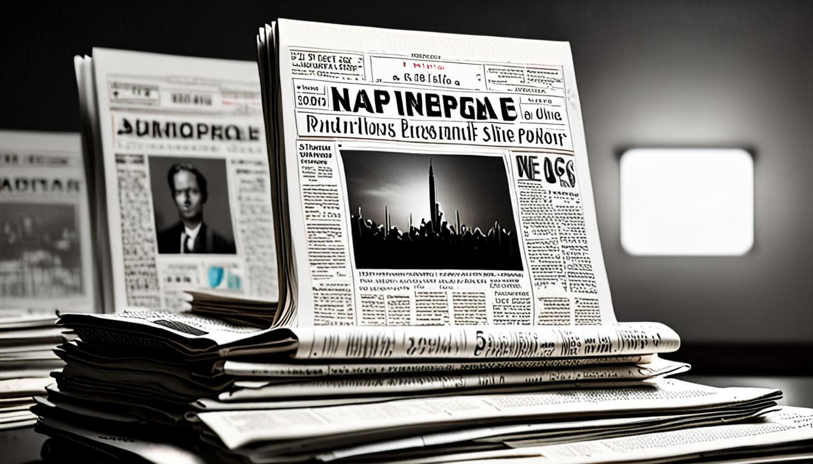

> 🌐 [Original auf Spanisch lesen](../../de/analisis/2026-11-15-mediano-medio_crudo.md)

<!-- EE_ENRICHED_START -->

<a href="/">Startseite</a>›<a href="/analisis/">Analyse</a>›15.11.2026

📄 Blickwinkel des Tages
<strong>Veröffentlicht:</strong> 15.11.2026 &nbsp;·&nbsp; <strong>Typ:</strong> Blickwinkel des Tages

<figure style="margin:1.5em 0;"><figcaption style="font-size:0.85em;color:#888;text-align:center;margin-top:0.5em;font-style:italic;">Libertad Digital: Die Technik der Disqualifikation durch Et</figcaption></figure>
<h1>Libertad Digital und die Technik der Disqualifikation durch negative Etikettierung und polarisierende Kontraste</h1>

Im Strudel des Wahlkampfs zum 29. November beschränken sich die Medien nicht auf die bloße Vermittlung von Fakten. Sie werden zu Architekten von Narrativen, die oft mit derselben Maschinerie wie die Regierung selbst konstruiert sind: Disqualifikation und polarisierender Kontrast. Libertad Digital, jene Zeitung, die zu einem Spiegelbild der Rhetorik der Opposition geworden ist, setzt meisterhaft die Technik der negativen Etikettierung ein, um das Image des Präsidenten Alberto Núñez Feijóo zu trüben, während sie gleichzeitig einen Kontrast schafft, der das Publikum bezüglich der Amtsführung von Pedro Sánchez polarisiert.

<h2>Was gesagt wurde</h2>
<figure style="margin:1.5em 0;"><figcaption style="font-size:0.85em;color:#888;text-align:center;margin-top:0.5em;font-style:italic;">Was gesagt wurde</figcaption></figure>

Die Schlagzeile von Libertad Digital „Feijóo reivindica la gestión frente al 'despilfarro' de Sánchez y arranca en Galicia su camino hacia el 29-N“ (Feijóo rühmt das Management angesichts der ‚Verschwendung‘ von Sánchez und beginnt in Galicien seinen Weg zum 29. Nov.) ist bereits eine Positionierungserklärung. Die Verwendung von „Verschwendung“ als negatives Etikett fasst das Narrativ zusammen, das das Medium vom Leser verinnerlicht sehen möchte: Die Regierung von Sánchez verschwende laut der Presse Ressourcen. Dieser Begriff disqualifiziert nicht nur die Regierung, sondern suggeriert auch einen Mangel an Haushaltsdisziplin, der aus Sicht von Libertad Digital im Gegensatz zu Feijóos angeblicher „Führungskompetenz“ steht.

<h2>Wie es gesagt wurde (wörtliches Zitat)</h2>

Im Hauptteil des Artikels belässt es das Medium nicht bei Abstraktionen. Es stützt sich auf wörtliche Zitate, die, ohne sie zu verändern, das Bild von Feijóo als einer Führungspersönlichkeit für „Strenge, Management und Erfahrung“ untermauern. Der Parteivorsitzende der PP selbst erklärte: <q>Spanien braucht „Strenge, Management und Erfahrung“</q>. Gleichzeitig proklamierte sich Feijóo mit dem Satz zum Verteidiger der öffentlichen Dienste: <q>Das Öffentliche verteidigt man, indem man es gut verwaltet, nicht indem man herumschreit, dass man es verteidigt, und das Öffentliche danach ruiniert</q>. Die Aussage über das Verhältnis von steuerlicher Anstrengung und öffentlichen Diensten, <q>Der Bürgerschaft eine entsprechende Anstrengung abzuverlangen bedeutet, ordentliche öffentliche Dienste zu haben, dafür zahlt ihr Steuern</q>, verleiht dem Wahlkampf eine Schicht wirtschaftlicher Rechtfertigung.

<h2>Was weggelassen wurde</h2>

Der Leitartikel lässt jedoch jegliche Erwähnung konkreter Errungenschaften der Regierung Sánchez im Bereich der öffentlichen Dienste aus. Weder die Erhöhung der Gesundheitsabdeckung noch die Sozialwohnungs- oder Infrastrukturinvestitionen, die Galicien zugutegekommen sind, werden erwähnt. Es wird auch nicht auf die EU-Finanzierungsvereinbarungen Bezug genommen, die die Durchführung von Projekten im Bereich der erneuerbaren Energien ermöglicht haben. Durch das Weglassen dieser Punkte konzentriert sich das Medium ausschließlich auf die Kritik, ohne einen ausgewogenen Kontrapunkt zu bieten, der die Polarisierung abmildern könnte.

<h2>Wie man es erkennt</h2>
Der aufmerksame Leser kann die Technik der Diskreditierung in der Wortwahl und im Weglassen relevanter Daten erkennen. Die Verwendung von „Verschwendung“ und das Fehlen konkreter Zahlen zu den Staatsausgaben erzeugen ein Narrativ der Ineffizienz, das nicht durch die Realität gestützt wird. Ebenso offenbart das Ausbleiben von Erwähnungen sozialer Hilfsprogramme und Infrastrukturverbesserungen eine redaktionelle Voreingenommenheit, die darauf abzielt, Feijóos Figur auf Kosten eines vollständigeren Bildes der politischen Landschaft zu begünstigen.

<figure style="margin:1.5em 0;"><figcaption style="font-size:0.85em;color:#888;text-align:center;margin-top:0.5em;font-style:italic;">Fazit</figcaption></figure>
<h2>Fazit</h2>

Libertad Digital zeigt durch die Anwendung der Diskreditierungstechnik mittels negativer Etikettierung und polarisierendem Kontrast, dass Information ebenso mächtig sein kann wie Propaganda. Indem das Medium Sánchez' Regierung als „verschwenderisch“ abstempelt und Feijóo als Retter der Amtsführung darstellt, schafft es eine Dichotomie, die die Komplexität der Politik auf einen Kampf von „Gut“ gegen „Böse“ vereinfacht. Diese Strategie polarisiert nicht nur die Öffentlichkeit, sondern bestärkt auch das Narrativ, dass die einzige machbare Lösung der Vorschlag der PP ist. In einem Kontext, in dem Objektivität zunehmend Mangelware wird, müssen die Leser kritisch sein und sich bewusst machen, wie Worte und Auslassungen die öffentliche Wahrnehmung formen können.

<strong>Tatsächliche Schlagzeile von Libertad Digital:</strong> „Feijóo beansprucht die Amtsführung gegenüber Sánchez' ‚Verschwendung‘ für sich und beginnt in Galicien seinen Weg zum 29. November“

<strong>Quelle:</strong> <a href="https://www.libertaddigital.com/espana/política/2026-11-14/feijoo-reivindica-la-gestion-frente-al-despilfarro-de-sanchez-y-arranca-en-galicia-su-camino-hacia-el-29-n-7491558/?utm_source=rss&amp;utm_medium=feed&amp;utm_campaign=Libertad+Digital%3A+Noticias+y+opini%C3%B3n+en+la+red" target="_blank" rel="noopener">Bei Libertad Digital lesen</a>

<strong>Erkannte Technik:</strong> Diskreditierung durch negative Etikettierung und polarisierenden Kontrast

<strong>Rechtlicher Hinweis:</strong> Dies ist keine Anschuldigung. Es ist eine Autopsie. Die Medien sind zitiert und verlinkt. Das Zitatrecht (Art. 32 LPI) schützt uns.

<strong>Folgen Sie uns:</strong> <a href="https://youtube.com/@somoselencuadre.oficial">YouTube</a> · <a href="https://tiktok.com/@somoselencuadre">TikTok</a> · <a href="https://instagram.com/somoselencuadre">Instagram</a> · <a href="https://x.com/SomosElEncuadre">X</a> · <a href="https://threads.net/@somoselencuadre">Threads</a>

<!-- EE_ENRICHED_END -->