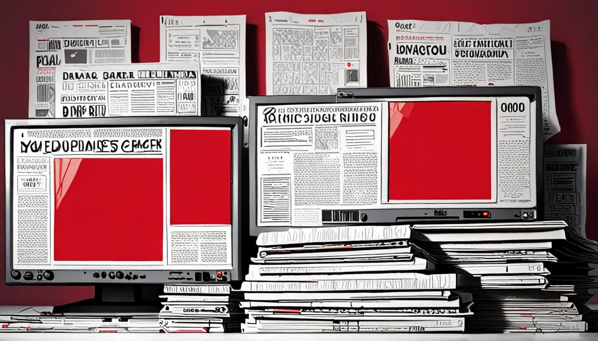

> 🌐 [Original auf Spanisch lesen](../../de/analisis/2026-11-17-mediano-tutorial.md)

<!-- EE_ENRICHED_START -->

<a href="/">Startseite</a>›<a href="/analisis/">Analyse</a>›17.11.2026

📄 Blickwinkel des Tages
<strong>Veröffentlicht:</strong> 17.11.2026 &nbsp;·&nbsp; <strong>Typ:</strong> Blickwinkel des Tages

<figure style="margin:1.5em 0;"><figcaption style="font-size:0.85em;color:#888;text-align:center;margin-top:0.5em;font-style:italic;">Wie man die Technik erkennt: Appell an die Angst (Alarmismus)</figcaption></figure>
<h1 style="font-size: 2.5em; margin-bottom: 10px; color: #8B0000; text-transform: uppercase; letter-spacing: 2px;">Die finstere Kunst, die Kuh zu verjagen: Ein Leitfaden, um nicht manipuliert zu werden</h1>

    

        Willkommen zur Party der Panik. Hier, wo die Logik feiern geht und die Angst sich durch das Fenster schleicht, um sich einen Drink der Verhöhnung einzuschenken. Wir sind nicht hier, um zu lernen, wie man Angst hat, sondern um zu erkennen, wer diese Angst wie kühles Wasser in der Wüste verkauft.
    

    <h2 style="font-size: 1.8em; color: #222; border-bottom: 2px solid #ccc; padding-bottom: 5px; margin-top: 30px;">1. Was soll dieser Mist? Definition eines Taschenspielertricks</h2>
<figure style="margin:1.5em 0;"><figcaption style="font-size:0.85em;color:#888;text-align:center;margin-top:0.5em;font-style:italic;">1. Was soll dieser Mist? Definition eines Taschenspielertricks</figcaption></figure>

    

        Nennen wir es beim richtigen Namen: der Appell an die Angst, oder wenn Sie einen eleganteren und weniger schmutzigen Begriff bevorzugen: Alarmismus. Das ist kein Argument. Das sind keine Daten. Das ist ein Schreien. Es ist das rhetorische Äquivalent dazu, einen Ziegelstein in ein Kaffeekränzchen zu werfen, um zu sehen, wer zuerst wegrennt. Es besteht darin, Beweise durch Bedrohung und Analyse durch Hysterie zu ersetzen.
    

    

        In einer Welt, in der Informationen mit Lichtgeschwindigkeit reisen, während das kritische Denken hinkt, ist diese Technik zum trojanischen Pferd der Demagogie geworden. Sie sagt dir nicht „Das ist schlecht“; sie sagt dir „Das wird dich zerstören“. Der Unterschied ist gewaltig. Ersteres ist ein Werturteil, das oft diskutierbar ist; letzteres ist ein Katastrophenversprechen, das direkt deinen Überlebensinstinkt anspricht – dieses primitive Reptil im Nacken, das lieber rennt als nachzudenken.
    

    

        Es ist ein alter Trick, so alt wie die Höhle, in der jemand „Löwe!“ schrie, während er einen Schatten an die Wand warf. Doch heute, mit digitalen Megaphonen und Algorithmen, die die Panik bis zur Raserei verstärken, hat er seine Mechanik verfeinert. Man braucht keinen echten Löwen mehr; mit einer aus dem Zusammenhang gerissenen Statistik und einer zitternden Stimme in einem dreiminütigen Video hält man die halbe Bevölkerung in Atem, bereit, jedem noch so absurden Befehl zu gehorchen.
    
<h2 style="font-size: 1.8em; color: #222; border-bottom: 2px solid #ccc; padding-bottom: 5px; margin-top: 30px;">2. Wie wird es benutzt? Die Anatomie der organisierten Panik</h2>
    

        Das Handbuch des Panikmachers hat nicht viele Einträge, aber es wiederholt sie mit der Ausdauer eines mit Amphetaminen vollgepumpten Papageien. Erstens: Wählen Sie ein echtes Problem. Erfinden Sie das Problem nicht, das ist zu schwierig und zu leicht zu widerlegen. Nehmen Sie etwas, das den Leuten ohnehin schon Sorgen bereitet: das Klima, die Wirtschaft, die Gesundheit, die Sicherheit.
    

    

        Zweitens: Blasen Sie die Dimensionen auf. Wenn das Risiko bei 1 % liegt, sprechen Sie von 99 %. Wenn es ein lokales Problem ist, stellen Sie es als globale Apokalypse dar. Verwenden Sie tonnenschwere Adjektiv: „unmittelbar bevorstehend“, „irreversibel“, „katastrophal“, „beispiellos“. Jedes Wort ist ein Tropfen Gift, der in die rationale Haut des Zuhörers eindringt.
    

    

        Drittens: Eliminieren Sie Nuancen. Die Realität ist grau, voller Nuancen und Wahrscheinlichkeiten. Panikmache ist schwarz-weiß. Entweder läuft alles gut, oder alles bricht zusammen. Es gibt keinen Mittelweg. Es gibt keine schrittweisen Lösungen. Es gibt nur das sofortige, drastische Handeln – das natürlich von demjenigen angeleitet wird, der am lautesten schreit.
    

    

        Viertens: Erschaffen Sie einen Feind oder eine einzige Ursache. Die Angst braucht einen Sündenbock. Das kann ein Unternehmen, eine politische Partei, eine Gruppe von Einwanderern oder eine neue Technologie sein. Durch die Vereinfachung der Schuldfrage wird auch die Lösung vereinfacht: „Wenn wir X beseitigen, verschwindet die Angst.“ Das ist die Logik eines Fünfjährigen, aber bei verängstigten Massen funktioniert sie hervorragend.
    

    <h2 style="font-size: 1.8em; color: #222; border-bottom: 2px solid #ccc; padding-bottom: 5px; margin-top: 30px;">3. Echtes Beispiel: Der Zirkus der Desinformation in Echtzeit</h2>
    

        Man muss keine Gespenster im Schrank suchen. Es reicht ein Blick auf die aktuelle politische und mediale Bühne. Denken wir daran, wie die Narrative gesteuert werden, wenn es eine Wohnungsnot gibt. Anstatt Spekulationen, unerschlossene öffentliche Grundstücke oder mangelnde Investitionen in bezahlbaren Wohnraum zu analysieren, hören wir bestimmte Stimmen rufen, dass „das System kollabiert“ und dass „normale Bürger von einer verborgenen Elite aus ihren Häusern vertrieben werden“.
    

    

        Hier gibt es keine Daten, hier gibt es Dramaturgie. Die Angst, das Zuhause zu verlieren, wird genutzt, um extreme Maßnahmen zu rechtfertigen oder die Aufmerksamkeit von den strukturellen Ursachen abzulenken. Die Situation wird als Belagerung dargestellt, bei der der Bürger ein Soldat in einem Schützengraben gegen eine unsichtbare Armee ist. Das ist eine mächtige, aber falsche Metapher. Es ist kein Konflikt, es ist ein verzerrter Markt. Aber „Konflikt“ erzeugt mehr Angst als „Markt“, und Angst verkauft sich besser als Wirtschaft.
    

    

        Ein weiteres klassisches Beispiel: die Verwaltung des öffentlichen Gesundheitswesens. Wenn ein Krankenhaus Wartelisten hat, spricht die rationale Version von Personalmangel, mangelnder Infrastruktur und schlechter Planung. Die Panikmache-Version spricht von „Vernachlässigung“, von „kaputten Systemen“ und davon, dass „die nächste Person, die auf einer Trage stirbt, Sie sein werden“. Selbst wenn wir explizite Begriffe über den Verlust von Menschenleben vermeiden, ist die Implikation klar: Man verkauft Ihnen die Idee, dass der Staat Ihrem Wohlbefinden den Krieg erklärt hat. Das ist eine grausame Manipulation, die die menschliche Schwachstelle ausnutzt, um Geduld in blinde Wut zu verwandeln.
    
<h2 style="font-size: 1.8em; color: 222; border-bottom: 2px solid #ccc; padding-bottom: 5px; margin-top: 30px;">4. Wie man es erkennt? Setzen Sie die Brille des Zweifels auf</h2>
    

        Alarmismus zu erkennen erfordert eine Dosis Zynismus und eine Prise Geduld. Fragen Sie sich zuerst: Ist das eine Tatsache oder eine Projektion? Tatsachen sind messbar. Projektionen sind albtraumhafte Träume, die als Wissenschaft getarnt sind. Wenn es keine Studie, keine harten Daten, keine überprüfbare Quelle gibt, ist das Schall und Rauch.
    

    

        Zweitens: Betrachten Sie die Quelle. Wer spricht da? Geht es um Information oder um Verkauf? Um Klicks zu generieren? Um Wahlen zu gewinnen? Eigeninteresse ist der beste Detektiv für Desinformation. Wenn jemand Geld, Macht oder Aufmerksamkeit damit gewinnt, dass er Ihnen Angst einjagt, sinkt seine Glaubwürdigkeit in den Keller.
    

    

        Drittens: Suchen Sie nach Zwischentönen. Wenn ein Argument zu einfach ist, ist es wahrscheinlich falsch. Die Realität ist komplex. Wenn die vorgeschlagene Lösung einzigartig, drastisch und dringend ist, ist sie fast sicher darauf ausgelegt, Debatte und Beratung zu umgehen.
    

    

        Viertens: Achten Sie auf die Sprache. Gibt es viele Ausrufezeichen? Gibt es Superlative? Ist von „noch nie dagewesen“ die Rede? Das ist eine rote Flagge. Die Geschichte ist voll von Dingen, die „noch nie dagewesen“ waren, und meistens wurden sie mit Zeit gelöst, nicht mit Panik.
    

    <figure style="margin:1.5em 0;"><figcaption style="font-size:0.85em;color:#888;text-align:center;margin-top:0.5em;font-style:italic;">5. Wie man es bekämpft? Die Impfung der Vernunft</figcaption></figure>
<h2 style="font-size: 1.8em; color: #222; border-bottom: 2px solid #ccc; padding-bottom: 5px; margin-top: 30px;">5. Wie man es bekämpft? Die Impfung der Vernunft</h2>
    

        Alarmismus zu bekämpfen ist keine leichte Aufgabe. Angst macht süchtig. Aber es gibt ein Heilmittel: qualitative, langsame und langweilige Information. Lesen Sie Primärquellen. Verlassen Sie sich nicht auf Zusammenfassungen in sozialen Netzwerken. Gehen Sie zum Ursprung. Wenn ein sensationalistisches Medium sagt „X ist das Ende der Welt“, suchen Sie danach, was das offizielle technische Organ dazu sagt. Oft ist der Unterschied gewaltig.
    

    

        Zweitens: Bilden Sie Ihr Umfeld. Sprechen Sie ruhig. Schreien Sie nicht. Der Alarmist schreit; Sie sollten flüstern. Erklären Sie die Nuancen. Zeigen Sie die Daten. Wenn Sie das nicht können, drängen Sie nicht weiter. Man kann mit niemandem vernünftig reden, der im Panikmodus ist.
    

    

        Drittens: Üben Sie emotionale Resilienz. Akzeptieren Sie, dass Sie nicht alles kontrollieren können. Akzeptieren Sie, dass es Risiken gibt, aber dass diese nicht zwangsläufig unmittelbar oder katastrophal sind. Lernen Sie, zwischen echtem und wahrgenommenem Risiko zu unterscheiden. Die meisten Dinge, vor denen wir uns heute fürchten, sind statistisch gesehen weniger gefährlich als Autofahren oder Rauchen.
    

    

        Schließlich: Wählen Sie mit dem Kopf, nicht mit dem verängstigten Herzen. Fordern Sie von Ihren politischen Vertretern, dass sie klar, mit Daten und ohne Drama sprechen. Wenn Sie nach Angst fragen, werden sie Ihnen Angst geben. Wenn Sie nach Wahrheit fragen, geben sie Ihnen vielleicht eine akzeptablere Version der Realität.
    

    

        Zusammenfassend lässt sich sagen: Alarmismus ist das Opium des Volkes, nur mit mehr Lärm und weniger unmittelbaren Nebenwirkungen. Es ist ein Werkzeug der sozialen Kontrolle, getarnt als Besorgnis. Lassen Sie sich nicht täuschen. Die Welt ist ein gefährlicher Ort, ja, aber nicht aus den Gründen, die Ihnen die Scharlatane der Hysterie verkaufen. Denken Sie nach, zweifeln Sie, recherchieren Sie. Und vor allem: Lassen Sie sich keine Angst einjagen von denen, die aus Ihrem Schrecken Profit schlagen. Die Vernunft ist das einzige Licht in diesem Sumpf aus Tinte und Panik.
    

<strong>Rechtlicher Hinweis:</strong> Dies ist keine Anschuldigung. Dies ist eine Autopsie. Die Medien sind zitiert und verlinkt. Das Zitierrecht schützt uns.

<strong>Folgen Sie uns:</strong> <a href="https://youtube.com/@somoselencuadre.oficial">YouTube</a> · <a href="https://tiktok.com/@somoselencuadre">TikTok</a> · <a href="https://instagram.com/somoselencuadre">Instagram</a> · <a href="https://x.com/SomosElEncuadre">X</a> · <a href="https://threads.net/@somoselencuadre">Threads</a>

<!-- EE_ENRICHED_END -->