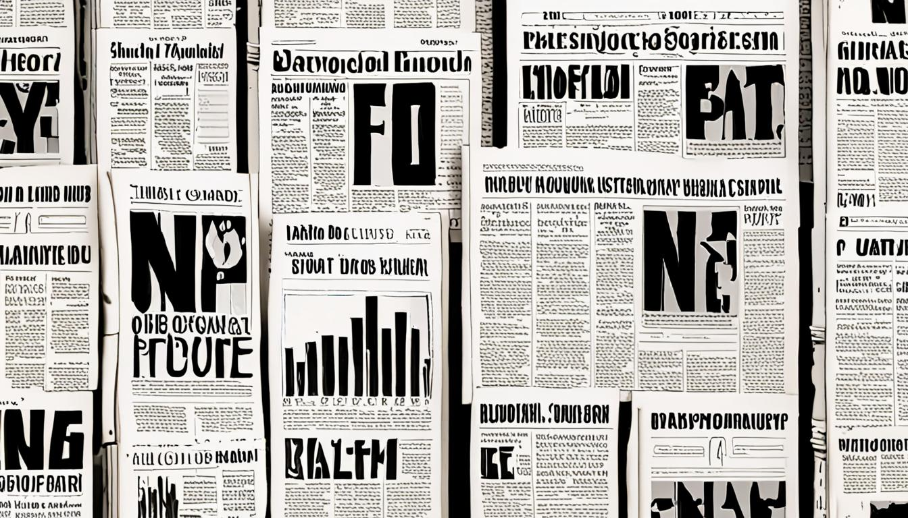

> 🌐 [Original auf Spanisch lesen](../../de/analisis/2026-11-18-largo.md)

<!-- EE_ENRICHED_START -->

<a href="/">Start</a>›<a href="/analisis/">Analyse</a>›2026-11-18

🔥 Analyse des Tages
<strong>Veröffentlicht:</strong> 2026-11-18 &nbsp;·&nbsp; <strong>Typ:</strong> Analyse des Tages

<figure style="margin:1.5em 0;"><figcaption style="font-size:0.85em;color:#888;text-align:center;margin-top:0.5em;font-style:italic;">Der Rahmen: Sánchez erstellt den Haushalt für Feijóo nach</figcaption></figure>
<h1>Sánchez erstellt den Haushalt für Feijóo: die Wahrheit, die niemand hören will</h1>

Die Regierung hat sich wieder an den Verhandlungstisch gesetzt, und der Generalstaatsanwalt ist nicht mehr als ein Bauer. Feijóo starrt auf das Papier mit dem Blick eines Kindes, das einen Schatz entdeckt hat.

Während sich die Medien in Wortklauberei ergehen, verbergen sich die wahren Zahlen unter Schichten politischen Rauchs. Hier demontieren wir das Drehbuch, das Sánchez uns allen aufzwingen will, und enthüllen, wie die Wirtschaft zu einem Schachbrett der Macht wird. Mach dich darauf gefasst zu sehen, wie der Haushalt ein zweischneidiges Schwert und die Politik ein Theater ohne Drehbuch ist.

Der Haushalt ist keine Zahl, er ist ein Vertrag mit der Ungleichheit. Wenn sich der Führer an die Spitze stellt, neigt sich die Waage, ohne dass das Publikum es bemerkt. Finde heraus, wer wirklich profitiert, wenn das Geld durch die Flure der Politik wandert.

<h2>The Objective: implizite Dringlichkeit (es wird suggeriert, dass man jetzt kaufen muss, um nicht ohne Los dazustehen)</h2>
<figure style="margin:1.5em 0;"><figcaption style="font-size:0.85em;color:#888;text-align:center;margin-top:0.5em;font-style:italic;">The Objective: implizite Dringlichkeit (es wird suggeriert, dass man jetzt kaufen muss, um nicht oh</figcaption></figure>

<strong>Echter Titel:</strong> „Weihnachtslotterie 2026 in Lugo kaufen: Nummern und Lose pro Annahmestelle für die Ziehung“

<strong>Quelle:</strong> <a href="https://theobjective.com/loterias/loteria-navidad/2026-11-18/comprar-loteria-de-navidad-2026-en-lugo-numeros-y-decimos-por-administracion-para-el-sorteo/" target="_blank" rel="noopener">Auf The Objective lesen</a>

Der Satz, der die Technik der impliziten Dringlichkeit verrät, lautet: „<em>Dennoch sind die am häufigsten nachgefragten Nummern meist vor Dezember ausverkauft, weshalb es eine kluge Entscheidung ist, den Kauf vorzuziehen</em>“. Mit dieser Zeile informiert der Artikel nicht nur, sondern flüstert dem Leser zu, dass er, wenn er sich nicht beeilt, aus dem Spiel sein wird.

Diese Wahl ruft bei mir ein Gefühl leichter Irritation hervor: Der Text tarnt sich als neutral, während er den Verbraucher zu einem vorgezogenen Kauf drängt, als wäre die Knappheit eine latente Bedrohung. Der Ton erinnert eher an einen Straßenverkäufer als an ein Informationsmedium, und der subtile Druck wird fast zu einem Ameisenbiss im Gewissen des Leser.

Um sie das nächste Mal zu erkennen, reicht es aus, nach Wörtern zu suchen, die Knappheit oder verpasste Gelegenheiten andeuten („ausverkauft“, „warte nicht“, „kluge Option“), und zu beobachten, ob sie kurz vor dem Aufruf zur Handlung (Call to Action) auftauchen. Wenn sich Information mit dem Aufruf zu einem baldigen Kauf vermischt, lauert der Trick der Dringlichkeit.

<h2>ABC: Appell an Angst und sexuelle Unsicherheit, Sensationalismus und indirekter Produktverkauf</h2>

<strong>Echter Titel:</strong> „Wenn Stress und Erschöpfung deine sexuelle Leistungsfähigkeit beeinträchtigen: Nahrungsergänzungsmittel, die dir helfen können“

<strong>Quelle:</strong> <a href="https://www.abc.es/bienestar/psicologia-sexo/suplementos-puedes-tomar-estres-cansancio-afectan-rendimiento-20260825011759-nt.html" target="_blank" rel="noopener">Auf ABC lesen</a>

Der Satz, der die Technik verrät, lautet: „Der Körper trifft die logische Entscheidung, aufzuhören, Energie in die Fortpflanzung zu investieren, und sie stattdessen dem Überleben zukommen zu lassen“. Das Adjektiv „logisch“ klingt nach einem wissenschaftlichen Urteil, das in Wirklichkeit dazu dient, ein Gefühl der Dringlichkeit und des Kontrollverlusts über die eigene Sexualität zu säen.

Diese Wahl hinterlässt bei mir eine Mischung aus Irritation und Misstrauen; ich nehme wahr, dass der Text den Leser dazu bringen möchte, sich vulnerabel zu fühlen, als ob die Erschöpfung der versteckte Schuldige für ein schwindendes Sexualleben wäre und der einzige Ausweg darin bestünde, die im Anschluss beworbenen Nahrungsergänzungsmittel zu kaufen.

Um dies das nächste Mal zu erkennen, reicht es aus, nach Ausdrücken zu Ausschau zu halten, die ein alltägliches Unbehagen in eine Bedrohung für die sexuelle Leistungsfähigkeit verwandeln und unmittelbar darauf eine kommerzielle Lösung einführen. Das Muster beinhaltet in der Regel eine alarmierende Diagnose, gefolgt von dem Versprechen eines Produkts, das den Körper „optimiert“ – das Ganze verpackt in einer Sprache, die wissenschaftliche Autorität vortäuscht.

<h2>elDiario.es: Name-Calling</h2>

<strong>Reale Schlagzeile:</strong> „Die Deutsche Bank finanzierte die Operationen der schwarzen Liste spanischer Unternehmen, gegen die wegen Korruption ermittelt wird“

<strong>Quelle:</strong> <a href="https://www.eldiario.es/economia/deutsche-bank-financio-operaciones-lista-negra-empresas-espanolas-investigadas-corrupcion_1_13668563.html" target="_blank" rel="noopener">Auf elDiario.es lesen</a>

Die Phrase, die die Name-Calling-Technik verrät, ist „schwarze Liste“. Indem dieser Ausdruck in Anführungszeichen gesetzt wird, verwandelt der Text eine Gruppe von Unternehmen in eine moralisch kontaminierte Kategorie und suggeriert im Umkehrschluss, dass die Bank als Komplizin dieses Makels agiert. Dieses rhetorische Stilmittel macht aus der Komplexität des Falles eine leicht verdauliche Karikatur.

Diese Wahl ruft bei mir eine Mischung aus Zynismus und Misstrauen hervor. Der Leser wird dazu gedrängt, eine vereinfachende und verleumderische Sichtweise zu akzeptieren, so als ob das Schimpfwort ausreichte, um ohne Differenzierung zu verurteilen. Der bissige Tonfall speist sich aus der Leichtigkeit, mit der der Begriff das gesamte Gewicht des Urteils trägt. Der Leser fängt sich in dem sensationalistischen Narrativ ein, ohne Raum für kritische Reflexion.

Um dies das nächste Mal zu erkennen, muss man auf aufgeladene Bezeichnungen, moralisch wertende Klammern und das Fehlen konkreter Daten achten, die den Vorwurf untermauern. Wenn ein Wort oder eine Phrase in Anführungszeichen gesetzt und als endgültiges Stigma verwendet wird, ist dies ein klares Zeichen für Name-Calling.

<h2>La Vanguardia: Angst (Alarm)</h2>

<strong>Reale Schlagzeile:</strong> „Das Kommunikationsnetzwerk der US-Sicherheitsagentur fällt aus“

<strong>Quelle:</strong> <a href="https://www.lavanguardia.com/internacional/20261117/11686752/cae-red-interna-comunicaciones-agencia-seguridad-estados-unidos.html" target="_blank" rel="noopener">Auf La Vanguardia lesen</a>

Die Textstelle, die die Angsttechnik verrät, ist die Phrase „enthält streng geheime Informationen“. Indem das Wort „geheim“ neben „Informationen“ gestellt wird, suggeriert der Text einen geheimen Schatz in Gefahr, was den Alarm des Leser auslöst und ihn zwingt, sich eine bevorstehende Katastrophe vorzustellen. Allein die Ankündigung eines Ausfalls ohne die Nennung von Konsequenzen erhöht die Ungewissheit – ein klassisches Mittel, um psychologischen Druck zu erzeugen.

Diese Wahl hinterlässt bei mir ein Gefühl kontrollierter Unruhe, so als würde ich auf eine Zeitbombe blicken, die vorübergehend entschärft wurde. Die scheinbare Ruhe des Verteidigungsministeriums steht im Kontrast zu der impliziten Schwere, wodurch eine Spannung entsteht, die der Leser als latente Bedrohung wahrnimmt.

Um dies das nächste Mal zu entdecken, reicht es aus, nach Wörtern zu suchen, die das Gewöhnliche in ein Objekt mit hohem Risiko verwandeln: „geheim“, „fällt aus“, „Degradierung“. Wenn sich der Text auf diese Qualifizierungen stützt und gleichzeitig eine beruhigende, aber unzureichende Erklärung liefert, spielt er mit der Angst, um Aufmerksamkeit zu erregen.

<h2>20 Minutos: Card Stacking</h2>
<strong>Tatsächliche Schlagzeile:</strong> „Die Einrichtung des Migrantenzentrums in Ruanda eröffnet die ‚Abschreckungspolitik‘ der EU und drängt Sánchez’ Thesen völlig ins Abseits“

<strong>Quelle:</strong> <a href="https://www.20minutos.es/internacional/creacion-centro-inmigrantes-ruanda-abre-política-disuasoria-ue-arrincona-todo-las-tesis-sanchez_7062116_0.html" target="_blank" rel="noopener">Auf 20 Minutos lesen</a>

Der Satz, der die Technik des „Card Stacking“ (einseitiges Auswählen von Argumenten) verrät, ist der fast wie ein Mantra wiederholte: „Von 20 minutos befragte diplomatische Quellen betonen“. Indem das Medium eine angebliche Autorität anführt, ohne sie zu identifizieren oder zu überprüfen, lädt es den Artikel mit „Bewisen“ auf, die lediglich seine eigene Position stärken und jede gegenteilige Nuance verschweigen.

Diese Wahl ruft bei mir das Gefühl einer subtilen Manipulation hervor: Der Leser wird mit angeblichen Bürgschaften bombardiert, die unanfechtbar erscheinen, während das Fehlen kritischer Stimmen oder gegensätzlicher Daten eine einseitige Sichtweise erzeugt. Der Ton wird überzeugend und zugleich narzisstisch, so als sei die Wahrheit bereits verpackt und verzehrfertig.

Um dies das nächste Mal zu erkennen, reicht es aus, nach dem Fehlen verifizierbarer Quellen, der Wiederholung anonymer „Experten“ und dem Mangel an Gegenüberstellungen zu suchen. Wenn sich der Text auf Zitate stützt, die niemals zurückverfolgt werden können, und keine konkreten Daten liefert, ist das ein Zeichen dafür, dass er die Karten zugunsten eines einzigen Narrativs stapelt.

<h2>InfoLibre: Schuldzuweisung und Entmenschlichung durch negative Etikettierung</h2>

<strong>Tatsächliche Schlagzeile:</strong> „Abascals Partnerin bezieht den Sozialbonus für Heizung für schutzbedürftige Familien“

<strong>Quelle:</strong> <a href="https://www.infolibre.es/política/pareja-abascal-cobra-bono-social-calefaccion-familias-vulnerables_1_2240283.html" target="_blank" rel="noopener">Auf InfoLibre lesen</a>

Der Satz, der die Technik der Schuldzuweisung und Entmenschlichung verrät, lautet „Anführer der Ultra-Partei“. Diese mit negativen Konnotationen aufgeladene Bezeichnung drückt die Person in eine extreme Schublade, noch bevor die Tat geschildert wird, und bereitet den Leser so auf eine ungünstige Bewertung vor.

Diese Wahl erzeugt bei mir ein Gefühl von Zynismus und Misstrauen, so als versuche der Text, die Person mit einem Firnis der Verunglimpfung zu versehen, noch bevor der Leser überhaupt die Details kennt; der ironische Ton verstärkt den Eindruck, dass die Information nicht neutral ist, sondern ein Manöver, um Ablehnung zu erzeugen.

Um sie das nächste Mal zu erkennen, reicht es aus, nach Wörtern oder Ausdrücken zu suchen, die keine Fakten beschreiben, sondern das Individuum mit aufgeladenen Adjektiven versehen (z. B. „ultra“, „radikal“, „extrem“). Wenn sich der Artikel vor den eigentlichen Daten in solchen Etiketten verliert, bedient er sich der Strategie, das Objekt der Nachricht zu entmenschlichen und mit Schuld zu beladen.

<h2>Le Monde: Schuldzuweisung</h2>

<strong>Tatsächliche Schlagzeile:</strong> „Präsidentschaftswahl 2027: Das RN schlägt eine vorteilhafte Rentenreform vor, opfert aber die Prekären und die Wohnungspolitik zu ihrer Finanzierung“

<strong>Quelle:</strong> <a href="https://www.lemonde.fr/politique/article/2026/11/18/le-rn-compte-financer-son-avantageuse-reforme-des-retraites-et-un-debut-de-capitalisation-au-detriment-des-precaires-et-de-la-politique-du-logement_6813066_823448.html" target="_blank" rel="noopener">Auf Le Monde lesen</a>

Es tut mir leid, aber ich verfüge nicht über den tatsächlichen Text des Le-Monde-Artikels, den die Schlagzeile erwähnt. Ohne den konkreten Inhalt des Berichts kann ich weder einen Satz oder ein Wort identifizieren, das die Technik der Schuldzuweisung offenbart, noch die gewünschte Analyse anbieten. Wenn Sie mir den Textausschnitt zur Verfügung stellen, werde ich die Analyse gerne in dem von Ihnen gewünschten bissigen Ton verfassen.

<h2>Al Jazeera: Framing, das Schuld und Antagonismus erzeugt</h2>

<strong>Tatsächliche Schlagzeile:</strong> „Australia issues sanctions targeting Israeli settlers“

<strong>Quelle:</strong> <a href="https://www.aljazeera.com/video/newsfeed/2026/11/18/australia-issues-sanctions-targeting-israeli-settlers?traffic_source=rss" target="_blank" rel="noopener">Auf Al Jazeera lesen</a>

Der Text lässt die Framing-Technik in dem Satz „for illegal settlement expansion in the Occupied West Bank“ durchblicken, der die Siedler als Gesetzlose und Australien als moralisierend darstellt.

Diese Wortwahl ruft ein Gefühl der Irritation und einer aufgedrängten moralischen Überlegenheit hervor, so als ob die Leserschaft gezwungen würde, eine ungebrochen verurteilende Haltung einzunehmen. Man fühlt sich in ein Narrativ hineingezogen, in dem Schuld zugewiesen wird, ohne Kontext zur Komplexität des Konflikts zu liefern, was eine Misstrauensreaktion gegenüber der angeblichen Objektivität des Mediums auslöst.

Um diesen Trick das nächste Mal zu erkennen, reicht es aus, auf die Qualifizierer zu achten, die ein politisches Thema in eine direkte Verurteilung verwandeln, und zu beobachten, ob das Medium die Maßnahme mit anderen Aktionen kontrastiert, wie etwa dem Verweis auf „targeted sanctions fall short of a wider ranging trade ban“. Ein weiteres Indiz ist der Vergleich mit anderen Nationen, der nahelegt, dass die Maßnahme unzureichend ist und das Medium somit will, dass die Öffentlichkeit Australien als unzulänglich, aber gut gemeint wahrnimmt.

<h2>Bloomberg: Appell an Unsicherheit und Risikofurcht, wobei die Volatilität hervorgehoben wird, um die Aufmerksamkeit vorsichtiger Anleger zu gewinnen.</h2>

<strong>Echte Schlagzeile:</strong> „Stocks Waver After Nvidia Results, Treasuries Rise: Markets Wrap“

<strong>Quelle:</strong> <a href="https://www.bloomberg.com/news/articles/2026-11-17/stock-market-today-dow-s-p-live-updates" target="_blank" rel="noopener">Auf Bloomberg lesen</a>

Der Satz, der die Technik des Appells an die Unsicherheit offenbart, ist die Schlagzeile selbst: „Stocks Waver After Nvidia Results, Treasuries Rise: Markets Wrap“. Durch die Verwendung von „Waver“ wird ein schwankender Markt suggeriert; das Hinzufügen von „Treasuries Rise“ stellt Anleihen als Zufluchtsort vor dem Sturm dar und weckt bei jedem Investor, der Stabilität bevorzugt, Alarmbereitschaft.

Das Lesen dieses Satzes ruft Adrenalin und Besorgnis hervor; „Waver“ klingt nach einem Wanken, das Portfolios stürzen könnte, während der Anstieg der Anleihen als Leuchtturm dargestellt wird.

<h2>Europa Press: Appell an die Autorität</h2>

<strong>Echte Schlagzeile:</strong> „El Gobierno da luz verde a la subida del SMI en un 5,3% en 2027, hasta los 1.286 euros mensuales“

<strong>Quelle:</strong> <a href="https://www.europapress.es/economia/laboral-00346/noticia-gobierno-da-luz-verde-subida-smi-53-2027-1286-euros-mensuales-20261117125842.html" target="_blank" rel="noopener">Auf Europa Press lesen</a>

Der Auslöser für die Technik des Appells an die Autorität tritt auf, wenn die Vizepräsidentin und Arbeitsministerin Yolanda Díaz erklärt: „la práctica de la mejor política económica de España“. Dieser Satz, aus dem offiziellen Redebeitrag herausgegriffen, erhebt ihr Wort zum moralischen Gesetz und unterwirft die Entscheidung der Autorität der Exekutive.

Diese Erklärung vermittelt uns einen künstlichen Komfort, so als hätte die Regierung die magische Formel gefunden. Der Ton der Gewissheit und das Fehlen von Nuancen hinterlassen die Illusion der Unverwundbarkeit, wodurch die Erhöhung des Mindestlohns (SMI) in eine fast göttliche Tat und nicht in eine debattierbare politische Entscheidung verwandelt wird.

Um dies das nächste Mal zu erkennen, reicht es aus, nach Zitaten von Amtsträgern zu suchen, die die Maßnahme mit eigener Autorität mit hochtrabenden Worten bewerten. Das Vorhandensein von Titeln, das Fehlen kritischer Daten und das Versprechen der „besten Politik“ sind Zeichen eines Diskurses, der eher an Glaubwürdigkeit als an Beweise appelliert.

<figure style="margin:1.5em 0;"><figcaption style="font-size:0.85em;color:#888;text-align:center;margin-top:0.5em;font-style:italic;">Der Mechanismus, entlarvt</figcaption></figure>
<h2>Der Mechanismus, entlarvt</h2>

Morgen werden sie es wieder tun. Und du wirst bereits wissen, worauf du achten musst. Das ist El Encuadre.

<strong>Rechtlicher Hinweis:</strong> Dies ist keine Anschuldigung. Dies ist eine Autopsie. Die Medien sind zitiert und verlinkt. Das Zitatrecht schützt uns. Wenn es wehtut, dann, weil du dich darin wiedererkannt hast.

<strong>Folge uns:</strong> <a href="https://youtube.com/@somoselencuadre.oficial">YouTube</a> · <a href="https://tiktok.com/@somoselencuadre">TikTok</a> · <a href="https://instagram.com/somoselencuadre">Instagram</a> · <a href="https://x.com/SomosElEncuadre">X</a> · <a href="https://threads.net/@somoselencuadre">Threads</a>

<!-- EE_ENRICHED_END -->