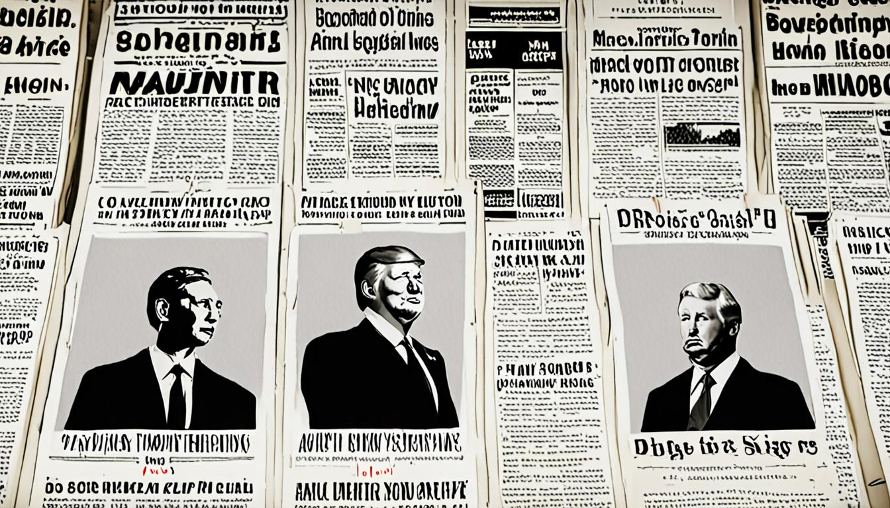
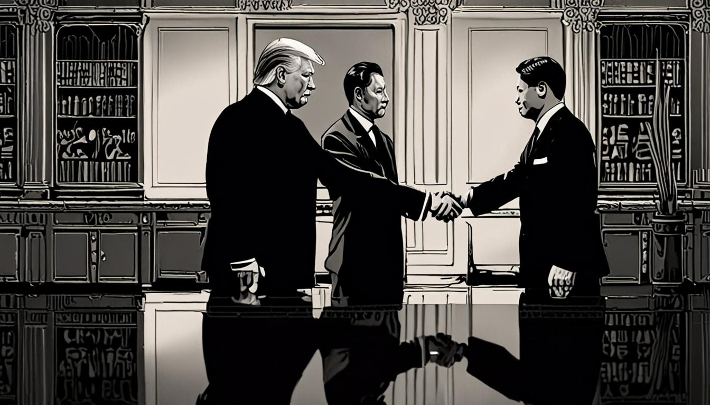

> 🌐 [Original auf Spanisch lesen](../../de/analisis/2026-11-19-dossier-v2.md)

<!-- EE_ENRICHED_START -->

<a href="/">Startseite</a>›<a href="/analisis/">Analyse</a>›19.11.2026

📁 Executive Dossier
<strong>Veröffentlicht:</strong> 19.11.2026 &nbsp;·&nbsp; <strong>Typ:</strong> Executive Dossier

<figure style="margin:1.5em 0;"><figcaption style="font-size:0.85em;color:#888;text-align:center;margin-top:0.5em;font-style:italic;">Der Rahmen: Putin als Gewinner des Dreiertreffens von Shenzhen:</figcaption></figure>
<h1>Dossier des Tages: Der Rahmen: Putin als Gewinner des Dreiertreffens von Shenzhen: Trump und Xi ignorieren Europa und nehmen ihn in die Triade der globalen Macht auf</h1>

<strong>Einleitung:</strong> Während die Welt in diplomatischen Gipfeltreffen verblutet, bei denen die Masken fallen, verkaufen uns die Medien dieses Landes Wahlkampf-Rauch und Migrationspanik. Heute informieren wir nicht, heute zerlegen wir den Mechanismus. Was sie als „Nachrichten“ bezeichnen, ist in Wirklichkeit eine Choreographie der Angst, die so konzipiert ist, dass wir nicht nach oben schauen, sondern in den Abgrund unserer eigenen Wahlen. Hier gibt es keine Wahrheit, nur den Rahmen. Und der heutige Rahmen ist eine Farce in drei Akten: die ignorierte Geopolitik, die vergiftete Demokratie und das leere Spektakel.

<h2>Nachrichten des Tages</h2>
<figure style="margin:1.5em 0;"><figcaption style="font-size:0.85em;color:#888;text-align:center;margin-top:0.5em;font-style:italic;">Nachrichten des Tages</figcaption></figure>

Die große Schlagzeile des Tages ist eine Lüge durch Unterlassung. Der Titel, den man uns verkauft, spricht von einem Gipfel in Shenzhen, bei dem Putin als „Gewinner“ hervorgeht und bei dem Trump und Xi „Europa ignorieren“. Ein internationales Verschwörungsnarrativ, über das man lächeln könnte, wäre es nicht das einzige Mittel, um das schwarze Loch der spanischen Politik zu verdecken. Aber vergessen wir für einen Moment die Bären und die Drachen. Das wahre Theater wird hier aufgeführt, auf der Halbinsel, mit einer lokalen Besetzung, die mit der Überzeugung eines Telenovela-Darstellers agiert.

Einerseits haben wir das juristische Chaos rund um das „Enkelgesetz“ (ley de nietos). Der Oberste Gerichtshof hat in einem Manöver, das nach institutioneller Verzweiflung riecht, eingeräumt, dass „keine materielle Zeit“ bleibt, um das Wählerverzeichnis zu überprüfen. Das bedeutet, dass 189.678 Personen, Kinder von Eingebürgerten, am 29. November wählen können. Laut juristischen Quellen, die von Libertad Digital zitiert werden, könnte dies „14 Sitze betreffen“. Vierzehn Stühle auf dem Schachbrett. Das ist keine Anekdote, das ist die Zeitbombe, die droht, die politische Landkarte neu zu zeichnen. Der Oberste Gerichtshof hat auch den Antrag von Vox abgewiesen, die Stimmabgabe einstweilig auszusetzen, womit die Regierung ein sehr ruhiges Gesicht behält, während die Wahlmaschinerie sich weiter auf einer Achse dreht, die zumindest für einige gebrochen ist.

Andererseits die Debatte. Das letzte Duell zwischen Pedro Sánchez und Alberto Núñez Feijóo. ElDiario.es rahmt es als eine „Revanche von 2023“ ein, ein Narrativ persönlicher Rache, getarnt als Politik. Unterdessen fordert die PP durch ihren Generalsekretär Miguel Tellado nicht dazu auf, sie zu wählen, sondern dass die sozialistischen Wähler „zu Hause bleiben sollen“. Ein Aufruf zum selektiven Abstentionismus, der an sich schon ein Geständnis der Schwäche ist. Sie vertrauen nicht auf ihre Botschaft, sie vertrauen auf die Faulheit der anderen.

<h2>Die Medien und ihre Techniken</h2>

Die Presse berichtet nicht über Fakten, sie installiert Emotionen. Jede Redaktion hat ihr geheimes Rezept, ihren chemischen Zusatz, damit der Leser nicht denkt, sondern fühlt. Angst, Dringlichkeit, falsche Gewissheit. Analysieren wir die Zutaten, die sie heute verwendet haben, um diese Buchstabensuppe zu kochen.
<table>
    <tr>
        <th>Medium</th>
        <th>Technik</th>
        <th>Lässt weg</th>
    </tr>
    <tr>
        <td>El Español</td>
        <td>Appell an Angst und Dramatisierung</td>
        <td>Die Realität des Gipfels; die Irrelevanz Europas in der Triade</td>
    </tr>
    <tr>
        <td>ABC</td>
        <td>Spektrales Framing</td>
        <td>Die Politik; der tatsächliche Inhalt der Debatte oder des Tagesgeschehens</td>
    </tr>
    <tr>
        <td>The Objective</td>
        <td>Kommerzielle Dringlichkeit</td>
        <td>Die Sozialkritik; der Kontext der öffentlichen Ausgaben</td>
    </tr>
    <tr>
        <td>OkDiario</td>
        <td>Territorialer Sensationalismus</td>
        <td>Die strukturellen Ursachen der Migration; die geteilte Verantwortung</td>
    </tr>
    <tr>
        <td>InfoLibre</td>
        <td>Unsicherheit und Ausgrenzung</td>
        <td>Die Solidität der gegensätzlichen demoskopischen Daten</td>
    </tr>
    <tr>
        <td>elDiario.es</td>
        <td>Narrativ vom Zyklusende</td>
        <td>Die Komplexität der Umfragen; die Fehlertoleranz</td>
    </tr>
    <tr>
        <td>Libertad Digital</td>
        <td>Appell an die Angst (Fear Appeal)</td>
        <td>Die Legalität des Gesetzes; der historische Kontext des Gedenkens</td>
    </tr>
</table>

Es ist ein Zirkus aus Zerrspiegeln. Jedes Medium verzerrt die Realität, damit sie in seine ideologische Blase passt. Aber das Muster ist klar: Sie geben dir nie das Werkzeug zum Denken, sondern nur den Schlag, um zu reagieren.

<h2>Die Techniken im Detail</h2>

<strong>1. Die Dramatisierung der Verschwörung (El Español)</strong> 
El Español betritt die Bühne mit einer Schlagzeile, die eher nach Spionagefilm als nach journalistischem Bericht klingt: „Putin, Gewinner des Dreiergipfels von Shenzhen: Trump und Xi überhören Europa und nehmen ihn in die Triade der globalen Macht auf“. Die Technik dahinter ist der <em>Appell an die Angst</em>. Indem Europa als eine Entität dargestellt wird, die „überhört“ und in ein Spiel „einbezogen“ wurde, das sie nicht kontrolliert, wird ein Gefühl kollektiver Vulnerabilität erzeugt. Uns wird gesagt, dass wir allein sind, dass die großen Akteure der Welt über uns lachen. Das ist eine elegante Art zu sagen: „Schaut nicht auf eure Regierung, schaut nach draußen, dort liegt die wahre Gefahr.“ Es lässt unerwähnt, dass Außenpolitik komplex ist und dass das „Gewinnen“ eines Gipfels kein binäres Konzept ist. Es nutzt die Angst vor Irrelevanz, um die Lektüre von allem anderen zu steuern.

<strong>2. Das kulturelle Zerrbild (ABC)</strong> 
ABC wählt einen meisterhaften Schachzug: das <em>Framing</em> bzw. den kontextuellen Rahmen. Während das Land wegen der Wahlen und der Wählerverzeichnisse brennt, titelt ABC: „Uhrzeit und Sender für die heutige Fernsehdebatte zwischen Pedro Sánchez und Feijóo“. Der tatsächliche Text, den sie uns liefern, ist jedoch ein Interview mit Neus Sendra, einer Hörbuchsprecherin, die sagt: „Ich erschaffe mir im Kopf einen Film und erzähle ihn dem Hörer. Ich nehme ihn an die Hand und lasse ihn während des ganzen Romans nicht mehr los.“ Die angewandte Technik ist die Ablenkung. Indem man die Politik (die Fernsehdebatte) mit der Kunst des Geschichtenerzählens (dem Hörbuchsprechen) verknüpft, wird die politische Debatte als unvermeidliches, fast schon künstlerisches Spektakel dargestellt. Der politische Inhalt wird weggelassen, um sich auf die Form zu konzentrieren. Man sagt uns, Politik sei Theater und wir seien das Publikum, das die Hand des Erzählers „nicht loslassen“ darf. Das ist eine kulturelle Betäubung. Anstatt die Vorschläge zu analysieren, wird die Emotion des Narrativs analysiert.

<strong>3. Die Dringlichkeit des Konsums (The Objective)</strong> 
The Objective bedient sich des reinen, unverfälschten <em>Dringlichkeitsgefühls</em>, angewandt auf den Konsum. Ihr eigentlicher Text handelt vom Kauf der Weihnachtslotterie in Badajoz: „Bis wann kann man sie kaufen und wie findet man eine Nummer? Der Verkauf begann am 29. Juni... und endet am 21. Dezember.“ Inmitten des politischen Sturms bietet uns The Objective das Rettungsboot des Glücksspiels an. Die Technik besteht in Ablenkung durch kommerzielle Begeisterung. Durch die Auflistung von Gewinnen und Annahmestellen wird ein Gefühl von Normalität und Routine erzeugt, das im Kontrast zum äußeren Chaos steht. Man lädt uns ein, aktiv am Lotteriespiel (einem staatlichen Wettsystem) teilzunehmen, während das Spiel der Demokratie ignoriert wird. Das ist eine Art zu sagen: „Du kannst weder Sánchez noch Feijóo kontrollieren, aber du kannst kontrollieren, ob du die Nummer 40000 kaufst.“ Es ist ein individualistischer Abwehrmechanismus in Zeiten kollektiver Ungewissheit.

<strong>4. Der Terrorismus des Wählerverzeichnisses (Libertad Digital)</strong> 
Libertad Digital schließt den Kreis mit dem direktesten und schmutzigsten <em>Appell an die Angst</em>: „Die Stimmen der Kinder von Eingebürgerten durch das Enkelgesetz... könnten 14 Sitze beeinflussen.“ Hier gibt es keine Subtilität. Es schwebt eine magische Zahl, die 14, wie eine existenzielle Bedrohung im Raum. Sie zitieren juristische Quellen, die „befürchten“, dass dies „notorische“ Auswirkungen haben wird. Die Technik besteht darin, Zweifel an der demokratischen Legitimität zu säen. Das Gesetz über das historische Gedächtnis wird als Instrument massiver Wahlmanipulation dargestellt. Die Debatte über das historische Gedächtnis wird weggelassen, um sich ausschließlich auf das arithmetische Ergebnis der Mandate zu konzentrieren. Man sagt uns, die Demokratie sei nicht wegen mangelnder Freiheit in Gefahr, sondern wegen eines Überflusses an Stimmzetteln. Das ist eine sehr konkrete, sehr messbare und daher sehr leicht zu verkaufende Angst.

<h2>Die geteilten Verzerrungen</h2>

Was haben El Español, ABC, The Objective, OkDiario, InfoLibre, elDiario.es und Libertad Digital gemeinsam? Dass sie alle in ihrem ideologischen Schützengraben dieselbe Häresie praktizieren: die Entmenschlichung der Politik zugunsten der primären Emotion.

Das sich wiederholende Muster ist die <em>Reduktion</em>. Die Geopolitik wird auf eine Falle für Europa reduziert. Die politische Debatte wird auf einen Film im Kopf reduziert. Die Migrationskrise wird auf „unvorhersehbare Bewegungen“ reduziert (OkDiario nennt es so: „unvorhersehbare Migrationsbewegungen gegen Ceuta“, eine Phrase, die nach dem Drehbuch eines Katastrophenfilms klingt). Die Wahl wird auf 14 Sitze oder eine Lotterienummer reduziert.

Warum das funktioniert? Weil der Durchschnittsbürger erschöpft ist. Die Komplexität der Realität ist überwältigend. Es ist bequemer zu glauben, dass es einen Bösewicht gibt (Putin, die Enkel, die Lotterie, den anderen Kandidaten), als die Nuancen eines internationalen Abkommens oder eines Gesetzes zum historischen Gedächtnis zu verstehen. Die Medien wissen: Wenn sie dir kalte Fakten liefern, langweilst du dich. Aber wenn sie dir Angst machen, bleibst du dran. Wenn sie dir Hoffnung geben (die Lotterie), bleibst du dran. Wenn sie dir das Gefühl geben, Teil eines Geheimnisses zu sein (der Gipfel von Shenzhen), bleibst du dran. Alle Medien, ausnahmslos, verkaufen dasselbe: die Gewissheit, dass etwas schief läuft, und der einzige Ausweg darin besteht, sich als Teil des Stammes zu fühlen, der es entdeckt hat.

Es gibt eine gemeinsame Voreingenommenheit der <em>institutionellen Unsicherheit</em>. Der Oberste Gerichtshof „handelt nicht mit der gebotenen Sorgfalt“ (El Español). Die Regierung garantiert nicht den Schlüssel zur Moncloa (InfoLibre). Die Inseln sind bedroht (OkDiario). Die Demokratie steht auf der Kippe (Libertad Digital). Das Gefühl, dass die Institutionen versagen oder mitschuldig sind, ist der Klebstoff, der das Publikum zusammenhält. Es spielt keine Rolle, wer regiert, wichtig ist, dass das System kaputt ist. Und solange das System kaputt ist, ist das Medienunternehmen das einzige, das die Teile hat, um es wieder zusammenzusetzen (oder es noch weiter zu zerstören).

<figure style="margin:1.5em 0;"><figcaption style="font-size:0.85em;color:#888;text-align:center;margin-top:0.5em;font-style:italic;">Fazit</figcaption></figure>
<h2>Fazit</h2>

Während Trump und Xi in Shenzhen Schach spielen, spielen wir im Melderegister Verstecken. Man hat uns ein Narrativ verkauft, in dem die einzige Wahrheit die ist, die in der Schlagzeile steht. In dem Geschichte wie ein Hörbuch erzählt wird, damit man nicht nachdenken muss. In dem Sicherheit in Metern Zaun in Ceuta gemessen wird. In dem man Hoffnung für 0,50 Euro in einer Lottoannahmestelle kaufen kann.

Der Mechanismus ist offengelegt. Morgen werden sie es wieder tun. Und du entscheidest, ob du die Hand des Erzählers ergreifst oder den Faden loslässt und dir die reale Karte anschaust. Denn der einzige Gipfel, der zählt, ist der in deinem Kopf. Und dort bestimmst du den Rahmen.

<h3>Verwendete Quellen:</h3>
<ul>
<li><strong>El Español:</strong> „Putin, Gewinner des Dreiertreffens in Shenzhen: Trump und Xi ignorieren Europa und nehmen ihn in die Triade der globalen Macht auf“ — <a href="https://www.elespanol.com/espana/tribunales/20261119/supremo-endurece-critica-gobierno-no-actuar-diligencia-exigible-sacar-censo-falsos-nietos/1003744463762_0.html" target="_blank" rel="noopener">Vollständig lesen</a></li>
<li><strong>ABC:</strong> „Uhrzeit und Sender für das heutige Duell zwischen Pedro Sánchez und Feijóo“ — <a href="https://www.abc.es/cultura/libros/neus-sendra-narradora-audiolibros-construyo-pelicula-cabeza-20261119050000-nt.html" target="_blank" rel="noopener">Vollständig lesen</a></li>
<li><strong>The Objective:</strong> „Weihnachtslotterie 2026 in Badajoz kaufen: Nummern und Lose nach Annahmestelle für die Ziehung“ — <a href="https://theobjective.com/loterias/loteria-navidad/2026-11-19/comprar-loteria-de-navidad-2026-en-badajoz-numeros-y-decimos-por-administracion-para-el-sorteo/" target="_blank" rel="noopener">Vollständig lesen</a></li>
<li><strong>OkDiario:</strong> „Robles verstärkt die Sicherheit der Inseln und Felsen nach den „unvorhersehbaren Migrationsbewegungen“ gegen Ceuta“ — <a href="https://okdiario.com/espana/robles-refuerza-seguridad-islas-penones-imprevisibles-movimientos-migratorios-contra-ceuta-21117704" target="_blank" rel="noopener">Vollständig lesen</a></li>
<li><strong>InfoLibre:</strong> „Sánchez appelliert an eine Wahlbeteiligung von 75 %, die ihm nicht den Schlüssel zur Moncloa garantiert“ — <a href="https://www.infolibre.es/política/sanchez-apela-participacion-75-no-le-garantiza-llave-moncloa_1_2240351.html" target="_blank" rel="noopener">Vollständig lesen</a></li>
<li><strong>elDiario.es:</strong> „N/A“ — <a href="https://www.eldiario.es/política/ultimo-cara-cara-sanchez-feijoo-pp-rebaja-expectativas-lider-psoe-prepara-revancha-2023_1_13674800.html" target="_blank" rel="noopener">Vollständig lesen</a></li>
<li><strong>Libertad Digital:</strong> „N/A“ — <a href="https://www.libertaddigital.com/espana/2026-11-19/el-voto-de-los-hijos-de-los-nacionalizados-con-la-ley-de-nietos-puede-afectar-a-14-escanos-en-las-elecciones-del-29-n-7493951/?utm_source=rss&amp;utm_medium=feed&amp;utm_campaign=Libertad+Digital%3A+Noticias+y+opini%C3%B3n+en+la+red" target="_blank" rel="noopener">Vollständig lesen</a></li>
<li><strong>Al Jazeera:</strong> „Trump wants to talk nuclear with Putin and Xi“ — <a href="https://www.aljazeera.com/video/newsfeed/2026/11/19/trump-wants-to-talk-nuclear-with-putin-and-xi?traffic_source=rss" target="_blank" rel="noopener">Vollständig lesen</a></li>
<li><strong>The Guardian:</strong> „One in four women globally unable to refuse sex within marriage, says UN“ — <a href="https://www.theguardian.com/global-development/2026/nov/19/women-girls-rights-rape-sexual-violence-africa-marriage-unfpa" target="_blank" rel="noopener">Vollständig lesen</a></li>
</ul>
<strong>Rechtlicher Hinweis:</strong> Dies ist keine Anschuldigung. Es ist eine Autopsie. Die Medien sind zitiert und verlinkt. Das Zitatrecht schützt uns.

<strong>Folge uns:</strong> <a href="https://youtube.com/@somoselencuadre.oficial">YouTube</a> · <a href="https://tiktok.com/@somoselencuadre">TikTok</a> · <a href="https://instagram.com/somoselencuadre">Instagram</a> · <a href="https://x.com/SomosElEncuadre">X</a> · <a href="https://threads.net/@somoselencuadre">Threads</a>

<!-- EE_ENRICHED_END -->