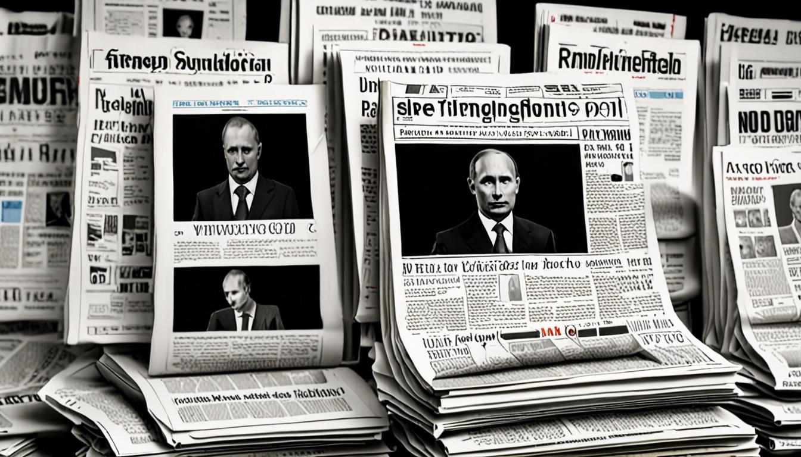

> 🌐 [Original auf Spanisch lesen](../../de/analisis/2026-11-19-largo.md)

<!-- EE_ENRICHED_START -->

<a href="/">Startseite</a>›<a href="/analisis/">Analyse</a>›2026-11-19

🔥 Analyse des Tages
<strong>Veröffentlicht:</strong> 2026-11-19 &nbsp;·&nbsp; <strong>Typ:</strong> Analyse des Tages

<figure style="margin:1.5em 0;"><figcaption style="font-size:0.85em;color:#888;text-align:center;margin-top:0.5em;font-style:italic;">Der Rahmen: Putin, Gewinner des Dreier-Gipfels von Shenzhen:</figcaption></figure>
<h1>Shenzhen: Der Rauchzeichen-Gipfel, der Ihnen als Weltuntergang verkauft wird</h1>

Während die Schlagzeilen aus Leibeskräften brüllen, dass der Planet zusammenbricht, findet auf der Halbinsel eine Zirkusaufführung statt, bei der Angst die einzig gültige Eintrittskarte ist. Wir haben die Pressekabel unter die Lupe genommen und herausgefunden, dass die Krise nicht das Problem, sondern das Spitzenprodukt der Saison ist.

Neun Medien, dieselbe Choreographie: Unsicherheit als Betäubungsmittel und Dringlichkeit als Skalpell. Es geht nicht darum, über die Vereinbarungen von Shenzhen zu informieren, sondern eine Parallelwelt zu erschaffen, in der es nur zwei Optionen gibt: absolute Unterwerfung oder drohende Katastrophe. Hier gibt es keine Analyse, sondern Massen-Scripting, das darauf ausgelegt ist, Ihre Fähigkeit zum kritischen Denken zu lähmen, noch bevor Sie die Augen öffnen.

Es ist die alte Falle der „Sicherheit durch Terror“: Man verkauft Ihnen die goldene Kette als einzige Rettung vor einem Drachen, den sie selbst mit Kreide gezeichnet haben. Wenn sich die Panik in der Redaktion breitmacht, wird die Wahrheit zu einem Hindernis für die redaktionelle Linie. Schalten Sie das Rauschen ab, betrachten Sie das Spielfeld und denken Sie daran, dass in diesem Spiel Ihre Angst ihr wertvollstes Kapital ist.

<h2>El Español: Appell an die Angst und Dramatisierung einer vermeintlichen internationalen Verschwörung</h2>
<figure style="margin:1.5em 0;"><figcaption style="font-size:0.85em;color:#888;text-align:center;margin-top:0.5em;font-style:italic;">El Español: Appell an die Angst und Dramatisierung einer vermeintlichen internationalen Ver</figcaption></figure>

<strong>Tatsächliche Schlagzeile:</strong> „Putin, Gewinner des Dreier-Gipfels von Shenzhen: Trump und Xi ignorieren Europa und nehmen ihn in die Triade der globalen Macht auf“

<strong>Quelle:</strong> <a href="https://www.elespanol.com/espana/tribunales/20261119/supremo-endurece-critica-gobierno-no-actuar-diligencia-exigible-sacar-censo-falsos-nietos/1003744463762_0.html" target="_blank" rel="noopener">Bei El Español lesen</a>

Der Text rezitiert mit der Präzision eines Chirurgen der Unsicherheit: <em>„ernste Verdächtigungen, dass seine Eintragung ins CERA unregelmäßig ist, da sie gegen das Gesetz über das demokratische Gedächtnis verstößt.“</em> Dieser Satz, so leicht wie ein scharfes Messer, klammert sich an das Wort „Verdächtigungen“ und das Adjektiv „unregelmäßig“, um eine einfache administrative Kontroverse in eine latente Bedrohung zu verwandeln.

Beim Hören von „Verdächtigungen“ empfindet der Leser ein Gefühl der Beunruhigung, als ob jede Eintragung ein potenzielles Leck im Netz der Justiz wäre. Das Wort „unregelmäßig“ fungiert als Leuchtfeuer, das signalisiert, dass etwas nicht stimmt, und löst einen Alarm aus, der nicht auf konkreten Fakten beruht, sondern auf der Möglichkeit eines Fehlers, der das Vertrauen in das System destabilisieren könnte.

Die Technik ist offensichtlich: Das Medium beschreibt keine Tatsache, sondern einen Verdacht, der als konkretes Risiko dargestellt wird. Durch die Dramatisierung der Situation mit Begriffen, die Gefahr und mangelnde Legitimität hervorrufen, wird der Bericht zu einem Aufruf zum Handeln, der in Wirklichkeit nur die Paranoia nährt.

Achten Sie in Zukunft auf Formulierungen, die Adjektive wie „Verdächtigungen“, „unregelmäßig“, „widersprüchlich“ oder „Risiko“ in rechtlichen oder politischen Kontexten verwenden. Wenn sich das Narrativ mehr auf das Gefühl als auf Daten stützt, baut es höchstwahrscheinlich eine Verschwörung der Angst auf.
<h2>ABC: Framing (Framing, das die Debatte als unvermeidliches Spektakel darstellt)</h2>

<strong>Echter Titel:</strong> „Uhrzeit und Sender für die Übertragung des Duells zwischen Pedro Sánchez und Feijóo heute“

<strong>Quelle:</strong> <a href="https://www.abc.es/cultura/libros/neus-sendra-narradora-audiolibros-construyo-pelicula-cabeza-20261119050000-nt.html" target="_blank" rel="noopener">Auf ABC lesen</a>

Das Zitat „Ich bastle mir im Kopf einen Film zusammen und erzähle ihn dem Hörer. Ich nehme ihn an die Hand und lasse ihn während des gesamten Romans nicht mehr los“ entlarvt deutlich die Framing-Technik: Das Medium hüllt die Informationen in eine Unterhaltungsnarrative, so als handele es sich bei dem Duell eher um einen Hörroman als um ein politisches Ereignis.

Diese Wahl erzeugt das Gefühl, in einem Billigkino gefangen zu sein, in dem die Realität in einer Handlung verschwimmt, die darauf ausgelegt ist, den Leser an den Bildschirm zu fesseln. Statt einer objektiven Analyse erhält der Leser ein emotional gesteuertes, fast hypnotisches Erlebnis.

Um dies in zukünftigen Beiträgen zu erkennen, reicht es aus, nach Ausdrücken zu suchen, die harte Fakten in filmische oder literarische Metaphern verwandeln, und darauf zu achten, ob sich der Fokus von der Substanz des Themas auf die Form der Geschichte verlagert. Wenn der Text die Atmosphäre über konkrete Informationen stellt, ist das Framing im Gange.

<h2>The Objective: Dringlichkeit (der Drang, schnell aus Angst zu kaufen, kein Los zu bekommen)</h2>

<strong>Echter Titel:</strong> „Weihnachtslotterie 2026 in Badajoz kaufen: Nummern und Lose pro Annahmestelle für die Ziehung“

<strong>Quelle:</strong> <a href="https://theobjective.com/loterias/loteria-navidad/2026-11-19/comprar-loteria-de-navidad-2026-en-badajoz-numeros-y-decimos-por-administracion-para-el-sorteo/" target="_blank" rel="noopener">Auf The Objective lesen</a>

Der Satz, der die Dringlichkeitstechnik verrät, lautet: „Der Verkauf begann am 29. Juni in den Annahmestellen und am 6. von …“. Dieser Ausschnitt setzt eine konkrete Frist und erzeugt, da er unvollständig bleibt, eine künstliche Knappheit, die den Leser dazu zwingt, zu kaufen, bevor die Zeit abläuft.

Diese Wahl hinterlässt bei mir das Gefühl eines Wettlaufs gegen die Zeit, so als wäre Weihnachten eine Auktion, bei der derjenige, der nicht schnell setzt, ohne das Versprechen eines Wirtschaftswunders dasteht. Der Tonfall der Dringlichkeit mischt sich mit Nostalgie und macht das Los zu einem Überlebensritual, das sofortiges Glück verspricht.

Um dies das nächste Mal zu erkennen, achten Sie auf jeden zeitlichen Bezug, der nicht rein informativer Natur ist, sondern Verben wie „beginnt“ oder „endet“ in Verbindung mit genauen Daten enthält. Achten Sie auch auf Imperative wie „melden Sie sich an“ oder „verpassen Sie es nicht“; ihr Vorhandensein zeigt an, dass der Text einen Impulskauf auslösen möchte.

<h2>OkDiario: Appell an die Angst und territorialer Sensationalismus</h2>

<strong>Echter Titel:</strong> „Robles verstärkt die Sicherheit der Inseln und Felseninseln nach den „unvorhersehbaren Migrationsbewegungen“ gegen Ceuta“

<strong>Quelle:</strong> <a href="https://okdiario.com/espana/robles-refuerza-seguridad-islas-penones-imprevisibles-movimientos-migratorios-contra-ceuta-21117704" target="_blank" rel="noopener">Auf OkDiario lesen</a>

Der Begriff, der die Angststrategie verrät, lautet „unvorhersehbare Migrationsbewegungen“ – eine Phrase, die in Anführungszeichen wie eine latente und außer Kontrolle geratene Bedrohung klingt, so als wäre die Grenze ein Schlachtfeld, das ohne Vorwarnung überläuft.

Diese Wortwahl erzeugt ein Gefühl von Dringlichkeit und Alarmismus und treibt den Leser dazu an, sich eine bevorstehende Welle vorzustellen, die die nationale Sicherheit gefährdet. Die Verwendung von Verben wie „verstärkt“ und „Notstandserklärung“ bekräftigt die Idee, dass der Staat angegriffen wird und außerordentliche Maßnahmen erfordert.

Um diese Ressource in zukünftigen Texten zu erkennen, reicht es aus, nach Wörtern zu suchen, die das Phänomen als unerwartet, überwältigend und gefährlich darstellen, begleitet von Ausdrücken, die eine militärische oder hoch technologisierte Reaktion implizieren. Wenn sich die Erzählung auf die Bedrohung und die unmittelbare Reaktion konzentriert, ist dies ein klares Zeichen dafür, dass mit Angst gespielt wird, um die Aufmerksamkeit der Öffentlichkeit zu erregen.

<h2>InfoLibre: Appell an die mangelnde Gewissheit (Unsicherheit) und an den Ausschluss des Publikums, um Druck zu erzeugen</h2>

<strong>Echte Schlagzeile:</strong> „Sánchez appeliert an eine Wahlbeteiligung von 75 %, die ihm nicht den Schlüssel zur Moncloa garantiert“

<strong>Quelle:</strong> <a href="https://www.infolibre.es/política/sanchez-apela-participacion-75-no-le-garantiza-llave-moncloa_1_2240351.html" target="_blank" rel="noopener">Auf InfoLibre lesen</a>

Der Auslöser für das Unsicherheitsspiel ist der Satz: „damit sie nicht wählen gehen“. Indem erklärt wird, dass die Beteiligung keinen Sieg garantiert, wird der Text zu einem Spiegel des Zweifels, einem Spiegel, der sich in der Instabilität der Wählerschaft widerspiegelt.

Diese Wahl lässt das Vertrauen des Lesers erschüttern, wie eine Trommel, die ohne Rhythmus schlägt. Das Publikum fühlt sich ausgeschlossen, so als wäre das politische Gespräch ein geschlossener Club mit einer eisernen Tür, und das Wort „wählen“ wird zu einer Waffe der Destabilisierung.

Um dies in Zukunft zu erkennen, achte auf das Fehlen von Garantien und die Aufforderung zur Tatenlosigkeit. Wenn sich der Diskurs auf Zweifel und Ausschluss stützt, baut sich der Druck auf Ungewissheit auf. Ein Aufruf zur Enthaltung, ein Ton von „geh nicht hin“, ist das Alarmzeichen. Dieses Muster manipuliert nicht nur den Willen, sondern untergräbt auch die Legitimität des Wahlprozesses.

<h2>elDiario.es: Verwendung der Kontrasttechnik und des Narrativs des „Zyklusabschlusses“, um den Unterschied zwischen der Haltung der PP und der der PSOE zu betonen, wodurch eine Wahrnehmung von Überlegenheit und der Vorbereitung der Opposition erzeugt wird.</h2>

<strong>Echte Schlagzeile:</strong> „N/A“

<strong>Quelle:</strong> <a href="https://www.eldiario.es/política/ultimo-cara-cara-sanchez-feijoo-pp-rebaja-expectativas-lider-psoe-prepara-revancha-2023_1_13674800.html" target="_blank" rel="noopener">Auf elDiario.es lesen</a>

Das Medium greift zu Kontrast und Zyklusabschluss mit dem Satz: „das letzte Duell Sánchez–Feijóo: die PP schraubt ihre Erwartungen herunter und der PSOE-Spitzenkandidat bereitet die Revanche von 2023 vor“. Indem der Rückgang der Hoffnung der PP neben die Kühnheit der PSOE gestellt wird, schließt sich das Narrativ auf eine Weise mit dem Versprechen einer neuen Konfrontation, als wüsste der Zuschauer bereits, dass das Drama seinen Lauf ohne Ende nehmen würde, in einem Ton, der deutlich macht, dass die Opposition auf die nächste Konfrontation vorbereitet ist.

Diese Wahl lässt mich eine Mischung aus Ironie und Zynismus empfinden. Beim Lesen des Satzes zeigt sich die Überlegenheit

<h2>Libertad Digital: Appell an die Angst (fear appeal) durch die Andeutung eines möglichen politischen Zusammenbruchs mit alarmierenden Zahlen.</h2>

<strong>Echte Schlagzeile:</strong> „N/A“

<strong>Quelle:</strong> <a href="https://www.libertaddigital.com/espana/2026-11-19/el-voto-de-los-hijos-de-los-nacionalizados-con-la-ley-de-nietos-puede-afectar-a-14-escanos-en-las-elecciones-del-29-n-7493951/?utm_source=rss&amp;utm_medium=feed&amp;utm_campaign=Libertad+Digital%3A+Noticias+y+opini%C3%B3n+en+la+red" target="_blank" rel="noopener">Auf Libertad Digital lesen</a>

Das Signal des Appells an die Angst findet sich in dem Satz „könnte sich auf bis zu 14 Sitze auswirken“, der eine Wähleranzahl in eine drohende Gefahr für das parlamentarische Gleichgewicht verwandelt. Der Text zögert nicht darauf hinzuweisen, dass diese „fast 190.000 Stimmen“ Wahlkreise entscheiden könnten, in denen der letzte Sitz mit weniger als 2.000 Stimmen gewonnen wurde, was den Alarm verstärkt.

Diese kühle Berechnung, die so dargestellt wird, als handele es sich um eine katastrophale Wahl, erzeugt ein Gefühl der Dringlichkeit und Paranoia; der Leser wird dazu verleitet sich vorzustellen, dass jede zusätzliche Stimme ein Eimer Wasser ist, der das Boot der Regierung zum Überlaufen bringen könnte. Darüber hinaus legt die Verwendung von Verben wie „sich spürbar auswirken“ nahe, dass die parlamentarische beziehungsweise verfassungsmäßige Ordnung kurz vor dem Zusammenbruch steht, was den emotionalen Druck auf den Leser erhöht.

Um dies zu erkennen, reicht es aus, auf übertriebene Zahlen und das Fehlen unabhängiger Quellen zu achten; dreht sich das Argument um ein Extremszenario ohne Wahrscheinlichkeitsdaten, haben wir es mit einem Appell an die Angst zu tun.

<h2>Al Jazeera: Angst (nuklearer Alarm)</h2>

<strong>Tatsächliche Schlagzeile:</strong> „Trump wants to talk nuclear with Putin and Xi“

<strong>Quelle:</strong> <a href="https://www.aljazeera.com/video/newsfeed/2026/11/19/trump-wants-to-talk-nuclear-with-putin-and-xi?traffic_source=rss" target="_blank" rel="noopener">Bei Al Jazeera lesen</a>

Al Jazeera greift bei der Präsentation der Nachricht auf den Ausdruck zurück: „raise nuclear non-proliferation“ [die nukleare Nichtverbreitung zur Sprache bringen]. Beim Lesen wird der Leser in ein Szenario einer drohenden Katastrophe hineingezogen, in dem das Wort „nuklear“ wie eine psychologische Bombe wirkt, die den ursprünglichsten Alarm auslöst.

Diese Wendung lässt mich erschaudern, als ob ein lautloser Alarm in meinem Inneren ausgelöst worden wäre. Die einfache Erwähnung von „nuklear“ ist nicht neutral; sie ist eine Einladung, sich eine Welt vorzustellen, in der die Stabilität unter dem Gewicht einer Waffe ins Wanken gerät, die niemand benutzen will.

Um dieses Mittel in Zukunft zu erkennen, reicht es aus, den Text nach Begriffen zu durchsuchen, die ein globales Risiko suggerieren: „nuklear“, „apokalyptisch“, „Katastrophe“, „Gefahr“ oder jedes andere Wort, das eine grenzüberschreitende Bedrohung heraufbeschwört. Wenn diese auftauchen, spielt das Medienorgan mit der kollektiven Angst. Diese Taktik wird umso wirksamer, je mehr der Leser bereits Krisenschlagzeilen ausgesetzt ist, da das Wort „nuklear“ zu einem Haken wird, der die emotionale Reaktion beschleunigt.

<h2>The Guardian: Alarmismus</h2>

<strong>Tatsächliche Schlagzeile:</strong> „One in four women globally unable to refuse sex within marriage, says UN“

<strong>Quelle:</strong> <a href="https://www.theguardian.com/global-development/2026/nov/19/women-girls-rights-rape-sexual-violence-africa-marriage-unfpa" target="_blank" rel="noopener">Bei The Guardian lesen</a>

Die Schlagzeile tropft vor Gift mit der Präzision eines makabren Chirurgen: „unable to refuse sex“. Es heißt dort nicht „sie stimmen nicht zu“ oder „sie wollen nicht“, sondern sie sind unfähig, sich zu verweigern. Dieser Satz beschreibt keinen Mangel an Wunsch, sondern absolute Gefangenschaft. Sie machen die Ehe zu einem Käfig, in dem der Wille der Frau eine rechtliche Fiktion ist und die Fähigkeit, „Nein“ zu sagen, völlig verschwindet. Es ist ein Narrativ völliger Ohnmacht, das die Nuancen ehelicher Verhandlungen ignoriert, um das Bild einer systematischen sexuellen Sklaverei zu verkaufen.

Diese sprachliche Wahl erzeugt ein sofortiges Gefühl der Erstickung. Beim Lesen verarbeitet das Gehirn keine Statistiken, sondern den Verlust menschlichen Handlungsspielraums. Man hat das Gefühl, Zeuge davon zu sein, wie Menschen in einem Szenario des alltäglichen Schreckens auf passive Objekte reduziert werden. Die Dringlichkeit kommt nicht von der Nachricht, sondern von der emotionalen Architektur des Verbs „unable“. Es ist ein alter Trick: dem Subjekt die Stimme zu nehmen, damit der Leser das Fehlen dieser Stimme noch stärker spürt, als wenn sie da wäre.

Um dies das nächste Mal zu erkennen, achte auf das Verben, das den Handlungsspielraum eliminiert. Wenn das Subjekt nicht agiert, sondern eine Unmöglichkeit „erleidet“, hast du es mit Alarmismus der Passivität zu tun. Frage dich: Ist es wirklich unmöglich oder ist es kulturell herausfordernd? Wenn der Text „cannot“ oder „unable“ verwendet, um komplexe interpersonelle Dynamiken zu beschreiben, siehst du eine narrative Manipulation, die soziale Schwierigkeiten in ein biologisches Urteil verwandelt. Misstraue jeder Schlagzeile, die dir die Fähigkeit nimmt, zu zweifeln.

<figure style="margin:1.5em 0;"><figcaption style="font-size:0.85em;color:#888;text-align:center;margin-top:0.5em;font-style:italic;">Der Mechanismus, offengelegt</figcaption></figure>
<h2>Der Mechanismus, offengelegt</h2>

Morgen werden sie es wieder tun. Und du wirst bereits wissen, wohin du schauen musst. Das ist El Encuadre.

<strong>Rechtlicher Hinweis:</strong> Dies ist keine Anschuldigung. Dies ist eine Autopsie. Die Medien sind zitiert und verlinkt. Das Zitatrecht schützt uns. Wenn es schmerzt, dann deshalb, weil du dich darin wiedererkannt hast.

<strong>Folge uns:</strong> <a href="https://youtube.com/@somoselencuadre.oficial">YouTube</a> · <a href="https://tiktok.com/@somoselencuadre">TikTok</a> · <a href="https://instagram.com/somoselencuadre">Instagram</a> · <a href="https://x.com/SomosElEncuadre">X</a> · <a href="https://threads.net/@somoselencuadre">Threads</a>

<!-- EE_ENRICHED_END -->