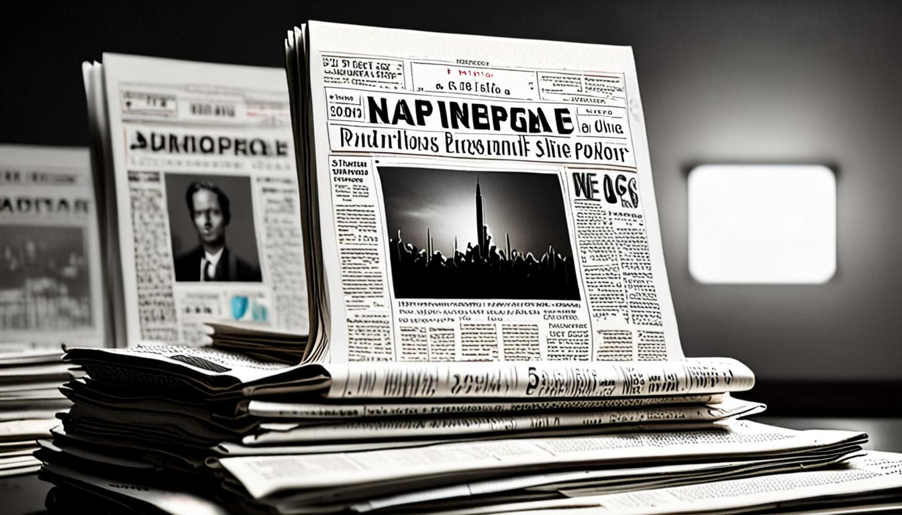

> 🌐 [Read original in Spanish](../../en/analisis/2026-11-15-mediano-medio_crudo.md)

<!-- EE_ENRICHED_START -->

<a href="/">Home</a>›<a href="/analisis/">Analysis</a>›2026-11-15

📄 Angle of the Day
<strong>Published:</strong> 2026-11-15 &nbsp;·&nbsp; <strong>Type:</strong> Angle of the Day

<figure style="margin:1.5em 0;"><figcaption style="font-size:0.85em;color:#888;text-align:center;margin-top:0.5em;font-style:italic;">Libertad Digital: the technique of disqualification through l</figcaption></figure>
<h1>Libertad Digital and the technique of disqualification through negative labeling and polarizing contrast</h1>

In the whirlwind of the November 29 election campaign, the media do not stop at merely transmitting facts. They become architects of narratives, often built using the same machinery as the government itself: disqualification and polarizing contrast. Libertad Digital, the newspaper that has become a mirror of the opposition's rhetoric, skillfully deploys the technique of negative labeling to tarnish the figure of President Alberto Núñez Feijóo, while simultaneously creating a contrast that polarizes the audience around Pedro Sánchez's administration.

<h2>What was said</h2>
<figure style="margin:1.5em 0;"><figcaption style="font-size:0.85em;color:#888;text-align:center;margin-top:0.5em;font-style:italic;">What was said</figcaption></figure>

Libertad Digital's headline, "Feijóo champions management against Sánchez's 'squandering' and kicks off his path toward Nov-29 in Galicia," is already a statement of positioning. The use of "squandering" as a negative label encapsulates the narrative that the outlet wants the reader to absorb: Sánchez's government, according to the press, is wasting resources. This term not only disqualifies the government but also suggests a lack of fiscal discipline which, in Libertad Digital's view, contrasts with Feijóo's supposed "management."

<h2>How it was said (direct quote)</h2>

Within the body of the article, the outlet does not stop at abstraction. It relies on direct quotes that, without altering them, reinforce Feijóo's image as a leader of "rigor, management, and experience." The PP president himself stated: <q>Spain needs "rigor, management, and experience"</q>. At the same time, Feijóo proclaimed himself a defender of public services with the phrase: <q>The public sector is defended by managing it well, not by shouting that you defend it and then breaking the public sector</q>. The statement regarding the relationship between fiscal effort and public services, <q>Matching citizens' effort means having proper public services, that is what you pay taxes for</q>, adds a layer of economic justification to the campaign.

<h2>What was omitted</h2>

The editorial piece, however, leaves aside any mention of Sánchez's government's concrete achievements in public services. There is no mention of increased healthcare coverage, social housing programs, or infrastructure investments that have benefited Galicia. Nor is there any reference to EU funding agreements that have allowed the execution of renewable energy projects. By omitting these points, the outlet focuses exclusively on criticism without offering a balanced counterpoint that could soften the polarization.

<h2>How to spot it</h2>
The attentive reader can identify the technique of disqualification in the choice of words and the omission of relevant data. The use of "squandering" and the absence of specific figures regarding public spending create a narrative of inefficiency that is not supported by reality. Likewise, the lack of mentions of social support programs and infrastructure improvements reveals an editorial bias that seeks to favor Feijóo's image at the expense of a more complete view of the political landscape.

<figure style="margin:1.5em 0;"><figcaption style="font-size:0.85em;color:#888;text-align:center;margin-top:0.5em;font-style:italic;">Conclusion</figcaption></figure>
<h2>Conclusion</h2>

Libertad Digital, by employing the technique of disqualification through negative labeling and polarizing contrast, demonstrates that information can be as powerful as propaganda. By labeling Sánchez's government as "spendthrift" and presenting Feijóo as the savior of governance, the outlet creates a dichotomy that simplifies the complexity of politics into a battle of "good" versus "evil." This strategy not only polarizes the public, but also reinforces the narrative that the only viable solution is the PP's proposal. In a context where objectivity is increasingly scarce, readers must be critical and aware of how words and omissions can shape public perception.

<strong>Real headline from Libertad Digital:</strong> "Feijóo defends good management against Sánchez's 'squandering' and kicks off his path toward November 29 in Galicia"

<strong>Source:</strong> <a href="https://www.libertaddigital.com/espana/política/2026-11-14/feijoo-reivindica-la-gestion-frente-al-despilfarro-de-sanchez-y-arranca-en-galicia-su-camino-hacia-el-29-n-7491558/?utm_source=rss&amp;utm_medium=feed&amp;utm_campaign=Libertad+Digital%3A+Noticias+y+opini%C3%B3n+en+la+red" target="_blank" rel="noopener">Read in Libertad Digital</a>

<strong>Detected technique:</strong> disqualification through negative labeling and polarizing contrast

<strong>Legal notice:</strong> This is not an accusation. It is an autopsy. The media outlets are cited and linked. The right of quotation (art. 32 LPI) protects us.

<strong>Follow us:</strong> <a href="https://youtube.com/@somoselencuadre.oficial">YouTube</a> · <a href="https://tiktok.com/@somoselencuadre">TikTok</a> · <a href="https://instagram.com/somoselencuadre">Instagram</a> · <a href="https://x.com/SomosElEncuadre">X</a> · <a href="https://threads.net/@somoselencuadre">Threads</a>

<!-- EE_ENRICHED_END -->