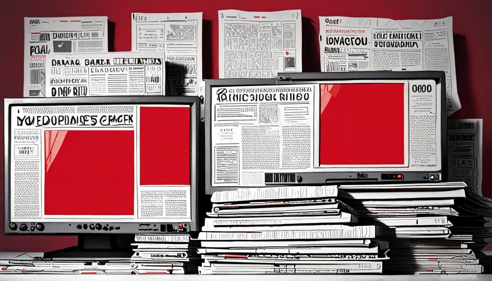

> 🌐 [Read original in Spanish](../../en/analisis/2026-11-17-mediano-tutorial.md)

<!-- EE_ENRICHED_START -->

<a href="/">Home</a>›<a href="/analisis/">Analysis</a>›2026-11-17

📄 Angle of the Day
<strong>Published:</strong> 2026-11-17 &nbsp;·&nbsp; <strong>Type:</strong> Angle of the Day

<figure style="margin:1.5em 0;"><figcaption style="font-size:0.85em;color:#888;text-align:center;margin-top:0.5em;font-style:italic;">How to spot the technique: appeal to fear (alarmism)</figcaption></figure>
<h1 style="font-size: 2.5em; margin-bottom: 10px; color: #8B0000; text-transform: uppercase; letter-spacing: 2px;">The Sinister Art of Scaring the Cow: A Guide to Not Being Manipulated</h1>

    

        Welcome to the panic party. Here, where logic goes out to party and fear sneaks in through the window to pour itself a drink of mockery. We are not here to learn how to be afraid, but to learn how to identify those who sell that fear as if it were fresh water in the desert.
    

    <h2 style="font-size: 1.8em; color: #222; border-bottom: 2px solid #ccc; padding-bottom: 5px; margin-top: 30px;">1. What is this crap? Definition of a sleight-of-hand trick</h2>
<figure style="margin:1.5em 0;"><figcaption style="font-size:0.85em;color:#888;text-align:center;margin-top:0.5em;font-style:italic;">1. What is this crap? Definition of a sleight-of-hand trick</figcaption></figure>

    

        Let's call it by its real name: the appeal to fear, or if you prefer a more elegant and less dirty term, alarmism. It is not an argument. It is not a fact. It is a scream. It is the rhetorical equivalent of throwing a brick at a gathering of ladies to see who fixes their hair first. It consists of replacing evidence with threat, analysis with hysteria.
    

    

        In a world where information travels at the speed of light but critical thinking limps along, this technique has become the Trojan horse of demagoguery. It doesn't tell you "this is bad"; it tells you "this is going to destroy you." The difference is abysmal. The former is a value judgment, often debatable; the latter is a promise of catastrophe that appeals directly to your survival instinct, that primitive reptilian at the back of your neck that prefers to run rather than think.
    

    

        It is an old trick, as old as the cave where someone shouted "Lion!" while showing a shadow on the wall. But today, with digital megaphones and algorithms that amplify panic to madness, its mechanics have been refined. You no longer need a real lion; with an out-of-context statistic and a trembling voice in a three-minute video, you have half the population on edge, ready to obey any order, no matter how absurd.
    
<h2 style="font-size: 1.8em; color: #222; border-bottom: 2px solid #ccc; padding-bottom: 5px; margin-top: 30px;">2. How is it used? The anatomy of organized panic</h2>
    

        The alarmist's manual doesn't have many entries, but it repeats them with the persistence of a parrot high on amphetamines. First, select a real problem. Do not invent the problem; that is too difficult and easy to dismantle. Take something that people are already worried about: the climate, the economy, health, security.
    

    

        Second, inflate the proportions. If the risk is 1%, talk about 99%. If it is a local problem, present it as a global apocalypse. Use adjectives that weigh tons: "imminent," "irreversible," "catastrophic," "unprecedented." Every word is a drop of poison that penetrates the listener's rational skin.
    

    

        Third, eliminate nuances. Reality is gray, full of nuances and probabilities. Alarmism is black and white. Either everything is going well, or everything is going to fall apart. There is no middle ground. There are no gradual solutions. There is only immediate, drastic action and, of course, directed by whoever is shouting the loudest.
    

    

        Fourth, create an enemy or a single cause. Fear needs a scapegoat. It can be a corporation, a political party, a group of immigrants, a new technology. By simplifying the blame, the solution is also simplified: "If we eliminate X, the fear disappears." It is five-year-old logic, but it works wonders on frightened masses.
    

    <h2 style="font-size: 1.8em; color: #222; border-bottom: 2px solid #ccc; padding-bottom: 5px; margin-top: 30px;">3. Real example: The circus of real-time misinformation</h2>
    

        There is no need to go looking for skeletons in the closet. It is enough to look at the current political and media stage. Think about how the narrative is managed when there is a housing crisis. Instead of analyzing speculation, unzoned public land, or the lack of investment in affordable rent, we hear certain voices shouting that "the system is collapsing" and that "ordinary citizens are being driven from their homes by a hidden elite."
    

    

        Here there is no data, there is dramaturgy. The fear of losing one's home is used to justify extreme measures or to divert attention from structural causes. The situation is presented as a siege, where the citizen is a soldier in a trench against an invisible army. It is a powerful metaphor, but a false one. It is not a conflict, it is a distorted market. But "conflict" generates more fear than "market," and fear sells better than economics.
    

    

        Another classic example: the management of public healthcare. When a hospital has waiting lists, the rational version talks about a lack of staff, infrastructure, and planning. The alarmist version talks about "abandonment," about "broken systems," and that "the next person to die on a gurney will be you." Even if we avoid explicit terms about the loss of life, the implication is clear: you are being sold the idea that the State has declared conflict on your well-being. It is a cruel manipulation that exploits human vulnerability to turn patience into blind fury.
    
<h2 style="font-size: 1.8em; color: 222; border-bottom: 2px solid #ccc; padding-bottom: 5px; margin-top: 30px;">4. How to detect it? Put on the glasses of doubt</h2>
    

        Detecting alarmism requires a dose of cynicism and a pinch of patience. First, ask yourself: Is this a fact or a projection? Facts are measurable. Projections are nightmare dreams disguised as science. If there is no study, hard data, or verifiable source, it's smoke.
    

    

        Second, look at the source. Who is speaking? Are they motivated by informing or by selling? By generating clicks? By winning an election? Self-interest is the best tracker of disinformation. If someone gains money, power, or attention by scaring you, their credibility plummets to the ground.
    

    

        Third, look for nuance. If an argument is too simple, it is probably false. Reality is complex. If the proposed solution is single, drastic, and urgent, it is almost certainly designed to bypass debate and deliberation.
    

    

        Fourth, observe the language. Are there many exclamation marks? Are there superlative adjectives? Is there talk of "never seen before"? That is a red flag. History is full of things "never seen before," and most of the time, they were resolved with time, not with panic.
    

    <figure style="margin:1.5em 0;"><figcaption style="font-size:0.85em;color:#888;text-align:center;margin-top:0.5em;font-style:italic;">5. How to combat it? The vaccine of reason</figcaption></figure>
<h2 style="font-size: 1.8em; color: #222; border-bottom: 2px solid #ccc; padding-bottom: 5px; margin-top: 30px;">5. How to combat it? The vaccine of reason</h2>
    

        Combating alarmism is not an easy task. Fear is addictive. But there is a cure: quality, slow, boring information. Read primary sources. Do not trust summaries on social media. Go to the source. If a sensationalist outlet says "X is the end of the world," look up what the official technical agency says. Often, the difference is abysmal.
    

    

        Second, educate your surroundings. Speak calmly. Do not shout. The alarmist shouts; you must whisper. Explain the nuances. Show the data. If you cannot, do not insist. You cannot reason with someone who is in panic mode.
    

    

        Third, practice emotional resilience. Accept that you cannot control everything. Accept that there are risks, but they are not necessarily imminent or catastrophic. Learn to distinguish between real risk and perceived risk. Most of the things that terrify us today are, statistically, less dangerous than driving a car or smoking.
    

    

        Finally, vote with your head, not with your frightened heart. Demand that your political representatives speak clearly, with data, without drama. If you ask them for fear, they will give you fear. If you ask them for truth, they might give you a more acceptable version of reality.
    

    

        In short, alarmism is the opium of the people, only with more noise and fewer immediate side effects. It is a tool of social control disguised as concern. Do not be fooled. The world is a dangerous place, yes, but not for the reasons that the hucksters of hysteria sell you. Think, doubt, investigate. And above all, do not let yourselves be frightened by those who profit from your terror. Reason is the only light in this swamp of ink and panic.
    

<strong>Disclaimer:</strong> This is not an accusation. It is an autopsy. Media outlets are cited and linked. The right of quotation (art. 32 LPI) protects us.

<strong>Follow us:</strong> <a href="https://youtube.com/@somoselencuadre.oficial">YouTube</a> · <a href="https://tiktok.com/@somoselencuadre">TikTok</a> · <a href="https://instagram.com/somoselencuadre">Instagram</a> · <a href="https://x.com/SomosElEncuadre">X</a> · <a href="https://threads.net/@somoselencuadre">Threads</a>

<!-- EE_ENRICHED_END -->