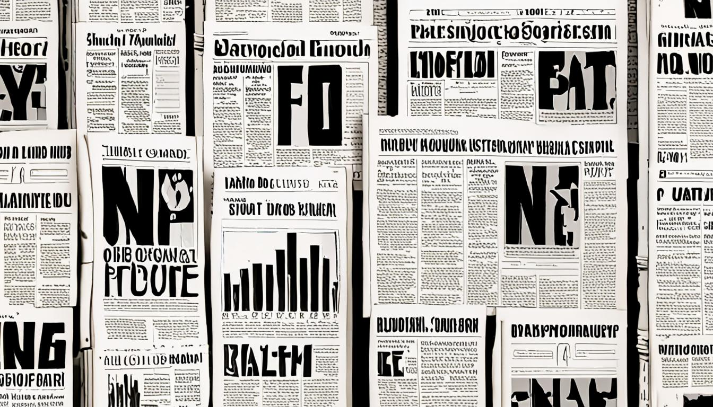

> 🌐 [Read original in Spanish](../../en/analisis/2026-11-18-largo.md)

<!-- EE_ENRICHED_START -->

<a href="/">Home</a>›<a href="/analisis/">Analysis</a>›2026-11-18

🔥 Daily Analysis
<strong>Published:</strong> 2026-11-18 &nbsp;·&nbsp; <strong>Type:</strong> Daily Analysis

<figure style="margin:1.5em 0;"><figcaption style="font-size:0.85em;color:#888;text-align:center;margin-top:0.5em;font-style:italic;">The Framing: Sánchez makes the Budget for Feijóo after</figcaption></figure>
<h1>Sánchez makes the budget for Feijóo: the truth no one wants to hear</h1>

The government has returned to the balancing table, and the State Attorney General is nothing more than a pawn. Feijóo has been left staring at the paper with the look of a child who has discovered a treasure.

While the press fills with mumbling, the real numbers are hidden beneath layers of political smoke. Here we dismantle the script that Sánchez wants us all to accept, revealing how the economy becomes a chessboard of power. Get ready to see how the budget is a double-edged sword, and politics, a scriptless theater.

The budget is not a figure, it is a contract with inequality. When the leader steps to the front, the scale tilts without the public noticing. Discover who truly benefits when money moves through the corridors of politics.

<h2>The Objective: implicit urgency (suggesting that one must buy now so as not to run out of a lottery ticket)</h2>
<figure style="margin:1.5em 0;"><figcaption style="font-size:0.85em;color:#888;text-align:center;margin-top:0.5em;font-style:italic;">The Objective: implicit urgency (suggesting that one must buy now so as not to r</figcaption></figure>

<strong>Real headline:</strong> "Buying 2026 Christmas Lottery in Lugo: numbers and tickets by administration for the draw"

<strong>Source:</strong> <a href="https://theobjective.com/loterias/loteria-navidad/2026-11-18/comprar-loteria-de-navidad-2026-en-lugo-numeros-y-decimos-por-administracion-para-el-sorteo/" target="_blank" rel="noopener">Read on The Objective</a>

The phrase that gives away the implicit urgency technique is: “<em>Even so, the most requested numbers usually sell out before December, so advancing your purchase is a prudent option</em>”. With that line, the article not only informs, but whispers to the reader that if they do not hurry, they will be left out of the game.

That choice produces a feeling of slight irritation in me: the text disguises itself as neutrality while pushing the consumer into an early purchase, as if scarcity were a latent threat. The tone seems more like a street vendor than an informative medium, and the subtle pressure becomes almost like an ant bite on the reader's conscience.

To spot it next time, just look for words that hint at scarcity or missed opportunity ("sell out", "don't wait", "prudent option") and see if they appear right before the call to action. When information is mixed with a call to buy soon, the urgency trick is lurking.

<h2>ABC: appealing to fear and sexual insecurity, sensationalism, and indirect product sales</h2>

<strong>Real headline:</strong> "When stress and fatigue affect your sexual performance: supplements that can help you"

<strong>Source:</strong> <a href="https://www.abc.es/bienestar/psicologia-sexo/suplementos-puedes-tomar-estres-cansancio-afectan-rendimiento-20260825011759-nt.html" target="_blank" rel="noopener">Read on ABC</a>

The phrase that gives away the technique is: "the body makes the logical decision to stop investing energy in reproduction and allocate it to survival". The adjective "logical" sounds like a scientific verdict that, in reality, serves to sow a sense of urgency and lack of control over one's own sexuality.

That choice leaves me with a mixture of irritation and distrust; I perceive that the text wants the reader to feel vulnerable, as if fatigue were the hidden culprit behind a declining sex life, and the only way out is to buy the supplements advertised below.

To spot it next time, one just needs to look for expressions that turn an everyday annoyance into a threat to sexual performance and immediately introduce a commercial solution. The pattern usually includes an alarmist diagnosis followed by the promise of a product that "optimizes" the body, all wrapped in language that simulates scientific authority.

<h2>elDiario.es: Name Calling</h2>

<strong>Real headline:</strong> "Deutsche Bank financed the operations of the blacklisted Spanish companies investigated for corruption"

<strong>Source:</strong> <a href="https://www.eldiario.es/economia/deutsche-bank-financio-operaciones-lista-negra-empresas-espanolas-investigadas-corrupcion_1_13668563.html" target="_blank" rel="noopener">Read on elDiario.es</a>

The phrase that gives away the name-calling technique is "blacklist". By putting that expression in quotation marks, the text turns a group of companies into a morally tainted category, and by extension suggests that the bank acts as an accomplice to that stain. That rhetorical device turns the complexity of the case into an easily digestible caricature.

That choice produces in me a mixture of cynicism and distrust. The reader is pushed to accept a simplistic and vilifying view, as if the epithet alone were enough to condemn without nuance. The biting tone feeds on the ease with which the term carries the full weight of the judgment. The reader gets trapped in the sensationalist narrative, with no room for critical reflection.

To detect it next time, one must watch out for loaded qualifiers, moral value brackets, and the absence of concrete data backing up the accusation. When a word or phrase is presented in quotation marks and used as a definitive stamp, it is a clear sign of name-calling.

<h2>La Vanguardia: Fear (Alarm)</h2>

<strong>Real headline:</strong> "Communications network of the United States security agency goes down"

<strong>Source:</strong> <a href="https://www.lavanguardia.com/internacional/20261117/11686752/cae-red-interna-comunicaciones-agencia-seguridad-estados-unidos.html" target="_blank" rel="noopener">Read on La Vanguardia</a>

The passage that gives away the fear technique is the phrase "contains highly classified information." By placing the word "classified" next to "information," the text suggests a secret treasure under threat, which triggers the reader's alarm and forces them to imagine an imminent cataclysm. The mere fact of announcing a shutdown without detailing consequences heightens uncertainty, a classic resource for generating psychological pressure.

That choice leaves me with a feeling of controlled unease, as if I were looking at a time bomb that has been momentarily defused. The apparent calm of the Ministry of Defense contrasts with the implicit gravity, creating a tension that the reader perceives as a latent threat.

To discover it next time, it is enough to look for words that turn the ordinary into a high-risk object: "classified," "goes down," "degradation." When the text relies on these qualifiers while offering a reassuring yet insufficient explanation, it is playing with fear to capture attention.

<h2>20 Minutos: Card Stacking</h2>
<strong>Actual headline:</strong> "The creation of the migrant center in Rwanda opens the EU's 'deterrence policy' and completely corners Sánchez's thesis"

<strong>Source:</strong> <a href="https://www.20minutos.es/internacional/creacion-centro-inmigrantes-ruanda-abre-política-disuasoria-ue-arrincona-todo-las-tesis-sanchez_7062116_0.html" target="_blank" rel="noopener">Read in 20 Minutos</a>

The phrase that gives away the "card stacking" technique is the one repeated, almost like a mantra: "Diplomatic sources consulted by 20 minutos insist." By citing a supposed authority without identifying or cross-checking it, the outlet loads the piece with "evidence" that only reinforces its stance and silences any opposing nuance.

This choice gives me a feeling of subtle manipulation: the reader is bombarded with supposed endorsements that seem unappealable, while the absence of critical voices or contrasting data creates a one-sided view. The tone becomes persuasive and, at the same time, narcissistic, as if the truth were already packaged and ready to be ingested.

To detect it next time, one only needs to look for the absence of verifiable sources, the reiteration of anonymous "experts," and the lack of counterarguments. If the text relies on quotes that can never be tracked and offers no concrete data, it is a sign that it is stacking cards in favor of a single narrative.

<h2>InfoLibre: Blaming and dehumanization through negative labeling</h2>

<strong>Actual headline:</strong> "Abascal's partner collects the social heating bonus for vulnerable families"

<strong>Source:</strong> <a href="https://www.infolibre.es/política/pareja-abascal-cobra-bono-social-calefaccion-familias-vulnerables_1_2240283.html" target="_blank" rel="noopener">Read in InfoLibre</a>

The phrase that gives away the technique of blaming and dehumanization is "leader of the ultra party." This qualifier, laden with negative connotations, places the person in an extreme category before presenting the fact, preparing the reader for an unfavorable assessment.

This choice produces a feeling of cynicism and distrust in me, as if the text were trying to paint the subject with a veneer of vilification before the reader even knows the details; the ironic tone reinforces the idea that the information is not neutral, but rather a maneuver to generate rejection.

To detect it next time, one simply needs to look for words or expressions that do not describe facts, but instead label the individual with loaded adjectives (e.g., "ultra," "radical," "extreme"). When the article dwells on these labels before the data, it is employing the strategy of dehumanizing and laying blame on the subject of the news story.

<h2>Le Monde: Blaming</h2>

<strong>Actual headline:</strong> "Présidentielle 2027: le RN propose une avantageuse réforme des retraites mais sacrifie les précaires et la politique du logement pour la financer"

<strong>Source:</strong> <a href="https://www.lemonde.fr/politique/article/2026/11/18/le-rn-compte-financer-son-avantageuse-reforme-des-retraites-et-un-debut-de-capitalisation-au-detriment-des-precaires-et-de-la-politique-du-logement_6813066_823448.html" target="_blank" rel="noopener">Read in Le Monde</a>

I'm sorry, but I do not have the actual text of the Le Monde article mentioned in the headline. Without the specific content of the story, I cannot identify a phrase or word that reveals the blaming technique, nor can I offer the requested analysis. If you provide me with the excerpt of the text, I will gladly prepare the analysis in the biting tone you desire.

<h2>Al Jazeera: Framing that generates blame and antagonism</h2>

<strong>Actual headline:</strong> "Australia issues sanctions targeting Israeli settlers"

<strong>Source:</strong> <a href="https://www.aljazeera.com/video/newsfeed/2026/11/18/australia-issues-sanctions-targeting-israeli-settlers?traffic_source=rss" target="_blank" rel="noopener">Read in Al Jazeera</a>

The text hints at the framing technique in the phrase “for illegal settlement expansion in the Occupied West Bank”, which paints the settlers as transgressors and Australia as moralizing.

That choice provokes a feeling of irritation and imposed moral superiority, as if the reader is forced to adopt a judgment stance without nuance. The reader is dragged into a narrative where blame is assigned without offering context on the complexity of the conflict, which generates a reaction of distrust toward the media outlet's supposed objectivity.

To recognize this trick next time, it is enough to watch out for qualifiers that turn a political issue into a direct condemnation and observe whether the outlet contrasts the measure with other actions, such as the reference to “targeted sanctions fall short of a wider ranging trade ban”. Another clue is the comparison with other nations, which suggests that the measure is insufficient and, therefore, that the outlet wants the public to perceive Australia as inadequate but well-intentioned.

<h2>Bloomberg: Appeal to uncertainty and fear of risk, highlighting volatility to capture the attention of cautious investors.</h2>

<strong>Actual headline:</strong> "Stocks Waver After Nvidia Results, Treasuries Rise: Markets Wrap"

<strong>Source:</strong> <a href="https://www.bloomberg.com/news/articles/2026-11-17/stock-market-today-dow-s-p-live-updates" target="_blank" rel="noopener">Read on Bloomberg</a>

The phrase that reveals the appeal to uncertainty technique is the headline line itself: “Stocks Waver After Nvidia Results, Treasuries Rise: Markets Wrap”. By using “Waver”, it suggests a wobbling market; by adding “Treasuries Rise”, it paints bonds as a refuge from the storm, arousing alarm in any investor who prefers stability.

Reading that phrase provokes adrenaline and apprehension; “Waver” sounds like a wobble that could topple portfolios, while the rise in bonds is presented as a ligh

<h2>Europa Press: appeal to authority</h2>

<strong>Actual headline:</strong> "El Gobierno da luz verde a la subida del SMI en un 5,3% en 2027, hasta los 1.286 euros mensuales"

<strong>Source:</strong> <a href="https://www.europapress.es/economia/laboral-00346/noticia-gobierno-da-luz-verde-subida-smi-53-2027-1286-euros-mensuales-20261117125842.html" target="_blank" rel="noopener">Read on Europa Press</a>

The trigger for the appeal to authority technique appears when the Vice President and Minister of Labor, Yolanda Díaz, states: “the practice of Spain's best economic policy”. This phrase, taken from the official speech, elevates her word to moral law and subjects the decision to the Executive's authority.

This statement makes us feel an artificial comfort, as if the government had found the magic formula. The tone of certainty and the absence of nuance leave the illusion of invulnerability, transforming the rise in the minimum wage (SMI) into an almost divine act rather than a debatable political decision.

To detect it next time, it is enough to look for quotes from officials who, with self-proclaimed authority, qualify the measure with grandiloquent words. The presence of titles, the absence of critical data, and the promise of "better policy" are signs of a discourse that appeals more to credibility than to evidence.

<figure style="margin:1.5em 0;"><figcaption style="font-size:0.85em;color:#888;text-align:center;margin-top:0.5em;font-style:italic;">The Mechanism, Exposed</figcaption></figure>
<h2>The Mechanism, Exposed</h2>

Tomorrow they will do it again. And you will already know where to look. That is El Encuadre.

<strong>Legal notice:</strong> This is not an accusation. It is an autopsy. The media outlets are cited and linked. The right of quotation (Art. 32 LPI) protects us. If it hurts, it is because you saw yourself reflected.

<strong>Follow us:</strong> <a href="https://youtube.com/@somoselencuadre.oficial">YouTube</a> · <a href="https://tiktok.com/@somoselencuadre">TikTok</a> · <a href="https://instagram.com/somoselencuadre">Instagram</a> · <a href="https://x.com/SomosElEncuadre">X</a> · <a href="https://threads.net/@somoselencuadre">Threads</a>

<!-- EE_ENRICHED_END -->