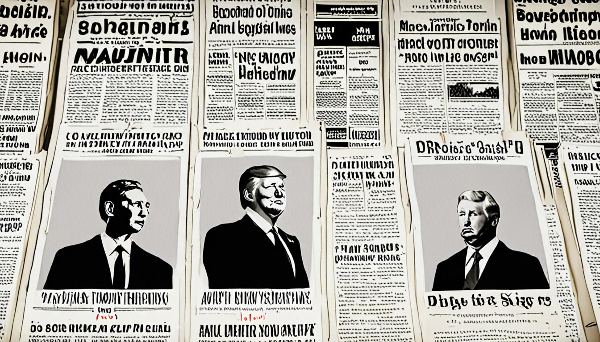
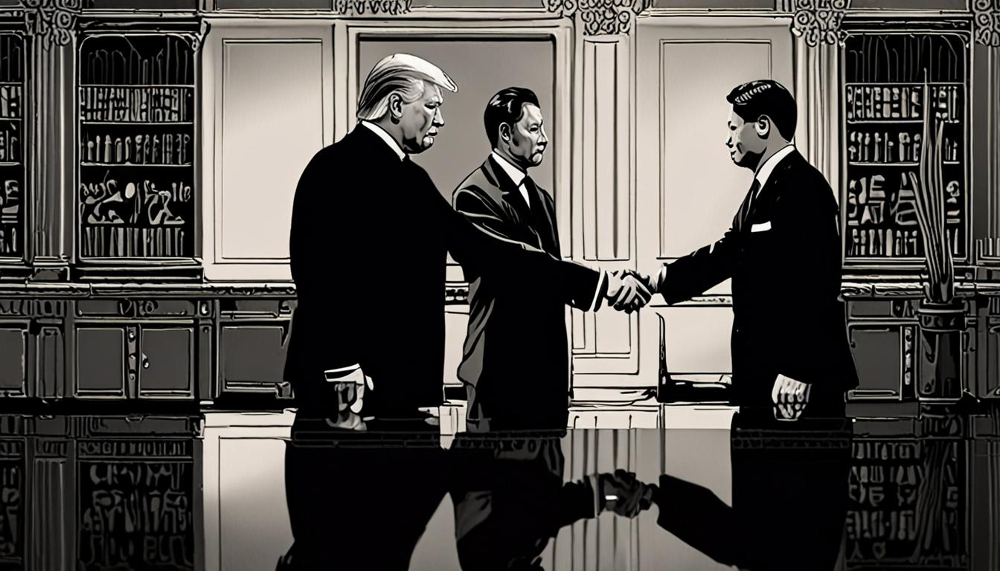

> 🌐 [Read original in Spanish](../../en/analisis/2026-11-19-dossier-v2.md)

<!-- EE_ENRICHED_START -->

<a href="/">Home</a>›<a href="/analisis/">Analysis</a>›2026-11-19

📁 Executive Dossier
<strong>Published:</strong> 2026-11-19 &nbsp;·&nbsp; <strong>Type:</strong> Executive Dossier

<figure style="margin:1.5em 0;"><figcaption style="font-size:0.85em;color:#888;text-align:center;margin-top:0.5em;font-style:italic;">The Framing: Putin, winner of the Shenzhen trilateral summit:</figcaption></figure>
<h1>Dossier of the day: The Framing: Putin, winner of the Shenzhen trilateral summit: Trump and Xi ignore Europe and include him in the global power triad</h1>

<strong>Lead:</strong> While the world bleeds in diplomatic summits where masks are falling, the media in this country sell us electoral smoke and immigration panic. Today we are not here to report, we are here to gut the mechanism. What they call "news" is, in reality, a choreography of fear designed so that we do not look up, but rather into the abyss of our own choices. There is no truth here, only framing. And today's framing is a three-act farce: ignored geopolitics, poisoned democracy, and empty spectacle.

<h2>News of the Day</h2>
<figure style="margin:1.5em 0;"><figcaption style="font-size:0.85em;color:#888;text-align:center;margin-top:0.5em;font-style:italic;">News of the Day</figcaption></figure>

The big headline of the day is a lie by omission. The headline they are selling us speaks of a summit in Shenzhen where Putin emerges as the "winner" and where Trump and Xi "ignore Europe." An international conspiracy narrative that should make us smile were it not for the fact that it is the only way to cover up the black hole that is Spanish politics. But let us forget about bears and dragons for a moment. The real theater is set up right here, on the peninsula, with a local cast that acts with the conviction of a soap opera actor.

On one hand, we have the legal chaos surrounding the "grandchildren law." The Supreme Court, in a maneuver that smells of institutional desperation, has admitted that "there is no material time" to review the census. This means that 189,678 people, children of naturalized citizens, will be able to vote on November 29. According to legal sources cited by Libertad Digital, this could "affect 14 seats." Fourteen chairs on the board. This is not an anecdote, it is the time bomb that threatens to redraw the political map. The Supreme Court has also dismissed Vox's appeal for a precautionary suspension of the vote, leaving the Government with a very calm face while the electoral machine continues to spin on an axis that, at least for some, is broken.

On the other hand, the debate. The latest face-to-face between Pedro Sánchez and Alberto Núñez Feijóo. ElDiario.es frames it as a "revenge of 2023," a narrative of personal vengeance disguised as politics. Meanwhile, the PP, through its general secretary Miguel Tellado, is not asking people to vote for them, but rather asking socialist voters to "stay home." A call to selective abstention that is, in itself, a confession of weakness. They do not trust their message; they trust the laziness of others.

<h2>The media and its techniques</h2>

The press does not report facts, it installs emotions. Every newsroom has its secret recipe, its chemical additive so that the reader does not think, but rather feels. Fear, urgency, false certainty. Let's analyze the ingredients they used today to cook this alphabet soup.
<table>
    <tr>
        <th>Medium</th>
        <th>Technique</th>
        <th>Omits</th>
    </tr>
    <tr>
        <td>El Español</td>
        <td>Appeal to fear and dramatization</td>
        <td>The reality of the summit; Europe's irrelevance in the triad</td>
    </tr>
    <tr>
        <td>ABC</td>
        <td>Spectral framing</td>
        <td>Politics; the actual content of the debate or current events</td>
    </tr>
    <tr>
        <td>The Objective</td>
        <td>Commercial urgency</td>
        <td>Social criticism; the context of public spending</td>
    </tr>
    <tr>
        <td>OkDiario</td>
        <td>Territorial sensationalism</td>
        <td>The structural causes of migration; shared responsibility</td>
    </tr>
    <tr>
        <td>InfoLibre</td>
        <td>Insecurity and exclusion</td>
        <td>The solidity of opposing polling data</td>
    </tr>
    <tr>
        <td>elDiario.es</td>
        <td>End-of-cycle narrative</td>
        <td>The complexity of polls; the margin of error</td>
    </tr>
    <tr>
        <td>Libertad Digital</td>
        <td>Fear appeal</td>
        <td>The legality of the law; the historical context of memory</td>
    </tr>
</table>

It is a circus of hall-of-mirrors distortions. Every media outlet distorts reality to fit its ideological bubble. But the pattern is clear: they never give you the tool to think, only the blow to react.

<h2>The techniques in detail</h2>

<strong>1. The Dramatization of Conspiracy (El Español)</strong> 
El Español enters the ring with a headline that sounds more like a spy movie than a journalistic chronicle: "Putin, winner of the Shenzhen three-way summit: Trump and Xi ignore Europe and include him in the triad of global power." The technique here is the <em>appeal to fear</em>. By presenting Europe as an entity that has been "ignored" and "included" in a game it does not control, a sense of collective vulnerability is generated. We are told that we are alone, that the major global players are laughing at us. It is an elegant way of saying: "Don't look at your government, look outward, that is where the real danger lies." It omits that foreign policy is complex and that "winning" a summit is not a binary concept. It uses the fear of irrelevance to condition the reading of everything else.

<strong>2. The Cultural Mirage (ABC)</strong> 
ABC makes a master chess move: <em>framing</em> or contextual framing. While the country is on fire because of the elections and the census, ABC headlines: "Time and channels broadcasting today's face-to-face between Pedro Sánchez and Feijóo." But the actual text given to us is an interview with Neus Sendra, an audiobook narrator, who says: "I build a movie in my head and tell it to the listener. I take them by the hand and don't let go throughout the whole novel." The technique is deflection. By associating politics (the face-to-face) with the art of storytelling (audiobook narration), the political debate is presented as an inevitable spectacle, almost artistic. Political content is omitted to focus on the form. They tell us that politics is theater, and that we are the audience that must stay with the narrator's hand "unreleased." It is cultural anesthesia. Instead of analyzing proposals, the emotion of the narrative is analyzed.

<strong>3. The Urgency of Consumption (The Objective)</strong> 
The Objective uses pure and hard <em>urgency</em>, but applied to consumption. Its actual text talks about buying the Christmas Lottery in Badajoz: "Until when can it be bought and how to find a number? Sales started on June 29... and close on December 21." In the middle of the political storm, The Objective offers us the life raft of chance. The technique is distraction through commercial enthusiasm. By listing prizes and administrations, a sense of normality and routine is created that contrasts with the outside chaos. We are invited to actively participate in the lottery game (a state betting system) while ignoring the game of democracy. It is a way of saying: "You can't control Sánchez or Feijóo, but you can control whether you buy the number 40000." It is an individualistic defense mechanism in times of collective uncertainty.

<strong>4. The Census Terrorism (Libertad Digital)</strong> 
Libertad Digital completes the circle with the most direct and dirty <em>appeal to fear</em>: "The vote of the children of those naturalized under the Grandchildren Law... can affect 14 seats." Here there is no subtlety. There is a magic number, 14, floating in the air like an existential threat. They cite legal sources that "fear" this will have a "notorious" repercussion. The technique is the instillation of doubt about democratic legitimacy. The memory law is presented as an instrument of massive electoral manipulation. The debate on historical memory is omitted to focus solely on the arithmetic outcome of the seats. They tell us that democracy is in danger not due to a lack of freedom, but due to an excess of ballots. It is a very specific, very measurable fear, and therefore very easy to sell.

<h2>Shared Biases</h2>

What do El Español, ABC, The Objective, OkDiario, InfoLibre, elDiario.es, and Libertad Digital have in common? That all of them, in their ideological trenches, practice the same heresy: the dehumanization of politics in favor of primary emotion.

The repetitive pattern is <em>reduction</em>. Geopolitics is reduced to a trap for Europe. Political debate is reduced to a movie in the head. The migration crisis is reduced to "unpredictable movements" (OkDiario calls it: "unpredictable migratory movements against Ceuta," a phrase that sounds like a disaster movie script). The election is reduced to 14 seats or a lottery number.

Why does it work? Because the average citizen is exhausted. The complexity of reality is overwhelming. It is more comforting to believe that there is a villain (Putin, the grandchildren, the lottery, the other candidate) than to understand the nuances of an international treaty or a historical memory law. The media knows that if they give you cold facts, you get bored. But if they scare you, you stay. If they give you hope (the lottery), you stay. If they give you the feeling of being in on a secret (the Shenzhen summit), you stay. All media outlets, without exception, are selling the same thing: the certainty that something is wrong, and the only way out is to feel part of the tribe that has spotted it.

There is a shared bias of <em>institutional insecurity</em>. The Supreme Court "fails to act with the required diligence" (El Español). The Government does not guarantee the key to La Moncloa (InfoLibre). The islands are under threat (OkDiario). Democracy is up in the air (Libertad Digital). The feeling that institutions are failing or are accomplices is the glue that keeps the audience together. It doesn't matter who governs, what matters is that the system is broken. And while the system is broken, the media outlet is the only one with the pieces to put it back together (or to break it even further).

<figure style="margin:1.5em 0;"><figcaption style="font-size:0.85em;color:#888;text-align:center;margin-top:0.5em;font-style:italic;">Conclusion</figcaption></figure>
<h2>Conclusion</h2>

While Trump and Xi play chess in Shenzhen, we play hide-and-seek in the census. We have been sold a narrative where the only truth is the one that makes the headline. Where history is told like an audiobook so we don't have to think. Where security is measured in meters of fencing in Ceuta. Where hope is bought for 0.50 euros at a lottery office.

The mechanism has been exposed. Tomorrow they will do it again. And you decide whether to take the narrator's hand or let go of the thread and look at the real map. Because the only summit that matters is not the one in Shenzhen, it's the one in your head. And there, you set the frame.

<h3>Sources consulted:</h3>
<ul>
<li><strong>El Español:</strong> "Putin, winner of the Shenzhen three-way summit: Trump and Xi ignore Europe and include him in the global power triad" — <a href="https://www.elespanol.com/espana/tribunales/20261119/supremo-endurece-critica-gobierno-no-actuar-diligencia-exigible-sacar-censo-falsos-nietos/1003744463762_0.html" target="_blank" rel="noopener">Read full</a></li>
<li><strong>ABC:</strong> "Time and channels broadcasting today's face-to-face debate between Pedro Sánchez and Feijóo" — <a href="https://www.abc.es/cultura/libros/neus-sendra-narradora-audiolibros-construyo-pelicula-cabeza-20261119050000-nt.html" target="_blank" rel="noopener">Read full</a></li>
<li><strong>The Objective:</strong> "Buying 2026 Christmas Lottery in Badajoz: numbers and tickets by administration for the draw" — <a href="https://theobjective.com/loterias/loteria-navidad/2026-11-19/comprar-loteria-de-navidad-2026-en-badajoz-numeros-y-decimos-por-administracion-para-el-sorteo/" target="_blank" rel="noopener">Read full</a></li>
<li><strong>OkDiario:</strong> "Robles reinforces the security of islands and rocky islets after 'unpredictable migratory movements' against Ceuta" — <a href="https://okdiario.com/espana/robles-refuerza-seguridad-islas-penones-imprevisibles-movimientos-migratorios-contra-ceuta-21117704" target="_blank" rel="noopener">Read full</a></li>
<li><strong>InfoLibre:</strong> "Sánchez appeals for a 75% turnout that does not guarantee him the key to La Moncloa" — <a href="https://www.infolibre.es/política/sanchez-apela-participacion-75-no-le-garantiza-llave-moncloa_1_2240351.html" target="_blank" rel="noopener">Read full</a></li>
<li><strong>elDiario.es:</strong> "N/A" — <a href="https://www.eldiario.es/política/ultimo-cara-cara-sanchez-feijoo-pp-rebaja-expectativas-lider-psoe-prepara-revancha-2023_1_13674800.html" target="_blank" rel="noopener">Read full</a></li>
<li><strong>Libertad Digital:</strong> "N/A" — <a href="https://www.libertaddigital.com/espana/2026-11-19/el-voto-de-los-hijos-de-los-nacionalizados-con-la-ley-de-nietos-puede-afectar-a-14-escanos-en-las-elecciones-del-29-n-7493951/?utm_source=rss&amp;utm_medium=feed&amp;utm_campaign=Libertad+Digital%3A+Noticias+y+opini%C3%B3n+en+la+red" target="_blank" rel="noopener">Read full</a></li>
<li><strong>Al Jazeera:</strong> "Trump wants to talk nuclear with Putin and Xi" — <a href="https://www.aljazeera.com/video/newsfeed/2026/11/19/trump-wants-to-talk-nuclear-with-putin-and-xi?traffic_source=rss" target="_blank" rel="noopener">Read full</a></li>
<li><strong>The Guardian:</strong> "One in four women globally unable to refuse sex within marriage, says UN" — <a href="https://www.theguardian.com/global-development/2026/nov/19/women-girls-rights-rape-sexual-violence-africa-marriage-unfpa" target="_blank" rel="noopener">Read full</a></li>
</ul>
<strong>Legal notice:</strong> This is not an accusation. It is an autopsy. The media outlets are cited and linked. The right of quotation (Art. 32 LPI) protects us.

<strong>Follow us:</strong> <a href="https://youtube.com/@somoselencuadre.oficial">YouTube</a> · <a href="https://tiktok.com/@somoselencuadre">TikTok</a> · <a href="https://instagram.com/somoselencuadre">Instagram</a> · <a href="https://x.com/SomosElEncuadre">X</a> · <a href="https://threads.net/@somoselencuadre">Threads</a>

<!-- EE_ENRICHED_END -->