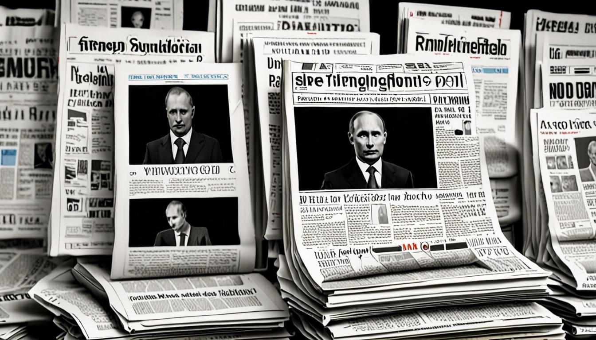

> 🌐 [Read original in Spanish](../../en/analisis/2026-11-19-largo.md)

<!-- EE_ENRICHED_START -->

<a href="/">Home</a>›<a href="/analisis/">Analysis</a>›2026-11-19

🔥 Daily Analysis
<strong>Published:</strong> 2026-11-19 &nbsp;·&nbsp; <strong>Type:</strong> Daily Analysis

<figure style="margin:1.5em 0;"><figcaption style="font-size:0.85em;color:#888;text-align:center;margin-top:0.5em;font-style:italic;">The Framing: Putin, winner of the Shenzhen three-way summit:</figcaption></figure>
<h1>Shenzhen: The summit's smoke and mirrors sold to you as the end of the world</h1>

While headlines scream at the top of their lungs that the planet is collapsing, a circus act is taking place on the peninsula where fear is the only valid admission ticket. We have gutted the press cables to discover that the crisis is not the problem, but this season's blockbuster product.

Nine headlines, the exact same choreography: uncertainty used as anesthesia and urgency as a scalpel. This isn't about reporting on the Shenzhen agreements, but about manufacturing a parallel reality where there are only two options: absolute submission or impending catastrophe. There is no analysis here, just mass scripting designed to paralyze your critical thinking capacity before you even open your eyes.

It's the old trap of "security through terror": they sell you the golden chain as your only salvation against a dragon that they themselves drew in chalk. When panic settles into the newsroom, the truth becomes an obstacle to the editorial line. Disconnect the noise, look at the board, and remember that in this game, your fear is their best asset.

<h2>El Español: appeal to fear and dramatization of a supposed international conspiracy</h2>
<figure style="margin:1.5em 0;"><figcaption style="font-size:0.85em;color:#888;text-align:center;margin-top:0.5em;font-style:italic;">El Español: appeal to fear and dramatization of a supposed international con</figcaption></figure>

<strong>Real headline:</strong> "Putin, winner of the Shenzhen three-way summit: Trump and Xi ignore Europe and include him in the global power triad"

<strong>Source:</strong> <a href="https://www.elespanol.com/espana/tribunales/20261119/supremo-endurece-critica-gobierno-no-actuar-diligencia-exigible-sacar-censo-falsos-nietos/1003744463762_0.html" target="_blank" rel="noopener">Read on El Español</a>

The text recites with the precision of a surgeon of uncertainty: <em>“serious suspicions that his registration in the CERA is irregular, as it violates the Democratic Memory Law.”</em> This phrase, as light as a sharp knife, latches onto the word “suspicions” and the adjective “irregular” to turn a simple administrative controversy into a latent threat.

Upon hearing “suspicions,” the reader is met with a sense of unease, as if every registration were a potential hole in the net of justice. The word “irregular” acts as a beacon signaling that something is not right, generating an alarm based not on concrete facts, but on the possibility of a flaw that could destabilize trust in the system.

The technique is obvious: the media outlet does not describe a fact, but a suspicion presented as a concrete risk. By dramatizing the situation with terms that evoke danger and a lack of legitimacy, the narrative becomes a call to action that, in reality, only feeds paranoia.

To spot this in the future, look for phrases that use adjectives like “suspicions,” “irregular,” “contrary,” or “risk” in legal or political contexts. If the narrative relies more on feeling than on data, it is likely constructing a conspiracy of fear.
<h2>ABC: framing (framing that presents the debate as an inevitable spectacle)</h2>

<strong>Actual headline:</strong> "Time and channels broadcasting today's face-to-face debate between Pedro Sánchez and Feijóo"

<strong>Source:</strong> <a href="https://www.abc.es/cultura/libros/neus-sendra-narradora-audiolibros-construyo-pelicula-cabeza-20261119050000-nt.html" target="_blank" rel="noopener">Read on ABC</a>

The excerpt "I build a movie in my head and tell it to the listener. I take them by the hand and don't let go throughout the whole novel" clearly gives away the framing technique: the media outlet wraps the information in an entertainment narrative, as if the face-to-face debate were part of a sound novel rather than a political event.

This choice produces the feeling of being trapped in a low-budget movie theater, where reality dissolves into a plot designed to keep the reader glued to the screen. Instead of objective analysis, the reader receives an emotionally guided, almost hypnotic experience.

To detect it in future pieces, it is enough to look for expressions that turn hard data into cinematic or literary metaphors, and observe whether the focus shifts from the substance of the topic to the form of the story. When the text prioritizes atmosphere over concrete information, framing is at work.

<h2>The Objective: urgency (the impulse to buy soon out of fear of missing out on a tenth of a lottery ticket)</h2>

<strong>Actual headline:</strong> "Buying 2026 Christmas Lottery in Badajoz: numbers and tenths by administration for the draw"

<strong>Source:</strong> <a href="https://theobjective.com/loterias/loteria-navidad/2026-11-19/comprar-loteria-de-navidad-2026-en-badajoz-numeros-y-decimos-por-administracion-para-el-sorteo/" target="_blank" rel="noopener">Read on The Objective</a>

The phrase that gives away the urgency technique is: "Sales began on June 29th at administrations and on the 6th of...". This cut-off sets a specific deadline and, by remaining incomplete, creates artificial scarcity that forces the reader to buy before the clock runs out.

That choice leaves me with the feeling of a race against time, as if Christmas were an auction where whoever doesn't bet quickly is left without the promise of an economic miracle. The tone of urgency blends with nostalgia, turning the lottery ticket into a survival rite that promises instant luck.

To detect it next time, look for any time reference that is not merely informative, but includes verbs like "begins" or "ends" accompanied by precise dates. Also pay attention to imperatives like "sign up" or "don't miss out"; their presence indicates that the text seeks to trigger an impulse purchase.

<h2>OkDiario: Appeal to fear and territorial sensationalism</h2>

<strong>Actual headline:</strong> "Robles reinforces security on islands and rocky islets following the 'unpredictable migratory movements' against Ceuta"

<strong>Source:</strong> <a href="https://okdiario.com/espana/robles-refuerza-seguridad-islas-penones-imprevisibles-movimientos-migratorios-contra-ceuta-21117704" target="_blank" rel="noopener">Read on OkDiario</a>

The term that gives away the fear strategy is "unpredictable migratory movements", a phrase that, by being in quotation marks, sounds like a latent and out-of-control threat, as if the border were a battlefield overflowing without warning.

This lexical choice generates a sense of urgency and alarm, pushing the reader to imagine an imminent wave that compromises national security. The use of verbs like "reinforces" and "declaration of emergency" reinforces the idea that the State is under attack and needs extraordinary measures.

To recognize this resource in future texts, it is enough to look for words that portray the phenomenon as unexpected, overwhelming, and dangerous, accompanied by expressions that imply a military or high-tech response. When the story focuses on the threat and the immediate reaction, it is a clear sign that fear is being played with to capture the public's attention.

<h2>InfoLibre: appeal to a lack of certainty (insecurity) and to the exclusion of the audience to generate pressure</h2>

<strong>Real headline:</strong> "Sánchez appeals for a 75% turnout that does not guarantee him the key to La Moncloa"

<strong>Source:</strong> <a href="https://www.infolibre.es/política/sanchez-apela-participacion-75-no-le-garantiza-llave-moncloa_1_2240351.html" target="_blank" rel="noopener">Read on InfoLibre</a>

The trigger for the insecurity game is the phrase: "so that they don't go to vote." By stating that turnout does not guarantee victory, the text becomes a mirror of doubt, a mirror that reflects the instability of the electorate.

This choice makes the reader's confidence tremble, like a drum beating out of rhythm. The audience feels excluded, as if political conversation were a closed club with an iron door, and the word "vote" becomes a weapon of destabilization.

To detect it in the future, look for the absence of guarantees and the invitation to inaction. When the discourse relies on doubt and exclusion, pressure is built upon uncertainty. A call to abstention, a tone of "don't go," is the alarm signal. This pattern not only manipulates the will, but also undermines the legitimacy of the electoral process.

<h2>elDiario.es: Use of the contrast technique and the 'end of cycle' narrative to emphasize the difference between the PP's stance and that of the PSOE, generating a perception of superiority and preparation on the part of the opposition.</h2>

<strong>Real headline:</strong> "N/A"

<strong>Source:</strong> <a href="https://www.eldiario.es/política/ultimo-cara-cara-sanchez-feijoo-pp-rebaja-expectativas-lider-psoe-prepara-revancha-2023_1_13674800.html" target="_blank" rel="noopener">Read on elDiario.es</a>

The media outlet resorts to contrast and the end of a cycle with the phrase: "the last head-to-head Sánchez-Feijóo: the PP lowers its expectations and the PSOE leader prepares the 2023 rematch." By placing the drop in the PP's hope alongside the PSOE's audacity, the narrative concludes with the promise of a new confrontation, as if the viewer already knew the drama would run its course endlessly, in a tone that makes it clear the opposition is prepared for the next clash.

This choice makes me feel a mix of irony and cynicism. Upon reading the phrase, the superior

<h2>Libertad Digital: Appeal to fear (fear appeal) by insinuating a possible political collapse with alarming figures.</h2>

<strong>Real headline:</strong> "N/A"

<strong>Source:</strong> <a href="https://www.libertaddigital.com/espana/2026-11-19/el-voto-de-los-hijos-de-los-nacionalizados-con-la-ley-de-nietos-puede-afectar-a-14-escanos-en-las-elecciones-del-29-n-7493951/?utm_source=rss&amp;utm_medium=feed&amp;utm_campaign=Libertad+Digital%3A+Noticias+y+opini%C3%B3n+en+la+red" target="_blank" rel="noopener">Read on Libertad Digital</a>
@@EEPROT163@@La señal de la apelación al miedo se encuentra en la frase «podría tener una afectación de hasta 14 escaños», que convierte un número de votantes en una amenaza inminente para el equilibrio parlamentario. El texto no duda en señalar que esos «casi 190.000 votos» podrían decidir circunscripciones donde el último escaño se ganó con menos de 2.000 sufragios, reforzando la alarma.@@EEPROT164@@
@@EEPROT165@@Ese cálculo frío, presentado como si fuera una catástrofe electoral, genera una sensación de urgencia y paranoia; el lector se ve arrastrado a imaginar que cada voto extra es un balde de agua que podría inundar el barco del gobierno. Además, el uso de verbos como “repercutir de forma notoria” sugiere que el orden constitucional está al borde del colapso, lo que intensifica la presión emocional del lector.@@EEPROT166@@
@@EEPROT167@@Para detectarlo, basta con vigilar los números exagerados y la ausencia de fuentes independientes; si el argumento gira en torno a un escenario extremo sin datos de probabilidad, estamos ante una apelación al miedo.@@EEPROT168@@

@@EEPROT169@@Al Jazeera: miedo (alarma nuclear)@@EEPROT170@@

@@EEPROT171@@@@EEPROT172@@Titular real:@@EEPROT173@@ «Trump wants to talk nuclear with Putin and Xi»@@EEPROT174@@

@@EEPROT175@@@@EEPROT176@@Fuente:@@EEPROT177@@ @@EEPROT178@@Leer en Al Jazeera@@EEPROT179@@@@EEPROT180@@

@@EEPROT181@@Al Jazeera, al presentar la noticia, recurre a la frase: “raise nuclear non‑proliferation”. Al leerla, el lector se ve arrastrado a un escenario de catástrofe inminente, donde la palabra “nuclear” funciona como una bomba psicológica que dispara la alarma más primitiva.@@EEPROT182@@
@@EEPROT183@@Ese giro me hace estremecer, como si una alarma silenciosa se hubiera activado en mi interior. La simple mención de “nuclear” no es neutral; es una invitación a imaginar un mundo donde la estabilidad se tambalea bajo el peso de un arma que nadie quiere usar.@@EEPROT184@@
@@EEPROT185@@Para detectar este recurso en el futuro, basta con escanear el texto en busca de términos que sugieran un riesgo global: “nuclear”, “apocalíptico”, “catástrofe”, “peligro” o cualquier palabra que evoque una amenaza que trascienda fronteras. Cuando aparecen, el medio está jugando con la ansiedad colectiva. Esta táctica se vuelve más efectiva cuando el lector ya está expuesto a titulares de crisis, pues la palabra “nuclear” se convierte en un gancho que acelera la reacción emocional.@@EEPROT186@@

@@EEPROT187@@The Guardian: alarmismo@@EEPROT188@@

@@EEPROT189@@@@EEPROT190@@Titular real:@@EEPROT191@@ «One in four women globally unable to refuse sex within marriage, says UN»@@EEPROT192@@

@@EEPROT193@@@@EEPROT194@@Fuente:@@EEPROT195@@ @@EEPROT196@@Leer en The Guardian@@EEPROT197@@@@EEPROT198@@

The headline drips venom with the precision of a macabre surgeon: "unable to refuse sex." They don't say "do not consent" or "do not desire," but rather that they are incapable of refusing. That phrase does not describe a lack of desire, but absolute captivity. They turn marriage into a cage where a woman's will is a legal fiction and the ability to say "no" disappears entirely. It is a narrative of total powerlessness that ignores the nuance of marital negotiation to sell the image of systemic sexual slavery.

This linguistic choice generates an immediate sense of suffocation. Upon reading it, the brain does not process statistics, but a loss of human agency. It makes you feel as though you are observing human beings reduced to passive objects in a daily horror scenario. The urgency doesn't come from the news, but from the emotional architecture of the verb "unable." It's an old trick: stripping the subject of its voice so that the reader feels the absence of that voice more strongly than if they had it.

To detect this next time, look for the verb that eliminates agency. If the subject does not act, but "suffers" an impossibility, you are facing the alarmism of passivity. Ask yourself: is it truly impossible or is it culturally challenging? If the text uses "cannot" or "unable" to describe complex interpersonal dynamics, you are witnessing a narrative manipulation that turns social difficulty into a biological sentence. Be suspicious of any headline that takes away your ability to doubt.

<figure style="margin:1.5em 0;"><figcaption style="font-size:0.85em;color:#888;text-align:center;margin-top:0.5em;font-style:italic;">The mechanism, exposed</figcaption></figure>
<h2>The mechanism, exposed</h2>

Tomorrow they'll do it again. And you'll already know where to look. That is El Encuadre.

<strong>Legal notice:</strong> This is not an accusation. It is an autopsy. The media outlets are cited and linked. The right of quotation (Art. 32 LPI) protects us. If it hurts, it's because you've seen yourself reflected.

<strong>Follow us:</strong> <a href="https://youtube.com/@somoselencuadre.oficial">YouTube</a> · <a href="https://tiktok.com/@somoselencuadre">TikTok</a> · <a href="https://instagram.com/somoselencuadre">Instagram</a> · <a href="https://x.com/SomosElEncuadre">X</a> · <a href="https://threads.net/@somoselencuadre">Threads</a>

<!-- EE_ENRICHED_END -->