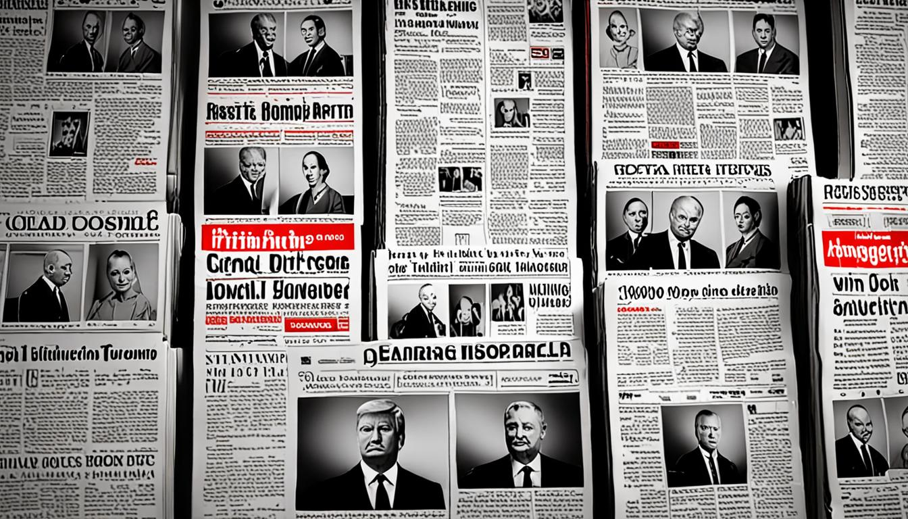

> 🌐 [Read original in Spanish](../../en/analisis/2026-11-19-mediano-cita.md)

<!-- EE_ENRICHED_START -->

<a href="/">Home</a>›<a href="/analisis/">Analysis</a>›2026-11-19

📄 Angle of the Day
<strong>Published:</strong> 2026-11-19 &nbsp;·&nbsp; <strong>Type:</strong> Angle of the Day

<figure style="margin:1.5em 0;"><figcaption style="font-size:0.85em;color:#888;text-align:center;margin-top:0.5em;font-style:italic;">The quote that changes everything</figcaption></figure>
<h1>Bernays' shadow over public opinion</h1>

In the era of algorithms whispering in our ears, a fragmented sentence from half a century ago resonates once again as an echo of warning. Edward Bernays, the grandfather of <em>public relations</em>, left a mark that today is felt in every click that turns us into consumers. His message, though incomplete, distills the essence of a strategy that has moved from elite drawing rooms to Instagram feeds.

<blockquote>«{'autor': 'Edward Bernays', 'frase': 'The conscious and intelligent manipulation of the habits and opin»</blockquote>
<h2>Who said it</h2>
<figure style="margin:1.5em 0;"><figcaption style="font-size:0.85em;color:#888;text-align:center;margin-top:0.5em;font-style:italic;">Who said it</figcaption></figure>
Edward Bernays (1891–1995) was an American pioneer of the so-called "art of persuasion." Grandson of the famous psychoanalyst Sigmund Freud, he inherited the idea that human desires can be shaped with surgical precision. After working on the campaign for the <em>American Tobacco Company</em>, where he popularized cigarettes among women under the slogan "Torch of Freedom!", Bernays founded his own agency and became the architect of modern opinion. His books, such as <em>Propaganda</em> (1928) and <em>Crystallizing Public Opinion</em> (1945), remain mandatory reading in communication and marketing schools, although few admit that his legacy is also a recipe for social control.

<h2>Context</h2>

The phrase emerged at a time when advertising was beginning to move away from simple product announcements and into mass psychology. Following the First World War, governments and corporations discovered that persuasion could be as decisive as military force. Bernays, inspired by the experiments of his uncle Freud, applied techniques of suggestion and symbol creation to turn abstract ideas into everyday habits. In the 1930s, his campaigns for the United Fruit Company and the "Borden" food company showed how the manipulation of information could shape public perception without the need for direct coercion.

<h2>What it meant</h2>

The fragment "The conscious and intelligent manipulation of the habits and opin..." reveals a clear intention: the deliberate creation of behavioral patterns through selected information. Bernays was not talking about mere persuasion; he was talking about social engineering that starts from the observation of unconscious desires to design messages that satisfy them before the individual even recognizes them. In other words, people buy the illusion of freedom while their decisions are orchestrated from the shadows of the data and narratives presented to them. The "intelligence" of the process lies in the ability to anticipate reactions and adapt the narrative in real time, a principle that today materializes in the recommendation algorithms of platforms like YouTube or TikTok.

<figure style="margin:1.5em 0;"><figcaption style="font-size:0.85em;color:#888;text-align:center;margin-top:0.5em;font-style:italic;">What it hides</figcaption></figure>
<h2>What it hides</h2>

Behind the apparent clarity of the phrase lies an uncomfortable truth: the lack of transparency. By speaking of "conscious manipulation," Bernays acknowledges that the process is deliberate, but he never mentions who decides which habits are worthy of being promoted. The absence of a clear subject allows manipulation to unfold under the guise of neutrality. Furthermore, the fragment is truncated; the word following "opin" would likely be "opinions" or "collective opinions," suggesting an intention to shape not only actions, but also the way people interpret reality. What is left out of the discourse is the ethical responsibility of those who handle these techniques, an issue that remains unresolved in the digital age.

In conclusion, Bernays's incomplete quote is not just a historical vestige, but a living warning. In a world where data is the new oil and influencers are the curators of opinion, "conscious and intelligent manipulation" continues to operate beneath the veneer of everyday life. The lesson we should draw is that vigilance belongs not only to state powers, but also to the marketing giants who, with the precision of a surgeon, sculpt our habits and ideas. Only by recognizing the existence of this invisible architecture can we reclaim a truly free public sphere.

<strong>Legal notice:</strong> This is not an accusation. It is an autopsy. The media outlets are cited and linked. The right of quotation (art. 32 LPI) protects us.

<strong>Follow us:</strong> <a href="https://youtube.com/@somoselencuadre.oficial">YouTube</a> · <a href="https://tiktok.com/@somoselencuadre">TikTok</a> · <a href="https://instagram.com/somoselencuadre">Instagram</a> · <a href="https://x.com/SomosElEncuadre">X</a> · <a href="https://threads.net/@somoselencuadre">Threads</a>

<!-- EE_ENRICHED_END -->