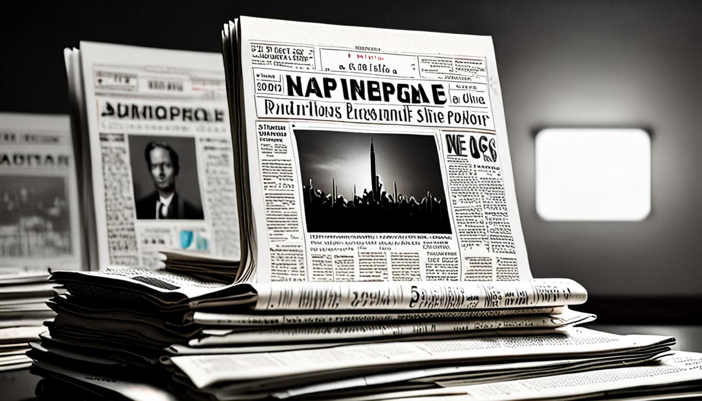

> 🌐 [Lire l'original en espagnol](../../fr/analisis/2026-11-15-mediano-medio_crudo.md)

<!-- EE_ENRICHED_START -->

<a href="/">Accueil</a>›<a href="/analisis/">Analyse</a>›2026-11-15

📄 Angle du Jour
<strong>Publié :</strong> 2026-11-15 &nbsp;·&nbsp; <strong>Type :</strong> Angle du Jour

<figure style="margin:1.5em 0;"><figcaption style="font-size:0.85em;color:#888;text-align:center;margin-top:0.5em;font-style:italic;">Libertad Digital : la technique de la disqualification par é</figcaption></figure>
<h1>Libertad Digital et la technique de disqualification par étiquetage négatif et contraste polarisateur</h1>

Dans la tourmente de la campagne électorale du 29 novembre, les médias ne se contentent pas de transmettre de simples faits. Ils deviennent des architectes de récits, souvent construits avec la même machinerie que le gouvernement lui-même : la disqualification et le contraste polarisateur. Libertad Digital, ce journal qui est devenu le miroir de la rhétorique de l'opposition, déploie avec maestria la technique de l'étiquetage négatif pour ternir l'image du président Alberto Núñez Feijóo, tout en créant un contraste qui polarise le public autour de la gestion de Pedro Sánchez.

<h2>Ce qu'il a dit</h2>
<figure style="margin:1.5em 0;"><figcaption style="font-size:0.85em;color:#888;text-align:center;margin-top:0.5em;font-style:italic;">Ce qu'il a dit</figcaption></figure>

Le titre de Libertad Digital, « Feijóo revendique la gestion face au "gaspillage" de Sánchez et lance en Galice sa marche vers le 29-N », constitue déjà une déclaration de positionnement. L'utilisation du mot « gaspillage » comme étiquette négative résume le récit que le média souhaite faire absorber au lecteur : le gouvernement de Sánchez, selon la presse, dilapide les ressources. Ce terme ne se contente pas de disqualifier le gouvernement, il suggère également un manque de discipline budgétaire qui, selon Libertad Digital, s'oppose à la prétendue « gestion » de Feijóo.

<h2>Comment il l'a dit (citation textuelle)</h2>

Dans le corps de l'article, le média ne s'arrête pas à l'abstraction. Il s'appuie sur des citations textuelles qui, sans les altérer, renforcent l'image de Feijóo en tant que leader de « la rigueur, la gestion et l'expérience ». Le président du PP lui-même a affirmé : <q>L'Espagne a besoin de « rigueur, de gestion et d'expérience »</q>. Parallèlement, Feijóo s'est proclamé défenseur des services publics avec cette phrase : <q>Le service public se défend en le gérant bien, et non en criant qu'on le défend pour ensuite le détruire</q>. La déclaration concernant le rapport entre l'effort fiscal et les services publics, <q>Faire correspondre l'effort des citoyens à des services publics corrects, c'est pour cela que vous payez des impôts</q>, ajoute une couche de justification économique à la campagne.

<h2>Ce qu'il a omis</h2>

Cependant, l'article omet toute mention des réalisations concrètes du gouvernement de Sánchez en matière de services publics. Il ne fait pas mention de l'augmentation de la couverture sanitaire, des programmes de logements sociaux ou des investissements dans les infrastructures qui ont bénéficié à la Galice. Aucune référence n'est faite non plus aux accords de financement de l'UE qui ont permis la mise en œuvre de projets d'énergie renouvelable. En omettant ces points, le média se concentre exclusivement sur la critique, sans offrir de contrepoids équilibré qui pourrait atténuer la polarisation.

<h2>Comment le détecter</h2>
L'lecteur attentif peut identifier la technique de disqualification dans le choix des mots et dans l'omission de données pertinentes. L'utilisation du terme « gaspillage » et l'absence de chiffres concrets sur les dépenses publiques créent un récit d'inefficacité qui ne repose sur aucune réalité. De même, le manque de mentions concernant les programmes de soutien social et les améliorations des infrastructures révèle un parti pris éditorial qui cherche à favoriser la figure de Feijóo au détriment d'une vision plus complète du paysage politique.

<figure style="margin:1.5em 0;"><figcaption style="font-size:0.85em;color:#888;text-align:center;margin-top:0.5em;font-style:italic;">Conclusion</figcaption></figure>
<h2>Conclusion</h2>

Libertad Digital, en employant la technique de la disqualification par le biais d'un étiquetage négatif et d'un contraste polarisant, démontre que l'information peut être aussi puissante que la propagande. En qualifiant le gouvernement de Sánchez de « gaspilleur » et en présentant Feijóo comme le sauveur de la gestion, le média crée une dichotomie qui simplifie la complexité de la politique en une bataille entre le « bien » et le « mal ». Cette stratégie non seulement polarise le public, mais renforce également l'idée que la seule solution viable est la proposition du PP. Dans un contexte où l'objectivité se fait de plus en plus rare, les lecteurs doivent faire preuve d'esprit critique et être conscients de la manière dont les mots et les omissions peuvent façonner la perception publique.

<strong>Vrai titre de Libertad Digital :</strong> « Feijóo revendique la gestion face au "gaspillage" de Sánchez et lance en Galice sa marche vers le 29-N »

<strong>Source :</strong> <a href="https://www.libertaddigital.com/espana/política/2026-11-14/feijoo-reivindica-la-gestion-frente-al-despilfarro-de-sanchez-y-arranca-en-galicia-su-camino-hacia-el-29-n-7491558/?utm_source=rss&amp;utm_medium=feed&amp;utm_campaign=Libertad+Digital%3A+Noticias+y+opini%C3%B3n+en+la+red" target="_blank" rel="noopener">Lire sur Libertad Digital</a>

<strong>Technique détectée :</strong> disqualification par étiquetage négatif et contraste polarisant

<strong>Avertissement légal :</strong> Ceci n'est pas une accusation. Il s'agit d'une autopsie. Les médias sont cités et référencés par des liens. Le droit de citation (art. 32 LPI) nous protège.

<strong>Suivez-nous :</strong> <a href="https://youtube.com/@somoselencuadre.oficial">YouTube</a> · <a href="https://tiktok.com/@somoselencuadre">TikTok</a> · <a href="https://instagram.com/somoselencuadre">Instagram</a> · <a href="https://x.com/SomosElEncuadre">X</a> · <a href="https://threads.net/@somoselencuadre">Threads</a>

<!-- EE_ENRICHED_END -->