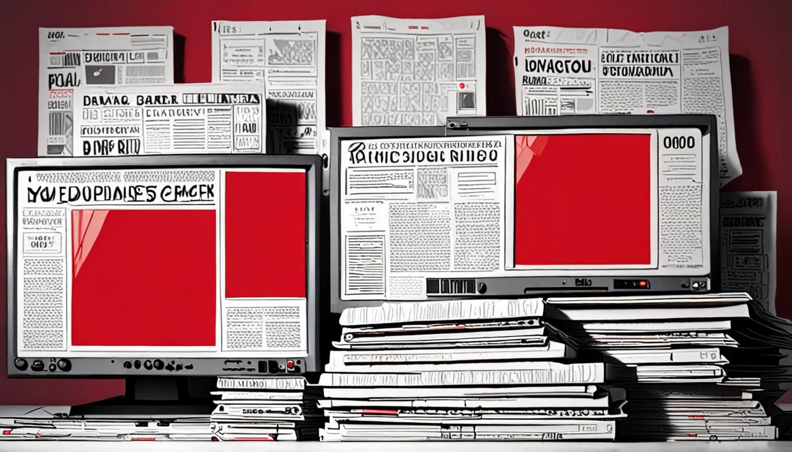

> 🌐 [Lire l'original en espagnol](../../fr/analisis/2026-11-17-mediano-tutorial.md)

<!-- EE_ENRICHED_START -->

<a href="/">Accueil</a>›<a href="/analisis/">Analyse</a>›2026-11-17

📄 Angle du Jour
<strong>Publié :</strong> 2026-11-17 &nbsp;·&nbsp; <strong>Type :</strong> Angle du Jour

<figure style="margin:1.5em 0;"><figcaption style="font-size:0.85em;color:#888;text-align:center;margin-top:0.5em;font-style:italic;">Comment détecter la technique : l'appel à la peur (alarmisme)</figcaption></figure>
<h1 style="font-size: 2.5em; margin-bottom: 10px; color: #8B0000; text-transform: uppercase; letter-spacing: 2px;">L'Art Sinistre de Faire Peur à la Vache : Guide pour Ne Pas Se Faire Manipuler</h1>

    

        Bienvenue à la fête de la panique. Ici, là où la logique fait la fête et où la peur s'infiltre par la fenêtre pour se servir un verre de dérision. Nous ne sommes pas ici pour apprendre à avoir peur, mais pour apprendre à identifier celui qui vend cette peur comme s'il s'agissait d'eau fraîche dans le désert.
    

    <h2 style="font-size: 1.8em; color: #222; border-bottom: 2px solid #ccc; padding-bottom: 5px; margin-top: 30px;">1. Qu'est-ce que cette saleté ? Définition d'un tour de passe-passe</h2>
<figure style="margin:1.5em 0;"><figcaption style="font-size:0.85em;color:#888;text-align:center;margin-top:0.5em;font-style:italic;">1. Qu'est-ce que cette saleté ? Définition d'un tour de passe-passe</figcaption></figure>

    

        Appelons-le par son vrai nom : l'appel à la peur, ou si vous préférez un terme plus élégant et moins grossier, l'alarmisme. Ce n'est pas un argument. Ce n'est pas une donnée. C'est un cri. C'est l'équivalent rhétorique de jeter une brique dans une réunion de dames pour voir qui se coiffe en premier. Il consiste à remplacer l'évidence par la menace, l'analyse par l'hystérie.
    

    

        Dans un monde où l'information voyage à la vitesse de la lumière mais où la pensée critique avance en boitant, cette technique est devenue le cheval de Troie de la démagogie. Elle ne vous dit pas « c'est mauvais » ; elle vous dit « cela va vous détruire ». La différence est abyssale. Le premier est un jugement de valeur, souvent discutable ; le second est une telle promesse de catastrophe qu'elle fait appel directement à votre instinct de survie, ce vieux réflexe reptilien niché dans votre nuque qui préfère fuir plutôt que de réfléchir.
    

    

        C'est un vieux truc, aussi vieux que la caverne où quelqu'un a crié « Lion ! » tout en projetant une ombre sur le mur. Mais aujourd'hui, avec des mégaphones numériques et des algorithmes qui amplifient la panique jusqu'à la folie, sa mécanique s'est affinée. Vous n'avez plus besoin d'un vrai lion ; avec une statistique mal contextualisée et une voix tremblante dans une vidéo de trois minutes, vous mettez la moitié de la population en émoi, prête à obéir au moindre ordre, aussi absurde soit-il.
    
<h2 style="font-size: 1.8em; color: #222; border-bottom: 2px solid #ccc; padding-bottom: 5px; margin-top: 30px;">2. Comment l'utilise-t-on ? L'anatomie de la panique organisée</h2>
    

        Le manuel de l'alarmiste ne comporte pas beaucoup d'entrées, mais il les répète avec la persistance d'un perroquet drogué aux amphétamines. Premièrement, il sélectionne un problème réel. N'inventez pas le problème, c'est trop difficile et facile à démonter. Prenez quelque chose qui inquiète déjà les gens : le climat, l'économie, la santé, la sécurité.
    

    

        Deuxièmement, gonflez les proportions. Si le risque est de 1 %, parlez de 99 %. S'il s'agit d'un problème local, présentez-le comme une apocalypse mondiale. Utilisez des adjectifs qui pèsent des tonnes : « imminent », « irréversible », « catastrophique », « sans précédent ». Chaque mot est une goutte de poison qui pénètre la carapace rationnelle de l'auditeur.
    

    

        Troisièmement, éliminez les nuances. La réalité est grise, pleine de nuances et de probabilités. L'alarmisme est noir et blanc. Soit tout va bien, soit tout va s'effondrer. Il n'y a pas de juste milieu. Il n'y a pas de solutions graduelles. Il n'y a que l'action immédiate, drastique et, bien sûr, dirigée par celui qui crie le plus fort.
    

    

        Quatrièmement, créez un ennemi ou une cause unique. La peur a besoin d'un bouc émissaire. Il peut s'agir d'une entreprise, d'un parti politique, d'un groupe d'immigrants, d'une nouvelle technologie. En simplifiant la culpabilité, on simplifie également la solution : « Si nous éliminons X, la peur disparaît ». C'est une logique d'enfant de cinq ans, mais elle fonctionne à merveille sur les foules effrayées.
    

    <h2 style="font-size: 1.8em; color: #222; border-bottom: 2px solid #ccc; padding-bottom: 5px; margin-top: 30px;">3. Exemple réel : Le cirque de la désinformation en temps réel</h2>
    

        Il n'est pas nécessaire d'aller chercher des squelettes dans le placard. Il suffit de regarder la scène politique et médiatique actuelle. Pensons à la façon dont le récit est géré lorsqu'il y a une crise du logement. Au lieu d'analyser la spéculation, les terrains publics non urbanisés ou le manque d'investissement dans les logements abordables, nous entendons certaines voix crier que « le système s'effondre » et que « les citoyens ordinaires sont chassés de chez eux par une élite cachée ».
    

    

        Ici, il n'y a pas de données, il y a de la dramaturgie. On utilise la peur de perdre son foyer pour justifier des mesures extrêmes ou pour détourner l'attention des causes structurelles. La situation est présentée comme un siège, où le citoyen est un soldat dans une tranchée contre une armée invisible. C'est une métaphore puissante, mais fausse. Ce n'est pas un conflit, c'est un marché faussé. Mais le mot « conflit » génère plus de peur que le mot « marché », et la peur fait vendre plus que l'économie.
    

    

        Autre exemple classique : la gestion de la santé publique. Lorsqu'un hôpital a des listes d'attente, la version rationnelle parle d'un manque de personnel, d'infrastructure, de planification. La version alarmiste parle d'« abandon », de « systèmes brisés », et affirme que « la prochaine personne qui mourra sur un brancard, ce sera vous ». Même si nous évitons les termes explicites sur la perte de vie, l'implication est claire : on vous vend l'idée que l'État a déclaré la guerre à votre bien-être. C'est une manipulation cruelle qui exploite la vulnérabilité humaine pour transformer la patience en une fureur aveugle.
    
<h2 style="font-size: 1.8em; color: 222; border-bottom: 2px solid #ccc; padding-bottom: 5px; margin-top: 30px;">4. Comment le détecter ? Chaussez les lunettes du doute</h2>
    

        Détecter l'alarmisme demande une dose de cynisme et une pincée de patience. Tout d'abord, demandez-vous : est-ce un fait ou une projection ? Les faits sont mesurables. Les projections sont des rêves cauchemardesques déguisés en science. S'il n'y a pas d'étude, de données concrètes, de source vérifiable, c'est du pipeau.
    

    

        Deuxièmement, examinez la source. Qui parle ? Est-il motivé par le désir d'informer ou de vendre ? De générer des clics ? De gagner des élections ? L'intérêt personnel est le meilleur indicateur de la désinformation. Si quelqu'un gagne de l'argent, du pouvoir ou de l'attention en vous effrayant, sa crédibilité s'effondre.
    

    

        Troisièmement, cherchez la nuance. Si un argument est trop simple, il est probablement faux. La réalité est complexe. Si la solution proposée est unique, drastique et urgente, elle est presque certainement conçue pour contourner le débat et la délibération.
    

    

        Quatrièmement, observez le langage. Y a-t-il beaucoup de points d'exclamation ? Des adjectifs superlatifs ? Parle-t-on de « du jamais vu » ? C'est un signal d'alarme. L'histoire est pleine de choses « jamais vues », et la plupart du temps, elles ont été réglées avec du temps, pas avec de la panique.
    

    <figure style="margin:1.5em 0;"><figcaption style="font-size:0.85em;color:#888;text-align:center;margin-top:0.5em;font-style:italic;">5. Comment le combattre ? Le vaccin de la raison</figcaption></figure>
<h2 style="font-size: 1.8em; color: #222; border-bottom: 2px solid #ccc; padding-bottom: 5px; margin-top: 30px;">5. Comment le combattre ? Le vaccin de la raison</h2>
    

        Combattre l'alarmisme n'est pas une tâche facile. La peur crée une dépendance. Mais il existe un remède : une information de qualité, lente et ennuyeuse. Lisez les sources primaires. Ne vous fiez pas aux résumés sur les réseaux sociaux. Allez à la source. Si un média sensationnaliste affirme que « X est la fin du monde », cherchez ce que dit l'organisme technique officiel. Souvent, la différence est abyssale.
    

    

        Deuxièmement, éduquez votre entourage. Parlez calmement. Ne criez pas. L'alarmiste crie ; vous devez chuchoter. Expliquez les nuances. Montrez les données. Si vous n'y parvenez pas, n'insistez pas. On ne peut pas raisonner quelqu'un qui est en mode panique.
    

    

        Troisièmement, pratiquez la résilience émotionnelle. Acceptez que vous ne pouvez pas tout contrôler. Acceptez qu'il y ait des risques, mais qu'ils ne sont pas nécessairement imminents ou catastrophiques. Apprenez à distinguer le risque réel du risque perçu. La plupart des choses qui nous terrifient aujourd'hui sont, statistiquement, moins dangereuses que de conduire une voiture ou de fumer.
    

    

        Enfin, votez avec votre tête, pas avec un cœur effrayé. Exigez de vos représentants politiques qu'ils parlent clairement, avec des données, sans dramaturgie. Si vous leur demandez de la peur, ils vous donneront de la peur. Si vous leur demandez la vérité, ils vous donneront peut-être une version plus acceptable de la réalité.
    

    

        En résumé, l'alarmisme est l'opium du peuple, avec simplement plus de bruit et moins d'effets secondaires immédiats. C'est un outil de contrôle social déguisé en préoccupation. Ne vous laissez pas berner. Le monde est un endroit dangereux, oui, mais pas pour les raisons que vous vendent les marchands d'hystérie. Réfléchissez, doutez, enquêtez. Et surtout, ne vous laissez pas effrayer par ceux qui profitent de votre terreur. La raison est la seule lumière dans ce marécage d'encre et de panique.
    

<strong>Mentions légales :</strong> Ceci n'est pas une accusation. C'est une autopsie. Les médias sont cités et référencés. Le droit de citation nous protège.

<strong>Suivez-nous :</strong> <a href="https://youtube.com/@somoselencuadre.oficial">YouTube</a> · <a href="https://tiktok.com/@somoselencuadre">TikTok</a> · <a href="https://instagram.com/somoselencuadre">Instagram</a> · <a href="https://x.com/SomosElEncuadre">X</a> · <a href="https://threads.net/@somoselencuadre">Threads</a>

<!-- EE_ENRICHED_END -->