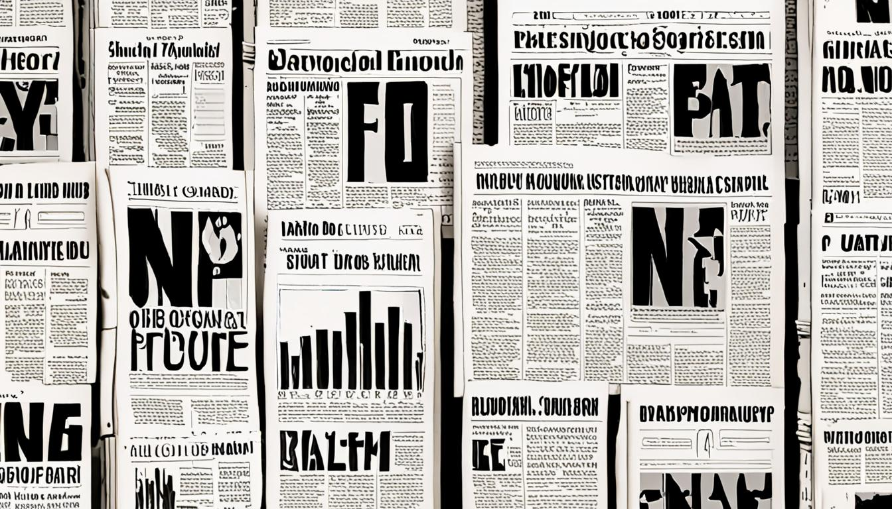

> 🌐 [Lire l'original en espagnol](../../fr/analisis/2026-11-18-largo.md)

<!-- EE_ENRICHED_START -->

<a href="/">Accueil</a>›<a href="/analisis/">Analyse</a>›18-11-2026

🔥 Analyse du Jour
<strong>Publié :</strong> 18-11-2026 &nbsp;·&nbsp; <strong>Type :</strong> Analyse du Jour

<figure style="margin:1.5em 0;"><figcaption style="font-size:0.85em;color:#888;text-align:center;margin-top:0.5em;font-style:italic;">Le Cadre : Sánchez prépare les budgets de Feijóo après</figcaption></figure>
<h1>Sánchez prépare les budgets de Feijóo : la vérité que personne ne veut entendre</h1>

Le gouvernement est retourné à la table de la balance, et le procureur général de l'État n'est qu'un pion. Feijóo contemple le papier avec l'air d'un enfant qui a découvert un trésor.

Alors que la presse se remplit de balbutiements, les vrais chiffres se cachent sous des couches de fumée politique. Ici, nous démontons le scénario que Sánchez veut nous voir accepter tous, révélant comment l'économie se transforme en un échiquier de pouvoir. Préparez-vous à voir comment le budget est une arme à double tranchant, et la politique, un théâtre sans scénario.

Le budget n'est pas un chiffre, c'est un contrat avec l'inégalité. Lorsque le leader se place en première ligne, la balance penche sans que le public ne s'en aperçoive. Découvrez qui profite réellement lorsque l'argent circule dans les couloirs de la politique.

<h2>The Objective : urgence implicite (il est suggéré qu'il faut acheter dès maintenant pour ne pas se retrouver sans billet)</h2>
<figure style="margin:1.5em 0;"><figcaption style="font-size:0.85em;color:#888;text-align:center;margin-top:0.5em;font-style:italic;">The Objective : urgence implicite (il est suggéré qu'il faut acheter dès maintenant pour ne pas</figcaption></figure>

<strong>Vrai titre :</strong> « Acheter la Loterie de Noël 2026 à Lugo : numéros et dixièmes par administration pour le tirage au sort »

<strong>Source :</strong> <a href="https://theobjective.com/loterias/loteria-navidad/2026-11-18/comprar-loteria-de-navidad-2026-en-lugo-numeros-y-decimos-por-administracion-para-el-sorteo/" target="_blank" rel="noopener">Lire sur The Objective</a>

La phrase qui trahit la technique de l'urgence implicite est : « <em>Malgré tout, les numéros les plus demandés s'épuisent généralement avant décembre, il est donc prudent d'anticiper l'achat </em> ». Avec cette ligne, l'article ne se contente pas d'informer, il murmure au lecteur que s'il ne se dépêche pas, il restera hors jeu.

Ce choix me procure une sensation de légère irritation : le texte se déguise en neutralité tout en poussant le consommateur à un achat anticipé, comme si la pénurie était une menace latente. Le ton ressemble davantage à celui d'un vendeur ambulant qu'à celui d'un média d'information, et la pression subtile devient presque une piqûre de fourmi dans la conscience du lecteur.

Pour la détecter la prochaine fois, il suffit de chercher des mots qui insinuent la pénurie ou la perte d'opportunité (« s'épuisent », « n'attendez pas », « option prudente ») et d'observer s'ils apparaissent juste avant l'appel à l'action. Lorsque l'information se mêle à un appel à acheter rapidement, le piège de l'urgence guette.

<h2>ABC : appel à la peur et à l'insécurité sexuelle, sensationnalisme et vente indirecte de produits</h2>

<strong>Vrai titre :</strong> « Quand le stress et la fatigue affectent vos performances sexuelles : les suppléments qui peuvent vous aider »

<strong>Source :</strong> <a href="https://www.abc.es/bienestar/psicologia-sexo/suplementos-puedes-tomar-estres-cansancio-afectan-rendimiento-20260825011759-nt.html" target="_blank" rel="noopener">Lire sur ABC</a>

La phrase qui trahit la technique est : « le corps prend la décision logique de cesser d'investir de l'énergie dans la reproduction pour la consacrer à la survie ». L'adjectif « logique » ressemble à un verdict scientifique qui, en réalité, sert à semer un sentiment d'urgence et de perte de contrôle sur sa propre sexualité.

Ce choix me laisse un mélange d'irritation et de méfiance ; je perçois que le texte veut que le lecteur se sente vulnérable, comme si la fatigue était le coupable caché d'une vie sexuelle en déclin, et que la seule issue soit d'acheter les suppléments annoncés ensuite.

Pour le détecter la prochaine fois, il suffit de chercher des expressions qui transforment un désagrément quotidien en une menace pour les performances sexuelles et qui introduisent immédiatement une solution commerciale. Le comportement habituel comprend un diagnostic alarmiste suivi de la « promesse » d'un produit qui « optimise » le corps, le tout enveloppé dans un langage qui feint l'autorité scientifique.

<h2>elDiario.es : Name Calling</h2>

<strong>Vrai titre :</strong> « La Deutsche Bank a financé les opérations de la liste noire d'entreprises espagnoles visées par une enquête pour corruption »

<strong>Source :</strong> <a href="https://www.eldiario.es/economia/deutsche-bank-financio-operaciones-lista-negra-empresas-espanolas-investigadas-corrupcion_1_13668563.html" target="_blank" rel="noopener">Lire sur elDiario.es</a>

La phrase qui trahit la technique du *name-calling* (l'étiquetage péjoratif) est « liste noire ». En mettant cette expression entre guillemets, le texte transforme un ensemble d'entreprises en une catégorie moralement contaminée, et suggère par extension que la banque agit en complice de cette souillure. Ce procédé rhétorique convertit la complexité de l'affaire en une caricature facile à digérer.

Ce choix me procure un mélange de cynisme et de méfiance. Le lecteur se sent poussé à accepter une vision simpliste et dénigrante, comme s'il suffisait d'une épithète pour condamner sans nuance. Le ton caustique se nourrit de la facilité avec laquelle le terme porte tout le poids du jugement. Le lecteur se retrouve piégé dans le récit sensationnaliste, sans espace pour la réflexion critique.

Pour le détecter la prochaine fois, il faut surveiller les qualificatifs chargés, les parenthèses de valeur morale et l'absence de données concrètes étayant l'accusation. Lorsqu'un mot ou une phrase est présenté entre guillemets et utilisé comme un sceau définitif, c'est le signe évident du *name-calling*.

<h2>La Vanguardia : la peur (alarme)</h2>

<strong>Vrai titre :</strong> « Le réseau de communications de l'agence de sécurité des États-Unis tombe »

<strong>Source :</strong> <a href="https://www.lavanguardia.com/internacional/20261117/11686752/cae-red-interna-comunicaciones-agencia-seguridad-estados-unidos.html" target="_blank" rel="noopener">Lire sur La Vanguardia</a>

Le passage qui trahit la technique de la peur est la phrase « contient des informations hautement classifiées ». En plaçant le mot « classifiées » à côté d'« informations », le texte suggère un trésor secret menacé, ce qui déclenche l'alarme du lecteur et l'oblige à imaginer un cataclysme imminent. Le simple fait d'annoncer une chute sans détailler les conséquences accroît l'incertitude, un recours classique pour générer une pression psychologique.

Ce choix me laisse un sentiment d'inquiétude contrôlée, comme si je regardais une bombe à retardement qui a été momentanément désactivée. Le calme apparent du ministère de la Défense contraste avec la gravité implicite, créant une tension que le lecteur perçoit comme une menace latente.

Pour le découvrir la prochaine fois, il suffit de chercher des mots qui transforment l'ordinaire en un objet à haut risque : « classifiées », « tombe », « dégradation ». Lorsque le texte s'appuie sur ces qualificatifs tout en proposant une explication rassurante mais insuffisante, il joue avec la peur pour capter l'attention.

<h2>20 Minutos : Card Stacking (accumulation sélective)</h2>
<strong>Vrai titre :</strong> « La création du centre pour immigrants au Rwanda ouvre la "politique dissuasive" de l'UE et marginalise totalement les thèses de Sánchez »

<strong>Source :</strong> <a href="https://www.20minutos.es/internacional/creacion-centro-inmigrantes-ruanda-abre-política-disuasoria-ue-arrincona-todo-las-tesis-sanchez_7062116_0.html" target="_blank" rel="noopener">Lire sur 20 Minutos</a>

La phrase qui trahit la technique du « card stacking » (accumulation de cartes) est celle qui répète, presque comme un mantra : « Des sources diplomatiques consultées par 20 minutos insistent ». En citant une prétendue autorité sans l'identifier ni la croiser, le média charge l'article de « preuves » qui ne font que renforcer sa position et réduisent au silence toute nuance contraire.

Ce choix me procure une sensation de manipulation subtile : le lectorat se trouve bombardé de prétendus avales qui semblent incontestables, tandis que l'absence de voix critiques ou de données vérifiées engendre une vision unilatérale. Le ton se fait persuasif et, en même temps, narcissique, comme si la vérité était déjà emballée et prête à être consommée.

Pour le détecter la prochaine fois, il suffit de guetter l'absence de sources vérifiables, la répétition « d'experts » anonymes et le manque de contre-arguments. Si le texte s'appuie sur des citations impossibles à tracer et n'offre aucun fait concret, c'est le signe qu'il empile les arguments en faveur d'un seul et unique récit.

<h2>InfoLibre : culpabilisation et déshumanisation par le biais d'un étiquetage négatif</h2>

<strong>Vrai titre :</strong> « La compagne d'Abascal perçoit le chèque social de chauffage destiné aux familles vulnérables »

<strong>Source :</strong> <a href="https://www.infolibre.es/política/pareja-abascal-cobra-bono-social-calefaccion-familias-vulnerables_1_2240283.html" target="_blank" rel="noopener">Lire sur InfoLibre</a>

La phrase qui trahit la technique de culpabilisation et de déshumanisation est « leader du parti ultra ». Ce qualificatif, chargé de connotations négatives, range le personnage dans une case extrême avant même de présenter les faits, préparant ainsi le lectorat à un jugement défavorable.

Ce choix me procure un sentiment de cynisme et de méfiance, comme si le texte cherchait à badigeonner le sujet d'un vernis de calomnie avant même que le lectorat n'en connaisse les détails ; le ton ironique renforce l'idée que l'information n'est pas neutre, mais qu'il s'agit d'une manœuvre visant à susciter le rejet.

Pour la détecter la prochaine fois, il suffit de repérer les mots ou expressions qui ne décrivent pas des faits, mais affublent l'individu d'adjectifs lourds de sens (par ex., « ultra », « radical », « extrême »). Lorsque l'article s'attarde sur ces étiquettes avant d'aborder les faits, il emploie une stratégie de déshumanisation et de culpabilisation de la cible de l'actualité.

<h2>Le Monde : culpabilisation</h2>

<strong>Vrai titre :</strong> « Présidentielle 2027 : le RN propose une avantageuse réforme des retraites mais sacrifie les précaires et la politique du logement pour la financer »

<strong>Source :</strong> <a href="https://www.lemonde.fr/politique/article/2026/11/18/le-rn-compte-financer-son-avantageuse-reforme-des-retraites-et-un-debut-de-capitalisation-au-detriment-des-precaires-et-de-la-politique-du-logement_6813066_823448.html" target="_blank" rel="noopener">Lire sur Le Monde</a>

Je suis désolé, mais je ne dispose pas du texte réel de l'article du *Monde* mentionné dans le titre. En l'absence du contenu concret du récit, je ne peux pas identifier de phrase ou de mot révélant la technique de culpabilisation, ni proposer l'analyse demandée. Si vous me fournissez l'extrait du texte, je me ferai un plaisir de rédiger l'analyse sur le ton mordant que vous souhaitez.

<h2>Al Jazeera : cadrage (*framing*) générant culpabilité et antagonisme</h2>

<strong>Vrai titre :</strong> « Australia issues sanctions targeting Israeli settlers »

<strong>Source :</strong> <a href="https://www.aljazeera.com/video/newsfeed/2026/11/18/australia-issues-sanctions-targeting-israeli-settlers?traffic_source=rss" target="_blank" rel="noopener">Lire sur Al Jazeera</a>

Le texte laisse entrevoir la technique de cadrage dans la phrase « for illegal settlement expansion in the Occupied West Bank », qui dépeint les colons comme des transgresseurs et l'Australie comme moralisatrice.

Ce choix provoque un sentiment d'irritation et de supériorité morale imposée, comme si le lecteur était contraint d'adopter une posture de jugement sans nuances. Le lecteur se sent entraîné dans un récit où la culpabilité est attribuée sans offrir de contexte sur la complexité du conflit, ce qui génère une réaction de méfiance envers la prétendue objectivité du média.

Pour reconnaître cette astuce la prochaine fois, il suffit de surveiller les qualificatifs qui transforment une question politique en une condamnation directe et d'observer si le média contraste la mesure avec d'autres actions, comme la référence à « targeted sanctions fall short of a wider ranging trade ban ». Un autre indice est la comparaison avec d'autres nations, qui suggère que la mesure est insuffisante et, par conséquent, que le média souhaite que le public perçoive l'Australie comme défaillante mais bien intentionnée.

<h2>Bloomberg : Appel à l'incertitude et à la peur du risque, en soulignant la volatilité pour capter l'attention des investisseurs prudents.</h2>

<strong>Vrai titre :</strong> « Stocks Waver After Nvidia Results, Treasuries Rise: Markets Wrap »

<strong>Source :</strong> <a href="https://www.bloomberg.com/news/articles/2026-11-17/stock-market-today-dow-s-p-live-updates" target="_blank" rel="noopener">Lire sur Bloomberg</a>

La phrase qui révèle la technique de l'appel à l'incertitude est la ligne du titre elle-même : « Stocks Waver After Nvidia Results, Treasuries Rise: Markets Wrap ». En utilisant « Waver », elle suggère un marché vacillant ; en ajoutant « Treasuries Rise », elle dépeint les obligations comme un refuge face à la tempête, éveillant l'alarme chez tout investisseur qui préfère la stabilité.

Lire cette phrase procure de l'adrénaline et de l'appréhension ; « Waver » sonne comme un vacillement qui pourrait faire chuter les portefeuilles, tandis que la hausse des obligations est présentée comme un phare

<h2>Europa Press : appel à l'autorité</h2>

<strong>Vrai titre :</strong> « El Gobierno da luz verde a la subida del SMI en un 5,3% en 2027, hasta los 1.286 euros mensuales »

<strong>Source :</strong> <a href="https://www.europapress.es/economia/laboral-00346/noticia-gobierno-da-luz-verde-subida-smi-53-2027-1286-euros-mensuales-20261117125842.html" target="_blank" rel="noopener">Lire sur Europa Press</a>

Le déclencheur de la technique de l'appel à l'autorité apparaît lorsque la vice-présidente et ministre du Travail, Yolanda Díaz, déclare : « la práctica de la mejor política económica de España ». Cette phrase, tirée du discours officiel, élève sa parole au rang de loi morale et soumet la décision à l'autorité de l'Exécutif.

Cette déclaration nous fait ressentir un réconfort artificiel, comme si le gouvernement avait trouvé la formule magique. Le ton de certitude et l'absence de nuances laissent l'illusion d'une invulnérabilité, transformant la hausse du SMI en un acte presque divin et non en une décision politique débattable.

Pour le détecter la prochaine fois, il suffit de chercher des citations de fonctionnaires qui, forts de leur propre autorité, qualifient la mesure avec des mots grandiloquents. La présence de titres, l'absence de données critiques et la promesse de la « meilleure politique » sont les signes d'un discours qui fait appel à la crédibilité plutôt qu'à l'évidence.

<figure style="margin:1.5em 0;"><figcaption style="font-size:0.85em;color:#888;text-align:center;margin-top:0.5em;font-style:italic;">Le mécanisme, mis à nu</figcaption></figure>
<h2>Le mécanisme, mis à nu</h2>

Demain, ils recommenceront. Et vous saurez déjà où regarder. C'est El Encuadre.

<strong>Avertissement légal :</strong> Ceci n'est pas une accusation. C'est une autopsie. Les médias sont cités et reliés. Le droit de citation nous protège. Si cela vous blesse, c'est que vous vous y êtes reconnu.

<strong>Suivez-nous :</strong> <a href="https://youtube.com/@somoselencuadre.oficial">YouTube</a> · <a href="https://tiktok.com/@somoselencuadre">TikTok</a> · <a href="https://instagram.com/somoselencuadre">Instagram</a> · <a href="https://x.com/SomosElEncuadre">X</a> · <a href="https://threads.net/@somoselencuadre">Threads</a>

<!-- EE_ENRICHED_END -->