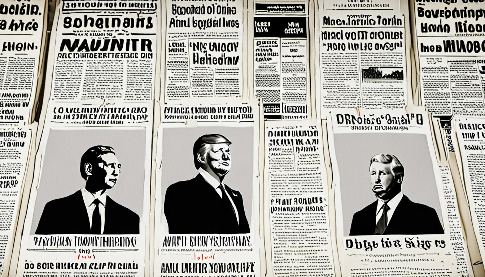
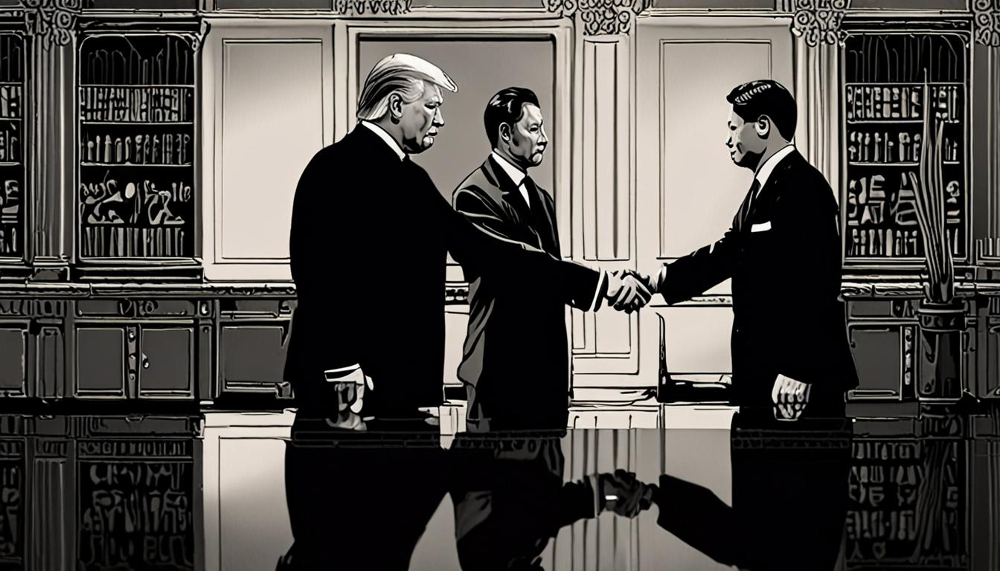

> 🌐 [Lire l'original en espagnol](../../fr/analisis/2026-11-19-dossier-v2.md)

<!-- EE_ENRICHED_START -->

<a href="/">Accueil</a>›<a href="/analisis/">Analyse</a>›2026-11-19

📁 Dossier Exécutif
<strong>Publié :</strong> 2026-11-19 &nbsp;·&nbsp; <strong>Type :</strong> Dossier Exécutif

<figure style="margin:1.5em 0;"><figcaption style="font-size:0.85em;color:#888;text-align:center;margin-top:0.5em;font-style:italic;">Le Cadrage : Poutine, vainqueur du sommet à trois de Shenzhen :</figcaption></figure>
<h1>Dossier du jour : Le Cadrage : Poutine, vainqueur du sommet à trois de Shenzhen : Trump et Xi ignorent l'Europe et l'intègrent dans la triade du pouvoir mondial</h1>

<strong>Introduction :</strong> Alors que le monde se vide de son sang dans des sommets diplomatiques où les masques tombent, les médias de ce pays nous vendent de la poudre aux yeux électorale et de la panique migratoire. Aujourd'hui, nous ne venons pas informer, nous venons décortiquer le mécanisme. Ce qu'ils appellent des « actualités » est en réalité une chorégraphie de la peur conçue pour nous empêcher de regarder vers le haut, et nous pousser vers l'abîme de nos propres choix. Ici, il n'y a pas de vérité, seulement un cadrage. Et le cadrage d'aujourd'hui est une farce en trois actes : la géopolitique ignorée, la démocratie empoisonnée et le spectacle vide.

<h2>Actualités du jour</h2>
<figure style="margin:1.5em 0;"><figcaption style="font-size:0.85em;color:#888;text-align:center;margin-top:0.5em;font-style:italic;">Actualités du jour</figcaption></figure>

Le grand titre du jour est un mensonge par omission. Le titre qu'on nous vend parle d'un sommet à Shenzhen où Poutine sort « vainqueur » et où Trump et Xi « ignorent l'Europe ». Un récit de conspiration internationale qui devrait nous faire sourire s'il ne s'agissait pas de l'unique moyen de masquer le trou noir qu'est la politique espagnole. Mais oublions un instant les ours et les dragons. Le véritable théâtre se joue ici, dans la péninsule, avec une distribution locale qui joue avec la conviction d'un acteur de feuilleton.

D'un côté, nous avons le chaos juridique autour de la « loi des petits-enfants ». La Cour suprême, dans une manœuvre qui sent le désespoir institutionnel, a admis qu'il n'y a « pas le temps matériel » de réviser les listes électorales. Cela signifie que 189 678 personnes, enfants de personnes naturalisées, pourront voter le 29 novembre. Selon des sources juridiques citées par Libertad Digital, cela pourrait « affecter 14 sièges ». Quatorze chaises sur l'échiquier. Ce n'est pas une anecdote, c'est la bombe à retardement qui menace de reconfigurer la carte politique. La Cour suprême a également rejeté le recours de Vox visant à suspendre provisoirement le vote, laissant le gouvernement avec un visage très serein tandis que la machine électorale continue de tourner sur un axe qui, du moins pour certains, est brisé.

D'un autre côté, le débat. Le dernier face-à-face entre Pedro Sánchez et Alberto Núñez Feijóo. ElDiario.es le présente comme une « revanche de 2023 », un récit de vengeance personnelle déguisé en politique. Pendant ce temps, le PP, par la voix de son secrétaire général Miguel Tellado, n'invite pas à voter pour lui, mais exhorte les électeurs socialistes à « rester chez eux ». Un appel à l'abstentionnisme sélectif qui est, en soi, l'aveu d'une faiblesse. Ils ne croient pas en leur message, ils comptent sur la paresse des autres.

<h2>Les médias et leurs techniques</h2>

La presse ne relate pas des faits, elle installe des émotions. Chaque rédaction a sa recette secrète, son additif chimique pour que le lecteur ne pense pas, mais ressente. La peur, l'urgence, la fausse certitude. Analysons les ingrédients qu'ils ont utilisés aujourd'hui pour cuisiner cette soupe de lettres.
<table>
    <tr>
        <th>Média</th>
        <th>Technique</th>
        <th>Omet</th>
    </tr>
    <tr>
        <td>El Español</td>
        <td>Appel à la peur et dramatisation</td>
        <td>La réalité du sommet ; l'irrélevance de l'Europe dans la triade</td>
    </tr>
    <tr>
        <td>ABC</td>
        <td>Cadrage spectral (Framing)</td>
        <td>La politique ; le contenu réel du débat ou de l'actualité</td>
    </tr>
    <tr>
        <td>The Objective</td>
        <td>Urgence commerciale</td>
        <td>La critique sociale ; le contexte des dépenses publiques</td>
    </tr>
    <tr>
        <td>OkDiario</td>
        <td>Sensationalisme territorial</td>
        <td>Les causes structurelles de la migration ; la responsabilité partagée</td>
    </tr>
    <tr>
        <td>InfoLibre</td>
        <td>Insécurité et exclusion</td>
        <td>La solidité des données démoscopiques opposées</td>
    </tr>
    <tr>
        <td>elDiario.es</td>
        <td>Narrative de fin de cycle</td>
        <td>La complexité des sondages ; la marge d'erreur</td>
    </tr>
    <tr>
        <td>Libertad Digital</td>
        <td>Appel à la peur (fear appeal)</td>
        <td>La légalité de la loi ; le contexte historique de la mémoire</td>
    </tr>
</table>

C'est un cirque de miroirs déformants. Chaque média déforme la réalité pour qu'elle corresponde à sa bulle idéologique. Mais le modèle est clair : on ne vous donne jamais l'outil pour réfléchir, seulement le choc pour réagir.

<h2>Les techniques en détail</h2>

<strong>1. La dramatisation de la conspiration (El Español)</strong> 
El Español entre en scène avec un titre qui ressemble plus à un film d'espionnage qu'à une chronique journalistique : « Poutine, vainqueur du sommet à trois de Shenzhen : Trump et Xi ignorent l'Europe et l'incluent dans la triade du pouvoir mondial ». La technique utilisée ici est <em>l'appel à la peur</em>. En présentant l'Europe comme une entité qui a été « ignorée » et « incluse » dans un jeu qu'elle ne contrôle pas, on génère un sentiment de vulnérabilité collective. On nous fait croire que nous sommes seuls, que les grands acteurs mondiaux se moquent de nous. C''est une manière élégante de dire : « Ne regardez pas votre gouvernement, regardez l'extérieur, c'est là que se trouve le véritable danger ». Il omet le fait que la politique étrangère est complexe et que « gagner » un sommet n'est pas un concept binaire. Il utilise la peur de l'irrélevance pour conditionner la lecture de tout le reste.

<strong>2. Le mirage culturel (ABC)</strong> 
ABC réalise un coup de maître échiquéen : le <em>framing</em> ou cadrage contextuel. Alors que le pays s'embrase à cause des élections et des recensements, ABC titre : "Heure et chaînes qui diffusent aujourd'hui le face-à-face entre Pedro Sánchez et Feijóo". Mais le texte réel qui nous est présenté est une interview de Neus Sendra, narratrice de livres audio, qui déclare : "Je me construis un film dans la tête et je le raconte à l'auditeur. Je le prends par la main et je ne le lâche plus de tout le roman". La technique est celle de la déviation. En associant la politique (le face-à-face) à l'art de raconter des histoires (la narration de livres audio), le débat politique est présenté comme un spectacle inévitable, presque artistique. Le contenu politique est omis pour se concentrer sur la forme. On nous dit que la politique est un théâtre et que nous sommes le public qui doit rester "sans lâcher" la main du narrateur. C'est une anesthésie culturelle. Au lieu d'analyser les propositions, on analyse l'émotion de la narration.

<strong>3. L'urgence de la consommation (The Objective)</strong> 
The Objective utilise l'<em>urgence</em> pure et dure, mais appliquée à la consommation. Son texte réel parle de l'achat de la Loterie de Noël à Badajoz : "Jusqu'à quand peut-on l'acheter et comment chercher un numéro ? La vente a commencé le 29 juin... et se clôture le 21 décembre". Au milieu de la tempête politique, The Objective nous offre la bouée de sauvetage du hasard. La technique est la distraction par l'enthousiasme commercial. En dressant la liste des prix et des administrations, on crée un sentiment de normalité et de routine qui contraste avec le chaos extérieur. On nous invite à participer activement au jeu de la loterie (un système de paris d'État) tout en ignorant le jeu de la démocratie. C'est une façon de dire : "Vous ne pouvez pas contrôler Sánchez ni Feijóo, mais vous pouvez contrôler si vous achetez le numéro 40000". C'est un mécanisme de défense individualiste en période d'incertitude collective.

<strong>4. Le terrorisme du recensement (Libertad Digital)</strong> 
Libertad Digital boucle la boucle avec l'<em>appel à la peur</em> le plus direct et le plus sournois : "Le vote des enfants de naturalisés avec la Loi des petits-enfants... peut affecter 14 sièges". Ici, aucune subtilité. Il y a un chiffre magique, 14, qui flotte dans l'air comme une menace existentielle. Ils citent des sources juridiques qui "craignent" que cela ait des répercussions de manière "notoire". La technique consiste à instiller le doute sur la légitimité démocratique. La loi sur la mémoire est présentée comme un instrument de manipulation électorale massive. Le débat sur la mémoire historique est omis pour se concentrer uniquement sur le résultat arithmétique des sièges. On nous dit que la démocratie est en danger non pas par manque de liberté, mais par excès de bulletins de vote. C'est une peur très concrète, très mesurable, et par conséquent, très facile à vendre.

<h2>Les biais partagés</h2>

Qu'ont en commun El Español, ABC, The Objective, OkDiario, InfoLibre, elDiario.es et Libertad Digital ? Que tous, dans leur tranche idéologique, pratiquent la même hérésie : la déshumanisation de la politique au profit de l'émotion primaire.

Le schéma répétitif est la <em>réduction</em>. La géopolitique se réduit à un piège pour l'Europe. Le débat politique se réduit à un film dans la tête. La crise migratoire se réduit à des "mouvements imprévisibles" (OkDiario l'appelle ainsi : "mouvements migratoires imprévisibles contre Ceuta", une phrase qui ressemble à un scénario de film catastrophe). L'élection se réduit à 14 sièges ou à un numéro de loterie.

Pourquoi cela fonctionne-t-il ? Parce que le citoyen moyen est épuisé. La complexité de la réalité est écrasante. Il est plus confortable de croire qu'il y a un méchant (Poutine, les petits-enfants, la loterie, l'autre candidat) que de comprendre les nuances d'un traité international ou d'une loi sur la mémoire. Les médias savent que si l'on vous donne des faits froids, vous vous ennuyez. Mais si l'on vous fait peur, vous restez. Si l'on vous donne de l'espoir (la loterie), vous restez. Si l'on vous donne l'impression de faire partie d'un secret (le sommet de Shenzhen), vous restez. Tous les médias, sans exception, vendent la même chose : la certitude que quelque chose ne va pas, et que la seule issue est de se sentir partie intégrante de la tribu qui l'a détecté.

Il y a un biais partagé d'<em>insécurité institutionnelle</em>. La Cour suprême « n'agit pas avec la diligence requise » (El Español). Le gouvernement ne garantit pas la clé de La Moncloa (InfoLibre). Les îles sont sous la menace (OkDiario). La démocratie est en suspens (Libertad Digital). Le sentiment que les institutions faillissent ou sont complices est la colle qui unit le public. Peu importe qui gouverne, ce qui importe, c'est que le système soit brisé. Et tant que le système est brisé, le média est le seul à posséder les pièces pour le réparer (ou pour le briser davantage).

<figure style="margin:1.5em 0;"><figcaption style="font-size:0.85em;color:#888;text-align:center;margin-top:0.5em;font-style:italic;">Conclusion</figcaption></figure>
<h2>Conclusion</h2>

Pendant que Trump et Xi jouent aux échecs à Shenzhen, nous jouons à cache-cache dans le recensement. On nous a vendu un narratif où la seule vérité est celle qui fait la une. Où l'histoire est racontée comme un livre audio pour nous dispenser de penser. Où la sécurité se mesure en mètres de clôture à Ceuta. Où l'espoir s'achète pour 0,50 euro dans un bureau de loterie.

Le mécanisme est mis à nu. Demain, ils recommenceront. Et vous, vous décidez si vous prenez la main du narrateur ou si vous lâchez le fil pour regarder la vraie carte. Car le seul sommet qui compte n'est pas celui de Shenzhen, c'est celui de votre tête. Et là, c'est vous qui posez le cadre.

<h3>Sources consultées :</h3>
<ul>
<li><strong>El Español :</strong> « Poutine, vainqueur du sommet à trois de Shenzhen : Trump et Xi ignorent l'Europe et l'incluent dans la triade du pouvoir mondial » — <a href="https://www.elespanol.com/espana/tribunales/20261119/supremo-endurece-critica-gobierno-no-actuar-diligencia-exigible-sacar-censo-falsos-nietos/1003744463762_0.html" target="_blank" rel="noopener">Lire l'article complet</a></li>
<li><strong>ABC :</strong> « Heure et chaînes qui diffusent aujourd'hui le face-à-face entre Pedro Sánchez et Feijóo » — <a href="https://www.abc.es/cultura/libros/neus-sendra-narradora-audiolibros-construyo-pelicula-cabeza-20261119050000-nt.html" target="_blank" rel="noopener">Lire l'article complet</a></li>
<li><strong>The Objective :</strong> « Acheter la Loterie de Noël 2026 à Badajoz : numéros et dixièmes par administration pour le tirage » — <a href="https://theobjective.com/loterias/loteria-navidad/2026-11-19/comprar-loteria-de-navidad-2026-en-badajoz-numeros-y-decimos-por-administracion-para-el-sorteo/" target="_blank" rel="noopener">Lire l'article complet</a></li>
<li><strong>OkDiario :</strong> « Robles renforce la sécurité des îles et des rochers après les « mouvements migratoires imprévisibles » contre Ceuta » — <a href="https://okdiario.com/espana/robles-refuerza-seguridad-islas-penones-imprevisibles-movimientos-migratorios-contra-ceuta-21117704" target="_blank" rel="noopener">Lire l'article complet</a></li>
<li><strong>InfoLibre :</strong> « Sánchez appelle à une participation de 75 % qui ne lui garantit pas la clé de La Moncloa » — <a href="https://www.infolibre.es/política/sanchez-apela-participacion-75-no-le-garantiza-llave-moncloa_1_2240351.html" target="_blank" rel="noopener">Lire l'article complet</a></li>
<li><strong>elDiario.es :</strong> « N/A » — <a href="https://www.eldiario.es/política/ultimo-cara-cara-sanchez-feijoo-pp-rebaja-expectativas-lider-psoe-prepara-revancha-2023_1_13674800.html" target="_blank" rel="noopener">Lire l'article complet</a></li>
<li><strong>Libertad Digital :</strong> « N/A » — <a href="https://www.libertaddigital.com/espana/2026-11-19/el-voto-de-los-hijos-de-los-nacionalizados-con-la-ley-de-nietos-puede-afectar-a-14-escanos-en-las-elecciones-del-29-n-7493951/?utm_source=rss&amp;utm_medium=feed&amp;utm_campaign=Libertad+Digital%3A+Noticias+y+opini%C3%B3n+en+la+red" target="_blank" rel="noopener">Lire l'article complet</a></li>
<li><strong>Al Jazeera :</strong> « Trump wants to talk nuclear with Putin and Xi » — <a href="https://www.aljazeera.com/video/newsfeed/2026/11/19/trump-wants-to-talk-nuclear-with-putin-and-xi?traffic_source=rss" target="_blank" rel="noopener">Lire l'article complet</a></li>
<li><strong>The Guardian :</strong> « One in four women globally unable to refuse sex within marriage, says UN » — <a href="https://www.theguardian.com/global-development/2026/nov/19/women-girls-rights-rape-sexual-violence-africa-marriage-unfpa" target="_blank" rel="noopener">Lire l'article complet</a></li>
</ul>
<strong>Mentions légales :</strong> Ceci n'est pas une accusation. C'est une autopsie. Les médias sont cités et en lien. Le droit de citation (art. 32 LPI) nous protège.

<strong>Suivez-nous :</strong> <a href="https://youtube.com/@somoselencuadre.oficial">YouTube</a> · <a href="https://tiktok.com/@somoselencuadre">TikTok</a> · <a href="https://instagram.com/somoselencuadre">Instagram</a> · <a href="https://x.com/SomosElEncuadre">X</a> · <a href="https://threads.net/@somoselencuadre">Threads</a>

<!-- EE_ENRICHED_END -->