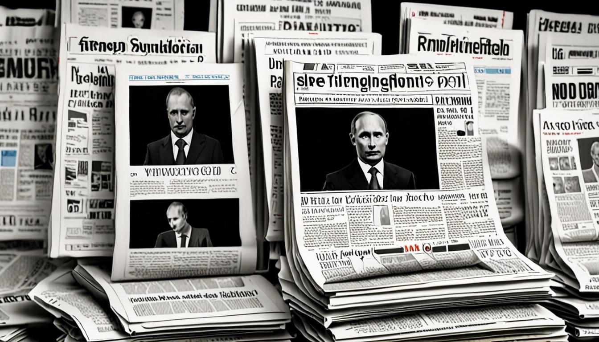

> 🌐 [Lire l'original en espagnol](../../fr/analisis/2026-11-19-largo.md)

<!-- EE_ENRICHED_START -->

<a href="/">Accueil</a>›<a href="/analisis/">Analyse</a>›2026-11-19

🔥 Analyse du Jour
<strong>Publié :</strong> 2026-11-19 &nbsp;·&nbsp; <strong>Type :</strong> Analyse du Jour

<figure style="margin:1.5em 0;"><figcaption style="font-size:0.85em;color:#888;text-align:center;margin-top:0.5em;font-style:italic;">Le Cadre : Poutine, vainqueur du sommet à trois de Shenzhen :</figcaption></figure>
<h1>Shenzhen : Le tour de passe-passe du sommet qu'on vous vend comme la fin du monde</h1>

Alors que les gros titres hurlent à pleins poumons que la planète s'effondre, une représentation de cirque se joue sur la péninsule où la peur est le seul billet d'entrée valable. Nous avons éventré les dépêches de presse pour découvrir que la crise n'est pas le problème, mais le produit phare de la saison.

Neuf journaux, une seule et même chorégraphie : l'incertitude comme anesthésique et l'urgence comme bistouri. Il ne s'agit pas d'informer sur les accords de Shenzhen, mais de fabriquer une réalité parallèle où il n'y a que deux options : la soumission absolue ou la catastrophe imminente. Ici, pas d'analyse, mais un script de masses conçu pour paralyser votre capacité de pensée critique avant même que vous n'ouvriez les yeux.

C'est le vieux piège de la « sécurité par la terreur » : on vous vend la chaîne en or comme unique salut face à un dragon qu'ils ont eux-mêmes dessiné à la craie. Quand la panique s'installe dans la rédaction, la vérité devient un obstacle pour la ligne éditoriale. Déconnectez le bruit, observez l'échiquier et rappelez-vous que dans cette partie, votre peur est leur meilleur atout.

<h2>El Español : appel à la peur et dramatisation d'une prétendue conspiration internationale</h2>
<figure style="margin:1.5em 0;"><figcaption style="font-size:0.85em;color:#888;text-align:center;margin-top:0.5em;font-style:italic;">El Español : appel à la peur et dramatisation d'une prétendue conspiration int</figcaption></figure>

<strong>Vrai titre :</strong> « Poutine, vainqueur du sommet à trois de Shenzhen : Trump et Xi ignorent l'Europe et l'incluent dans la triade du pouvoir mondial »

<strong>Source :</strong> <a href="https://www.elespanol.com/espana/tribunales/20261119/supremo-endurece-critica-gobierno-no-actuar-diligencia-exigible-sacar-censo-falsos-nietos/1003744463762_0.html" target="_blank" rel="noopener">Lire sur El Español</a>

Le texte récite avec la précision d'un chirurgien de l'incertitude : <em>« de sérieux soupçons selon lesquels son inscription au CERA est irrégulière, car contraire à la Loi sur la Mémoire démocratique. »</em> Cette phrase, aussi légère qu'un couteau affûté, s'accroche au mot « soupçons » et à l'adjectif « irrégulière » pour transformer une simple polémique administrative en menace latente.

En entendant « soupçons », le lecteur ressent un sentiment d'inquiétude, comme si chaque inscription était une brèche potentielle dans le filet de la justice. Le mot « irrégulière » agit comme un phare signalant que quelque chose ne va pas, générant une alarme qui ne repose pas sur des faits concrets, mais sur la possibilité d'une faille susceptible de déstabiliser la confiance dans le système.

La technique est évidente : le média ne décrit pas un fait, mais un soupçon présenté comme un risque concret. En dramatisant la situation avec des termes qui évoquent le danger et le manque de légitimité, le récit se transforme en un appel à l'action qui, en réalité, ne fait qu'alimenter la paranoïa.

Pour le détecter à l'avenir, cherchez les phrases qui utilisent des adjectifs tels que « soupçons », « irrégulière », « contraire » ou « risque » dans des contextes juridiques ou politiques. Si le narratif s'appuie davantage sur la sensation que sur les données, il est probable qu'il construise une conspiration de la peur.
<h2>ABC : framing (cadrage qui présente le débat comme un spectacle inévitable)</h2>

<strong>Vrai titre :</strong> « Heure et chaînes qui diffusent aujourd'hui le face-à-face entre Pedro Sánchez et Feijóo »

<strong>Source :</strong> <a href="https://www.abc.es/cultura/libros/neus-sendra-narradora-audiolibros-construyo-pelicula-cabeza-20261119050000-nt.html" target="_blank" rel="noopener">Lire sur ABC</a>

Le passage « Je me construis un film dans la tête et je le raconte à l'auditeur. Je le prends par la main et je ne le lâche pas de tout le roman » trahit clairement la technique du framing : le média enveloppe l'information dans une narration de divertissement, comme si le face-à-face relevait d'un roman sonore plutôt que d'un fait politique.

Ce choix produit la sensation d'être piégé dans une salle de cinéma à petit budget, où la réalité se dilue dans une intrigue conçue pour maintenir le lecteur collé à l'écran. Au lieu d'une analyse objective, le lecteur reçoit une expérience guidée par l'émotion, presque hypnotique.

Pour le détecter dans de futurs articles, il suffit de rechercher des expressions qui transforment des données brutes en métaphores cinématographiques ou littéraires, et d'observer si l'attention se déplace de la substance du sujet vers la forme de l'histoire. Lorsque le texte privilégie l'atmosphère au détriment de l'information concrète, le framing est à l'œuvre.

<h2>The Objective : urgence (impulsion d'acheter rapidement par peur de rater son billet de loterie)</h2>

<strong>Vrai titre :</strong> « Acheter la Loterie de Noël 2026 à Badajoz : numéros et dixièmes par administration pour le tirage au sort »

<strong>Source :</strong> <a href="https://theobjective.com/loterias/loteria-navidad/2026-11-19/comprar-loteria-de-navidad-2026-en-badajoz-numeros-y-decimos-por-administracion-para-el-sorteo/" target="_blank" rel="noopener">Lire sur The Objective</a>

La phrase qui trahit la technique de l'urgence est : « La vente a commencé le 29 juin dans les administrations et le 6 de… ». Cette coupe fixe un délai précis et, en restant incomplète, génère une rareté artificielle qui oblige le lecteur à acheter avant que le temps ne soit écoulé.

Ce choix me laisse une sensation de course contre la montre, comme si Noël était une enchère où celui qui ne parie pas rapidement se retrouve privé de la promesse d'un miracle économique. Le ton d'urgence se mêle à la nostalgie, transformant le billet en un rite de survie qui promet la chance instantanée.

Pour le détecter la prochaine fois, cherchez toute référence temporelle qui ne soit pas purement informative, mais qui inclue des verbes tels que « commence » ou « se termine » accompagnés de dates précises. Prêtez également attention aux impératifs comme « inscris-toi » ou « ne rate pas » ; leur présence indique que le texte cherche à déclencher un achat impulsif.

<h2>OkDiario : Appel à la peur et sensationnalisme territorial</h2>

<strong>Vrai titre :</strong> « Robles renforce la sécurité des îles et des rochers après les « mouvements migratoires imprévisibles » contre Ceuta »

<strong>Source :</strong> <a href="https://okdiario.com/espana/robles-refuerza-seguridad-islas-penones-imprevisibles-movimientos-migratorios-contra-ceuta-21117704" target="_blank" rel="noopener">Lire sur OkDiario</a>

Le terme qui trahit la stratégie de la peur est « mouvements migratoires imprévisibles », une expression qui, placée entre guillemets, sonne comme une menace latente et incontrôlée, comme si la frontière était un champ de bataille qui déborde sans prévenir.

Ce choix lexical génère un sentiment d'urgence et d'alarme, poussant le lecteur à imaginer une vague imminente qui compromet la sécurité nationale. L'utilisation de verbes comme « renforce » et la mention d'une « déclaration d'urgence » appuient l'idée que l'État est attaqué et requiert des mesures extraordinaires.

Pour reconnaître cette ressource dans les textes futurs, il suffit de rechercher des mots qui dépeignent le phénomène comme inattendu, débordant et dangereux, accompagnés d'expressions impliquant une réponse militaire ou de haute technologie. Lorsque le récit se concentre sur la menace et la réaction immédiate, c'est le signe évident que l'on joue sur la peur pour capter l'attention du public.

<h2>InfoLibre : appel au manque de certitude (insécurité) et à l'exclusion du public pour générer de la pression</h2>

<strong>Vrai titre :</strong> « Sánchez en appelle à une participation de 75 % qui ne lui garantit pas les clés de La Moncloa »

<strong>Source :</strong> <a href="https://www.infolibre.es/política/sanchez-apela-participacion-75-no-le-garantiza-llave-moncloa_1_2240351.html" target="_blank" rel="noopener">Lire sur InfoLibre</a>

L'élément déclencheur du jeu d'insécurité est la phrase : « pour qu'ils n'aillent pas voter ». En déclarant que la participation ne garantit pas la victoire, le texte devient un miroir du doute, un miroir qui se reflète dans l'instabilité de l'électorat.

Ce choix fait vaciller la confiance du lecteur, comme un tambour qui bat sans rythme. Le public se sent exclu, comme si la conversation politique était un club fermé doté d'une porte en fer, et le mot « voter » se transforme en une arme de déstabilisation.

Pour le détecter à l'avenir, recherchez l'absence de garanties et l'invitation à l'inaction. Lorsque le discours s'appuie sur le doute et l'exclusion, la pression se construit sur l'incertitude. Un appel à l'abstention, sur un ton de « n'y va pas », est le signal d'alarme. Ce schéma manipule non seulement la volonté, mais mine également la légitimité du processus électoral.

<h2>elDiario.es : Utilisation de la technique du contraste et de la narration de « fin de cycle » pour accentuer la différence entre la posture du PP et celle du PSOE, générant une perception de supériorité et de préparation de l'opposition.</h2>

<strong>Vrai titre :</strong> « N/A »

<strong>Source :</strong> <a href="https://www.eldiario.es/política/ultimo-cara-cara-sanchez-feijoo-pp-rebaja-expectativas-lider-psoe-prepara-revancha-2023_1_13674800.html" target="_blank" rel="noopener">Lire sur elDiario.es</a>

Le média a recours au contraste et à la fin de cycle avec la phrase : « le dernier face-à-face Sánchez-Feijóo : le PP baisse ses attentes et le leader du PSOE prépare la revanche de 2023 ». En plaçant la chute d'espoir du PP aux côtés de l'audace du PSOE, la narration se referme avec la promesse d'un nouvel affrontement, comme si le spectateur savait déjà que le drame suivrait son cours sans fin, sur un ton qui laisse clairement entendre que l'opposition est prête pour le prochain affrontement.

Ce choix me fait ressentir un mélange d'ironie et de cynisme. En lisant la phrase, la supériorité
 *(Note : la phrase originale était incomplète)*

<h2>Libertad Digital : Appel à la peur (*fear appeal*) en insinuant un possible effondrement politique avec des chiffres alarmants.</h2>

<strong>Vrai titre :</strong> « N/A »

<strong>Source :</strong> <a href="https://www.libertaddigital.com/espana/2026-11-19/el-voto-de-los-hijos-de-los-nacionalizados-con-la-ley-de-nietos-puede-afectar-a-14-escanos-en-las-elecciones-del-29-n-7493951/?utm_source=rss&amp;utm_medium=feed&amp;utm_campaign=Libertad+Digital%3A+Noticias+y+opini%C3%B3n+en+la+red" target="_blank" rel="noopener">Lire sur Libertad Digital</a>

Le signal de l'appel à la peur se trouve dans la phrase « pourrait avoir un impact allant jusqu'à 14 sièges », qui transforme un nombre d'électeurs en une menace imminente pour l'équilibre parlementaire. Le texte n'hésite pas à souligner que ces « près de 190 000 voix » pourraient faire basculer des circonscriptions où le dernier siège a été remporté avec moins de 2 000 suffrages, renforçant ainsi l'alarme.

Ce calcul froid, présenté comme une catastrophe électorale, engendre un sentiment d'urgence et de paranoïa ; le lectorat est entraîné à imaginer que chaque vote supplémentaire est un seau d'eau susceptible de faire couler le navire gouvernemental. De plus, l'utilisation de verbes tels que « se répercuter de manière notoire » suggère que l'ordre constitutionnel est au bord de l'effondrement, ce qui intensifie la pression émotionnelle exercée sur le lecteur.

Pour le détecter, il suffit de surveiller les chiffres exagérés et l'absence de sources indépendantes ; si l'argumentation tourne autour d'un scénario extrême dépourvu de données de probabilité, nous sommes face à un appel à la peur.

<h2>Al Jazeera : peur (alarme nucléaire)</h2>

<strong>Vrai titre :</strong> « Trump wants to talk nuclear with Putin and Xi »

<strong>Source :</strong> <a href="https://www.aljazeera.com/video/newsfeed/2026/11/19/trump-wants-to-talk-nuclear-with-putin-and-xi?traffic_source=rss" target="_blank" rel="noopener">Lire sur Al Jazeera</a>

En présentant l'information, Al Jazeera recourt à la formule : « raise nuclear non‑proliferation ». À sa lecture, le lecteur est entraîné dans un scénario de catastrophe imminente, où le mot « nucléaire » agit comme une bombe psychologique qui déclenche l'alarme la plus primitive.

Cette tournure me fait frissonner, comme si une alarme silencieuse s'était déclenchée en moi. La simple mention du mot « nucléaire » n'est pas neutre ; c'est une invitation à imaginer un monde où la stabilité vacille sous le poids d'une arme que personne ne souhaite utiliser.

Pour détecter ce procédé à l'avenir, il suffit de parcourir le texte à la recherche de termes suggérant un risque mondial : « nucléaire », « apocalyptique », « catastrophe », « danger », ou tout autre mot évoquant une menace transfrontalière. Lorsqu'ils apparaissent, le média joue avec l'anxiété collective. Cette tactique s'avère d'autant plus efficace que le lecteur est déjà exposé à des titres traitant de crises, le mot « nucléaire » devenant alors un hameçon qui accélère la réaction émotionnelle.

<h2>The Guardian : alarmisme</h2>

<strong>Vrai titre :</strong> « One in four women globally unable to refuse sex within marriage, says UN »

<strong>Source :</strong> <a href="https://www.theguardian.com/global-development/2026/nov/19/women-girls-rights-rape-sexual-violence-africa-marriage-unfpa" target="_blank" rel="noopener">Lire sur The Guardian</a>

Le titre exsude du venin avec la précision d'un chirurgien macabre : « unable to refuse sex ». On ne dit pas « ne consentent pas » ou « ne désirent pas », mais qu'elles sont incapables de refuser. Cette phrase ne décrit pas un manque de désir, mais une captivité absolue. On transforme le mariage en une cage où la volonté de la femme est une fiction juridique et où la capacité de dire « non » disparaît complètement. C'est un récit d'impuissance totale qui ignore la nuance de la négociation conjugale pour vendre l'image d'un esclavage sexuel systémique.

Ce choix linguistique génère une sensation d'asphyxie immédiate. En le lisant, le cerveau ne traite pas des statistiques, mais une perte d'agentivité humaine. Cela donne l'impression d'observer des êtres humains réduits à l'état d'objets passifs dans un scénario d'horreur quotidienne. L'urgence ne vient pas de la nouvelle, mais de l'architecture émotionnelle du verbe « unable ». C'est un vieux truc : priver le sujet de sa voix pour que le lecteur ressente le manque de cette voix plus intensément que s'il l'avait.

Pour détecter cela la prochaine fois, cherchez le verbe qui élimine l'agentivité. Si le sujet n'agit pas, mais « subit » une impossibilité, vous êtes face à un alarmisme de la passivité. Posez la question : est-ce réellement impossible ou est-ce culturellement difficile ? Si le texte utilise « cannot » ou « unable » pour décrire des dynamiques interpersonnelles complexes, vous assistez à une manipulation narrative qui transforme la difficulté sociale en condamnation biologique. Méfiez-vous de tout titre qui vous retire la capacité de douter.

<figure style="margin:1.5em 0;"><figcaption style="font-size:0.85em;color:#888;text-align:center;margin-top:0.5em;font-style:italic;">Le mécanisme, mis à nu</figcaption></figure>
<h2>Le mécanisme, mis à nu</h2>

Demain, ils recommenceront. Et vous saurez déjà où regarder. C'est El Encuadre.

<strong>Mentions légales :</strong> Ceci n'est pas une accusation. C'est une autopsie. Les médias sont cités et liés. Le droit de citation (art. 32 LPI) nous protège. Si cela vous blesse, c'est que vous vous y êtes reconnu.

<strong>Suivez-nous :</strong> <a href="https://youtube.com/@somoselencuadre.oficial">YouTube</a> · <a href="https://tiktok.com/@somoselencuadre">TikTok</a> · <a href="https://instagram.com/somoselencuadre">Instagram</a> · <a href="https://x.com/SomosElEncuadre">X</a> · <a href="https://threads.net/@somoselencuadre">Threads</a>

<!-- EE_ENRICHED_END -->