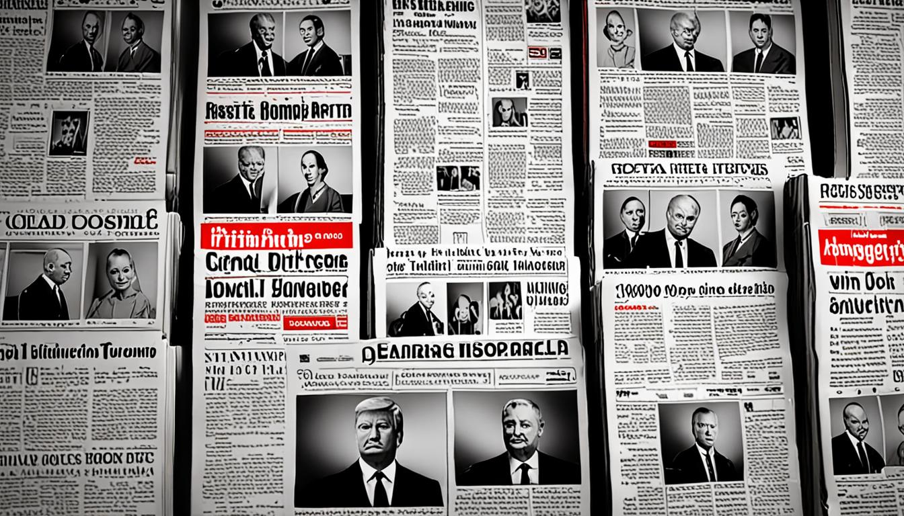

> 🌐 [Lire l'original en espagnol](../../fr/analisis/2026-11-19-mediano-cita.md)

<!-- EE_ENRICHED_START -->

<a href="/">Accueil</a>›<a href="/analisis/">Analyse</a>›2026-11-19

📄 Angle du Jour
<strong>Publié :</strong> 2026-11-19 &nbsp;·&nbsp; <strong>Type :</strong> Angle du Jour

<figure style="margin:1.5em 0;"><figcaption style="font-size:0.85em;color:#888;text-align:center;margin-top:0.5em;font-style:italic;">La citation qui change tout</figcaption></figure>
<h1>L'ombre de Bernays sur l'opinion publique</h1>

À l'ère des algorithmes qui nous chuchotent à l'oreille, une phrase fragmentée d'il y a un demi-siècle résonne à nouveau comme un écho d'avertissement. Edward Bernays, le grand-père des <em>public relations</em> (relations publiques), a laissé une empreinte qui se fait sentir aujourd'hui dans chaque clic qui fait de nous des consommateurs. Son message, bien qu'incomplet, distille l'essence d'une stratégie passée des salons de l'élite aux fils d'actualité Instagram.

<blockquote>«{'autor': 'Edward Bernays', 'frase': 'La manipulación consciente e inteligente de los hábitos y opin»</blockquote>
<h2>Qui l'a dit</h2>
<figure style="margin:1.5em 0;"><figcaption style="font-size:0.85em;color:#888;text-align:center;margin-top:0.5em;font-style:italic;">Qui l'a dit</figcaption></figure>
Edward Bernays (1891-1995) a été un pionnier américain de ce que l'on appelle « l'art de la persuasion ». Petit-fils du célèbre psychanalyste Sigmund Freud, il a hérité de l'idée que les désirs humains peuvent être façonnés avec une précision chirurgicale. Après avoir travaillé pour la campagne de l'<em>American Tobacco Company</em>, où il a popularisé la cigarette auprès des femmes sous le slogan « Fumez si vous êtes libres ! », Bernays a fondé sa propre agence et est devenu l'architecte de l'opinion moderne. Ses livres, tels que <em>Propaganda</em> (1928) et <em>Crystallizing Public Opinion</em> (1945), restent des lectures obligatoires dans les écoles de communication et de marketing, bien que peu nombreux soient ceux qui admettent que son héritage est également une recette pour le contrôle social.

<h2>Contexte</h2>

La phrase est apparue à une époque où la publicité commençait à délaisser la simple annonce de produits pour s'aventurer dans la psychologie des foules. Après la Première Guerre mondiale, les gouvernements et les entreprises ont découvert que la persuasion pouvait être aussi décisive que la force militaire. Bernays, inspiré par les expériences de son oncle Freud, a appliqué des techniques de suggestion et de création de symboles pour transformer des idées abstraites en habitudes quotidiennes. Dans les années 1930, ses campagnes pour la United Fruit Company et l'entreprise agroalimentaire « Borden » ont montré comment la manipulation de l'information pouvait façonner la perception publique sans qu'il soit besoin de coercition directe.

<h2>Ce qu'il voulait dire</h2>

L'extrait « La manipulation consciente et intelligente des habitudes et des opin… » révèle une intention claire : la création délibérée de schémas de comportement par le biais d'une information sélectionnée. Bernays ne parlait pas de simple persuasion ; il parlait d'une ingénierie sociale qui part de l'observation des désirs inconscients pour concevoir des messages qui les satisfont avant même que l'individu ne les reconnaisse. En d'autres termes, les gens achètent l'illusion de la liberté tandis que leurs décisions sont orchestrées dans l'ombre par les données et les récits qui leur sont présentés. L'« intelligence » du processus réside dans la capacité d'anticiper les réactions et d'adapter le narratif en temps réel, un principe qui se matérialise aujourd'hui dans les algorithmes de recommandation de plateformes telles que YouTube ou TikTok.

<figure style="margin:1.5em 0;"><figcaption style="font-size:0.85em;color:#888;text-align:center;margin-top:0.5em;font-style:italic;">Ce qu'elle cache</figcaption></figure>
<h2>Ce qu'elle cache</h2>

Derrière la clarté apparente de la phrase se cache une vérité dérangeante : le manque de transparence. En parlant de « manipulation consciente », Bernays reconnaît que le processus est délibéré, mais il ne mentionne jamais qui décide quelles habitudes méritent d'être encouragées. L'absence d'un sujet clair permet à la manipulation de se déployer sous l'apparence de la neutralité. De plus, l'extrait est tronqué ; le mot qui suit « opin » serait probablement « opinions » ou « opinions collectives », ce qui suggère une intention de façonner non seulement les actions, mais aussi la manière dont les gens interprètent la réalité. Ce qui est exclu du discours est la responsabilité ethiquée de ceux qui manipulent ces techniques, une question qui reste non résolue à l'ère numérique.

En conclusion, la citation incomplète de Bernays n'est pas seulement un vestige historique, mais un avertissement bien vivant. Dans un monde où les données sont le nouveau pétrole et où les influenceurs sont les conservateurs de l'opinion, la « manipulation consciente et intelligente » continue d'opérer sous le couvert du quotidien. La leçon que nous devrions en tirer est que la surveillance ne relève pas seulement des pouvoirs de l'État, mais aussi des géants du marketing qui, avec la précision d'un chirurgien, sculptent nos habitudes et nos idées. Ce n'est qu'en reconnaissant l'existence de cette architecture invisible que nous pourrons revendiquer une sphère publique véritablement libre.

<strong>Mentions légales :</strong> Ceci n'est pas une accusation. C'est une autopsie. Les médias sont cités et reliés par des liens. Le droit de citation (art. 32 LPI) nous protège.

<strong>Suivez-nous :</strong> <a href="https://youtube.com/@somoselencuadre.oficial">YouTube</a> · <a href="https://tiktok.com/@somoselencuadre">TikTok</a> · <a href="https://instagram.com/somoselencuadre">Instagram</a> · <a href="https://x.com/SomosElEncuadre">X</a> · <a href="https://threads.net/@somoselencuadre">Threads</a>

<!-- EE_ENRICHED_END -->