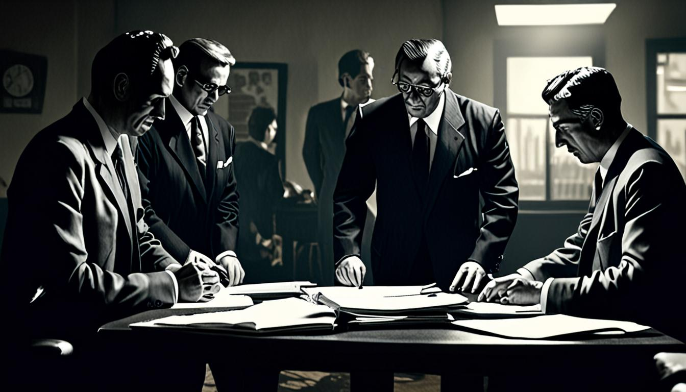

---
hide:
  - navigation
  - toc
---

<section class="ee-hero-dia">
  
📌 HOY EN EL ENCUADRE

  
  <h1 class="ee-hero-titulo"><a href="/analisis/2026-11-22/">Pedro Sánchez vuelve a Andalucía para activar el voto tras la polémica del baile en Sevilla</a></h1>
  
Análisis de 1800 palabras sobre la visita de Pedro Sánchez a Andalucía, la crítica mediática al baile en Sevilla y el uso de priming y framing negativo en la campaña electoral.

  <a href="/analisis/2026-11-22/" class="btn-hero">Leer análisis completo →</a>
</section>

<section class="ee-ticker">
  
⚡ ÚLTIMA HORA

  <ul class="ee-ticker-lista">
<li><a href="/analisis/2026-11-21/">01 2026 11 21</a></li>
<li><a href="/analisis/2026-11-19-largo/">02 El Encuadre: Putin, ganador de la cumbre a tres de Shenzhen:</a></li>
<li><a href="/analisis/2026-11-19-dossier-v2/">03 Dossier del día: El Encuadre: Putin, ganador de la cumbre a tres de Shenzhen:</a></li>
<li><a href="/analisis/2026-11-19-mediano-cita/">04 La cita que lo cambia todo</a></li>
<li><a href="/analisis/2026-11-18-largo/">05 El Encuadre: Sánchez le hace los Presupuestos a Feijóo despu</a></li>
  </ul>
</section>

  

    <h2 class="ee-section-title">Más análisis</h2>
    

  

    
📁 Dossier Ejecutivo

    
    <h3>Dossier del día: El Encuadre: Sánchez le hace los Presupuestos a Feijóo despu</h3>
    
Dossier ejecutivo: El Encuadre: Sánchez le hace los Presupuestos a Feijóo después de cuatro años si

    
📅 2026-11-18

  

  

    
📄 Ángulo del Día

    
    <h3>Radar de medios: El Encuadre: Sánchez le hace los Presupuestos a Fe</h3>
    
Analisis radar: Radar de medios: El Encuadre: Sánchez le hace los Presupuestos a Fe

    
📅 2026-11-18

  

  

    
🔥 Análisis del Día

    
    <h3>El Encuadre: El CNI informó al Gobierno del riesgo de desbor</h3>
    
Analisis largo: El Encuadre: El CNI informó al Gobierno del riesgo de desbor

    
📅 2026-11-17

  

  

    
📁 Dossier Ejecutivo

    
    <h3>Dossier del día: El Encuadre: El CNI informó al Gobierno del riesgo de desbor</h3>
    
Dossier ejecutivo: El Encuadre: El CNI informó al Gobierno del riesgo de desbordamiento en Canarias

    
📅 2026-11-17

  

  

    
📄 Ángulo del Día

    
    <h3>Cómo detectar la técnica: apelación al miedo (alarmismo)</h3>
    
Analisis tutorial: Cómo detectar la técnica: apelación al miedo (alarmismo)

    
📅 2026-11-17

  

  

    
🔥 Análisis del Día

    
    <h3>El Encuadre: Vox roza un hito con dos escaños en Galicia y d</h3>
    
Analisis largo: El Encuadre: Vox roza un hito con dos escaños en Galicia y d

    
📅 2026-11-16

  

    

    

    

      <a href="/analisis/" class="btn-hero">Ver los 64 análisis →</a>
    

  

  <aside class="ee-sidebar">
    

      <h3>📡 Síguenos</h3>
      
Análisis diario en Telegram sin filtros.

      <a href="https://t.me/somoselencuadre" class="btn-hero" style="display:block;text-align:center;">Unirse al canal</a>
    

    

      <h3>🔥 Últimos</h3>
      <ul class="ee-side-list">
<li><a href="/analisis/2026-11-22/">Pedro Sánchez vuelve a Andalucía para activar el voto tras l</a> 2026-11-22</li>
<li><a href="/analisis/2026-11-21/">2026 11 21</a> 2026-11-21</li>
<li><a href="/analisis/2026-11-19-largo/">El Encuadre: Putin, ganador de la cumbre a tres de Shenzhen:</a> 2026-11-19</li>
<li><a href="/analisis/2026-11-19-dossier-v2/">Dossier del día: El Encuadre: Putin, ganador de la cumbre a </a> 2026-11-19</li>
<li><a href="/analisis/2026-11-19-mediano-cita/">La cita que lo cambia todo</a> 2026-11-19</li>
      </ul>
    

    

      <h3>📊 El Encuadre en cifras</h3>
      
<strong>64</strong> análisis publicados

      
<strong>2026-11-22</strong> último publicado

    

  </aside>

