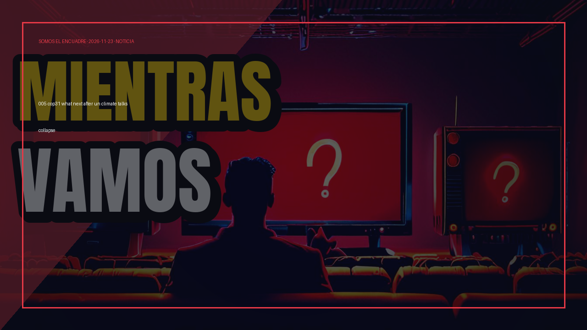

**COP31: ¿Qué sigue después del colapso de las negociaciones climáticas de la ONU?**  

El titular de Al Jazeera recurre a un encuadre negativo y casi apocalíptico al presentar la cumbre climática como “colapsada”. La palabra *colapso* sugiere un fracaso total, una ruptura irreversible, y prepara al lector para una narrativa de desesperanza. Sin embargo, el fondo del mensaje —“¡Qué maravilla! Un nuevo capítulo de la impotencia climática tras la caída de las negociaciones, porque el mundo necesita más drama”— revela la intención de satirizar esa visión fatalista, mostrando que el dramatismo no aporta soluciones.

Primero, el título omite cualquier matiz: no se menciona qué aspectos concretos de la cumbre fallaron, quiénes fueron los responsables ni qué avances parciales se lograron. Al concentrarse en la palabra *colapso*, se crea una imagen de caos absoluto que eclipsa cualquier discusión sobre posibles caminos a seguir. Este tipo de encuadre simplifica un proceso complejo en una única etiqueta negativa, lo que dificulta que el público perciba la continuidad de los esfuerzos climáticos fuera del marco oficial.

Segundo, el uso de la pregunta “¿Qué sigue?” refuerza la sensación de vacío y falta de dirección, invitando al lector a imaginar un futuro sin liderazgo. La ausencia de datos o propuestas concretas convierte la pregunta en un recurso retórico que alimenta la ansiedad más que la información.

Finalmente, el fondo irónico del mensaje señala que el dramatismo es, en sí mismo, una forma de manipulación: el “mundo necesita más drama” sugiere que la cobertura mediática prefiere el espectáculo al análisis profundo. Al señalar la “impotencia climática”, se acusa implícitamente a los actores políticos y a los medios de perpetuar la inacción bajo la apariencia de urgencia.

En resumen, el titular emplea un encuadre negativo para magnificar el fracaso percibido, mientras que el tono sarcástico del fondo denuncia esa misma estrategia, recordándonos que el verdadero desafío está en superar el drama y avanzar con propuestas concretas, no en celebrar la caída de una negociación.

