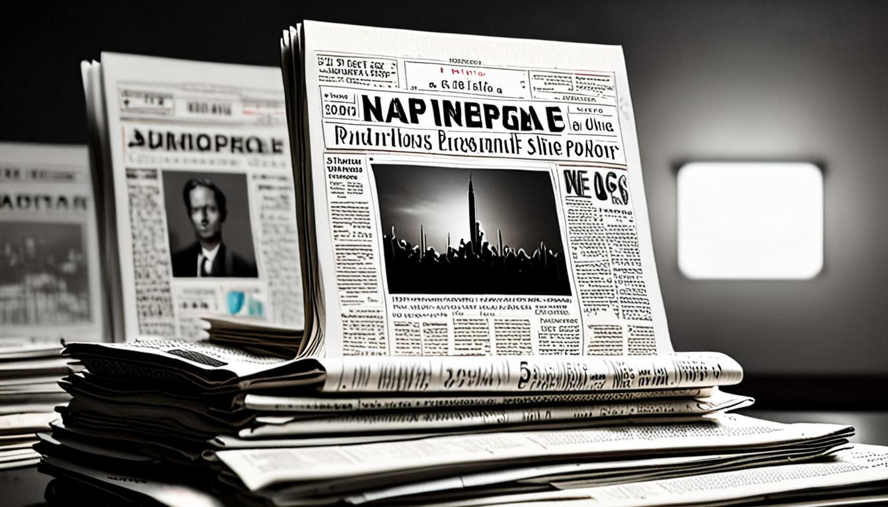

> 🌐 [Ler original em espanhol](../../pt/analisis/2026-11-15-mediano-medio_crudo.md)

<!-- EE_ENRICHED_START -->

<a href="/">Início</a>›<a href="/analisis/">Análise</a>›2026-11-15

📄 Ângulo do Dia
<strong>Publicado:</strong> 2026-11-15 &nbsp;·&nbsp; <strong>Tipo:</strong> Ângulo do Dia

<figure style="margin:1.5em 0;"><figcaption style="font-size:0.85em;color:#888;text-align:center;margin-top:0.5em;font-style:italic;">Libertad Digital: a técnica da desqualificação mediante et</figcaption></figure>
<h1>Libertad Digital e a técnica de desqualificação mediante rotulagem negativa e contraste polarizador</h1>

Na voragem da campanha eleitoral de 29 de novembro, os meios de comunicação não se ficam pela mera transmissão de factos. Tornam-se arquitetos de narrativas, frequentemente construídas com a mesma maquinaria que o próprio governo: a desqualificação e o contraste polarizador. O Libertad Digital, jornal que se transformou num espelho da retórica da oposição, aplica com maestria a técnica da rotulagem negativa para empanar a figura do presidente Alberto Núñez Feijóo, enquanto em simultâneo cria um contraste que polariza o público em torno da governação de Pedro Sánchez.

<h2>O que disse</h2>
<figure style="margin:1.5em 0;"><figcaption style="font-size:0.85em;color:#888;text-align:center;margin-top:0.5em;font-style:italic;">O que disse</figcaption></figure>

O título do Libertad Digital, «Feijóo reivindica a gestão em detrimento do "desperdício" de Sánchez e arranca na Galiza o seu caminho rumo a 29-N», é já uma declaração de posicionamento. O uso de “desperdício” como rótulo negativo encapsula a narrativa que o órgão de comunicação quer que o leitor absorva: o governo de Sánchez, segundo a imprensa, está a malbaratar recursos. Este termo não só desqualifica o governo, como também sugere uma falta de disciplina fiscal que, na visão do Libertad Digital, se contrapõe à suposta “gestão” de Feijóo.

<h2>Como o disse (citação textual)</h2>

No corpo do artigo, o jornal não se fica pela abstração. Apoia-se em citações textuais que, sem as alterar, reforçam a imagem de Feijóo como um líder de “rigor, gestão e experiência”. O próprio presidente do PP afirmou: <q>Espanha precisa de “rigor, gestão e experiência”</q>. Ao mesmo tempo, Feijóo autoproclamou-se defensor dos serviços públicos com a frase: <q>O público defende-se gerindo-o bem, e não a gritar que o defendes para depois destruí-lo</q>. A declaração sobre a relação entre o esforço fiscal e os serviços públicos, <q>Corresponder o esforço à cidadania é ter serviços públicos em condições, é para isso que pagam impostos</q>, acrescenta uma camada de justificação económica à campanha.

<h2>O que omitiu</h2>

A peça editorial, no entanto, deixa de lado qualquer menção aos êxitos concretos do governo de Sánchez nos serviços públicos. Não se menciona o aumento da cobertura da saúde, os programas de habitação social nem os investimentos em infraestruturas que beneficiaram a Galiza. Tampouco se faz referência aos acordos de financiamento da UE que permitiram a execução de projetos de energia renovável. Ao omitir estes pontos, o meio foca-se exclusivamente na crítica, sem oferecer um contraponto equilibrado que pudesse suavizar a polarização.

<h2>Como detetá-lo</h2>
O leitor atento pode identificar a técnica de desqualificação na seleção de palavras e na omissão de dados relevantes. O uso de "desperdício" e a ausência de números concretos sobre os gastos públicos criam uma narrativa de ineficiência que não se sustenta na realidade. Da mesma forma, a falta de menções aos programas de apoio social e às melhorias na infraestrutura revela um viés editorial que busca favorecer a figura de Feijóo em detrimento de uma visão mais completa do panorama político.

<figure style="margin:1.5em 0;"><figcaption style="font-size:0.85em;color:#888;text-align:center;margin-top:0.5em;font-style:italic;">Conclusão</figcaption></figure>
<h2>Conclusão</h2>

O Libertad Digital, ao empregar a técnica de desqualificação por meio de rotulagem negativa e contraste polarizador, demonstra que a informação pode ser tão poderosa ao serviço da propaganda. Ao rotular o governo de Sánchez como "desperdiçador" e ao apresentar Feijóo como o salvador da gestão, o meio cria uma dicotomia que simplifica a complexidade da política em uma batalha do "bem" contra o "mal". Esta estratégia não só polariza o público, como também reforça a narrativa de que a única solução viável é a proposta do PP. Em um contexto em que a objetividade se torna cada vez mais escassa, os leitores devem ser críticos e conscientes de como as palavras e as omissões podem moldar a percepção pública.

<strong>Título real do Libertad Digital:</strong> «Feijóo reivindica a gestão em face do "desperdício" de Sánchez e inicia na Galiza o seu caminho rumo ao 29-N»

<strong>Fonte:</strong> <a href="https://www.libertaddigital.com/espana/política/2026-11-14/feijoo-reivindica-la-gestion-frente-al-despilfarro-de-sanchez-y-arranca-en-galicia-su-camino-hacia-el-29-n-7491558/?utm_source=rss&amp;utm_medium=feed&amp;utm_campaign=Libertad+Digital%3A+Noticias+y+opini%C3%B3n+en+la+red" target="_blank" rel="noopener">Ler no Libertad Digital</a>

<strong>Técnica detectada:</strong> desqualificação por meio de rotulagem negativa e contraste polarizador

<strong>Aviso legal:</strong> Isto não é uma acusação. É uma autópsia. Os meios estão citados e com links. O direito de citação (art. 32 LPI) nos protege.

<strong>Siga-nos:</strong> <a href="https://youtube.com/@somoselencuadre.oficial">YouTube</a> · <a href="https://tiktok.com/@somoselencuadre">TikTok</a> · <a href="https://instagram.com/somoselencuadre">Instagram</a> · <a href="https://x.com/SomosElEncuadre">X</a> · <a href="https://threads.net/@somoselencuadre">Threads</a>

<!-- EE_ENRICHED_END -->