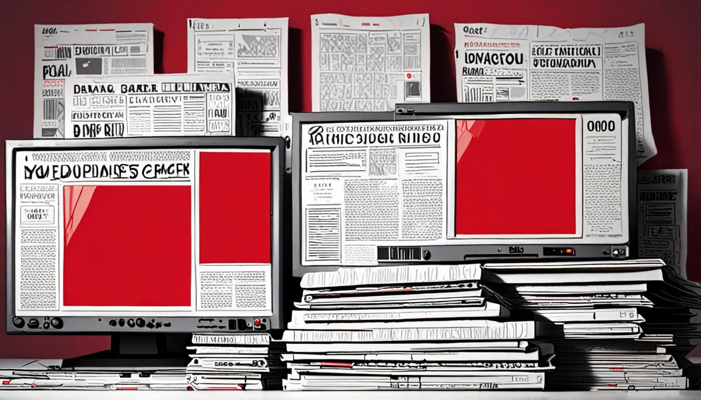

> 🌐 [Ler original em espanhol](../../pt/analisis/2026-11-17-mediano-tutorial.md)

<!-- EE_ENRICHED_START -->

<a href="/">Início</a>›<a href="/analisis/">Análise</a>›2026-11-17

📄 Ângulo do Dia
<strong>Publicado:</strong> 2026-11-17 &nbsp;·&nbsp; <strong>Tipo:</strong> Ângulo do Dia

<figure style="margin:1.5em 0;"><figcaption style="font-size:0.85em;color:#888;text-align:center;margin-top:0.5em;font-style:italic;">Como detectar a técnica: apelo ao medo (alarmismo)</figcaption></figure>
<h1 style="font-size: 2.5em; margin-bottom: 10px; color: #8B0000; text-transform: uppercase; letter-spacing: 2px;">A Arte Sinistra de Assustar a Vaca: Guia para Não Ser Manipulado</h1>

    

        Bem-vindos à festa do pânico. Aqui, onde a lógica vai para a farra e o medo entra pela janela para servir-se de uma taça de zombaria. Não estamos aqui para aprender a ter medo, mas sim para aprender a identificar quem vende esse medo como se fosse água fresca no deserto.
    

    <h2 style="font-size: 1.8em; color: #222; border-bottom: 2px solid #ccc; padding-bottom: 5px; margin-top: 30px;">1. Que porcaria é esta? Definição de um truque de prestidigitador</h2>
<figure style="margin:1.5em 0;"><figcaption style="font-size:0.85em;color:#888;text-align:center;margin-top:0.5em;font-style:italic;">1. Que porcaria é esta? Definição de um truque de prestidigitador</figcaption></figure>

    

        Chamemos-lhe pelo seu nome real: o apelo ao medo, ou se preferirem um termo mais elegante e menos sujo, o alarmismo. Não é um argumento. Não é um dado. É um grito. É o equivalente retórico de atirar um tijolo para uma reunião de senhoras para ver quem foge primeiro. Consiste em substituir a evidência pela ameaça, a análise pela histeria.
    

    

        Num mundo onde a informação viaja à velocidade da luz mas o pensamento crítico caminha a coxear, esta técnica tornou-se o cavalo de Troia da demagogia. Não te diz "isto é mau"; diz-te "isto vai destruir-te". A diferença é abismal. O primeiro é um juízo de valor, frequentemente discutível; o segundo é uma promessa de catástrofe que apela diretamente ao teu instinto de sobrevivência, aquele réptil primitivo que tens na nuca e que prefere correr a pensar.
    

    

        É um truque antigo, tão antigo como a caverna onde alguém gritou "Leão!" enquanto fazia uma sombra na parede. Mas hoje, com megofones digitais e algoritmos que amplificam o pânico até à loucura, refinou a sua mecânica. Já não precisas de um leão real; com uma estatística mal contextualizada e uma voz trémula num vídeo de três minutos, tens meia população em polvorosa, pronta para obedecer a qualquer ordem, por mais absurda que seja.
    
<h2 style="font-size: 1.8em; color: #222; border-bottom: 2px solid #ccc; padding-bottom: 5px; margin-top: 30px;">2. Como se usa? A anatomia do pânico organizado</h2>
    

        O manual do alarmista não tem muitas entradas, mas repete-as com a persistência de um papagaio drogado com anfetaminas. Primeiro, selecione um problema real. Não invente o problema, isso é demasiado difícil e fácil de desmontar. Pegue em algo que já preocupa as pessoas: o clima, a economia, a saúde, a segurança.
    

    

        Segundo, infle as proporções. Se o risco é de 1%, fale de 99%. Se é um problema local, apresente-o como um apocalipse global. Use adjetivos que pesem toneladas: "iminente", "irreversível", "catastrófico", "sem precedentes". Cada palavra é uma gota de veneno que penetra na pele racional de quem ouve.
    

    

        Terceiro, elimine nuances. A realidade é cinzenta, cheia de nuances e probabilidades. O alarmismo é preto e branco. Ou tudo vai bem, ou tudo vai desabar. Não há meio-termo. Não há soluções graduais. Só há a ação imediata, drástica e, claro, liderada por quem está a gritar mais alto.
    

    

        Quarto, crie um inimigo ou uma causa única. O medo precisa de um bode expiatório. Pode ser uma corporação, um partido político, um grupo de imigrantes, uma tecnologia nova. Ao simplificar a culpa, simplifica-se também a solução: "Se eliminarmos o X, o medo desaparece". É uma lógica de uma criança de cinco anos, mas funciona maravilhosamente em massas assustadas.
    

    <h2 style="font-size: 1.8em; color: #222; border-bottom: 2px solid #ccc; padding-bottom: 5px; margin-top: 30px;">3. Exemplo real: O circo da desinformação em tempo real</h2>
    

        Não é preciso ir procurar fantasmas no armário. Basta olhar para o cenário político e mediático atual. Pensemos em como a narrativa é gerida quando há uma crise na habitação. Em vez de analisar a especulação, os terrenos públicos não urbanizados ou a falta de investimento em arrendamento acessível, ouvimos certas vozes gritar que "o sistema está a colapsar" e que "os cidadãos comuns estão a ser expulsos das suas casas por uma elite oculta".
    

    

        Aqui não há dados, há dramaturgia. Usa-se o medo de perder a casa para justificar medidas extremas ou para desviar a atenção das causas estruturais. A situação é apresentada como um cerco, onde o cidadão é um soldado numa trincheira contra um exército invisível. É uma metáfora poderosa, mas falsa. Não é um conflito, é um mercado distorcido. Mas "conflito" gera mais medo do que "mercado", e o medo vende mais do que a economia.
    

    

        Outro exemplo clássico: a gestão da saúde pública. Quando um hospital tem listas de espera, a versão racional fala de falta de pessoal, de infraestruturas, de planeamento. A versão alarmista fala de "abandono", de "sistemas rotos", de que "a próxima pessoa a morrer numa maca será você". Embora evitemos termos explícitos sobre a perda de vida, a implicação é clara: estão a vender-lhe a ideia de que o Estado declarou conflito ao seu bem-estar. É uma manipulação cruel que explora a vulnerabilidade humana para transformar a paciência em fúria cega.
    
<h2 style="font-size: 1.8em; color: 222; border-bottom: 2px solid #ccc; padding-bottom: 5px; margin-top: 30px;">4. Como detectá-lo? Coloque os óculos da dúvida</h2>
    

        Detectar o alarmismo exige uma dose de cinismo e uma pitada de paciência. Primeiro, pergunte-se: isto é um fato ou uma projeção? Os fatos são mensuráveis. As projeções são sonhos de pesadelo disfarçados de ciência. Se não há um estudo, um dado concreto, uma fonte verificável, é fumaça.
    

    

        Segundo, olhe para a fonte. Quem está falando? Está motivado por informar ou por vender? Por gerar cliques? Por vencer uma eleição? O interesse próprio é o melhor rastreador da desinformação. Se alguém ganha dinheiro, poder ou atenção ao assustá-lo, sua credibilidade despenca por terra.
    

    

        Terceiro, procure a nuance. Se um argumento é simples demais, é provavelmente falso. A realidade é complexa. Se a solução proposta for única, drástica e urgente, é quase certo que foi desenhada para burlar o debate e a deliberação.
    

    

        Quarto, observe a linguagem. Há muitas exclamações? Há adjetivos superlativos? Fala-se de "algo nunca antes visto"? Isso é um sinal vermelho. A história está cheia de coisas "nunca antes vistas" e, na maioria das vezes, elas foram resolvidas com tempo, não com pânico.
    

    <figure style="margin:1.5em 0;"><figcaption style="font-size:0.85em;color:#888;text-align:center;margin-top:0.5em;font-style:italic;">5. Como combatê-lo? A vacina da razão</figcaption></figure>
<h2 style="font-size: 1.8em; color: #222; border-bottom: 2px solid #ccc; padding-bottom: 5px; margin-top: 30px;">5. Como combatê-lo? A vacina da razão</h2>
    

        Combater o alarmismo não é tarefa fácil. O medo vicia. Mas há uma cura: informação de qualidade, lenta e entediante. Leia fontes primárias. Não confie em resumos nas redes sociais. Vá à origem. Se uma mídia sensacionalista diz "X é o fim do mundo", procure o que diz o órgão técnico oficial. Muitas vezes, a diferença é abismal.
    

    

        Segundo, eduque o seu entorno. Fale com calma. Não grite. O alarmista grita; você deve sussurrar. Explique as nuances. Mostre os dados. Se não conseguir, não insista. Não se pode raciocinar com alguém que está em modo de pânico.
    

    

        Terceiro, pratique a resiliência emocional. Aceite que não pode controlar tudo. Aceite que existem riscos, mas que eles não são necessariamente iminentes ou catastróficos. Aprenda a distinguir entre o risco real e o risco percebido. A maioria das coisas que nos aterrorizam hoje são, estatisticamente, menos perigosas do que andar de carro ou fumar.
    

    

        Finalmente, vote com a cabeça, não com o coração assustado. Exija que seus representantes políticos falem com clareza, com dados, sem drama. Se você lhes pedir medo, eles lhe darão medo. Se lhes pedir verdade, talvez lhe deem uma versão mais aceitável da realidade.
    

    

        Em suma, o alarmismo é o ópio do povo, só que com mais barulho e menos efeitos colaterais imediatos. É uma ferramenta de controle social disfarçada de preocupação. Não se deixe enganar. O mundo é um lugar perigoso, sim, mas não pelas razões que os charlatões da histeria lhe vendem. Pense, duvide, investigue. E, acima de tudo, não se deixe assustar por aqueles que lucram com o seu terror. A razão é a única luz neste pântano de tinta e pânico.
    

<strong>Aviso legal:</strong> Isto não é uma acusação. É uma autópsia. A mídia está citada e com links. O direito de citação (art. 32 LPI) nos protege.

<strong>Siga-nos:</strong> <a href="https://youtube.com/@somoselencuadre.oficial">YouTube</a> · <a href="https://tiktok.com/@somoselencuadre">TikTok</a> · <a href="https://instagram.com/somoselencuadre">Instagram</a> · <a href="https://x.com/SomosElEncuadre">X</a> · <a href="https://threads.net/@somoselencuadre">Threads</a>

<!-- EE_ENRICHED_END -->