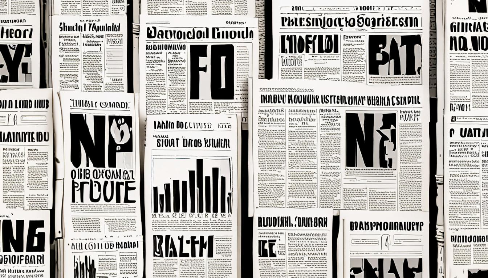

> 🌐 [Ler original em espanhol](../../pt/analisis/2026-11-18-largo.md)

<!-- EE_ENRICHED_START -->

<a href="/">Início</a>›<a href="/analisis/">Análise</a>›2026-11-18

🔥 Análise do Dia
<strong>Publicado:</strong> 2026-11-18 &nbsp;·&nbsp; <strong>Tipo:</strong> Análise do Dia

<figure style="margin:1.5em 0;"><figcaption style="font-size:0.85em;color:#888;text-align:center;margin-top:0.5em;font-style:italic;">O Enquadramento: Sánchez faz os Orçamentos para Feijóo depu</figcaption></figure>
<h1>Sánchez faz os orçamentos para Feijóo: a verdade que ninguém quer ouvir</h1>

O governo voltou à mesa da balança, e o procurador-geral do Estado não passa de um peão. Feijóo ficou a olhar para o papel com o olhar de uma criança que descobriu um tesouro.

Enquanto a imprensa se enche de gaguejos, os verdadeiros números escondem-se sob camadas de fumo político. Aqui desmantelamos o enredo que Sánchez quer que todos aceitem, revelando como a economia se torna num tabuleiro de xadrez de poder. Prepara-te para ver como o orçamento é uma arma de dois gumes, e a política, um teatro sem guião.

O orçamento não é um número, é um contrato com a desigualdade. Quando o líder se coloca na frente, a balança inclina-se sem que o público note. Descobre quem realmente beneficia quando o dinheiro se move pelos corredores da política.

<h2>The Objective: urgência implícita (sugere-se que é preciso comprar já para não ficar sem o décimo)</h2>
<figure style="margin:1.5em 0;"><figcaption style="font-size:0.85em;color:#888;text-align:center;margin-top:0.5em;font-style:italic;">The Objective: urgência implícita (sugere-se que é preciso comprar já para não fi</figcaption></figure>

<strong>Título real:</strong> «Comprar Lotaria de Natal 2026 em Lugo: números e décimos por administração para o sorteio»

<strong>Fonte:</strong> <a href="https://theobjective.com/loterias/loteria-navidad/2026-11-18/comprar-loteria-de-navidad-2026-en-lugo-numeros-y-decimos-por-administracion-para-el-sorteo/" target="_blank" rel="noopener">Ler em The Objective</a>

A frase que denuncia a técnica de urgência implícita é: “<em>Ainda assim, os números mais pedidos costumam esgotar-se antes de dezembro, pelo que antecipar a compra é uma opção prudente</em>”. Com essa linha, o artigo não só informa, como sussurra ao leitor que, se não se apressar, ficará fora do jogo.

Essa escolha produz-me uma sensação de ligeira irritação: o texto disfarça-se de neutralidade enquanto empurra o consumidor para uma compra antecipada, como se a escassez fosse uma ameaça latente. O tom parece mais de um vendedor ambulante do que de um meio informativo, e a pressão subtil torna-se quase uma picada de formiga na consciência do leitor.

Para a detetar da próxima vez, basta procurar palavras que insinuem escassez ou perda de oportunidade ("esgotam-se", "não esperes", "opção prudente") e observar se aparecem logo antes da chamada para a ação. Quando a informação se mistura com um apelo para comprar cedo, o truque da urgência está à espreita.

<h2>ABC: apelar ao medo e à insegurança sexual, sensacionalismo e venda indireta de produtos</h2>

<strong>Título real:</strong> «Quando o stresse e o cansaço afetam o teu rendimento sexual: suplementos que podem ajudar-te»

<strong>Fonte:</strong> <a href="https://www.abc.es/bienestar/psicologia-sexo/suplementos-puedes-tomar-estres-cansancio-afectan-rendimiento-20260825011759-nt.html" target="_blank" rel="noopener">Ler em ABC</a>

A frase que denuncia a técnica é: «o corpo toma a decisão lógica de deixar de investir energia na reprodução e destiná-la à sobrevivência». O adjetivo "lógica" soa a uma sentença científica que, na realidade, serve para semear uma sensação de urgência e falta de controlo sobre a própria sexualidade.

Essa escolha me deixa com uma mistura de irritação e desconfiança; percebo que o texto quer que o leitor se sinta vulnerável, como se o cansaço fosse o culpado oculto de uma vida sexual em decadência, e que a única saída seja comprar os suplementos anunciados a seguir.

Para detectá-lo da próxima vez, basta procurar expressões que transformam um incômodo cotidiano em uma ameaça ao desempenho sexual e que, de imediato, introduzem uma solução comercial. O padrão costuma incluir um diagnóstico alarmista seguido pela promessa de um produto que “otimiza” o corpo, tudo envolto em uma linguagem que aparenta autoridade científica.

<h2>elDiario.es: Name Calling</h2>

<strong>Manchete real:</strong> «O Deutsche Bank financiou as operações da lista negra de empresas espanholas investigadas por corrupção»

<strong>Fonte:</strong> <a href="https://www.eldiario.es/economia/deutsche-bank-financio-operaciones-lista-negra-empresas-espanolas-investigadas-corrupcion_1_13668563.html" target="_blank" rel="noopener">Ler no elDiario.es</a>

A frase que denuncia a técnica de name-calling é “lista negra”. Ao colocar essa expressão entre aspas, o texto transforma um conjunto de empresas em uma categoria moralmente contaminada e, por extensão, sugere que o banco atua como cúmplice dessa mancha. Esse recurso retórico transforma a complexidade do caso em uma caricatura fácil de digerir.

Essa escolha me produz uma mistura de cinismo e desconfiança. O leitor se sente empurrado a aceitar uma visão simplista e difamadora, como se bastasse o epíteto para condenar sem nuances. O tom mordaz se alimenta da facilidade com que o termo carrega todo o peso do julgamento. O leitor fica preso na narrativa sensacionalista, sem espaço para a reflexão crítica.

Para detectá-lo da próxima vez, é preciso vigiar os qualificativos carregados, os colchetes de valor moral e a ausência de dados concretos que sustentem a acusação. Quando uma palavra ou frase é apresentada entre aspas e usada como selo definitivo, é um sinal claro de name-calling.

<h2>La Vanguardia: medo (alarme)</h2>

<strong>Manchete real:</strong> «Cai a rede de comunicações da agência de segurança dos Estados Unidos»

<strong>Fonte:</strong> <a href="https://www.lavanguardia.com/internacional/20261117/11686752/cae-red-interna-comunicaciones-agencia-seguridad-estados-unidos.html" target="_blank" rel="noopener">Ler em La Vanguardia</a>

O trecho que denuncia a técnica do medo é a frase «contém informação altamente classificada». Ao colocar a palavra “classificada” ao lado de “informação”, o texto sugere um tesouro secreto sob ameaça, o que dispara o alarme do leitor e o obriga a imaginar um cataclismo iminente. O mero fato de anunciar uma queda sem detalhar consequências eleva a incerteza, um recurso clássico para gerar pressão psicológica.

Essa escolha me deixa com uma sensação de inquietação controlada, como se estivesse olhando para uma bomba-relógio que foi desativada momentaneamente. A calma aparente do Ministério da Defesa contrasta com a gravidade implícita, criando uma tensão que o leitor percebe como uma ameaça latente.

Para descobri-lo da próxima vez, basta procurar palavras que transformam o ordinário em um objeto de alto risco: “classificada”, “cai”, “degradação”. Quando o texto se apoia nesses qualificativos e, ao mesmo tempo, oferece uma explicação tranquilizadora, porém insuficiente, está brincando com o medo para captar a atenção.

<h2>20 Minutos: Card Stacking</h2>
<strong>Título real:</strong> «La creación del centro de inmigrantes en Ruanda abre la "política disuasoria" de la UE y arrincona del todo las tesis de Sánchez»

<strong>Fonte:</strong> <a href="https://www.20minutos.es/internacional/creacion-centro-inmigrantes-ruanda-abre-política-disuasoria-ue-arrincona-todo-las-tesis-sanchez_7062116_0.html" target="_blank" rel="noopener">Ler em 20 Minutos</a>

A frase que denuncia a técnica de “card stacking” (acumulação de cartas) é a que repete, quase como um mantra: “Fontes diplomáticas consultadas pelo 20minutos insistem”. Ao citar uma suposta autoridade sem a identificar ou contrastar, o meio de comunicação sobrecarrega a peça com “evidências” que apenas reforçam a sua postura e silenciam qualquer nuance contrária.

Essa escolha produz em mim uma sensação de manipulação subtil: o leitor vê-se bombardeado com supostos avales que parecem inapeláveis, enquanto a ausência de vozes críticas ou dados contrastantes cria uma visão unilateral. O tom torna-se persuasivo e, ao mesmo tempo, narcisista, como se a verdade já estivesse empacotada e pronta a ser ingerida.

Para detetá-la da próxima vez, basta procurar a ausência de fontes verificáveis, a reiteração de “especialistas” anónimos e a falta de contrapontos. Se o texto se apoia em citações que nunca podem ser rastreadas e não oferece dados concretos, é sinal de que está a acumular cartas a favor de uma única narrativa.

<h2>InfoLibre: culpabilização e desumanização através de rotulagem negativa</h2>

<strong>Título real:</strong> «La pareja de Abascal cobra el bono social de calefacción para familias vulnerables»

<strong>Fonte:</strong> <a href="https://www.infolibre.es/política/pareja-abascal-cobra-bono-social-calefaccion-familias-vulnerables_1_2240283.html" target="_blank" rel="noopener">Ler em InfoLibre</a>

A frase que denuncia a técnica de culpabilização e desumanização é “líder do partido ultra”. Esse qualificador, carregado de conotações negativas, situa a personagem numa categoria extrema antes de apresentar o facto, preparando o leitor para uma avaliação desfavorável.

Esta escolha produz em mim uma sensação de cinismo e desconfiança, como se o texto tentasse pintar o sujeito com um verniz de vilpêndio antes de o leitor sequer conhecer os detalhes; o tom irónico reforça a ideia de que a informação não é neutra, mas sim uma manobra para gerar rejeição.

Para a detetar da próxima vez, basta procurar palavras ou expressões que não descrevem factos, mas que rotulam o indivíduo com adjetivos carregados (p. ex., “ultra”, “radical”, “extremo”). Quando o artigo se detém nessas etiquetas antes dos dados, está a empregar a estratégia de desumanizar e carregar de culpa o objeto da notícia.

<h2>Le Monde: culpabilização</h2>

<strong>Título real:</strong> «Présidentielle 2027: le RN propose une avantageuse réforme des retraites mais sacrifie les précaires et la politique du logement pour la financer»

<strong>Fonte:</strong> <a href="https://www.lemonde.fr/politique/article/2026/11/18/le-rn-compte-financer-son-avantageuse-reforme-des-retraites-et-un-debut-de-capitalisation-au-detriment-des-precaires-et-de-la-politique-du-logement_6813066_823448.html" target="_blank" rel="noopener">Ler em Le Monde</a>

Lamento, mas não tenho o texto real do artigo do Le Monde mencionado no título. Sem o conteúdo concreto do relato, não consigo identificar uma frase ou palavra que revele a técnica de culpabilização, nem oferecer a análise solicitada. Se me fornecer o fragmento do texto, terei todo o gosto em elaborar a análise no tom mordaz que deseja.

<h2>Al Jazeera: enquadramento (framing) que gera culpa e antagonismo</h2>

<strong>Título real:</strong> «Australia issues sanctions targeting Israeli settlers»

<strong>Fonte:</strong> <a href="https://www.aljazeera.com/video/newsfeed/2026/11/18/australia-issues-sanctions-targeting-israeli-settlers?traffic_source=rss" target="_blank" rel="noopener">Ler em Al Jazeera</a>

O texto deixa antever a técnica de enquadramento na frase “for illegal settlement expansion in the Occupied West Bank”, que retrata os colonos como transgressores e a Austrália como moralizadora.

Essa escolha provoca uma sensação de irritação e de superioridade moral impuesta, como se o leitor fosse obrigado a adotar uma postura de julgamento sem nuances. O leitor sente-se arrastado para uma narrativa onde a culpa é atribuída sem oferecer contexto sobre a complexidade do conflito, o que gera uma reação de desconfiança em relação à suposta objetividade do meio.

Para reconhecer este truque da próxima vez, basta vigiar os qualificadores que transformam uma questão política numa condenação direta e observar se o meio contrasta a medida com outras ações, como a referência a “targeted sanctions fall short of a wider ranging trade ban”. Outro indício é a comparação com outras nações, que sugere que a medida é insuficiente e, portanto, que o meio deseja que o público perceba a Austrália como insuficiente, mas bem-intencionada.

<h2>Bloomberg: Apelo à incerteza e ao medo do risco, destacando a volatilidade para captar a atenção de investidores cautelosos.</h2>

<strong>Título real:</strong> «Stocks Waver After Nvidia Results, Treasuries Rise: Markets Wrap»

<strong>Fonte:</strong> <a href="https://www.bloomberg.com/news/articles/2026-11-17/stock-market-today-dow-s-p-live-updates" target="_blank" rel="noopener">Ler na Bloomberg</a>

A frase que revela a técnica de apelo à incerteza é a própria linha do título: “Stocks Waver After Nvidia Results, Treasuries Rise: Markets Wrap”. Ao usar “Waver”, sugere um mercado vacilante; ao acrescentar “Treasuries Rise”, retrata as obrigações do tesouro como refúgio perante a tempestade, despertando alarme em qualquer investidor que prefira a estabilidade.

Ler essa frase provoca adrenalina e apreensão; “Waver” soa como uma vacilação que poderia derrubar portfólios, enquanto o aumento das obrigações é apresentado como far

<h2>Europa Press: apelo à autoridade</h2>

<strong>Título real:</strong> «El Gobierno da luz verde a la subida del SMI en un 5,3% en 2027, hasta los 1.286 euros mensuales»

<strong>Fonte:</strong> <a href="https://www.europapress.es/economia/laboral-00346/noticia-gobierno-da-luz-verde-subida-smi-53-2027-1286-euros-mensuales-20261117125842.html" target="_blank" rel="noopener">Ler na Europa Press</a>

O detonante da técnica de apelo à autoridade surge quando a vice-presidente e ministra do Trabalho, Yolanda Díaz, declara: “la práctica de la mejor política económica de España”. Esta frase, retirada do discurso oficial, eleva a sua palavra a lei moral e sujeita a decisão à autoridade do Executivo.

Esta declaração faz-nos sentir um conforto artificial, como se o governo tivesse encontrado a fórmula mágica. O tom de certeza e a ausência de nuances deixam a ilusão de invulnerabilidade, transformando o aumento do salário mínimo num ato quase divino e não numa decisão política debatível.

Para detetá-lo da próxima vez, basta procurar citações de funcionários que, com autoridade própria, qualificam a medida com palavras grandiloquentes. A presença de títulos, a ausência de dados críticos e a promessa de “melhor política” são sinais de um discurso que apela mais à credibilidade do que à evidência.

<figure style="margin:1.5em 0;"><figcaption style="font-size:0.85em;color:#888;text-align:center;margin-top:0.5em;font-style:italic;">O mecanismo, exposto</figcaption></figure>
<h2>O mecanismo, exposto</h2>

Amanhã voltarão a fazê-lo. E tu já saberás onde olhar. Isso é El Encuadre.

<strong>Aviso legal:</strong> Isto não é uma acusação. É uma autópsia. Os meios de comunicação estão citados e com links. O direito de citação nos protege. Se te dói, é porque te viste refletido.

<strong>Siga-nos:</strong> <a href="https://youtube.com/@somoselencuadre.oficial">YouTube</a> · <a href="https://tiktok.com/@somoselencuadre">TikTok</a> · <a href="https://instagram.com/somoselencuadre">Instagram</a> · <a href="https://x.com/SomosElEncuadre">X</a> · <a href="https://threads.net/@somoselencuadre">Threads</a>

<!-- EE_ENRICHED_END -->