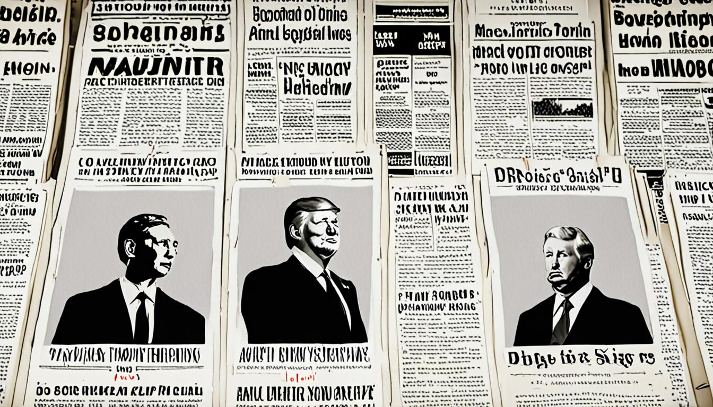
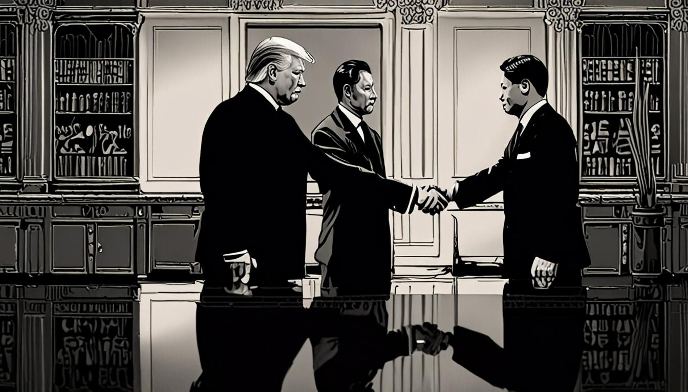

> 🌐 [Ler original em espanhol](../../pt/analisis/2026-11-19-dossier-v2.md)

<!-- EE_ENRICHED_START -->

<a href="/">Início</a>›<a href="/analisis/">Análise</a>›2026-11-19

📁 Dossier Executivo
<strong>Publicado:</strong> 2026-11-19 &nbsp;·&nbsp; <strong>Tipo:</strong> Dossier Executivo

<figure style="margin:1.5em 0;"><figcaption style="font-size:0.85em;color:#888;text-align:center;margin-top:0.5em;font-style:italic;">O Enquadramento: Putin, vencedor da cimeira a três de Shenzhen:</figcaption></figure>
<h1>Dossier do dia: O Enquadramento: Putin, vencedor da cimeira a três de Shenzhen: Trump e Xi ignoram a Europa e incluem-no na tríade do poder global</h1>

<strong>Introdução:</strong> Enquanto o mundo sangra em cimeiras diplomáticas onde as máscaras caem, os meios de comunicação deste país vendem-nos fumo eleitoral e pânico migratório. Hoje não vimos informar, vimos estripar o mecanismo. O que chamam de "notícias" é, na realidade, uma coreografia de medo desenhado para que não olhemos para cima, mas sim para o abismo das nossas próprias escolhas. Aqui não há verdade, apenas enquadramento. E o enquadramento de hoje é uma farsa de três atos: a geopolítica ignorada, a democracia envenenada e o espetáculo vazio.

<h2>Notícias do dia</h2>
<figure style="margin:1.5em 0;"><figcaption style="font-size:0.85em;color:#888;text-align:center;margin-top:0.5em;font-style:italic;">Notícias do dia</figcaption></figure>

O grande título do dia é uma mentira por omissão. O título que nos vendem fala de uma cimeira em Shenzhen onde Putin sai "vencedor" e onde Trump e Xi "ignoram a Europa". Uma narrativa de conspiração internacional que deveria fazer-nos sorrir se não fosse a única forma de tapar o buraco negro que é a política espanhola. Mas esqueçamos por um momento os ursos e os dragões. O verdadeiro teatro é montado aqui, na península, com um elenco local que atua com a convicção de um ator de telenovela.

Por um lado, temos o caos jurídico em torno da "lei de netos". O Supremo Tribunal, numa manobra que cheira a desespero institucional, admitiu que "não há tempo material" para rever o recenseamento. Isto significa que 189.678 pessoas, filhos de nacionalizados, poderão votar a 29 de novembro. Segundo fontes jurídicas citadas pelo Libertad Digital, isto poderá "afetar 14 lugares". Catorze cadeiras no tabuleiro. Não é uma anedota, é a bomba-relógio que ameaça reconfigurar o mapa político. O Supremo também rejeitou o recurso do Vox para suspender cautelarmente o voto, deixando o Governo com uma cara muito tranquila enquanto a maquinaria eleitoral continua a girar sobre um eixo que, pelo menos para alguns, está partido.

Por outro lado, o debate. O último mano a mano entre Pedro Sánchez e Alberto Núñez Feijóo. ODiario.es enquadra-o como uma "desforra de 2023", uma narrativa de vingança pessoal disfarçada de política. Enquanto isso, o PP, através do seu secretário-general Miguel Tellado, não pede que votem neles, mas sim que os eleitores socialistas "fiquem em casa". Um apelo ao abstencionismo seletivo que é, em si mesmo, uma confissão de fraqueza. Não confiam na sua mensagem, confiam na preguiça dos outros.

<h2>A imprensa e as suas técnicas</h2>

A imprensa não relata factos, instala emoções. Cada redação tem a sua receita secreta, o seu aditivo químico para que o leitor não pense, mas sim sinta. Medo, urgência, certeza falsa. Analisemos os ingredientes que usaram hoje para cozinhar esta sopa de letras.
<table>
    <tr>
        <th>Meio</th>
        <th>Técnica</th>
        <th>Omite</th>
    </tr>
    <tr>
        <td>El Español</td>
        <td>Apelo ao medo e dramatização</td>
        <td>A realidade da cúpula; a irrelevância da Europa na tríade</td>
    </tr>
    <tr>
        <td>ABC</td>
        <td>Enquadramento espectral (Framing espectral)</td>
        <td>A política; o conteúdo real do debate ou da atualidade</td>
    </tr>
    <tr>
        <td>The Objective</td>
        <td>Urgência comercial</td>
        <td>A crítica social; o contexto da despesa pública</td>
    </tr>
    <tr>
        <td>OkDiario</td>
        <td>Sensacionalismo territorial</td>
        <td>As causas estruturais da migração; a responsabilidade compartilhada</td>
    </tr>
    <tr>
        <td>InfoLibre</td>
        <td>Insegurança e exclusão</td>
        <td>A solidez dos dados demoscópicos opuestos</td>
    </tr>
    <tr>
        <td>elDiario.es</td>
        <td>Narrativa de encerramento de ciclo</td>
        <td>A complexidade das sondagens; a margem de erro</td>
    </tr>
    <tr>
        <td>Libertad Digital</td>
        <td>Apelo ao medo (fear appeal)</td>
        <td>A legalidade da lei; o contexto histórico da memória</td>
    </tr>
</table>

É um circo de espelhos deformados. Cada meio distorce a realidade para que se encaixe na sua bolha ideológica. Mas o padrão é claro: nunca te dão a ferramenta para pensar, apenas o golpe para reagir.

<h2>As técnicas em detalhe</h2>

<strong>1. A Dramatização da Conspiração (El Español)</strong> 
O El Español entra em cena com uma manchete que tem mais de filme de espionagem do que de crónica jornalística: "Putin, vencedor da cúpula a três de Shenzhen: Trump e Xi ignoram a Europa e o incluem na tríade do poder global". A técnica aqui é o <em>apelo ao medo</em>. Ao apresentar a Europa como uma entidade que foi "ignorada" e "incluída" num jogo que não controla, gera-se uma sensação de vulnerabilidade coletiva. Dizem-nos que estamos sozinhos, que os grandes atores mundiais riem-se de nós. É uma forma elegante de dizer: "Não olhem para o vosso governo, olhem para o exterior, é lá que está o verdadeiro perigo". Omite que a política externa é complexa e que "ganhar" uma cúpula não é um conceito binário. Usa o medo da irrelevância para condicionar a leitura de tudo o resto.

<strong>2. O Miradouro Cultural (ABC)</strong> 
O ABC faz um movimento magistral de xadrez: o <em>framing</em> ou enquadramento contextual. Enquanto o país arde por causa das eleições e dos censos, o ABC titula: "Hora e canais que transmitem hoje o debate cara a cara entre Pedro Sánchez e Feijóo". Mas o texto real que nos é dado é uma entrevista a Neus Sendra, narradora de audiolivros, que diz: "Eu construio um filme na minha cabeça e conto-o ao ouvinte. Pego-lhe na mão e não a largo durante todo o romance". A técnica é o desvio. Ao associar a política (o cara a cara) à arte de contar histórias (a narração de audiolivros), o debate político é apresentado como um espetáculo inevitável, quase artístico. O conteúdo político é omitido para se focar na forma. Dizem-nos que a política é teatro e que nós somos o público que deve ficar "sem largar" a mão do narrador. É uma anestesia cultural. Em vez de analisar as propostas, analisa-se a emoção da narrativa.

<strong>3. A Urgência do Consumo (The Objective)</strong> 
O The Objective utiliza a <em>urgência</em> pura e dura, mas aplicada ao consumo. O seu texto real fala sobre comprar a Lotaria de Natal em Badajoz: "Até quando se pode comprar e como procurar um número? A venda começou a 29 de junho... e termina a 21 de dezembro". No meio da tempestade política, o The Objective oferece-nos a tábua de salvação do acaso. A técnica é a distração através do entusiasmo comercial. Ao listar os prémios e as administrações, cria-se uma sensação de normalidade e rotina que contrasta com o caos exterior. Somos convidados a participar ativamente no jogo da lotaria (um sistema de apostas estatal) enquanto se ignora o jogo da democracia. É uma forma de dizer: "Não podes controlar nem Sánchez nem Feijóo, mas podes controlar se compras o número 40000". É um mecanismo de defesa individualista em tempos de incerteza coletiva.

<strong>4. O Terrorismo do Censo (Libertad Digital)</strong> 
O Libertad Digital fecha o círculo com a <em>apelo ao medo</em> mais direto e sujo: "O voto dos filhos dos nacionalizados com a Lei de Netos... pode afetar 14 lugares". Aqui não há subtileza. Há um número mágico, 14, que flutua no ar como uma ameaça existencial. Citatm fontes jurídicas que "temem" que isto repercuta de forma "notória". A técnica é a insinuação de dúvidas sobre a legitimidade democrática. A lei da memória é apresentada como um instrumento de manipulação eleitoral massiva. O debate sobre a memória histórica é omitido para se centrar unicamente no resultado aritmético dos lugares. Dizem-nos que a democracia está em perigo não por falta de liberdade, mas por excesso de boletins de voto. É um medo muito concreto, muito mensurável e, portanto, muito fácil de vender.

<h2>Os preconceitos partilhados</h2>

O que têm em comum o El Español, o ABC, o The Objective, o OkDiario, o InfoLibre, o elDiario.es e o Libertad Digital? Que todos, na sua trincheira ideológica, praticam a mesma heresia: a desumanização da política em favor da emoção primária.

O padrão repetitivo é a <em>redução</em>. A geopolítica reduz-se a uma armadilha para a Europa. O debate político reduz-se a um filme na cabeça. A crise migratória reduz-se a "movimentos imprevisíveis" (o OkDiario chama-lhe assim: "imprevisíveis movimentos migratórios contra Ceuta", uma frase que soa a guião de filme de catástrofe). A eleição reduz-se a 14 lugares ou a um número de lotaria.

Por que funciona? Porque o cidadão médio está esgotado. A complexidade da realidade é avassaladora. É mais confortável acreditar que existe um vilão (Putin, os netos, a lotaria, o outro candidato) do que entender as nuances de um tratado internacional ou de uma lei de memória. Os meios de comunicação sabem que, se lhe derem dados frios, você aborrece-se. Mas se lhe derem medo, você fica. Se lhe derem esperança (a lotaria), você fica. Se lhe derem a sensação de estar dentro de um segredo (a cimeira de Shenzhen), você fica. Todos os meios, sem exceção, estão a vender a mesma coisa: a certeza de que algo está errado, e a única saída é sentir-se parte da tribo que o detetou.

Há um viés partilhado de <em>insegurança institucional</em>. O Supremo "não atua com a diligência exigível" (El Español). O Governo não garante a chave do Palácio da Moncloa (InfoLibre). As ilhas estão sob ameaça (OkDiario). A democracia está no ar (Libertad Digital). A sensação de que as instituições estão a falhar ou são cúmplices é a cola que mantém a audiência unida. Não importa quem governa, importa que o sistema esteja roto. E enquanto o sistema estiver roto, o meio de comunicação é o único que tem as peças para o montar (ou para o partir ainda mais).

<figure style="margin:1.5em 0;"><figcaption style="font-size:0.85em;color:#888;text-align:center;margin-top:0.5em;font-style:italic;">Conclusão</figcaption></figure>
<h2>Conclusão</h2>

Enquanto Trump e Xi jogam xadrez em Shenzhen, nós jogamos às escondidas no censos. Venderam-nos uma narrativa onde a única verdade é a que sai na manchete. Onde a história é contada como um audiolivro para não pensar. Onde a segurança se mede em metros de vedação em Ceuta. Onde a esperança se compra por 0,50 euros numa administração de lotaria.

O mecanismo, exposto. Amanhã voltarão a fazê-lo. E tu, decides se ages de mãos dadas com o narrador ou se largues o fio e olhas para o mapa real. Porque a única cimeira que importa não é a de Shenzhen, é a da tua cabeça. E aí, o enquadramento és tu que o defines.

<h3>Fontes consultadas:</h3>
<ul>
<li><strong>El Español:</strong> «Putin, vencedor da cimeira a três de Shenzhen: Trump e Xi ignoram a Europa e incluem-no na tríade do poder global» — <a href="https://www.elespanol.com/espana/tribunales/20261119/supremo-endurece-critica-gobierno-no-actuar-diligencia-exigible-sacar-censo-falsos-nietos/1003744463762_0.html" target="_blank" rel="noopener">Ler completo</a></li>
<li><strong>ABC:</strong> «Hora e canais que transmitem hoje o mano a mano entre Pedro Sánchez e Feijóo» — <a href="https://www.abc.es/cultura/libros/neus-sendra-narradora-audiolibros-construyo-pelicula-cabeza-20261119050000-nt.html" target="_blank" rel="noopener">Ler completo</a></li>
<li><strong>The Objective:</strong> «Comprar Lotaria de Natal 2026 em Badajoz: números e décimos por administração para o sorteio» — <a href="https://theobjective.com/loterias/loteria-navidad/2026-11-19/comprar-loteria-de-navidad-2026-en-badajoz-numeros-y-decimos-por-administracion-para-el-sorteo/" target="_blank" rel="noopener">Ler completo</a></li>
<li><strong>OkDiario:</strong> «Robles reforça a segurança de ilhas e penhascos após os «imprevisíveis movimentos migratórios» contra Ceuta» — <a href="https://okdiario.com/espana/robles-refuerza-seguridad-islas-penones-imprevisibles-movimientos-migratorios-contra-ceuta-21117704" target="_blank" rel="noopener">Ler completo</a></li>
<li><strong>InfoLibre:</strong> «Sánchez apela a uma participação de 75% que não lhe garante a chave da Moncloa» — <a href="https://www.infolibre.es/política/sanchez-apela-participacion-75-no-le-garantiza-llave-moncloa_1_2240351.html" target="_blank" rel="noopener">Ler completo</a></li>
<li><strong>elDiario.es:</strong> «N/A» — <a href="https://www.eldiario.es/política/ultimo-cara-cara-sanchez-feijoo-pp-rebaja-expectativas-lider-psoe-prepara-revancha-2023_1_13674800.html" target="_blank" rel="noopener">Ler completo</a></li>
<li><strong>Libertad Digital:</strong> «N/A» — <a href="https://www.libertaddigital.com/espana/2026-11-19/el-voto-de-los-hijos-de-los-nacionalizados-con-la-ley-de-nietos-puede-afectar-a-14-escanos-en-las-elecciones-del-29-n-7493951/?utm_source=rss&amp;utm_medium=feed&amp;utm_campaign=Libertad+Digital%3A+Noticias+y+opini%C3%B3n+en+la+red" target="_blank" rel="noopener">Ler completo</a></li>
<li><strong>Al Jazeera:</strong> «Trump wants to talk nuclear with Putin and Xi» — <a href="https://www.aljazeera.com/video/newsfeed/2026/11/19/trump-wants-to-talk-nuclear-with-putin-and-xi?traffic_source=rss" target="_blank" rel="noopener">Ler completo</a></li>
<li><strong>The Guardian:</strong> «One in four women globally unable to refuse sex within marriage, says UN» — <a href="https://www.theguardian.com/global-development/2026/nov/19/women-girls-rights-rape-sexual-violence-africa-marriage-unfpa" target="_blank" rel="noopener">Ler completo</a></li>
</ul>
<strong>Aviso legal:</strong> Isto não é uma acusação. É uma autópsia. Os meios estão citados e com hiperligação. O direito de citação (art. 32 LPI) protege-nos.

<strong>Siga-nos:</strong> <a href="https://youtube.com/@somoselencuadre.oficial">YouTube</a> · <a href="https://tiktok.com/@somoselencuadre">TikTok</a> · <a href="https://instagram.com/somoselencuadre">Instagram</a> · <a href="https://x.com/SomosElEncuadre">X</a> · <a href="https://threads.net/@somoselencuadre">Threads</a>

<!-- EE_ENRICHED_END -->