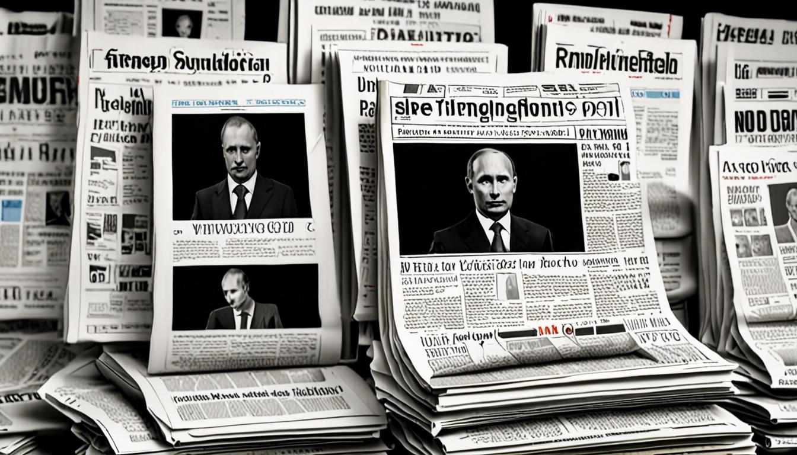

> 🌐 [Ler original em espanhol](../../pt/analisis/2026-11-19-largo.md)

<!-- EE_ENRICHED_START -->

<a href="/">Início</a>›<a href="/analisis/">Análise</a>›2026-11-19

🔥 Análise do Dia
<strong>Publicado:</strong> 2026-11-19 &nbsp;·&nbsp; <strong>Tipo:</strong> Análise do Dia

<figure style="margin:1.5em 0;"><figcaption style="font-size:0.85em;color:#888;text-align:center;margin-top:0.5em;font-style:italic;">O Enquadramento: Putin, vencedor da cimeira a três de Shenzhen:</figcaption></figure>
<h1>Shenzhen: O truque de magia da cimeira que lhe vendem como o fim do mundo</h1>

Enquanto as manchetes gritam a plenos pulmões que o planeta está a desabar, na península celebra-se um número de circo onde o medo é o único bilhete de entrada válido. Debulhámos os cabos de imprensa para descobrir que a crise não é o problema, mas sim o produto estrela da época.

Nove cabeçalhos, uma única coreografia: a incerteza como anestesia e a urgência como bisturi. Não se trata de informar sobre os acordos de Shenzhen, mas sim de fabricar uma realidade paralela onde só existem duas opções: a submissão absoluta ou a catástrofe iminente. Aqui não há análise, há *scripting* de massas desenhado para paralisar a sua capacidade de pensamento crítico antes de abrir os olhos.

É a velha armadilha da "segurança pelo terror": vendem-lhe a corrente de ouro como a única salvação face a um dragão que eles próprios desenharam a giz. Quando o pânico se instala na redação, a verdade torna-se um entrave para a linha editorial. Desligue o ruído, olhe para o tabuleiro e lembre-se de que, neste jogo, o seu medo é o melhor ativo deles.

<h2>El Español: apelo ao medo e dramatização de uma suposta conspiração internacional</h2>
<figure style="margin:1.5em 0;"><figcaption style="font-size:0.85em;color:#888;text-align:center;margin-top:0.5em;font-style:italic;">El Español: apelo ao medo e dramatização de uma suposta conspiração inte</figcaption></figure>

<strong>Título real:</strong> «Putin, vencedor da cimeira a três de Shenzhen: Trump e Xi ignoram a Europa e incluem-no na tríade do poder global»

<strong>Fonte:</strong> <a href="https://www.elespanol.com/espana/tribunales/20261119/supremo-endurece-critica-gobierno-no-actuar-diligencia-exigible-sacar-censo-falsos-nietos/1003744463762_0.html" target="_blank" rel="noopener">Ler em El Español</a>

O texto recita com a precisão de um cirurgião da incerteza: <em>“sérias suspeitas de que a sua inscrição no CERA é irregular, por ser contrária à Lei da Memória Democrática.”</em> Esta frase, tão leve como uma faca afiada, agarra-se à palavra “suspeitas” e ao adjetivo “irregular” para transformar uma simples polémica administrativa numa ameaça latente.

Ao ouvir “suspeitas”, o leitor depara-se com uma sensação de inquietação, como se cada inscrição fosse um possível buraco na rede da justiça. A palavra “irregular” atua como um farol que assinala que algo não está bem, gerando um alarme que não se baseia em factos concretos, mas sim na possibilidade de uma falha que poderia desestabilizar a confiança no sistema.

A técnica é evidente: o meio não descreve um facto, mas sim uma suspeita que é apresentada como um risco concreto. Ao dramatizar a situação com termos que evocam perigo e falta de legitimidade, o relato transforma-se num apelo à ação que, na realidade, apenas alimenta a paranoia.

Para detetá-lo no futuro, procure frases que utilizem adjetivos como “suspeitas”, “irregular”, “contrária” ou “risco” em contextos legais ou políticos. Se a narrativa se apoiar mais na sensação do que nos dados, é provável que esteja a construir uma conspiração de medo.
@@EEPROT64@@ABC: framing (encuadre que presenta el debate como un espectáculo inevitable)@@EEPROT65@@

@@EEPROT66@@@@EEPROT67@@Titular real:@@EEPROT68@@ «Hora y canales que emiten hoy el cara a cara entre Pedro Sánchez y Feijóo»@@EEPROT69@@

@@EEPROT70@@@@EEPROT71@@Fuente:@@EEPROT72@@ @@EEPROT73@@Leer en ABC@@EEPROT74@@@@EEPROT75@@

@@EEPROT76@@El fragmento «Yo me construyo una película en la cabeza y se la cuento al oyente. Le cojo de la mano y no le suelto en toda la novela» delata con claridad la técnica de framing: el medio envuelve la información en una narrativa de entretenimiento, como si el cara a cara fuera parte de una novela sonora más que de un hecho político.@@EEPROT77@@

@@EEPROT78@@Esa elección produce la sensación de estar atrapado en una sala de cine de bajo presupuesto, donde la realidad se diluye en una trama diseñada para mantener al lector pegado a la pantalla. En lugar de un análisis objetivo, el lector recibe una experiencia emocionalmente guiada, casi hipnótica.@@EEPROT79@@

@@EEPROT80@@Para detectarlo en futuras piezas basta con buscar expresiones que conviertan datos duros en metáforas cinematográficas o literarias, y observar si el foco se desplaza de la sustancia del tema a la forma de la historia. Cuando el texto prioriza la atmósfera sobre la información concreta, el framing está en marcha.@@EEPROT81@@

@@EEPROT82@@The Objective: urgencia (impulso de comprar pronto por miedo a quedarse sin décimo)@@EEPROT83@@

@@EEPROT84@@@@EEPROT85@@Titular real:@@EEPROT86@@ «Comprar Lotería de Navidad 2026 en Badajoz: números y décimos por administración para el sorteo»@@EEPROT87@@

@@EEPROT88@@@@EEPROT89@@Fuente:@@EEPROT90@@ @@EEPROT91@@Leer en The Objective@@EEPROT92@@@@EEPROT93@@

@@EEPROT94@@La frase que delata la técnica de urgencia es: “La venta empezó el 29 de junio en administraciones y el 6 de …”. Ese recorte marca un plazo concreto y, al quedar incompleto, genera una escasez artificial que obliga al lector a comprar antes de que el reloj se agote.@@EEPROT95@@

@@EEPROT96@@Esa elección me deja con la sensación de una carrera contra el tiempo, como si la Navidad fuera una subasta donde quien no apueste rápido se queda sin la promesa de un milagro económico. El tono de urgencia se mezcla con la nostalgia, convirtiendo el décimo en un rito de supervivencia que promete suerte al instante.@@EEPROT97@@

@@EEPROT98@@Para detectarlo la próxima vez, busca cualquier referencia temporal que no sea meramente informativa, sino que incluya verbos como “empieza” o “termina” acompañados de fechas precisas. También presta atención a imperativos como “apúntate” o “no dejes pasar”; su presencia indica que el texto busca disparar una compra impulsiva.@@EEPROT99@@

@@EEPROT100@@OkDiario: Apelación al miedo y sensacionalismo territorial@@EEPROT101@@

@@EEPROT102@@@@EEPROT103@@Titular real:@@EEPROT104@@ «Robles refuerza la seguridad de islas y peñones tras los «imprevisibles movimientos migratorios» contra Ceuta»@@EEPROT105@@

@@EEPROT106@@@@EEPROT107@@Fuente:@@EEPROT108@@ @@EEPROT109@@Leer en OkDiario@@EEPROT110@@@@EEPROT111@@

@@EEPROT112@@El término que delata la estrategia de miedo es «imprevisibles movimientos migratorios», una frase que, al estar entre comillas, suena a amenaza latente y descontrolada, como si la frontera fuera un campo de batalla que se desborda sin aviso.@@EEPROT113@@

@@EEPROT114@@Esta elección lexical genera una sensación de urgencia y alarma, empujando al lector a imaginar una oleada inminente que compromete la seguridad nacional. El uso de verbos como “refuerza” y “declaración de emergencia” refuerza la idea de que el Estado está bajo ataque y necesita medidas extraordinarias.@@EEPROT115@@

Para reconhecer este recurso em textos futuros, basta procurar palavras que retratem o fenômeno como inesperado, transbordante e perigoso, acompanhadas de expressões que impliquem uma resposta militar ou de alta tecnologia. Quando o relato se concentra na ameaça e na reação imediata, é um sinal claro de que se está jogando com o medo para captar a atenção do público.

<h2>InfoLibre: apelo à falta de certeza (insegurança) e à exclusão da audiência para gerar pressão</h2>

<strong>Manchete real:</strong> «Sánchez apela a uma participação de 75% que não lhe garante a chave de La Moncloa»

<strong>Fonte:</strong> <a href="https://www.infolibre.es/política/sanchez-apela-participacion-75-no-le-garantiza-llave-moncloa_1_2240351.html" target="_blank" rel="noopener">Ler no InfoLibre</a>

O detonador do jogo de insegurança é a frase: “para que não vão votar”. Ao declarar que a participação não garante a vitória, o texto transforma-se num espelho da dúvida, um espelho que se reflete na instabilidade do eleitorado.

Esta escolha faz estremecer a confiança do leitor, como um tambor que bate sem ritmo. A audiência sente-se excluída, como se a conversa política fosse um clube fechado com uma porta de ferro e a palavra “votar” se convertesse numa arma de desestabilização.

Para detetá-lo no futuro, procure a ausência de garantias e o convite à inação. Quando o discurso se apoia na dúvida e na exclusão, a pressão constrói-se sobre a incerteza. Um apelo à abstenção, um tom de “não vás”, é o sinal de alarme. Este padrão não só manipula a vontade, como também mina a legitimidade do processo eleitoral.

<h2>elDiario.es: Uso da técnica de contraste e da narrativa de 'encerramento de ciclo' para enfatizar a diferença entre a postura do PP e a do PSOE, gerando uma perceção de superioridade e de preparação da oposição.</h2>

<strong>Manchete real:</strong> «N/A»

<strong>Fonte:</strong> <a href="https://www.eldiario.es/política/ultimo-cara-cara-sanchez-feijoo-pp-rebaja-expectativas-lider-psoe-prepara-revancha-2023_1_13674800.html" target="_blank" rel="noopener">Ler no elDiario.es</a>

O meio recorre ao contraste e ao encerramento de ciclo com a frase: “o último mano a mano Sánchez‑Feijóo: o PP reduz as suas expectativas e o líder do PSOE prepara a desforra de 2023”. Ao colocar a queda da esperança do PP ao lado da audácia do PSOE, a narrativa fecha-se com a promessa de um novo confronto, como se o espectador já soubesse que o drama continuaria o seu curso sem fim, num tom que deixa claro que a oposição está preparada para o próximo confronto.

Esta escolha faz-me sentir uma mistura de ironia e cinismo. Ao ler a frase, a superior

<h2>Libertad Digital: Apelo ao medo (fear appeal) ao insinuar um possível colapso político com números alarmantes.</h2>

<strong>Manchete real:</strong> «N/A»

<strong>Fonte:</strong> <a href="https://www.libertaddigital.com/espana/2026-11-19/el-voto-de-los-hijos-de-los-nacionalizados-con-la-ley-de-nietos-puede-afectar-a-14-escanos-en-las-elecciones-del-29-n-7493951/?utm_source=rss&amp;utm_medium=feed&amp;utm_campaign=Libertad+Digital%3A+Noticias+y+opini%C3%B3n+en+la+red" target="_blank" rel="noopener">Ler no Libertad Digital</a>

O sinal do apelo ao medo encontra-se na frase «poderá ter uma incidência de até 14 assentos», que transforma um número de eleitores numa ameaça iminente para o equilíbrio parlamentar. O texto não hesita em assinalar que esses «quase 190.000 votos» poderiam decidir círculos eleitorais onde o último assento foi ganho com menos de 2.000 sufrágios, reforçando o alarme.

Esse cálculo frio, apresentado como se fosse uma catástrofe eleitoral, gera uma sensação de urgência e paranoia; o leitor é arrastado a imaginar que cada voto extra é um balde de água que poderia inundar o barco do governo. Além disso, o uso de verbos como “repercutir de forma notória” sugere que a ordem constitucional está à beira do colapso, o que intensifica a pressão emocional do leitor.

Para detetá-lo, basta vigiar os números exagerados e a ausência de fontes independentes; se o argumento gira em torno de um cenário extremo sem dados de probabilidade, estamos perante um apelo ao medo.

<h2>Al Jazeera: medo (alarme nuclear)</h2>

<strong>Título real:</strong> «Trump wants to talk nuclear with Putin and Xi»

<strong>Fonte:</strong> <a href="https://www.aljazeera.com/video/newsfeed/2026/11/19/trump-wants-to-talk-nuclear-with-putin-and-xi?traffic_source=rss" target="_blank" rel="noopener">Ler em Al Jazeera</a>

A Al Jazeera, ao apresentar a notícia, recorre à frase: “raise nuclear non‑proliferation”. Ao lê-la, o leitor é arrastado para um cenário de catástrofe iminente, onde a palavra “nuclear” funciona como uma bomba psicológica que dispara o alarme mais primitivo.

Essa reviravolta faz-me estremecer, como se um alarme silencioso se tivesse ativado no meu interior. A simples menção de “nuclear” não é neutra; é um convite a imaginar um mundo onde a estabilidade vacila sob o peso de uma arma que ninguém quer usar.

Para detetar este recurso no futuro, basta procurar no texto termos que sugiram um risco global: “nuclear”, “apocalíptico”, “catástrofe”, “perigo” ou qualquer palavra que evoque uma ameaça que transcenda fronteiras. Quando aparecem, o meio de comunicação está a brincar com a ansiedade coletiva. Esta tática torna-se mais eficaz quando o leitor já está exposto a manchetes de crise, pois a palavra “nuclear” transforma-se num gancho que acelera a reação emocional.

<h2>The Guardian: alarmismo</h2>

<strong>Título real:</strong> «One in four women globally unable to refuse sex within marriage, says UN»

<strong>Fonte:</strong> <a href="https://www.theguardian.com/global-development/2026/nov/19/women-girls-rights-rape-sexual-violence-africa-marriage-unfpa" target="_blank" rel="noopener">Ler em The Guardian</a>

O título goteja veneno com a precisão de um cirurgião macabro: «unable to refuse sex». Não dizem «não consentem» nem «não desejam», mas sim que são incapazes de recusar. Essa frase não descreve uma falta de desejo, mas sim um cativeiro absoluto. Transformam o casamento numa jaula onde a vontade da mulher é uma ficção jurídica e a capacidade de dizer «não» desaparece por completo. É uma narrativa de impotência total que ignora a nuance da negociação conjugal para vender a imagem de uma escravidão sexual sistémica.

Esta escolha linguística gera uma sensação de asfixia imediata. Ao lê-la, o cérebro não processa estatísticas, mas sim uma perda de agência humana. Faz-te sentir que estás a observar seres humanos reduzidos a objetos passivos num cenário de horror quotidiano. A urgência não vem da notícia, mas da arquitetura emocional do verbo «unable». É um truque antigo: retirar a voz ao sujeito para que o leitor sinta a falta dessa voz com mais força do que se a tivesse.

Para detetar isto da próxima vez, procura o verbo que elimina a agência. Se o sujeito não age, mas antes «sofre» uma impossibilidade, estás perante o alarmismo da passividade. Pergunta: é realmente impossível ou é culturalmente desafiante? Se o texto usa «cannot» ou «unable» para descrever dinâmicas interpessoais complexas, estás a ver uma manipulação narrativa que converte a dificuldade social numa condenação biológica. Desconfia de qualquer título que te retire a capacidade de duvidar.

<figure style="margin:1.5em 0;"><figcaption style="font-size:0.85em;color:#888;text-align:center;margin-top:0.5em;font-style:italic;">O mecanismo, exposto</figcaption></figure>
<h2>O mecanismo, exposto</h2>

Amanhã tornarão a fazê-lo. E tu já saberás onde olhar. Isto é O Enquadramento.

<strong>Aviso legal:</strong> Isto não é uma acusação. É uma autópsia. Os meios estão citados e hiperligados. O direito de citação ampara-nos. Se te dói, é porque te viste refletido.

<strong>Segue-nos:</strong> <a href="https://youtube.com/@somoselencuadre.oficial">YouTube</a> · <a href="https://tiktok.com/@somoselencuadre">TikTok</a> · <a href="https://instagram.com/somoselencuadre">Instagram</a> · <a href="https://x.com/SomosElEncuadre">X</a> · <a href="https://threads.net/@somoselencuadre">Threads</a>

<!-- EE_ENRICHED_END -->