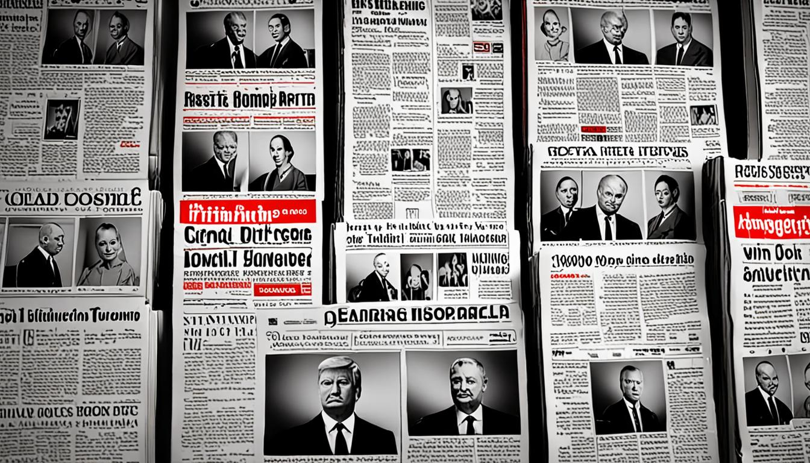

> 🌐 [Ler original em espanhol](../../pt/analisis/2026-11-19-mediano-cita.md)

<!-- EE_ENRICHED_START -->

<a href="/">Início</a>›<a href="/analisis/">Análise</a>›2026-11-19

📄 Ângulo do Dia
<strong>Publicado:</strong> 2026-11-19 &nbsp;·&nbsp; <strong>Tipo:</strong> Ângulo do Dia

<figure style="margin:1.5em 0;"><figcaption style="font-size:0.85em;color:#888;text-align:center;margin-top:0.5em;font-style:italic;">A citação que muda tudo</figcaption></figure>
<h1>A sombra de Bernays sobre a opinião pública</h1>

Na era dos algoritmos que nos sussurram ao ouvido, uma frase fragmentada de meio século atrás volta a ressoar como um eco de advertência. Edward Bernays, o avô das <em>relações públicas</em>, deixou uma marca que hoje se faz sentir em cada clique que nos transforma em consumidores. A sua mensagem, embora incompleta, destila a essência de uma estratégia que passou dos salões da elite para os *feeds* do Instagram.

<blockquote>«{'autor': 'Edward Bernays', 'frase': 'A manipulação consciente e inteligente dos hábitos e opin»</blockquote>
<h2>Quem o disse</h2>
<figure style="margin:1.5em 0;"><figcaption style="font-size:0.85em;color:#888;text-align:center;margin-top:0.5em;font-style:italic;">Quem o disse</figcaption></figure>
Edward Bernays (1891-1995) foi um pioneiro norte-americano da chamada "arte da persuasão". Neto do célebre psicanalista Sigmund Freud, herdou a ideia de que os desejos humanos podem ser moldados com precisão cirúrgica. Após trabalhar na campanha da <em>American Tobacco Company</em>, onde popularizou o cigarro entre as mulheres sob o lema "Fume se és livre!", Bernays fundou sua própria agência e tornou-se o arquiteto da opinião moderna. Seus livros, como <em>Propaganda</em> (1928) e <em>Crystallizing Public Opinion</em> (1945), continuam sendo leituras obrigatórias em escolas de comunicação e marketing, embora poucos admitam que seu legado seja também uma receita para o controle social.

<h2>Contexto</h2>

A frase surgiu em uma época em que a publicidade começava a abandonar o simples anúncio de produtos para adentrar a psicologia de massas. Após a Primeira Guerra Mundial, governos e corporações descobriram que a persuasão podia ser tão decisiva quanto a força militar. Bernays, inspirado pelos experimentos de seu tio Freud, aplicou técnicas de sugestão e criação de símbolos para transformar ideias abstractas em hábitos cotidianos. Na década de 1930, suas campanhas para a United Fruit Company e para a empresa de alimentos "Borden" mostraram como a manipulação da informação podia moldar a percepção pública sem a necessidade de coerção direta.

<h2>O que significava</h2>

O fragmento "A manipulação consciente e inteligente dos hábitos e opin..." revela uma intenção clara: a criação deliberada de padrões de comportamento através de informações selecionadas. Bernays não falava de mera persuasão; ele falava de uma engenharia social que parte da observação de desejos inconscientes para projetar mensagens que os satisfaçam antes mesmo que o indivíduo os reconheça. Em outras palavras, as pessoas compram a ilusão de liberdade enquanto suas decisões são orquestradas a partir das sombras dos dados e das narrativas que lhes são apresentadas. A "inteligência" do processo reside na capacidade de antecipar reações e adaptar a narrativa em tempo real, um princípio que hoje se materializa nos algoritmos de recomendação de plataformas como YouTube ou TikTok.

<figure style="margin:1.5em 0;"><figcaption style="font-size:0.85em;color:#888;text-align:center;margin-top:0.5em;font-style:italic;">O que oculta</figcaption></figure>
<h2>O que oculta</h2>

Por trás da aparente clareza da frase esconde-se uma verdade incômoda: a falta de transparência. Ao falar em "manipulação consciente", Bernays reconhece que o processo é deliberado, mas nunca menciona quem decide quais hábitos merecem ser incentivados. A ausência de um sujeito claro permite que a manipulação se desenrole sob a aparência de neutralidade. Além disso, o fragmento está truncado; a palavra que se segue a "opin" provavelmente seria "opiniões" ou "opiniões coletivas", o que sugere a intenção de moldar não apenas ações, mas também a forma como as pessoas interpretam a realidade. O que fica de fora do discurso é a responsabilidade ética daqueles que manejam essas técnicas, uma questão que continua sem solução na era digital.

Em conclusão, a citação incompleta de Bernays não é apenas um vestígio histórico, mas um aviso vivo. Em um mundo onde os dados são o novo petróleo e os influenciadores são os curadores da opinião, a "manipulação consciente e inteligente" continua operando sob o manto da vida cotidiana. A lição que devemos tirar é que a vigilância não cabe apenas aos poderes do Estado, mas também aos gigantes do marketing que, com a mesma precisão de um cirurgião, esculpem nossos hábitos e ideias. Só ao reconhecer a existência dessa arquitetura invisível poderemos reivindicar uma esfera pública verdadeiramente livre.

<strong>Aviso legal:</strong> Isto não é uma acusação. É uma autópsia. Os meios de comunicação estão citados e com hiperligação. O direito de citação (art. 32 LPI) protege-nos.

<strong>Segue-nos:</strong> <a href="https://youtube.com/@somoselencuadre.oficial">YouTube</a> · <a href="https://tiktok.com/@somoselencuadre">TikTok</a> · <a href="https://instagram.com/somoselencuadre">Instagram</a> · <a href="https://x.com/SomosElEncuadre">X</a> · <a href="https://threads.net/@somoselencuadre">Threads</a>

<!-- EE_ENRICHED_END -->