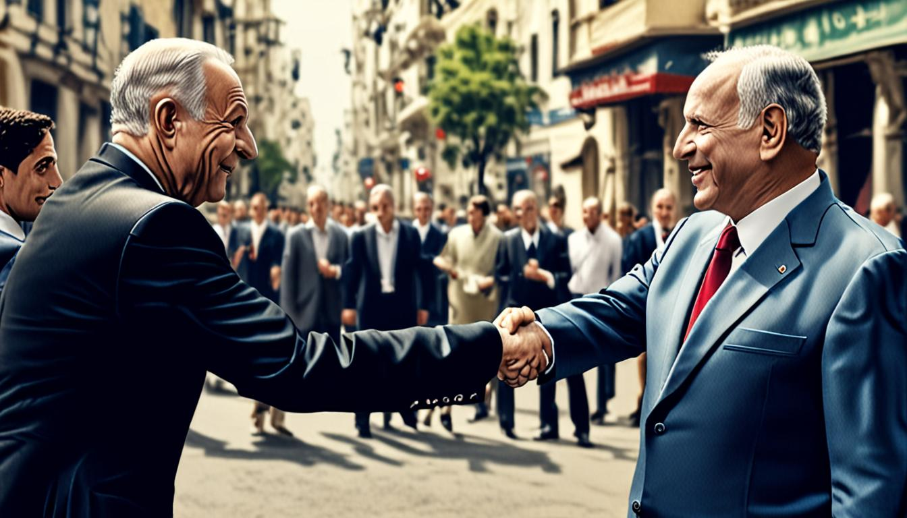

<figure></figure>
<figure></figure>
<figure></figure>
<h1>Dossier Ejecutivo del día: El "encuadre" de la crisis israelí frente al ruido de la campaña española</h1>

El mundo gira sobre un eje que nadie quiere mirar: mientras Israel intenta armar un gobierno con el opositor Eisenko, la península ibérica se ahoga en el ruido de campanas electorales, metáforas mafiosas y cálculos de inflación. Este dossier no viene a contarte qué pasó, sino a desmontarte cómo te lo están vendiendo para que no veas el mecanismo. Bienvenido a la carnicería de la narrativa.

<h2>Noticias del día</h2>

La noticia que realmente importa, la que mueve tectónica política en el Medio Oriente, es la encarga al opositor Eisenko para formar gobierno en Israel. Un movimiento de pánico estratégico que los medios locales están intentando diluir en el ruido de la cobertura española. En casa, el espectáculo es de otra índole: una batalla de narrativas donde los números de la inflación y las indemnizaciones se convierten en armas arrojadizas. No se trata de saber quién tiene razón, sino de ver quién controla la palabra. Los datos duros son fríos: las ayudas por fallecidos en siniestros ferroviarios siguen congeladas en cifras de 2014, mientras que otros indicadores sociales disparan la tensión social hacia las urnas.

Para entender la atmósfera tóxica, basta con escuchar a dos bandos que se gritan desde trincheras mediáticas. Por un lado, la presidenta madrileña, Isabel Díaz Ayuso, lanza una metáfora criminalizadora: <em>"La mafia sindical está haciendo la campaña a su amo Sánchez y secuestra los servicios públicos"</em>. Por otro, el presidente del Gobierno, Pedro Sánchez, invoca la legitimidad democrática más sagrada para movilizar a su base: <em>"Hasta el Papa León XIV ha votado"</em>. Dos realidades paralelas, dos mecanismos de control, un sólo objetivo: que no pienses en lo que realmente está ocurriendo en Jerusalén.

<h2>Los medios y sus técnicas</h2>

No son fuentes, son herramientas de manipulación cognitiva. Cada medio tiene su truco de magia, su ángulo fallecido diseñado para que tu cerebro procese la información de la forma que el propietario del medio desea. Analicemos el menú del día. Aquí no hay periodismo, hay circo de los horrores con facturas.

<table border="1" cellpadding="5" cellspacing="0">
  <thead>
    <tr>
      <th>Medio</th>
      <th>Técnica Detectada</th>
      <th>Lo que se Omite (El Vacío)</th>
    </tr>
  </thead>
  <tbody>
    <tr>
      <td>El Español</td>
      <td>Deshumanización y culpabilización mediante metáfora de 'mafia'</td>
      <td>La complejidad estructural de la negociación colectiva; la realidad de los servicios públicos.</td>
    </tr>
    <tr>
      <td>OkDiario</td>
      <td>Framing positivo (en realidad, catastrofismo económico)</td>
      <td>El contexto macroeconómico global; las decisiones de política monetaria.</td>
    </tr>
    <tr>
      <td>Ara</td>
      <td>Gore semántico y enmarcado de clase</td>
      <td>La responsabilidad del consumidor; la oferta de mercado y la regulación urbanística.</td>
    </tr>
    <tr>
      <td>La Vanguardia</td>
      <td>Etiquetado emocional y atribución de motivación interna</td>
      <td>Las causas sistémicas de la violencia; el contexto social de aislamiento.</td>
    </tr>
    <tr>
      <td>20 Minutos</td>
      <td>Apelación a la autoridad y al consenso social (bandwagon effect)</td>
      <td>La diversidad de opiniones; la crítica a la gestión de infraestructuras.</td>
    </tr>
    <tr>
      <td>Libertad Digital</td>
      <td>Pánico moral y doble rasero religioso</td>
      <td>La coherencia de la agenda política; el respeto a la laicidad o la tradición.</td>
    </tr>
  </tbody>
</table>

<h2>Las técnicas al detalle</h2>

<h3>1. La Metáfora Criminal (Deshumanización)</h3>

<strong>Medio:</strong> El Español. 
<strong>Cita textual:</strong> <em>"La mafia sindical está haciendo la campaña a su amo Sánchez y secuestra los servicios públicos"</em>. 
<strong>Análisis:</strong> Al convertir a los sindicatos en "mafia" y a Sánchez en "amo", se elimina la posibilidad del debate racional. No se discute política, se combate al caso. Es una técnica antigua, eficaz y sucia. Te obliga a reaccionar con miedo o desprecio, no con análisis. Si eres la mafia, no tienes derecho a negociar, sólo a ser destruido.

<h3>2. El Ancla Informativa Falsa</h3>

<strong>Medio:</strong> OkDiario. 
<strong>Cita textual:</strong> <em>"Sí, en efecto, el título de este editorial es exacto, porque el Gobierno de Pedro Sánchez, pese a haber pasado doce años, sigue fijando en 72.121,46 euros las ayudas por cada víctima mortal en los siniestros ferroviarios que se fijó en 2014."</em> 
<strong>Análisis:</strong> Aquí se usa un dato técnico y real (la falta de actualización del baremo) para construir una narrativa de "misericordia congelada". Se ignora que los baremos son ley y requieren procesos legislativos largos. Se presenta un trámite burocrático como una elección moral consciente. Es la técnica del "dato aislado": es verdad, pero es mentira por omisión. Te hacen sentir que el Estado te roba por capricho, no por inercia legislativa.

<h3>3. El Gore Semántico de Clase</h3>

<strong>Medio:</strong> Ara. 
<strong>Cita textual:</strong> <em>"Són fonamentalment dos: l'habitatge i l'alimentació, segons deixa clar la Generalitat en l'Informe Social 2025."</em> 
<strong>Análisis:</strong> En catalán, pero el mecanismo es universal. Se reduce la economía a dos dolores de barril: casa y comida. Se crea un "nosotros" (los que sufren) contra un "ellos" (el sistema). Al destacar el "Informe Social 2025", se da una capa de cientificidad a lo que es pura percepción de dolor. Es el enmarcado de clase puro: no importa la causa, importa que duela. Y que duela en el bolsillo, que es donde no se puede discutir.

<h3>4. La Apelación a la Autoridad Suprema</h3>

<strong>Medio:</strong> 20 Minutos / Libertad Digital. 
<strong>Cita textual:</strong> <em>"Hasta el Papa León XIV ha votado"</em>. 
<strong>Análisis:</strong> Invocar al líder religioso más alto del mundo para justificar una acción política es el colmo de la desfachatez secular. Se usa el Papa como sello de legitimidad democrática. Si el Papa vota, tú también debes hacerlo, o eres un hereje cívico. Es una técnica de "bandwagon effect" (efecto arrastre): no pienses, sigue al rebaño. Y si, como señala Libertad Digital, el mismo presidente evita el funeral religioso, la hipocresía queda al descubierto, pero la técnica sigue funcionando porque la mayoría no conecta los puntos.

<h3>5. La Etiquetado Emocional</h3>

<strong>Medio:</strong> La Vanguardia. 
<strong>Cita textual:</strong> <em>"El agresor, un ultranacionalista de extrema derecha polaco, disparó al azar contra la gente desde un coche en la plaza del Mercado"</em>. 
<strong>Análisis:</strong> Antes de que termines de leer la frase, ya sabes cómo sentirte: miedo, asco y rechazo. La palabra "ultranacionalista" hace todo el trabajo sucio. No se analiza la salud mental, el contexto social o la falla del sistema de seguridad. Se etiqueta al agresor como un monstruo ideológico. Así, la violencia no es un fallo del sistema, es un fallo de "ellos". Y tú estás a salvo, siempre y cuando no pienses como "ellos".

<h2>Los sesgos compartidos</h2>

¿Qué tienen en común todos estos medios? Que ninguno te está informando. Todos te están emocionalizando. El patrón es claro: simplificar la complejidad en un binomio maniqueo. Ayuso vs. Sánchez. El Estado vs. El Ciudadano. El Orden vs. El Caos. La "mafia" vs. La "democracia".

Funciona porque el cerebro humano es perezoso. Prefiere una narrativa clara, aunque sea falsa, a una verdad compleja y aburrida. Al reducir la realidad a colores primarios (rojo de la ira, azul de la calma), te impiden ver los tonos grises donde se cuece la verdadera política. Y mientras te distraen con el "pánico moral" de Francia o la "mafia" de Madrid, el verdadero mecanismo de poder, aquel que encarga a Eisenko formar gobierno en medio del caos, pasa desapercibido en las notas al pie. El ruido es el mejor camuflaje.

<h2>Conclusión</h2>

No eres un consumidor de noticias. Eres un activo de marketing emocional. Cada titular es un golpe en el estómago diseñado para que actúes antes de pensar. Ayuso no te está contando sus planes, te está inyectando miedo al "amo". Sánchez no te está pidiendo tu voto, te está vendiendo la salvación a través del Papa. Los datos de OkDiario no son una crítica fiscal, son un insulto personal a tu bolsillo.

El mecanismo, expuesto. Mañana volverán a hacerlo. Y tú, si no desmontas el truco, seguirás siendo el público ideal para su circo. Despierta. O al menos, deja de morder el anzuelo.

<h3>Fuentes consultadas:</h3>
<ul>
<li><strong>El Español:</strong> «Ayuso ante el 29-N: "La mafia sindical está haciendo la campaña a su amo Sánchez y secuestra los servicios públicos"» — <a href="https://www.elespanol.com/espana/política/20261108/ayuso-mafia-sindical-haciendo-campana-amo-sanchez-secuestra-servicios-publicos/1003744449012_0.html" target="_blank" rel="noopener">Leer completo</a></li>
<li><strong>The Objective:</strong> «Podcast | ¿Quién fue el responsable de la matanza de Paracuellos?» — <a href="https://theobjective.com/podcasts/historia-canalla/podcast-historia-canalla-responsable-matanza-paracuellos/" target="_blank" rel="noopener">Leer completo</a></li>
<li><strong>OkDiario:</strong> «Pedro vuelve a contratar a Koldo» — <a href="https://okdiario.com/opinion/gobierno-recorta-23-000-euros-ayudas-cada-fallecido-adamuz-urda-20718786" target="_blank" rel="noopener">Leer completo</a></li>
<li><strong>Ara:</strong> «N/A» — <a href="https://www.ara.cat/economia/mercat-laboral/l-augment-preus-s-acarnissa-rendes-mitjanes-baixes_1_5901164.html" target="_blank" rel="noopener">Leer completo</a></li>
<li><strong>La Vanguardia:</strong> «Un joven fascinado por la extrema derecha: así define el Gobierno polaco al pistolero de Cracovia» — <a href="https://www.lavanguardia.com/internacional/20261107/11678781/tiroteo-cracovia-deja-cinco-personas-muertas.html" target="_blank" rel="noopener">Leer completo</a></li>
<li><strong>20 Minutos:</strong> «Isabel Díaz Ayuso, aclamada en Valencia: "España necesita a Feijóo, va a cumplir, es el único que une tantas sensibilidades"» — <a href="https://www.20minutos.es/nacional/sanchez-culpa-los-accidentes-trenes-los-recortes-rajoy-pide-votar-como-eeuu-tenemos-papa-punki_7058507_0.html" target="_blank" rel="noopener">Leer completo</a></li>
<li><strong>Libertad Digital:</strong> «Pinchazo sindical en Francia: la participación en las protestas cae en picado tras cuatro semanas» — <a href="https://www.libertaddigital.com/espana/2026-11-07/sanchez-pide-el-voto-citando-al-papa-pero-evita-ir-al-funeral-religioso-por-las-afectados-de-urda-7488144/?utm_source=rss&amp;utm_medium=feed&amp;utm_campaign=Libertad+Digital%3A+Noticias+y+opini%C3%B3n+en+la+red" target="_blank" rel="noopener">Leer completo</a></li>
<li><strong>Le Monde:</strong> «Présidentielle 2027: en meeting au Bourget, Jean-Luc Mélenchon mobilise sa base tout en s’attelant à élargir son électorat» — <a href="https://www.lemonde.fr/politique/article/2026/11/08/presidentielle-2027-en-meeting-au-bourget-jean-luc-melenchon-s-attelle-a-mobiliser-sa-base-tout-en-elargissant-son-electorat_6808387_823448.html" target="_blank" rel="noopener">Leer completo</a></li>
<li><strong>BBC World:</strong> «What we know so far after Krakow gun attack» — <a href="https://www.bbc.co.uk/news/articles/cmd7q15drwgeo?at_medium=RSS&amp;at_campaign=rss" target="_blank" rel="noopener">Leer completo</a></li>
<li><strong>Bloomberg:</strong> «China Set to Lead World in Energy Investment in 2026, CCTV Says» — <a href="https://www.bloomberg.com/news/articles/2026-11-08/china-set-to-lead-world-in-energy-investment-in-2026-cctv-says" target="_blank" rel="noopener">Leer completo</a></li>
<li><strong>Europa Press:</strong> «N/A» — <a href="https://www.europapress.es/catalunya/noticia-29n-sanchez-llama-votar-contra-involucion-papa-leon-xiv-votado-20261107125406.html" target="_blank" rel="noopener">Leer completo</a></li>
</ul>

<strong>Aviso legal:</strong> Esto no es una acusación. Es una autopsia. Los medios están citados y enlazados. El derecho de cita (art. 32 LPI) nos ampara.

<strong>Síguenos:</strong> <a href="https://youtube.com/@somoselencuadre.oficial">YouTube</a> · <a href="https://tiktok.com/@somoselencuadre">TikTok</a> · <a href="https://instagram.com/somoselencuadre">Instagram</a> · <a href="https://x.com/SomosElEncuadre">X</a> · <a href="https://threads.net/@somoselencuadre">Threads</a>

