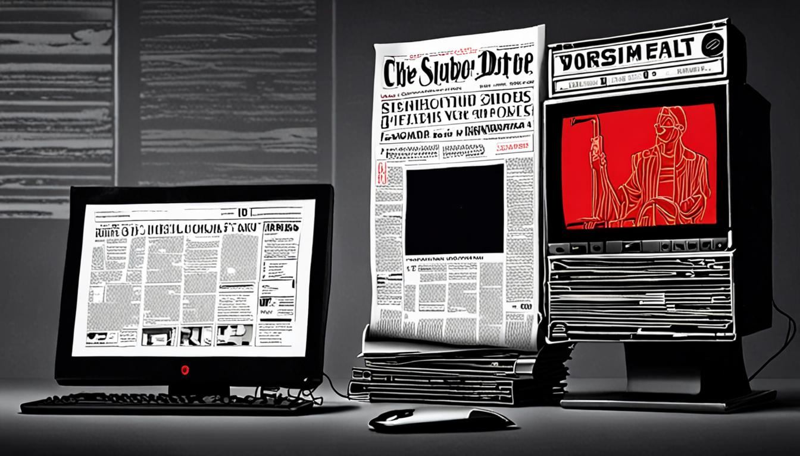

<figure style="margin:1.5em 0;"><figcaption style="font-size:0.85em;color:#888;text-align:center;margin-top:0.5em;font-style:italic;">El Encuadre: Nvidia abre una investigación a su consejero de</figcaption></figure>
<h1>Nvidia investiga a su consejero: la trama que los medios no quieren contar</h1>

Mientras los titanes de la tecnología se pelean por el control, un consejero de Nvidia desaparece entre sombras de prensa. Los grandes diarios aúllan con aplausos, pero el verdadero espectáculo está en la trama que se cuece tras bambalinas.

Los titulares de La Vanguardia y ABC pintan a Nvidia como un blanco inocente de un complot, mientras OkDiario y 20 Minutos alimentan la histeria con un halo de aprobación. InfoLibre y Libertad Digital, con su habitual sesgo de confrontación, lanzan acusaciones que mezclan miedo y autoridad. En este reportaje desmantelamos la maquinaria de desinformación que ha convertido una investigación interna en un circo de opiniones, y revelamos lo que los gigantes mediáticos prefieren ocultar.

El truco consiste en mezclar el temor a perder el control con la glorificación de figuras como Trump, para distraer del verdadero problema: la falta de transparencia de Nvidia. Al destapar la estrategia de framing y el uso de la urgencia artificial, dejamos al descubierto la fachada que los medios han construido. El lector, armado con la verdad, ya no será cómplice del espectáculo.

<h2>La Vanguardia: apelación a la amenaza de pérdida de control y a la asociación negativa con Trump</h2>
<figure style="margin:1.5em 0;"><figcaption style="font-size:0.85em;color:#888;text-align:center;margin-top:0.5em;font-style:italic;">La Vanguardia: apelación a la amenaza de pérdida de control y a la asociación ne</figcaption></figure>

<strong>Titular real:</strong> «Sánchez advierte que si PP y Vox gobiernan se plegarán a Trump: “Estos tragan con todo”»

<strong>Fuente:</strong> <a href="https://www.lavanguardia.com/política/20261108/11679248/sanchez-advierte-pp-vox-gobiernan-plegaran-trump-tragan.html" target="_blank" rel="noopener">Leer en La Vanguardia</a>

La frase que delata la táctica de amenaza es “se plegarán a Trump: ‘Estos tragan con todo’”, que sitúa al posible gobierno como esclavo de un poder externo y sugiere la pérdida de soberanía española.

Esa elección lexical genera una mezcla de irritación y desconfianza; el lector percibe que se le está vendiendo un escenario apocalíptico donde el país se convierte en patio trasero de una ultraderecha transnacional, provocando una reacción visceral de rechazo.

Para reconocerla en otro texto basta con buscar dos pistas: primero, la alusión a un “peligro inminente” que implica que el lector o la nación perderá el control; segundo, la asociación directa con una figura polémica (Trump) para cargar de connotaciones negativas cualquier proyecto político rival. Cuando ambas se combinan, el discurso se vuelve un juego de miedo y desprestigio.

Además, la estructura suele acompañarse de verbos fuertes como “tragan” o “plegarse”, que intensifican la sensación de sumisión y refuerzan la narrativa del “peligro”.

<h2>ABC: framing positivo (halo effect)</h2>

<strong>Titular real:</strong> «N/A»

<strong>Fuente:</strong> <a href="https://www.abc.es/espana/accidente-urda-apenas-altera-bloques-29n-derecha-20261108023004-nt.html" target="_blank" rel="noopener">Leer en ABC</a>

El indicio más claro del framing positivo se encuentra en la frase «apenas altera los bloques para el 29N», que actúa como un velo de indiferencia frente a los hechos más impactantes. Al describir el accidente ferroviario y el fallecimiento de una anciana como meros “puntos de la encuesta”, el texto los reduce a simples variables sin peso, creando la ilusión de que el panorama electoral sigue inalterado y, por ende, positivo para los protagonistas.

Esta elección léxica genera una sensación de calma forzada, como si el caos fuera una simple bruma que no empaña la claridad del pronóstico. El lector percibe un discurso que, bajo la apariencia de objetividad, suaviza los acontecimientos críticos para mantener la narrativa de estabilidad política, provocando una mezcla de escepticismo y fastidio.

Para detectar este truco en futuras lecturas, basta con buscar expresiones que minimicen o desestimen eventos relevantes mediante adverbios como “apenas”, “sólo” o “ya con”. Cuando la información se presenta como una fotografía estática que “no cambia nada”, es señal de que el autor está aplicando un halo effect para proteger la imagen de los actores políticos.

<h2>OkDiario: Apelación a la emoción mediante la exageración de los aplausos para generar simpatía y espectáculo</h2>

<strong>Titular real:</strong> «El Chamán y los aplausos inverosímiles»

<strong>Fuente:</strong> <a href="https://okdiario.com/opinion/chaman-aplausos-inverosimiles-20726653" target="_blank" rel="noopener">Leer en OkDiario</a>

La frase que delata la estrategia es «aplausos inverosímiles», un guiño exagerado que convierte cualquier hecho en un espectáculo de ovación. Al leer esa expresión, el lector se ve arrastrado a una montaña rusa emocional donde la razón queda relegada a un segundo plano, y la curiosidad se alimenta de la promesa de un espectáculo.

Ese recurso genera una sensación de complicidad cómplice, como si estuvieras asistiendo a una función de circo donde el público aplaude sin saber por qué. El tono grandilocuente despierta entusiasmo, pero también una ligera irritación, pues se percibe la intención de manipular la percepción mediante el ruido de los aplausos en lugar de los hechos.

Para reconocerlo en el futuro, basta con vigilar el uso de superlativos que describen reacciones del público («aplausos», «ovaciones», «gritos de júbilo») sin que exista un respaldo objetivo. Cuando el texto se vuelve más espectáculo que información, la técnica de apelación emocional mediante exageración está al acecho.

<h2>20 Minutos: apelar al contraste y la autoridad, usando el contraste entre Trump y los trenes para desacreditar al presidente y reforzar la imagen de Feijóo como un líder práctico y orientado a la infraestructura</h2>

<strong>Titular real:</strong> «Feijóo pide a Sánchez "menos mirar a Trump y más a los trenes" y a los directivos de Adif devolver los bonus que han cobrado»

<strong>Fuente:</strong> <a href="https://www.20minutos.es/nacional/feijoo-pide-sanchez-menos-mirar-trump-más-trenes-directivos-adif-devolver-gratificaciones-han-cobrado_7058678_0.html" target="_blank" rel="noopener">Leer en 20 Minutos</a>

La frase que delata la estrategia es “menos mirar a Trump y más a los trenes”, un guiño que sitúa al líder estadounidense como símbolo de lo absurdo frente a la supuesta sensatez ferroviaria de Feijóo. Al emparejar al ex presidente con una imagen de caos, el medio crea un contraste que desacredita a Sánchez y eleva al candidato como autoridad práctica. El artículo también menciona “devolver las gratificaciones que han cobrado” para reforzar la imagen de austeridad, mientras que el contraste con Trump sirve de ancla moral.

Esta elección me provoca una sonrisa sardónica; el lector percibe una burla velada que pretende convencerlo de que la solución está en los rieles y no en la política internacional. El tono pomposo del texto, cargado de referencias a “30 años” de servicio, busca presentar a Feijóo como el único salvador del caos cotidiano.

Para reconocerlo en futuros textos hay que buscar comparaciones exageradas, nombres de figuras internacionales usados como chivos expiatorios y la inserción de verbos como “revisar… palmo a palmo” que confieren una autoridad de experto sin sustento. Detectar esas fórmulas permite desarmar la ilusión de objetividad que el medio intenta proyectar.

<h2>InfoLibre: Efecto de contraste y sensacionalismo: se resalta la variabilidad semanal para generar duda y alarma.</h2>

<strong>Titular real:</strong> «N/A»

<strong>Fuente:</strong> <a href="https://www.infolibre.es/política/29n-campana-electoral-cambia-guion-semana_1_2239674.html" target="_blank" rel="noopener">Leer en InfoLibre</a>

La frase que delata la técnica es “la campaña que cambia de guion cada semana”. Ese fragmento, con su ritmo de “cambia… cada semana”, está diseñado para crear la sensación de una montaña rusa inestable que nunca se asienta, alimentando la duda y el sobresalto del lector.

Esta elección me hace sentir como si estuviese viendo una telenovela política, donde cada nuevo episodio supera al anterior en dramatismo; el lector queda atrapado en la expectación de lo inesperado, con una alarma constante que le impide descansar.

Para detectarlo la próxima vez, basta con buscar palabras que impliquen variabilidad constante (“cada semana”, “giros de guion”, “nunca les ha dado tiempo”), y observar cómo el texto se apoya en esa inestabilidad para generar impacto, en lugar de presentar hechos consolidados.

<h2>Libertad Digital: Urgencia existencial y victimización colectiva mediante la deshumanización del tiempo transcurrido.</h2>

<strong>Titular real:</strong> «N/A»

<strong>Fuente:</strong> <a href="https://www.libertaddigital.com/espana/política/2026-11-08/federico-jimenez-losantos-nos-invade-un-pais-musulman-y-sanchez-se-niega-a-ir-a-un-funeral-catolico-7488214/?utm_source=rss&amp;utm_medium=feed&amp;utm_campaign=Libertad+Digital%3A+Noticias+y+opini%C3%B3n+en+la+red" target="_blank" rel="noopener">Leer en Libertad Digital</a>

La frase que delata la técnica es “Marruecos invadió España por Ceuta, hace tres meses, con la complacencia de Sánchez”. El uso del verbo “invadió” junto a la referencia temporal “hace tres meses” crea una urgencia que obliga al lector a sentir que el peligro está latente y que el gobierno ha fallado.

Esta elección me produce una mezcla de irritación y escepticismo: la exageración de la amenaza y la culpa colectiva hacen que el texto se convierta en un espejo distorsionado de la realidad, donde el lector se ve arrastrado a una atmósfera de alarma constante que alimenta la polarización.

Para reconocerla en el futuro basta con buscar tres pistas: una cronología apremiante (“hace X tiempo”), números inflados que pretendan asustar y la asignación de culpa a un “otro” colectivo. Cuando el relato se apoya en esos recursos para dramatizar hechos, está empleando la urgencia existencial y la victimización colectiva como arma retórica.

<h2>Le Monde: apelación a la autoridad</h2>

<strong>Titular real:</strong> «Mobilisation sociale: pour Sébastien Lecornu, la semaine de toutes les négociations»

<strong>Fuente:</strong> <a href="https://www.lemonde.fr/politique/article/2026/11/09/mobilisation-sociale-pour-sebastien-lecornu-la-semaine-de-toutes-les-negociations_6808601_823448.html" target="_blank" rel="noopener">Leer en Le Monde</a>

En el fragmento que nos ha dejado Le Monde —«JavaScript is disabled in your browser»— no se vislumbra ni una sola frase que sirva de perno a la apelación a la autoridad, esa táctica de envolver la información en el manto de un supuesto experto o de una institución venerable. La ausencia de una cita como “según el ministro” o “afirma el presidente del comité” deja al lector con la sensación de haber tropezado con una página en blanco, una excusa técnica que, en tono sarcástico, parece decirnos que el verdadero poder informativo está oculto tras un muro de código.

Para no caer en la trampa de buscar autoridad donde no la hay, basta con escudriñar el texto en busca de palabras que legitimen la voz del artículo: verbos como “afirma”, “declara” o nombres de cargos elevados. Cuando esas pistas desaparecen, como ocurre aquí, el relato carece de la herramienta de la autoridad y, por ende, se vuelve un eco vacío. La próxima vez, basta con preguntar: ¿quién habla y bajo qué título? Si la respuesta no aparece, la apelación a la autoridad está ausente.

<h2>Al Jazeera: Negativity Bias</h2>

<strong>Titular real:</strong> «New Delhi blanketed in toxic smog after Diwali fireworks»

<strong>Fuente:</strong> <a href="https://www.aljazeera.com/video/newsfeed/2026/11/9/new-delhi-blanketed-in-toxic-smog-after-diwali-fireworks?traffic_source=rss" target="_blank" rel="noopener">Leer en Al Jazeera</a>

Al describir la ciudad como “blanketed in toxic smog” el medio ya dispara el sesgo de negatividad, pues la palabra “blanketed” sugiere una capa ineludible que envuelve a los habitantes en una amenaza invisible.

Esa elección me deja con una sensación de asfixia y urgencia, como si el aire mismo fuera un enemigo que ataca sin piedad; el lector se ve arrastrado a un escenario de alarma constante, sin espacio para matices positivos.

Para reconocer la táctica en futuros textos basta con buscar adjetivos que intensifiquen el peligro (“toxic”, “severe”, “blanketed”) y que conviertan datos objetivos en imágenes sensoriales de horror; cuando el titular convierte una medición en una escena apocalíptica, el sesgo está en marcha.

El lector, al absorber esa atmósfera de alarma, tiende a sobreestimar la gravedad real del problema y a subestimar cualquier iniciativa de mitigación; la clave está en contrastar la cifra del AQI con los rangos oficiales y preguntar si la cobertura es total o puntual.

<h2>The Guardian: miedo (alarmismo)</h2>

<strong>Titular real:</strong> «Collision of two trains in Egypt kills at least seven»

<strong>Fuente:</strong> <a href="https://www.theguardian.com/world/2026/nov/08/egypt-two-trains-deadly-collision" target="_blank" rel="noopener">Leer en The Guardian</a>

El Guardian empuña el bisturí con una precisión quirúrgica para incrustar la clavija final: «catastrophic mismanagement and poor maintenance». No se trata de un simple error humano, sino de una patología sistémica. Al etiquetar la infraestructura como «common», normalizan la negligencia crónica. Esa frase no informa; sentencia. Te hace sentir como un espectador impotente ante el derrumbe de un edificio viejo que todos sabían que iba a caer, pero nadie hizo nada. El miedo aquí no es al choque, sino a la idea de que el colapso es el estado natural de las cosas. Es un alarmismo tibio, envuelto en la asepsia del inglés británico, que te deja con un nudo en el estómago al saber que el desastre no fue un accidente, sino una cita a la que el sistema llegó puntualmente.

Para detectarlo en el futuro, no mires sólo el titular. Busca los adjetivos que califican la causa raíz. Si el texto no dice sólo «accidente», sino que añade «historia de desorden» o «falta de mantenimiento», están construyendo un relato de fatalidad ineludible. La técnica no es gritar, susurrar la incompetencia como si fuera un hecho geológico. Cuando veas que convierten un fallo puntual en una condición permanente del entorno, sabrás que no buscan informar, sino que buscan que asumas que el caos es el precio de entrada. Esa es la verdadera alarma: que ya no nos sorprendamos de que las cosas fallen.

<h2>Europa Press: apelación a la acción colectiva y al sentido de urgencia</h2>

<strong>Titular real:</strong> «Sánchez insiste en blindar pensiones y subir el SMI, y pide votar "en masa" para "llegar mucho más lejos"»

<strong>Fuente:</strong> <a href="https://www.europapress.es/euskadi/noticia-sanchez-insiste-blindar-pensiones-subir-smi-pide-votar-masa-llegar-mucho-más-lejos-20261108133745.html" target="_blank" rel="noopener">Leer en Europa Press</a>

La técnica se revela de forma flagrante en la frase citada: <strong>"votar en masa"</strong>. Ese llamado a la acción colectiva no es un simple eslogan, sino una maniobra de movilización que convierte al electorado en un ejército de voluntarios, como si cada voto fuera un disparo en la batalla contra la “derecha” y la “ultraderecha”.

Al escuchar esa frase, la respuesta inmediata es una mezcla de entusiasmo y cierta inquietud: el mensaje suena como un canto de conflicto, donde el miedo a perder se convierte en la fuerza propulsora de la participación. Se siente la presión de no quedar fuera de la causa, la urgencia de ser parte de algo grandioso, y la promesa de que, si no se actúa ahora, el futuro se arruinará.

Para detectar esta táctica en el futuro, busca expresiones que conviertan la acción individual en un imperativo colectivo (“en masa”, “todos juntos”, “la gente” en plural). Observa también la presencia de un enemigo claramente definido y la urgencia implícita (“en los próximos cuatro años”, “para llegar mucho más lejos”). Si la pieza juega con estos elementos, es probable que esté apelando a la movilización y a la urgencia colectiva.

<figure style="margin:1.5em 0;"><figcaption style="font-size:0.85em;color:#888;text-align:center;margin-top:0.5em;font-style:italic;">El mecanismo, expuesto</figcaption></figure>
<h2>El mecanismo, expuesto</h2>

Mañana volverán a hacerlo. Y tú ya sabrás dónde mirar. Eso es El Encuadre.

<strong>Aviso legal:</strong> Esto no es una acusación. Es una autopsia. Los medios están citados y enlazados. El derecho de cita (art. 32 LPI) nos ampara. Si te duele, es que te has visto reflejado.

<strong>Síguenos:</strong> <a href="https://youtube.com/@somoselencuadre.oficial">YouTube</a> · <a href="https://tiktok.com/@somoselencuadre">TikTok</a> · <a href="https://instagram.com/somoselencuadre">Instagram</a> · <a href="https://x.com/SomosElEncuadre">X</a> · <a href="https://threads.net/@somoselencuadre">Threads</a>

