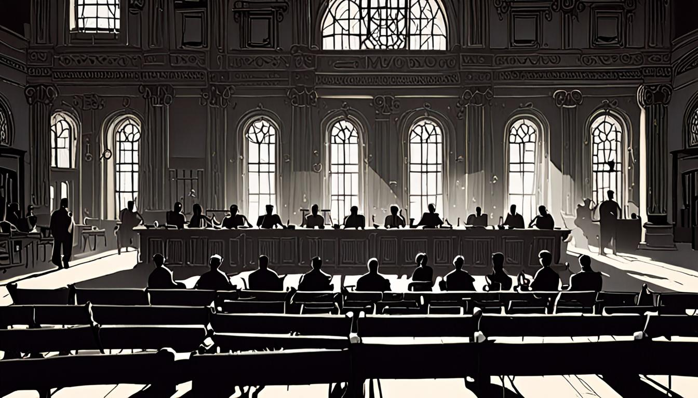

<figure style="margin:1.5em 0;"><figcaption style="font-size:0.85em;color:#888;text-align:center;margin-top:0.5em;font-style:italic;">El Encuadre: El TS admite que 180.000 hijos de supuestos "ni</figcaption></figure>
<h1>Dossier del día: El TS admite que 180.000 hijos de supuestos "nietos" podrán votar</h1>

El Tribunal Supremo ha dado luz verde a una operación que huele a trampa de campanario: 180.000 hijos de supuestos "nietos" de la dictadura podrán ejercer el sufragio. Mientras la cúpula judicial firma el acta de nacimiento de esta nueva cohorte electoral, el Gobierno se afana en desviar la mirada hacia el fango de Koldo García, y la maquinaria mediática opera al unísono para mantener el foco en el escándalo menor mientras el engranaje mayor gira en silencio. Aquí no se trata de informar sobre quién vota o no, sino de destapar el mecanismo que decide quién cuenta y quién es un fantasma con DNI. Este dossier no es un resumen; es una autopsia al encuadre del día.

<h2>Noticias del día</h2>
<figure style="margin:1.5em 0;"><figcaption style="font-size:0.85em;color:#888;text-align:center;margin-top:0.5em;font-style:italic;">Noticias del día</figcaption></figure>

La noticia central es jurídicamente simple y políticamente explosiva: el TS ha admitido que los hijos de los "nietos" (hijos de represaliados) pueden votar si cumplen ciertos requisitos de residencia o vinculación, ampliando así el censo de forma drástica. Es una puerta giratoria hacia la legitimidad democrática que, paradójicamente, se abre con la cerradura del nacionalismo. Mientras tanto, el ruido de fondo lo pone Pedro Sánchez, que en una entrevista en La Séptima ha iniciado una ofensiva judicial contra el PP, no por la Ley de Memoria, sino por la factura de 264.000 euros pagada por la editora de Okdiario a la abogada de Koldo García. Sánchez insiste en que "hay pruebas de que puede haber evidencias para iniciar una investigación" sobre el presunto soborno para "difundir falsedades". El contraste es brutal: mientras el Poder Judicial limpia el camino para 180.000 nuevos votantes, el Ejecutivo se embarriza en la disputa por quién mintió primero sobre los pagos a un exasesor. El circo está montado; el público cree que ve política, pero lo que ve es gestión de agendas cruzadas.

<h2>Los medios y sus técnicas</h2>

La prensa no refleja la realidad; la fabrica mediante el recorte. Cada medio elige su ángulo de ataque o de defensa, omitiendo lo que no sirve a su narrativa. La siguiente tabla expone cómo cada casa ha encuadrado el día, dejando vacíos estratégicos que son tan elocuentes como las palabras impresas.

<table>
  <thead>
    <tr>
      <th>Medio</th>
      <th>Técnica dominante</th>
      <th>Lo que omiten (El vacío)</th>
    </tr>
  </thead>
  <tbody>
    <tr>
      <td>elDiario.es</td>
      <td>Framing de victimización del Gobierno</td>
      <td>Cuál es el impacto real de la sentencia del TS sobre el censo; si la ampliación de votantes es legalmente sólida o una maniobra partidista.</td>
    </tr>
    <tr>
      <td>InfoLibre</td>
      <td>Asociación de identidad y resiliencia</td>
      <td>Si la estrategia de "haga su juego" frente a la oposición es una táctica de desgaste o una admisión de debilidad institucional.</td>
    </tr>
    <tr>
      <td>El Independiente</td>
      <td>Desminimización y elitismo cultural</td>
      <td>El contenido sustantivo de la huelga o la protesta; reduce el conflicto social a una "montería" o "pícnic" organizado desde arriba.</td>
    </tr>
    <tr>
      <td>BBC World</td>
      <td>Sensacionalismo corporativo-espionaje</td>
      <td>El contexto geopolítico profundo; se centra en la caída de bolsa de Nvidia y el escándalo personal de Jensen Huang como si fuera el eje del mundo.</td>
    </tr>
  </tbody>
</table>

<h2>Las técnicas al detalle</h2>

Para entender cómo se construye la verdad oficial, hay que diseccionar las herramientas. Aquí cuatro ejemplos brillantes de ingeniería semántica.

<strong>1. Framing de victimización institucional</strong> 
<em>Medio:</em> elDiario.es 
<em>Cita textual:</em> "Sánchez ha considerado este lunes que 'hay pruebas de que puede haber evidencias para iniciar una investigación' sobre el presunto soborno a Koldo García... 'A mí me produce asco la corrupción'". 
<em>Detección:</em> El medio coloca al jefe del Gobierno no como un político defendiéndose, sino como un moralista ofendido. Al usar la palabra "asco" y centrarse en la "factura" de 264.000 euros, se transfiere la culpa de la crisis política al PP, presentando al Gobierno como la única fuerza que "ha actuado con total contundencia". Se omite si Sánchez tiene motivos para investigar o si está usando la justicia como arma política. La técnica funciona porque activa la repulsión del lector hacia el "mal" (el PP) y la simpatía hacia el "bueno" (Sánchez), independientemente de los hechos procesales reales.

<strong>2. Asociación de identidad y victimización</strong> 
<em>Medio:</em> InfoLibre 
<em>Cita textual:</em> "¿Si pierde las elecciones, dejará la política?... 'Pero, ¿tú crees que yo salgo al terreno de juego a perder? Me han dado muchas veces por jubilado y aquí sigo cotizando a la Seguridad Social'". 
<em>Detección:</em> El titular asocia la defensa de Sánchez con una lucha de supervivencia ("hacernos caer"). La cita seleccionada no es una respuesta a una pregunta sobre política pública, sino una declaración de conflicto existencial. El medio usa la técnica de la "víctima resurgente": presentando a Sánchez como alguien que se muere pero no se hunde, se gana la empatía del votante de base. Se ignora completamente el mérito o demérito de sus actos de gobierno; sólo importa su voluntad de permanencia. Es un encuadre emocional, no racional.

<strong>3. Normalización de la protesta mediante negación (Desminimización)</strong> 
<em>Medio:</em> El Independiente 
<em>Cita textual:</em> "Viendo a Sánchez... uno se da cuenta de que esta huelga no es una huelga. Será un sarao, una mascarada, un pícnic... organizadas desde la Moncloa... esto no es una huelga, es una montería de meritorios". 
<em>Detección:</em> Esta es la técnica del "no es lo que parece". El medio niega la naturaleza de la acción colectiva para deslegitimarla. Al llamarla "montería" o "carrera de sacos", se despoja a los trabajadores de su agencia política. La huelga deja de ser un conflicto de intereses y pasa a ser una farsa teatral dirigida por "señoritos". La omisión es total de las demandas laborales o sociales; sólo importa la estética de la organización. Funciona porque crea una distancia de clase: el lector "culto" que ve a través de la "mascarada" frente al "pueblo" que es manipulado.

<strong>4. Sensacionalismo corporativo-espionaje</strong> 
<em>Medio:</em> BBC World 
<em>Cita textual:</em> "Trump says FBI investigating Nvidia boss's affair with alleged Chinese spy... The revelations knocked about $250bn (£190bn) off its value on Monday...". 
<em>Detección:</em> Aquí, el escándalo personal se entrelaza con el mercado de valores. La técnica es el "shock value" financiero. Se presenta el asunto no como una cuestión de seguridad nacional compleja, sino como un drama de telenovela (la "affair") con consecuencias inmediatas en la bolsa. La omisión es el análisis de las implicaciones estratégicas de la IA y los chips; sólo queda el escándalo del CEO y el dinero evaporado. Es eficaz porque mezcla lo sexual, lo espía y lo económico, tres adicciones del lector moderno. Se evita el debate profundo sobre la dependencia tecnológica occidental, sustituyéndolo por el morbo del "escándalo de pareja" a escala global.

<h2>Los sesgos compartidos</h2>

A pesar de sus diferencias ideológicas, elDiario.es, InfoLibre, El Independiente y la BBC comparten un patrón subyacente: la <strong>personalización del conflicto</strong>. En España, la política se reduce a la salud física y moral de Sánchez y sus enemigos. No se debate la ley de memoria, se debate quién mintió y quién pagó. No se debate la economía, se debate quién está "estofado" o "jubilado". En el ámbito internacional, la BBC reduce la geopolítica de la IA a un triángulo amoroso-espía con resultados en Wall Street.

¿Por qué funciona? Porque es digestible. El ciudadano medio no tiene el tiempo ni la energía para entender los meandros del Tribunal Supremo sobre la nacionalidad de los nietos, ni para analizar la arquitectura de los chips de Nvidia. Pero sí entiende el drama, la traición, el escándalo y la victoria del héroe sobre el villano. Los medios, conscientes de esto, actúan como traductores de la realidad compleja en cuentos morales simples. El sesgo compartido es la <strong>reducción</strong>: convertir sistemas de poder en personajes de novela. Cuando el TS decide sobre 180.000 votos, los medios prefieren hablar de una factura de 264.000 euros, porque es un número concreto, un hecho "asco", una historia de traición. La abstracción democrática es aburrida; la traición personal es adictiva.

<figure style="margin:1.5em 0;"><figcaption style="font-size:0.85em;color:#888;text-align:center;margin-top:0.5em;font-style:italic;">Conclusión</figcaption></figure>
<h2>Conclusión</h2>

Mientras el Tribunal Supremo firma el acta de 180.000 nuevos ciudadanos, los medios se pelean por saber quién le debe dinero a quién. El mecanismo está expuesto: la democracia se administra mediante el ruido. Lo que importa es lo que no se dice. La sentencia del TS no es una noticia porque no hay un villano de cara visible al que señalar con el dedo; es una decisión técnica que reconfigura el mapa electoral. Por eso, se la ignora o se la enterra bajo el alud de declaraciones sobre Koldo García y las huelgas que "no son huelgas". Mañana volverán a hacerlo. Volverán a convertir la estructura en personaje, la ley en rumor y el poder en escándalo. Usted, que ha leído esto, ya sabe cómo le están encuadrando. La pregunta no es qué es verdad, sino qué han elegido no mostrarle para que usted siga creyendo que está viendo la película completa, cuando en realidad sólo está viendo el tráiler de un montaje.

<h3>Fuentes consultadas:</h3>
<ul>
<li><strong>elDiario.es:</strong> «Sánchez pide a la Justicia que investigue los pagos a Koldo García para que mintiera contra el Gobierno» — <a href="https://www.eldiario.es/política/sanchez-pide-justicia-investigue-pagos-koldo-garcia-mintiera-gobierno_1_13650855.html" target="_blank" rel="noopener">Leer completo</a></li>
<li><strong>InfoLibre:</strong> «Sánchez pide investigar los pagos a Koldo García: “Inda financió su defensa para difamarnos y hacernos caer"» — <a href="https://www.infolibre.es/política/sanchez-pide-investigar-pagos-koldo-garcia-inda-pago-defensa-difamarnos-hacernos-caer_1_2239690.html" target="_blank" rel="noopener">Leer completo</a></li>
<li><strong>El Independiente:</strong> «Esto no es una huelga» — <a href="https://www.elindependiente.com/opinion/2026/11/09/esto-no-es-una-huelga/" target="_blank" rel="noopener">Leer completo</a></li>
<li><strong>Al Jazeera:</strong> «Enojo mientras agentes de ICE realizan arresto en supermercado de New Jersey» — <a href="https://www.aljazeera.com/video/newsfeed/2026/11/10/anger-as-ice-agents-make-arrest-in-new-jersey-grocery-store?traffic_source=rss" target="_blank" rel="noopener">Leer completo</a></li>
<li><strong>BBC World:</strong> «N/A» — <a href="https://www.bbc.co.uk/news/articles/cqg7x7dpvym8o?at_medium=RSS&amp;at_campaign=rss" target="_blank" rel="noopener">Leer completo</a></li>
<li><strong>The Guardian:</strong> «Deadly floods hit Iraq as thunderstorms sweep across region» — <a href="https://www.theguardian.com/environment/2026/nov/09/deadly-floods-iraq-thunderstorms-iran-portugal-japan-snow" target="_blank" rel="noopener">Leer completo</a></li>
<li><strong>Le Monde:</strong> «Midterms 2026 : « Nous, les Américains, ne pouvons pas continuer à nous engager dans le monde avec notre seule puissance militaire »» — <a href="https://www.lemonde.fr/international/article/2026/11/10/midterms-2026-nous-les-americains-ne-pouvons-pas-continuer-a-nous-engager-dans-le-monde-avec-notre-seule-puissance-militaire_6808780_3210.html" target="_blank" rel="noopener">Leer completo</a></li>
</ul>

<strong>Aviso legal:</strong> Esto no es una acusación. Es una autopsia. Los medios están citados y enlazados. El derecho de cita (art. 32 LPI) nos ampara.

<strong>Síguenos:</strong> <a href="https://youtube.com/@somoselencuadre.oficial">YouTube</a> · <a href="https://tiktok.com/@somoselencuadre">TikTok</a> · <a href="https://instagram.com/somoselencuadre">Instagram</a> · <a href="https://x.com/SomosElEncuadre">X</a> · <a href="https://threads.net/@somoselencuadre">Threads</a>

