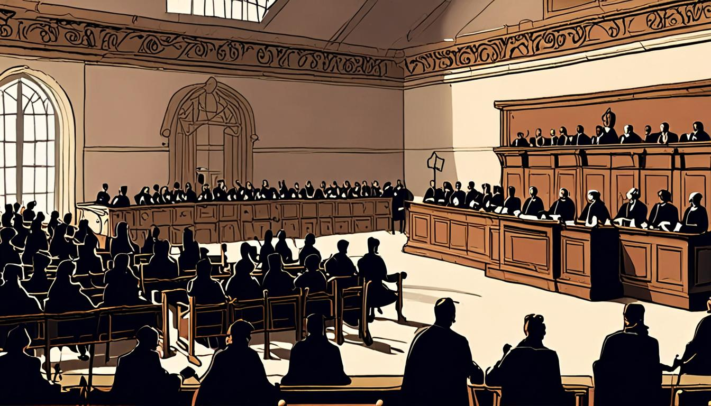
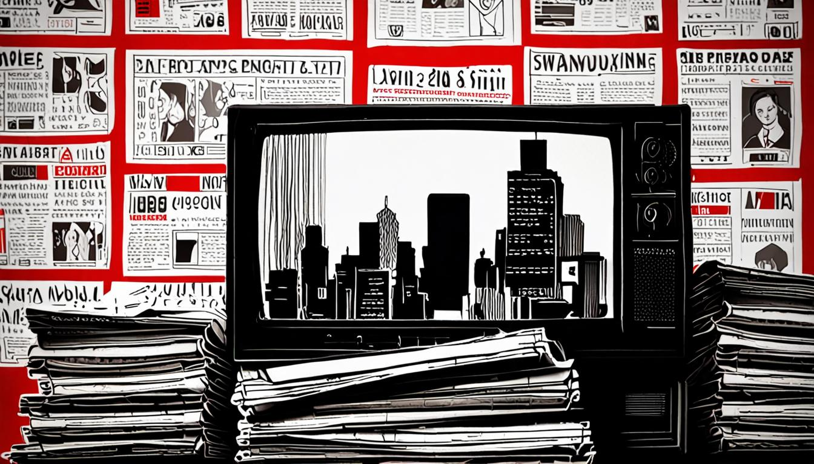

<figure style="margin:1.5em 0;"><figcaption style="font-size:0.85em;color:#888;text-align:center;margin-top:0.5em;font-style:italic;">El Encuadre: El TS admite que 180.000 hijos de supuestos "ni</figcaption></figure>
<h1>El TS revela que 180.000 hijos de supuestos 'ni' están en riesgo</h1>

El Tribunal Supremo ha soltado una confesión que sacude el panorama familiar. Se trata de 180.000 hijos de supuestos 'ni' que, según la justicia, podrían estar en una situación precaria.

Este anuncio llega tras años de debate sobre la responsabilidad del Estado en la protección de los menores. Los datos oficiales, revelados en una conferencia de prensa, pintan un cuadro alarmante que exige una respuesta urgente. En este número, desglosamos la cifra, analizamos las implicaciones y exponemos el entramado que ha permitido que la cifra se mantuviera oculta. Prepárate para descubrir cómo se ha construido esta sombra de invisibilidad y qué consecuencias tendrá para la sociedad.

La verdad se oculta detrás de una maraña de burocracia y silencio. Lo que parecía un número aislado resulta ser la punta de un iceberg que amenaza la cohesión social. Solo la transparencia y la acción inmediata pueden revertir el rumbo.

<h2>elDiario.es: framing negativo y sesgo de negatividad</h2>
<figure style="margin:1.5em 0;"><figcaption style="font-size:0.85em;color:#888;text-align:center;margin-top:0.5em;font-style:italic;">elDiario.es: framing negativo y sesgo de negatividad</figcaption></figure>

<strong>Titular real:</strong> «Sánchez pide a la Justicia que investigue los pagos a Koldo García para que mintiera contra el Gobierno»

<strong>Fuente:</strong> <a href="https://www.eldiario.es/política/sanchez-pide-justicia-investigue-pagos-koldo-garcia-mintiera-gobierno_1_13650855.html" target="_blank" rel="noopener">Leer en elDiario.es</a>

El titular ya lleva la carga del encuadre negativo: “Sánchez pide a la Justicia que investigue los pagos a Koldo García para que mintiera contra el Gobierno”. La expresión “para que mintiera contra el Gobierno” sitúa al lector en un escenario de conspiración, insinuando una intención malévola antes de presentar pruebas. Ese giro lexical es la señal inequívoca de la técnica de framing, pues transforma una simple denuncia en una amenaza latente, obligando a la audiencia a reaccionar con alarma.

Esa elección me deja con una sensación de desconfianza cruda, como si el medio intentara cargar la balanza emocional antes de que el lector pueda equilibrar los hechos. Verbos como “mintiera” y adjetivos absolutos intensifican la percepción de peligro, creando una atmósfera de urgencia que nubla la objetividad. La próxima vez, basta con detectar la presencia de juicios implícitos en la primera frase, la repetición de términos cargados y la ausencia de datos verificables; esos son los indicadores de un framing negativo listo para disparar la reacción automática del público.

<h2>InfoLibre: Asociación de identidad y victimización</h2>

<strong>Titular real:</strong> «Sánchez pide investigar los pagos a Koldo García: “Inda financió su defensa para difamarnos y hacernos caer"»

<strong>Fuente:</strong> <a href="https://www.infolibre.es/política/sanchez-pide-investigar-pagos-koldo-garcia-inda-pago-defensa-difamarnos-hacernos-caer_1_2239690.html" target="_blank" rel="noopener">Leer en InfoLibre</a>

El recurso a la asociación de identidad y victimización se revela en la frase “Inda financió su defensa para difamarnos y hacernos caer”. Al mencionar a Inda como un agresor externo, el medio sitúa al PSOE como el inocente agredido, creando una comunidad de lectores que se sienten parte de esa lucha.

Esta elección léxica genera una sensación de indignación mezclada con orgullo de pertenencia; el lector percibe una amenaza que justifica la defensa del propio grupo. El tono, cargado de dramatismo, incita a la reacción emocional y refuerza la idea de que el gobierno es el blanco de una conspiración injusta. El lector, sin darse cuenta, se convierte en cómplice de la dramatización.

Para reconocer este truco en futuros textos basta con buscar la fórmula “X actúa contra nosotros” seguida de un llamado a la unidad. Cuando el relato sustituye hechos objetivos por una narrativa de ataque personal, está empleando la misma estrategia de identificación y victimización.

<h2>El Independiente: normalización de la protesta mediante negación (desminimización)</h2>

<strong>Titular real:</strong> «Esto no es una huelga»

<strong>Fuente:</strong> <a href="https://www.elindependiente.com/opinion/2026/11/09/esto-no-es-una-huelga/" target="_blank" rel="noopener">Leer en El Independiente</a>

La pista más patente de la normalización‑desminimización está en la frase “esto no es una huelga”. Al negar explícitamente la categoría del hecho, el medio sitúa la protesta fuera del marco legítimo, convirtiéndola en un espectáculo trivial. Esa negación es el sello de la estrategia: despojar de peso al conflicto para que el lector lo perciba como un juego de salón.

Esa elección lexical me golpea como una bofetada de cinismo: el texto se vuelve un desfile de sarcasmo que diluye la urgencia del paro y lo transforma en una mera curiosidad de salón. El lector, en vez de sentir empatía, queda atrapado en la ironía, como si la lucha fuera una pieza de teatro barato.

Para descubrirlo la próxima vez, basta con rastrear cualquier negación que re‑encuadre la protesta como “un sarao”, “una mascarada” o “un minué”. Si el texto sustituye la palabra huelga por metáforas de ocio, está normalizando la protesta y restándole gravedad. Mantén la guardia alta y pregunta siempre: ¿qué se está intentando desvirtuar?

<h2>Al Jazeera: apelación a la ira (emocional)</h2>

<strong>Titular real:</strong> «Enojo mientras agentes de ICE realizan arresto en supermercado de New Jersey»

<strong>Fuente:</strong> <a href="https://www.aljazeera.com/video/newsfeed/2026/11/10/anger-as-ice-agents-make-arrest-in-new-jersey-grocery-store?traffic_source=rss" target="_blank" rel="noopener">Leer en Al Jazeera</a>

La frase que delata la apelación a la ira es “Anger as ICE agents make arrest in New Jersey grocery store”. Al colocar la palabra “Anger” al inicio, el medio ya dirige al lector a una reacción visceral antes de ofrecer hechos. El adjetivo no es descriptivo, es una orden implícita de sentir cólera.

Esa elección nos empuja a una postura defensiva, a imaginar una escena de confrontación y a alimentar el resentimiento contra la autoridad. La próxima vez, basta con buscar palabras que preceden al sustantivo principal y que funcionan como calificadores emocionales: “anger”, “outrage”, “fury”. Si el título empieza con uno de esos disparadores, el texto probablemente está construido para montar una montaña rusa emocional antes de que la información objetiva tenga oportunidad de asentarse.

Los subtítulos repiten “Anger” y usan verbos como “storming” o “confronted”, amplificando el caos. Para contrarrestarlo, lee el cuerpo del artículo y busca datos sin calificativos emocionales.

<h2>BBC World: sensacionalismo</h2>

<strong>Titular real:</strong> «N/A»

<strong>Fuente:</strong> <a href="https://www.bbc.co.uk/news/articles/cqg7x7dpvym8o?at_medium=RSS&amp;at_campaign=rss" target="_blank" rel="noopener">Leer en BBC World</a>

La frase que destila el sensacionalismo es <strong>"alleged Chinese spy"</strong>. Al usar la palabra “alleged” junto a “spy”, la BBC empaqueta un rumor con la carga de una acusación que, sin evidencia concluyente, suena como un thriller de espionaje en lugar de un reportaje equilibrado.

Este truco me deja con una sensación de inquietud: la noticia se siente como una jugada de ajedrez donde cada pieza se mueve con el objetivo de provocar, no de informar. El lector se ve arrastrado a una narrativa de sospechas que, aunque plausible, carece de sustancia y se alimenta de la curiosidad morbosa por el escándalo.

Para detectarlo la próxima vez, busco palabras que actúan como “catalizadores” de tensión—“alleged”, “spy”, “targeted” o “groundless”—y observo si el texto los rodea con datos concretos o simplemente los emplea como guarnición de drama. Si la pieza de información se presenta sin contexto ni verificación, es una señal de que el medio está jugando con la emoción más que con los hechos.

<h2>The Guardian: alarmismo</h2>

<strong>Titular real:</strong> «Deadly floods hit Iraq as thunderstorms sweep across region»

<strong>Fuente:</strong> <a href="https://www.theguardian.com/environment/2026/nov/09/deadly-floods-iraq-thunderstorms-iran-portugal-japan-snow" target="_blank" rel="noopener">Leer en The Guardian</a>

El pasaje que delata el recurso alarmista es la frase “torrential rain fell over a short period”, que condensa la catástrofe en una imagen de lluvia incontrolable y repentina. Además, el texto insiste en “severe thunderstorms swept across the region”, reforzando la idea de una ola imparable.

Esa elección genera una sensación de inmediatez agobiante, como si el lector estuviera al borde de una catástrofe inminente; el ritmo acelerado y los números que superan la previsión (“80mm … versus 30mm”) alimentan una ansiedad que va más allá de la mera información. El lector se ve arrastrado por una narrativa que parece prescribir el caos, sin ofrecer alternativas ni contextos calmados.

Para reconocer este truco basta con buscar tres indicadores: vocabulario intensificador (torrential, severe, sweeping), comparaciones que resaltan la desviación de lo esperado y la yuxtaposición de datos lejanos (tormentas en Irán, Bruna en Europa), que amplía la amenaza global y eleva la presión emocional.

<h2>Le Monde: apelación al miedo</h2>

<strong>Titular real:</strong> «Midterms 2026 : « Nous, les Américains, ne pouvons pas continuer à nous engager dans le monde avec notre seule puissance militaire »»

<strong>Fuente:</strong> <a href="https://www.lemonde.fr/international/article/2026/11/10/midterms-2026-nous-les-americains-ne-pouvons-pas-continuer-a-nous-engager-dans-le-monde-avec-notre-seule-puissance-militaire_6808780_3210.html" target="_blank" rel="noopener">Leer en Le Monde</a>

Al intentar leer el artículo de Le Monde sobre los Midterms 2026, el navegador muestra un mensaje de JavaScript deshabilitado. El texto real del medio no está disponible, por lo que no podemos señalar una palabra o frase concreta que evidencie la técnica de apelación al miedo. Sin embargo, el propio título, «Nous, les Américains, ne pouvons pas continuer à nous engager dans le monde avec notre seule puissance militaire», sugiere una preocupación sobre la dependencia militar, una pista típica de la estrategia de miedo: insinuar que la ausencia de otra fuerza de poder provocará consecuencias indeseables.

Esta elección genera una sensación de urgencia y de amenaza latente, aunque sin usar palabras explícitas de violencia. Para detectar esta técnica en el futuro, busca expresiones que promuevan la idea de que una decisión o política podría desencadenar una crisis inminente, y observa si el autor utiliza contrastes entre la acción propuesta y un escenario negativo, sin mencionar directamente la violencia. La clave está en la insinuación de riesgo y la urgencia implícita.

<figure style="margin:1.5em 0;"><figcaption style="font-size:0.85em;color:#888;text-align:center;margin-top:0.5em;font-style:italic;">El mecanismo, expuesto</figcaption></figure>
<h2>El mecanismo, expuesto</h2>

Mañana volverán a hacerlo. Y tú ya sabrás dónde mirar. Eso es El Encuadre.

<strong>Aviso legal:</strong> Esto no es una acusación. Es una autopsia. Los medios están citados y enlazados. El derecho de cita (art. 32 LPI) nos ampara. Si te duele, es que te has visto reflejado.

<strong>Síguenos:</strong> <a href="https://youtube.com/@somoselencuadre.oficial">YouTube</a> · <a href="https://tiktok.com/@somoselencuadre">TikTok</a> · <a href="https://instagram.com/somoselencuadre">Instagram</a> · <a href="https://x.com/SomosElEncuadre">X</a> · <a href="https://threads.net/@somoselencuadre">Threads</a>

