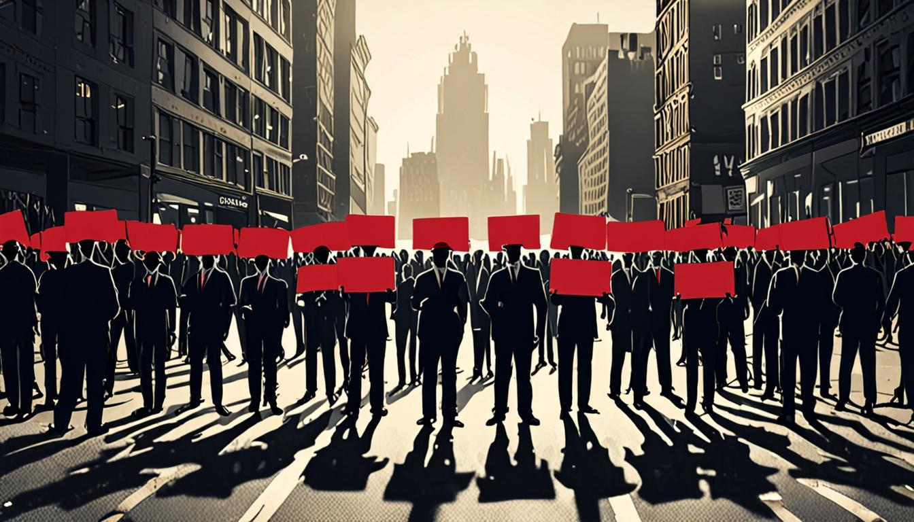
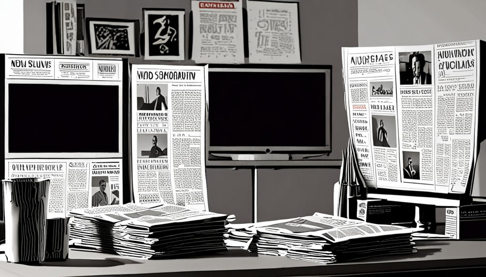
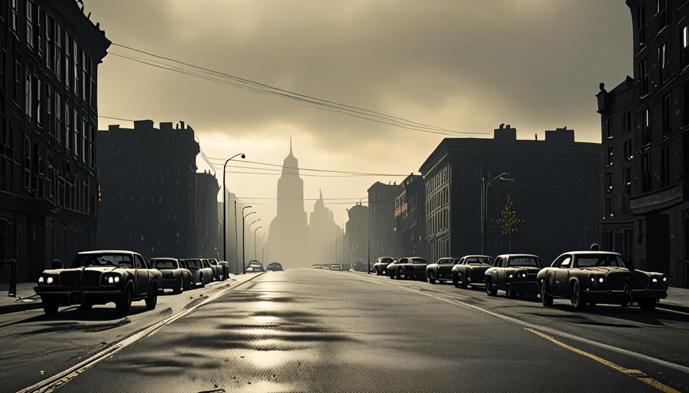

<figure style="margin:1.5em 0;"><figcaption style="font-size:0.85em;color:#888;text-align:center;margin-top:0.5em;font-style:italic;">El Encuadre: Los sindicatos llaman a España a una huelga gen</figcaption></figure>
<h1>Dossier del día: Los sindicatos llaman a España a una huelga general por primera vez en 14 años y los medios encienden las alertas antes de que caiga el sol</h1>

<strong>Contexto y Promesa:</strong> Estamos a once días de las elecciones generales del 29-N. España se ha paralizado. No por un apagón, sino por una decisión política del mundo laboral. Mientras los candidatos pulen sus escaños, las calles están llenas de piquetes. Aquí no venimos a decirte si la huelga es buena o mala. Venimos a mostrar las costuras: cómo los mismos hechos son envueltos en pánico, en fatalismo o en instrumentalización política según quién tenga el micrófono. El mecanismo está expuesto. Tú decides si parpadeas o si ves la maquinaria girar.

<h2>Noticias del día</h2>
<figure style="margin:1.5em 0;"><figcaption style="font-size:0.85em;color:#888;text-align:center;margin-top:0.5em;font-style:italic;">Noticias del día</figcaption></figure>

El 11 de noviembre marca un punto de inflexión. Es la mayor convocatoria de paro laboral en España desde 2012, una jornada de 24 horas impulsada por el Sindicato de Inquilinas y respaldada por las grandes centrales como CCOO, UGT, CGT y CNT. La demanda es clara y tangible: acceso a vivienda digna, freno a la especulación y una subida del Salario Mínimo Interprofesional (SMI) de al menos el 7% en 2027.

El escenario no es neutro. Estamos en plena "noche demoscópica", como describen los analistas, a tres semanas de las urnas. El Gobierno de Moncloa, consciente de su posición, ha aprobado en las últimas semanas medidas a largo plazo, como el IV Plan Estratégico para la Igualdad Efectiva de Mujeres y Hombres con más de 750 medidas, o la ampliación de la protección a familias monoparentales. Por su parte, Alberto Núñez Feijóo, líder del PP, ha anunciado que si gobierna reunirá el ingreso mínimo vital y los subsidios en una "renta de activación". Su argumento, textual, es que "trabajar tiene que compensar más que no hacerlo" y que rechazar empleos adecuados "sin causa justificada" supondrá la pérdida de ayudas.

En las calles, la fisura entre la narrativa de éxito y la realidad operativa es visible. CCOO celebra que "la demanda de energía eléctrica ha caído un 9,7% en las primeras horas de la huelga", interpretándolo como éxito. Pero al mismo tiempo, 20 Minutos reporta "caos en las carreteras" en Cataluña e incidentes en Mercamadrid y las cocheras de la EMT en Carabanchel, donde se denuncian cargas policiales y detenciones.

<blockquote>
    
<strong>Cita El Español:</strong> "Cuenta atrás para la huelga general más 'atípica' del siglo XXI y temor entre los sindicatos a que pinche su seguimiento".

</blockquote>
<blockquote>
    
<strong>Cita elDiario.es:</strong> "Un 'basta ya' de la clase trabajadora que se echó a las calles tras el desahucio de Maricarmen, de 87 años, hoy fallecida".

</blockquote>

<h2>Los medios y sus técnicas</h2>

No todos los periódicos miran el mismo reloj. Algunos ven una crisis social inminente; otros, una maniobra electoral. La tabla siguiente desnuda la estructura subyacente de cada titular. No es cuestión de verdad o mentira, es cuestión de qué pieza del rompecabezas te están obligando a poner primero.

<table border="1" cellpadding="8" cellspacing="0" style="width:100%; border-collapse: collapse;">
    <thead>
        <tr style="background-color: #f2f2f2;">
            <th>Medio</th>
            <th>Técnica Detectada</th>
            <th>Omisión Estratégica</th>
        </tr>
    </thead>
    <tbody>
        <tr>
            <td><strong>El Mundo</strong></td>
            <td>Enmarcado negativo y apelación al miedo</td>
            <td>Omite el consenso social real para centrar la mirada en la "visibilidad reducida" del gobierno saliente.</td>
        </tr>
        <tr>
            <td><strong>El Español</strong></td>
            <td>Alarmismo técnico</td>
            <td>Omite el contexto político del 29-N para vender la duda sobre el "seguimiento".</td>
        </tr>
        <tr>
            <td><strong>20 Minutos</strong></td>
            <td>Sensacionalismo y alarmización</td>
            <td>Omite las plataformas de diálogo para amplificar el "caos" y las "incidencias".</td>
        </tr>
        <tr>
            <td><strong>elDiario.es</strong></td>
            <td>Apelación a la urgencia y crisis inminente</td>
            <td>Omite la complejidad de las negociaciones para simplificar la narrativa en un "basta ya" heroico.</td>
        </tr>
        <tr>
            <td><strong>Europa Press</strong></td>
            <td>Reencuadre coercitivo administrativo</td>
            <td>Omite el contexto de la huelga para presentar la propuesta de Feijóo como solución neutral.</td>
        </tr>
    </tbody>
</table>

<h2>Las técnicas al detalle</h2>

Desglosemos la anatomía del engaño. Estas son las cuatro manos invisibles que mueven la marioneta informativa de hoy.

<strong>1. El Framing Alarmista (El Mundo)</strong> 
El Mundo no informa de una huelga; informa de una maniobra. Su titular acusa al Gobierno de "buscar impulso agitando la huelga en pleno sprint social para condicionar un posible gobierno del PP y Vox". Al leer el texto real, vemos cómo describen la situación: "En medio de una carretera en plena noche demoscópica, el Gobierno enciende las luces largas, tratando de proyectarse lejos en el futuro, pese a que su visibilidad... queda reducida a metros, véase meses". 
<strong>Cómo detectarla:</strong> Busca metáforas de conducción o visión ("luces largas", "visibilidad") aplicadas a la política. Cuando un medio te dice qué <em>ve</em> el gobierno en lugar de qué <em>hace</em>, está proyectando intencionalidad oculta. El miedo a la manipulación electoral sustituye al análisis de las políticas sociales.

<strong>2. La Duda Sembrada (El Español)</strong> 
El Español utiliza el formato de directo para generar ansiedad. Su titular anuncia "temor entre los sindicatos a que pinche su seguimiento". En el cuerpo del texto, se mezcla la caída de la demanda eléctrica con la incertidumbre: "Cuenta atrás para la huelga general más 'atípica' del siglo XXI". 
<strong>Cómo detectarla:</strong> Fíjate en el uso de la palabra "pinche" o "atípica" en un contexto de movilización masiva. Al calificar la huelga de atípica, se deslegitima su potencia histórica. Al introducir el "temor" sindical, se transfiere la responsabilidad del fracaso potencial a los propios convocantes, creando una narrativa de inseguridad antes de que termine el día.

<strong>3. La Amplificación del Caos (20 Minutos)</strong> 
Aquí no hay matices, hay ruido. El titular es "La huelga toma las calles con piquetes y primeras incidencias". El texto real se centra en lo disruptivo: "caos en las carreteras", "incidentes en Mercamadrid", "cargas policiales" y "ocho personas heridas". 
<strong>Cómo detectarla:</strong> Cuenta las palabras relacionadas con el conflicto físico frente a las relacionadas con la reivindicación. Si la proporción de "incidentes" supera a la de "reivindicaciones" (vivienda, salarios), el medio ha convertido una protesta social en un problema de orden público. El objetivo es que veas el palo, no la causa del palo.

<strong>4. La Narrativa del Héroico Desesperado (elDiario.es)</strong> 
elDiario.es apela a la emoción pura. Describe el día como "una huelga general en España inédita por la crisis de la vivienda" y la vincula directamente a la figura de Maricarmen. Cita textualmente: "Un 'basta ya' de la clase trabajadora que se echó a las calles tras el desahucio de Maricarmen... 'Luchad, defended lo que es vuestro', dijo la anciana en su último vídeo". 
<strong>Cómo detectarla:</strong> Busca la personalización extrema. Al reducir una huelga general de 24 horas a la historia de una persona concreta, se simplifica la estructura económica en una suceso emocional. Funciona porque apela a la empatía inmediata, pero omite el análisis sistémico de la burbuja inmobiliaria que afecta a millones, no sólo a una mujer de 87 años.

<h2>Los sesgos compartidos</h2>

A pesar de las diferencias de color político, hay un denominador común que une a El Mundo, El Español, 20 Minutos y elDiario.es: la <strong>Temporalización Electoral</strong>. Todos los medios insisten en que esto ocurre "a menos de tres semanas de las elecciones generales del 29 de noviembre". Este marco temporal no es un dato neutro; es el lente a través del cual se filtra toda la información.

Por qué funciona: Porque transforma una demanda estructural (vivienda, salarios) en un arma arrojadiza política. Para el votante, la huelga deja de ser un derecho laboral para convertirse en un movimiento que busca "condicionar" a Feijóo o salvar a Sánchez. Se crea una falsa dicotomía: o estás con el Gobierno que "enciende las luces largas", o estás con la oposición que propone la "renta de activación". El ciudadano es empujado a elegir bandos antes de entender el problema. El mecanismo es efectivo porque activa las defensas políticas del lector, no su capacidad crítica. Si piensas en términos de "ellos" contra "nosotros", has dejado de analizar el texto y has empezado a defender una tribu.

<figure style="margin:1.5em 0;"><figcaption style="font-size:0.85em;color:#888;text-align:center;margin-top:0.5em;font-style:italic;">Conclusión</figcaption></figure>
<h2>Conclusión</h2>

Mientras los piquetes informan y la demanda eléctrica cae un 9,7%, los medios de comunicación están ocupados en otra cosa: definiendo quién es el villano y quién es el héroe de esta jornada. El Mundo ve un truco electoral. El Español ve una posible derrota. 20 Minutos ve un caos. elDiario.es ve una revuelta épica. Ninguno, quizás, está viendo simplemente lo que está pasando: trabajadores que quieren pagar menos por su techo y ganar más por su esfuerzo, en un país que parece incapaz de discutirlo sin gritos.

La información no es un reflejo de la realidad, es una construcción. Hoy, esa construcción tiene olor a gas pimienta en Carabanchel y a tinta electoral en Madrid. Lee los titulares, mira las fuentes, y recuerda: si todos te dicen qué sentir, pregunta qué están intentando que no sientas. El mecanismo, expuesto. Mañana volverán a hacerlo.

<h3>Fuentes consultadas:</h3>
<ul>
<li><strong>El Mundo:</strong> «El Gobieno busca impulso agitando la huelga en pleno sprint social para condicionar un posible gobierno del PP y Vox» — <a href="https://www.elmundo.es/elecciones/elecciones-generales/2026/11/10/6af368cae85ece41108b45ad.html" target="_blank" rel="noopener">Leer completo</a></li>
<li><strong>El Español:</strong> «Huelga general 11 de noviembre, en directo | Paros, servicios mínimos y piquetes en carreteras y accesos urbanos» — <a href="https://www.elespanol.com/espana/20261110/huelga-general-noviembre-directo-horario-recorrido-calles-cortadas-servicios-minimos-ultima-hora-movilizaciones/1003744452728_10.html" target="_blank" rel="noopener">Leer completo</a></li>
<li><strong>20 Minutos:</strong> «La huelga toma las calles con piquetes y primeras incidencias en varios puntos de España» — <a href="https://www.20minutos.es/nacional/huelga-general-11n-directo-ultima-hora-los-paros-manifestaciones-servicios-minimos-toda-espana_7059492_6.html" target="_blank" rel="noopener">Leer completo</a></li>
<li><strong>elDiario.es:</strong> «España vive una huelga general inédita por el derecho a la vivienda y los sueldos dignos» — <a href="https://www.eldiario.es/economia/espana-vive-huelga-general-inedita-derecho-vivienda-sueldos-dignos_1_13652980.html" target="_blank" rel="noopener">Leer completo</a></li>
<li><strong>Le Monde:</strong> «Guerre en Ukraine: à Abou Dhabi, les pourparlers russo-ukrainiens condamnés à l’impasse» — <a href="https://www.lemonde.fr/international/article/2026/11/11/guerre-en-ukraine-a-abu-dhabi-les-pourparlers-russo-ukrainiens-condamnes-a-l-impasse_6808927_3210.html" target="_blank" rel="noopener">Leer completo</a></li>
<li><strong>BBC World:</strong> «Three Iran-backed suspects plotted attacks including RAF Fairford incident, US says» — <a href="https://www.bbc.co.uk/news/articles/c3rryrryk59zo?at_medium=RSS&amp;at_campaign=rss" target="_blank" rel="noopener">Leer completo</a></li>
<li><strong>Europa Press:</strong> «N/A» — <a href="https://www.europapress.es/nacional/noticia-feijoo-reunira-ingreso-minimo-vital-subsidios-renta-activacion-vinculada-busqueda-empleo-20261110143401.html" target="_blank" rel="noopener">Leer completo</a></li>
<li><strong>Al Jazeera:</strong> «South African swimmer Tatjana Smith switches allegiance to Netherlands» — <a href="https://www.aljazeera.com/sports/2026/11/11/south-african-swimmer-tatjana-smith-switches-allegiance-to-netherlands?traffic_source=rss" target="_blank" rel="noopener">Leer completo</a></li>
</ul>

<strong>Aviso legal:</strong> Esto no es una acusación. Es una autopsia. Los medios están citados y enlazados. El derecho de cita (art. 32 LPI) nos ampara.

<strong>Síguenos:</strong> <a href="https://youtube.com/@somoselencuadre.oficial">YouTube</a> · <a href="https://tiktok.com/@somoselencuadre">TikTok</a> · <a href="https://instagram.com/somoselencuadre">Instagram</a> · <a href="https://x.com/SomosElEncuadre">X</a> · <a href="https://threads.net/@somoselencuadre">Threads</a>

