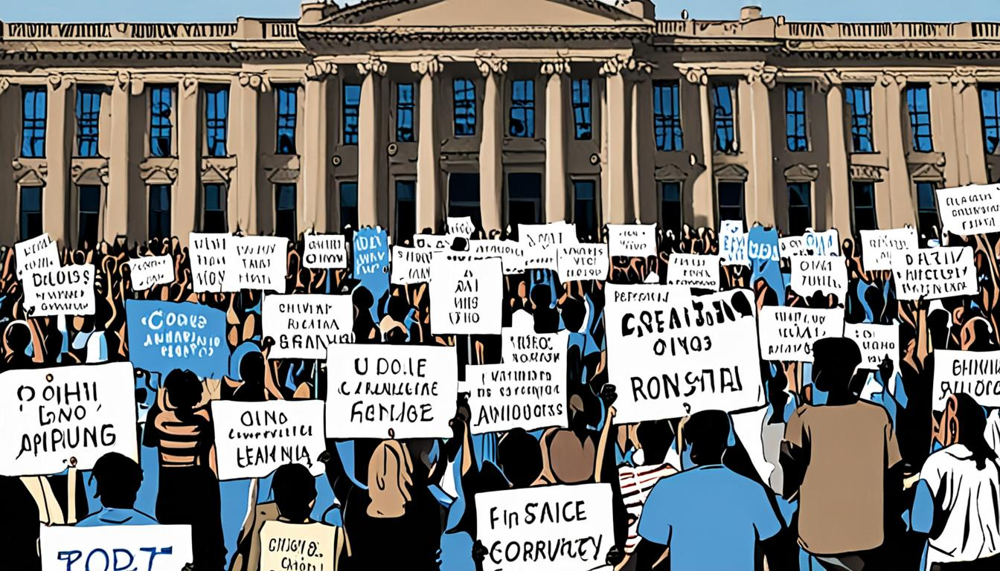
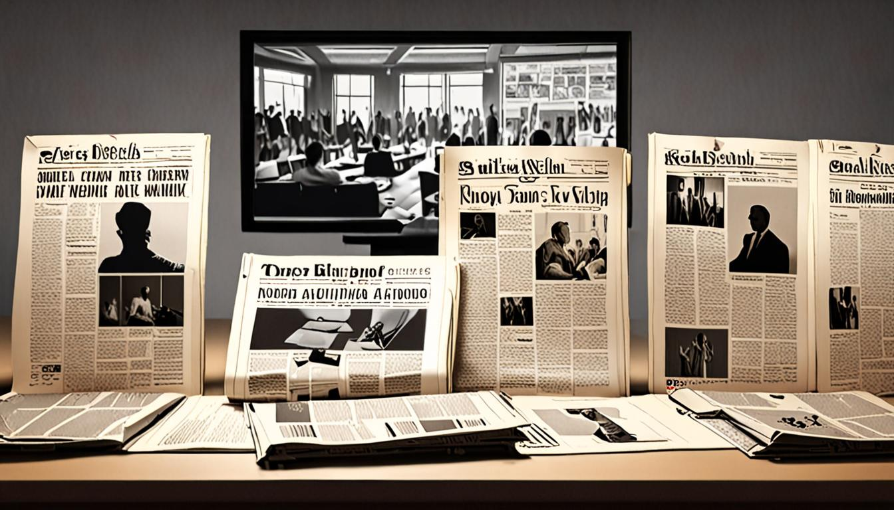

<figure style="margin:1.5em 0;"><figcaption style="font-size:0.85em;color:#888;text-align:center;margin-top:0.5em;font-style:italic;">El Encuadre: Los sindicatos llaman a España a una huelga gen</figcaption></figure>
<h1>La jugada oculta: cómo los sindicatos quieren paralizar a España</h1>

Los sindicatos lanzan la alarma de una huelga general que, según sus propias voces, podría paralizar el país. Nosotros desmenuzamos el discurso para descubrir lo que realmente se cuece tras el telón.

En los últimos días, los principales sindicatos han inundado los medios con titulares que evocan un caos inminente, citando la necesidad de una acción urgente para defender los derechos laborales. Sin embargo, el mensaje está cargado de imágenes que buscan despertar el miedo y la sensación de una crisis sin precedentes. Analizaremos cómo estos relatos se construyen a través de técnicas de encuadre alarmista y qué intereses se esconden tras la aparente neutralidad. Al final, revelaremos el verdadero objetivo de esta campaña de presión.

El truco consiste en transformar una reivindicación legítima en una amenaza de desorden nacional, obligando a la opinión pública a aceptar medidas drásticas. Cuando el ruido se disipa, la presión sobre el Gobierno se vuelve imposible de ignorar.

<h2>El Mundo: Enmarcado negativo y apelación al miedo (framing alarmista)</h2>
<figure style="margin:1.5em 0;"><figcaption style="font-size:0.85em;color:#888;text-align:center;margin-top:0.5em;font-style:italic;">El Mundo: Enmarcado negativo y apelación al miedo (framing alarmista)</figcaption></figure>

<strong>Titular real:</strong> «El Gobieno busca impulso agitando la huelga en pleno sprint social para condicionar un posible gobierno del PP y Vox»

<strong>Fuente:</strong> <a href="https://www.elmundo.es/elecciones/elecciones-generales/2026/11/10/6af368cae85ece41108b45ad.html" target="_blank" rel="noopener">Leer en El Mundo</a>

La frase que delata el encuadre alarmista es “<strong>agitando la huelga en pleno sprint social</strong>”. El adjetivo “agitando” convierte una disputa laboral en una maniobra de conflicto psicológica, mientras que “sprint social” sugiere una carrera frenética que sólo puede terminar en colapso, creando una atmósfera de urgencia y amenaza que el lector absorbe sin cuestionar.

Esta elección me produce una sensación de inquietud calculada, como si el texto intentara inyectar una dosis de nerviosismo para que el lector perciba al Gobierno como un titiritero que manipula el caos. El tono mordaz y la ironía subyacente hacen que el lector se sienta atrapado en una espiral de sospecha, con la impresión de que cualquier paso del Ejecutivo está diseñado para sembrar miedo y desconfianza.

Para reconocer este recurso en el futuro, basta con buscar verbos que impliquen movimiento violento o manipulación (“agitando”, “condicionar”, “proyectarse”) acompañados de sustantivos que aludan a competición o crisis (“sprint”, “carrera”, “pánico”). Cuando el discurso combina acción agresiva con un contexto de urgencia, suele estar usando el framing alarmista para encuadrar la realidad bajo una luz ominosa.

<h2>El Español: alarmismo</h2>

<strong>Titular real:</strong> «Huelga general 11 de noviembre, en directo | Paros, servicios mínimos y piquetes en carreteras y accesos urbanos»

<strong>Fuente:</strong> <a href="https://www.elespanol.com/espana/20261110/huelga-general-noviembre-directo-horario-recorrido-calles-cortadas-servicios-minimos-ultima-hora-movilizaciones/1003744452728_10.html" target="_blank" rel="noopener">Leer en El Español</a>

El fragmento que delata sin disimulo la apuesta alarmista es la frase «Cuenta atrás para la huelga general más “atípica” del siglo XXI y temor entre los sindicatos a que pinche su seguimiento». El uso de superlativos como “más atípica” y la alusión a un “temor” inmediato construye una atmósfera de urgencia y catástrofe inminente, como si el país estuviese al borde de un colapso.

Esta elección provoca una sensación de inquietud y de estar atrapado en una espiral de noticias que exageran la gravedad para captar la atención. El lector, en lugar de informarse con datos serenos, se ve empujado a un estado de alerta constante, como si cada minuto fuera una nueva amenaza.

Para reconocer el truco la próxima vez, basta con buscar palabras que inflen el drama: superlativos, adjetivos cargados y la presentación de “cuenta atrás” o “temor” sin acompañarlos de cifras contrastadas. Si la pieza se apoya más en la emoción que en la evidencia, probablemente esté usando el alarmismo como gancho.

<h2>20 Minutos: sensacionalismo y uso de la alarmización</h2>

<strong>Titular real:</strong> «La huelga toma las calles con piquetes y primeras incidencias en varios puntos de España»

<strong>Fuente:</strong> <a href="https://www.20minutos.es/nacional/huelga-general-11n-directo-ultima-hora-los-paros-manifestaciones-servicios-minimos-toda-espana_7059492_6.html" target="_blank" rel="noopener">Leer en 20 Minutos</a>

El detonante del sensacionalismo en el artículo es la frase «caos en las carreteras», que aparece sin matiz y con la intención de disparar la adrenalina del lector. Al leer esa expresión, el cerebro se sube a la montaña rusa del miedo y la urgencia, como si la nación estuviera al borde del colapso, aunque la realidad sea una simple congestión puntual.

Esta elección me produce una sensación de manipulación: el texto salta de datos verificables a vocabulario cargado, creando una atmósfera de alarma que obliga a seguir leyendo para “saber qué pasa”. El uso de términos como «incidentes», «cargas policiales» y «uso de gas pimienta» refuerza la idea de un escenario peligroso, aunque los hechos sean escasos y localizados.

Para detectarlo en el futuro, basta con vigilar el salto de un tono objetivo a palabras que evocan catástrofe o desorden, y comprobar si la información se sustenta en cifras o se queda en dramatizaciones sensacionales. La clave está en la ausencia de contexto y la presencia de vocabulario incendiario.

<h2>elDiario.es: Apelación a la urgencia y al miedo al caos social, generando un sentido de crisis inminente</h2>

<strong>Titular real:</strong> «España vive una huelga general inédita por el derecho a la vivienda y los sueldos dignos»

<strong>Fuente:</strong> <a href="https://www.eldiario.es/economia/espana-vive-huelga-general-inedita-derecho-vivienda-sueldos-dignos_1_13652980.html" target="_blank" rel="noopener">Leer en elDiario.es</a>

El texto de elDiario.es se apoya en la frase “pasará a la historia como el 11N, una huelga general inédita” para crear la sensación de un punto de inflexión inminente. Al colocar la fecha como si fuera una fecha clave, el lector percibe una urgencia que roza el pánico, como si el país estuviera al borde de un colapso social.

Esa elección genera una mezcla de adrenalina; el lector se siente arrastrado a una narrativa donde la inacción implica complicidad. El tono grandilocuente y la alusión a “un ‘basta ya’ de la clase trabajadora” intensifican la presión emocional, empujando a la audiencia a compartir la indignación y a temer que la calma sea sólo una ilusión.

Para reconocer la táctica basta con buscar marcadores temporales que se presenten como inevitables (“pasará a la historia”, “la mayor convocatoria en 14 años”) y vocabulario que apela al deber colectivo (“luchad”, “defended lo que es vuestro”). Cuando el discurso se vuelve una campana de alarma constante, es probable que se esté empleando la apelación a la urgencia y al miedo al desorden social.

<h2>Le Monde: Fatalismo determinista</h2>

<strong>Titular real:</strong> «Guerre en Ukraine: à Abou Dhabi, les pourparlers russo-ukrainiens condamnés à l’impasse»

<strong>Fuente:</strong> <a href="https://www.lemonde.fr/international/article/2026/11/11/guerre-en-ukraine-a-abu-dhabi-les-pourparlers-russo-ukrainiens-condamnes-a-l-impasse_6808927_3210.html" target="_blank" rel="noopener">Leer en Le Monde</a>

El titular «Guerre en Ukraine: à Abou Dhabi, les pourparlers russo-ukrainiens condamnés à l’impasse» se descompone en la cruda frase del cuerpo del texto “couldn’t load”. Esa expresión, sacada del mensaje de error del sitio, actúa como un mantra de fatalismo determinista: el futuro del artículo ya está sellado antes de que el lector lo alcance.

Al leer esa elección, lo primero que surge es una sensación de impotencia burlona, como si el propio medio admitiera que el destino de la información está predestinado a colapsar bajo el peso de sus propias limitaciones técnicas. El tono se vuelve irónico, casi una confesión de que todo está escrito en piedra y que cualquier intento de desvío es una quimera.

Para reconocer este recurso la próxima vez, basta con estar alerta a verbos que niegan la acción (“couldn’t”, “won’t”, “fails”) y a estructuras que presentan los hechos como inevitables. Cuando el texto se refugia en la imposibilidad, está desplegando el fatalismo determinista bajo la máscara de una simple advertencia técnica.

<h2>BBC World: Miedo al terrorismo y amenaza externa</h2>

<strong>Titular real:</strong> «Three Iran-backed suspects plotted attacks including RAF Fairford incident, US says»

<strong>Fuente:</strong> <a href="https://www.bbc.co.uk/news/articles/c3rryrryk59zo?at_medium=RSS&amp;at_campaign=rss" target="_blank" rel="noopener">Leer en BBC World</a>

La frase que destapa la técnica es: “orchestrated a terrorist plot at an air force base” – una línea que se cuela como una bomba de ansiedad. Al leerla, el lector se siente como si hubiera recibido una llamada de la alarma: la amenaza está a la vuelta de la esquina, y el público es el objetivo.

Esta elección me hace sentir una mezcla de irritación y alarma: la redacción parece estar más preocupada por vender miedo que por informar con precisión. El tono, lejos de ser neutral, se inclina a la retórica que convierte cada sospecha en un clamor de seguridad absoluta para la audiencia que busca certezas y seguridad inmediata.

Detectarlo la próxima vez es cuestión de leer entre líneas y notar la repetición de alarmas externas. Si un titular o cuerpo menciona “Iran-backed” y “terrorist plot” sin contexto adicional, ya es señal de alarma. La clave está en separar la información de la propaganda y cuestionar la fuente antes de aceptar la narrativa global.

<h2>Europa Press: Reencuadre coercitivo disfrazado de neutralidad administrativa</h2>

<strong>Titular real:</strong> «N/A»

<strong>Fuente:</strong> <a href="https://www.europapress.es/nacional/noticia-feijoo-reunira-ingreso-minimo-vital-subsidios-renta-activacion-vinculada-busqueda-empleo-20261110143401.html" target="_blank" rel="noopener">Leer en Europa Press</a>

El pasaje que delata el reencuadre coercitivo bajo la máscara de neutralidad es la frase «si llega al Palacio de la Moncloa reunirá el ingreso mínimo vital y los diferentes subsidios en una 'renta de activación'».

Esa elección de palabras, revestida de tecnicismo y de tono casi administrativo, genera la sensación de que el Estado se vuelve un árbitro implacable, listo para premiar la obediencia y castigar la pasividad, como si la dignidad dependiera de un algoritmo.

Para reconocerlo la próxima vez basta con buscar tres pistas: un vocabulario excesivamente formal, la presentación de la medida como una solución universal y, sobre todo, la insinuación de sanciones implícitas para quien no siga el guion propuesto.

Así, la próxima lectura se vuelve un juego de espionaje lingüístico: si el texto se disfraza de informe objetivo pero inserta condicionantes de comportamiento, la neutralidad ya está comprometida y el reencuadre ha hecho su trabajo.

<h2>Al Jazeera: framing</h2>

<strong>Titular real:</strong> «South African swimmer Tatjana Smith switches allegiance to Netherlands»

<strong>Fuente:</strong> <a href="https://www.aljazeera.com/sports/2026/11/11/south-african-swimmer-tatjana-smith-switches-allegiance-to-netherlands?traffic_source=rss" target="_blank" rel="noopener">Leer en Al Jazeera</a>

El texto recurre a la frase <q>“financial and practical challenges”</q> para encerrar el relato en un discurso de sacrificio personal. Presentar la decisión de Smith como una carga económica convierte la narrativa en una suceso individual, despojándola de la dimensión política y reduciendo la historia a una lucha de supervivencia. Así, el framing se hace con la lógica del <q>yo</q> frente al <q>tú</q>.

Esta elección me provoca irritación y compasión. El medio usa la vulnerabilidad de Smith como arma de simpatía, distorsionando la realidad para favorecer un heroísmo individual. Al final, el deporte de élite exige sacrificios que pocos pueden asumir, y el texto los convierte en una suceso personal.

Detectar este framing implica buscar frases que conviertan hechos en <q>culpa personal</q> y omitan el contexto institucional. Observa si el texto recurre a la emocionalidad del atleta como excusa para ignorar causas sistémicas. La presencia de <q>“financial and practical challenges”</q> señala que el medio pinta la historia como suceso individual.

<figure style="margin:1.5em 0;"><figcaption style="font-size:0.85em;color:#888;text-align:center;margin-top:0.5em;font-style:italic;">El mecanismo, expuesto</figcaption></figure>
<h2>El mecanismo, expuesto</h2>

Mañana volverán a hacerlo. Y tú ya sabrás dónde mirar. Eso es El Encuadre.

<strong>Aviso legal:</strong> Esto no es una acusación. Es una autopsia. Los medios están citados y enlazados. El derecho de cita (art. 32 LPI) nos ampara. Si te duele, es que te has visto reflejado.

<strong>Síguenos:</strong> <a href="https://youtube.com/@somoselencuadre.oficial">YouTube</a> · <a href="https://tiktok.com/@somoselencuadre">TikTok</a> · <a href="https://instagram.com/somoselencuadre">Instagram</a> · <a href="https://x.com/SomosElEncuadre">X</a> · <a href="https://threads.net/@somoselencuadre">Threads</a>

