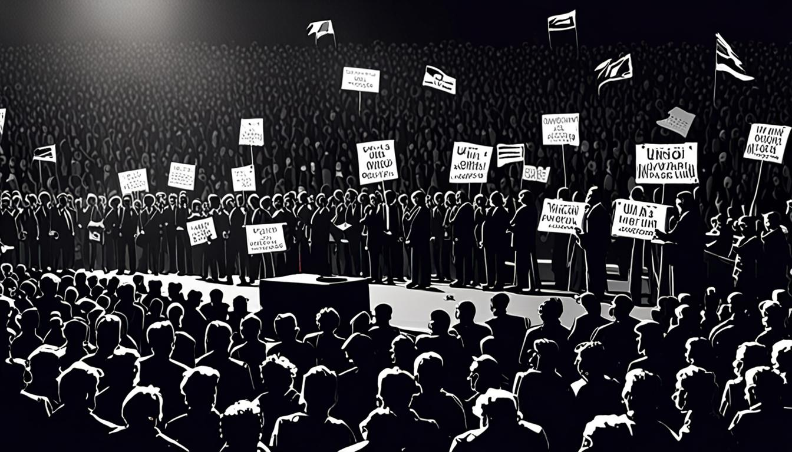
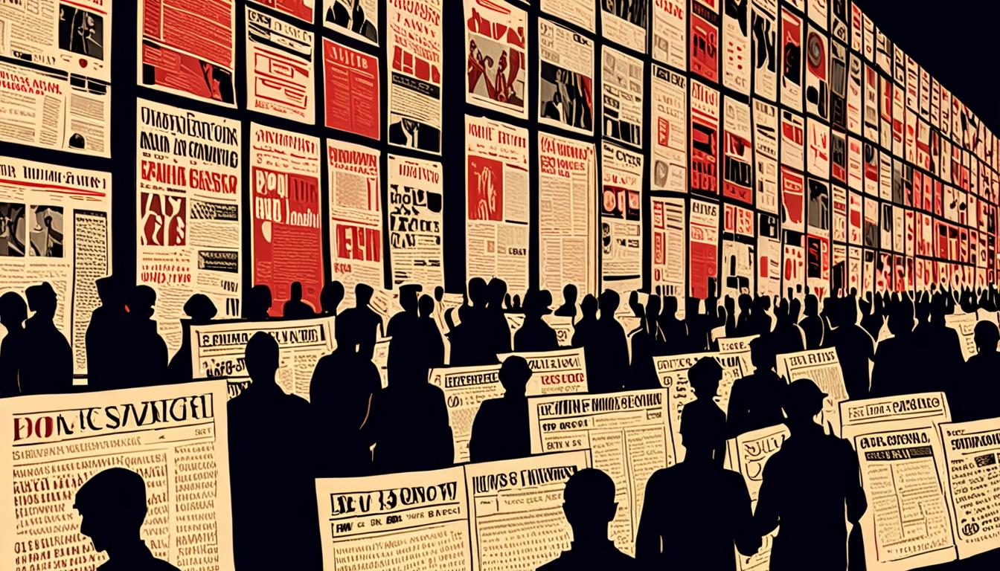
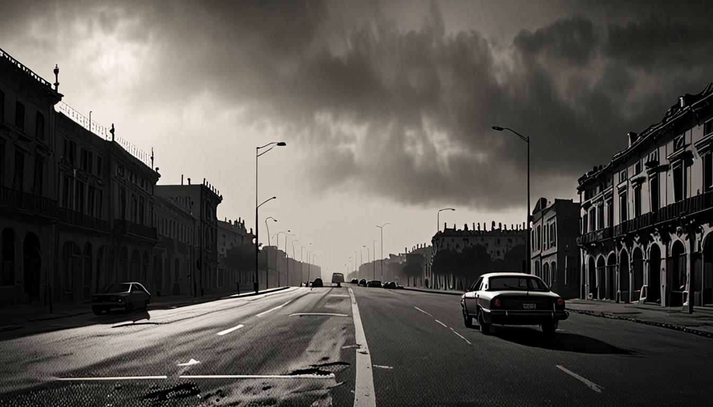

<figure style="margin:1.5em 0;"><figcaption style="font-size:0.85em;color:#888;text-align:center;margin-top:0.5em;font-style:italic;">Radar de medios: El Encuadre: Los sindicatos llaman a España</figcaption></figure>
<h1>El Encuadre: Los sindicatos llaman a España a una huelga general por primera vez</h1>

En un día que parecía una rutina política, la voz de los sindicatos se alzó con un eco que recorrió las calles y los parlamentos. La convocatoria a una huelga general, la primera en catorce años, se presentó como un punto de inflexión, una señal de que la tensión social ya no se puede contener sin un gesto contundente. El Gobierno, encabezado por Pedro Sánchez, se ve ante la presión de un sector que exige más que simples concesiones: exige un cambio de rumbo. Óscar Puente, figura destacada en la escena sindical, se convirtió en la personificación de esa demanda colectiva. El debate se abre, las agendas se llenan, y el escenario se prepara para un enfrentamiento que, aunque sin violencia, promete alterar el tejido social y político del país.

<h2>El Mundo</h2>
<figure style="margin:1.5em 0;"><figcaption style="font-size:0.85em;color:#888;text-align:center;margin-top:0.5em;font-style:italic;">El Mundo</figcaption></figure>

El titular del mundo, “El Gobieno busca impulso agitando la huelga en pleno sprint social para condicionar un posible gobierno del PP y Vox”, se abre con una doble capa de crítica. La palabra “Gobieno” sugiere una mezcla de gobierno y gobierno, una alusión a la confusión que se percibe en la gestión actual. La técnica de enmarcado negativo se despliega, insinuando que el gobierno se ve obligado a ceder a la presión sindical para evitar un escenario más radical. El miedo se convierte en el hilo conductor: la amenaza de que la huelga se convierta en un catalizador de la transición de poder. La narrativa sugiere que la fuerza sindical no sólo busca mejores condiciones, sino también una oportunidad para reconfigurar el tablero político.

El análisis del mundo no se queda en la superficie. Se profundiza en la idea de que la huelga es un arma de doble filo: mientras busca mejorar la situación laboral, también abre la puerta a la posibilidad de un gobierno alternativo. La crítica se dirige a la falta de visión del Ejecutivo, insinuando que la respuesta a la demanda es más una maniobra de supervivencia que una estrategia de progreso. La pieza finaliza con una insinuación de que el gobierno se encuentra en un punto de inflexión, donde cada decisión puede determinar el futuro político del país.

<h2>El Español</h2>

Con el titular “Huelga general 11 de noviembre, en directo | Paros, servicios mínimos y piquetes en carreteras y accesos urbanos”, El Español adopta una postura de alarmismo puro. La palabra “directo” sugiere una cobertura constante, una vigilancia que no deja espacio para la calma. La descripción de los paros y los piquetes se convierte en una lista de escenarios de tensión, donde la incertidumbre se convierte en la única constante. La técnica de alarmismo se manifiesta en la elección de palabras que evocan un estado de alerta, sin ofrecer soluciones claras.

El Español profundiza en la logística de la huelga, describiendo la presencia de servicios mínimos y la organización de piquetes. Se menciona la participación de sindicatos como la Unión General de Trabajadores y la Confederación Española de Derechas Autónomas, sin entrar en detalles de sus demandas. La cobertura se centra en el impacto inmediato de la huelga, sin explorar las causas subyacentes. El tono, aunque informativo, se mantiene en una línea de tensión, sugiriendo que el país está al borde de una ruptura.

<figure style="margin:1.5em 0;"><figcaption style="font-size:0.85em;color:#888;text-align:center;margin-top:0.5em;font-style:italic;">El País</figcaption></figure>
<h2>El País</h2>

El titular del país, “Los sindicatos llaman a España a

<strong>Aviso legal:</strong> Esto no es una acusacion. Es una autopsia. Los medios estan citados y enlazados. El derecho de cita (art. 32 LPI) nos ampara.

<strong>Síguenos:</strong> <a href="https://youtube.com/@somoselencuadre.oficial">YouTube</a> · <a href="https://tiktok.com/@somoselencuadre">TikTok</a> · <a href="https://instagram.com/somoselencuadre">Instagram</a> · <a href="https://x.com/SomosElEncuadre">X</a> · <a href="https://threads.net/@somoselencuadre">Threads</a>

